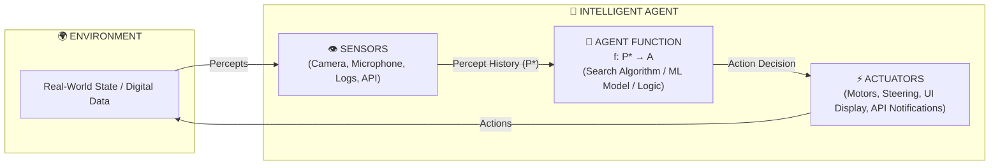
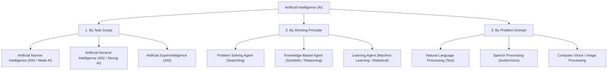
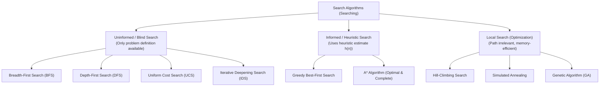
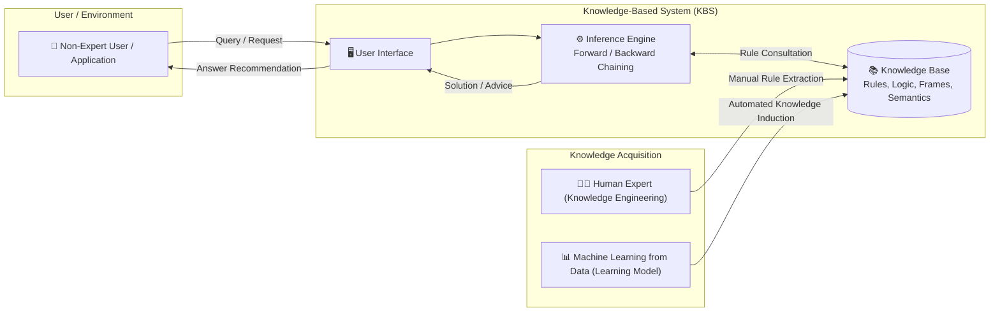
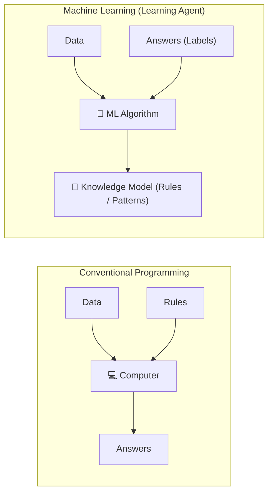
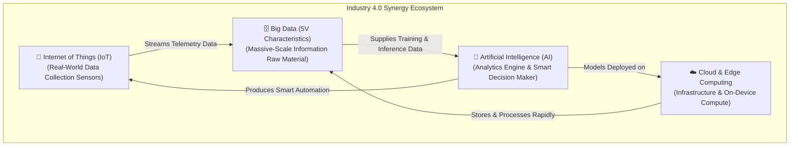
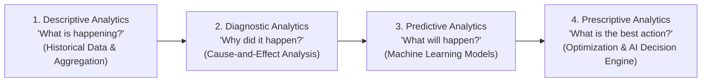
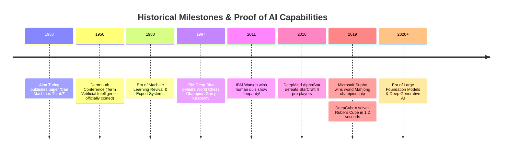
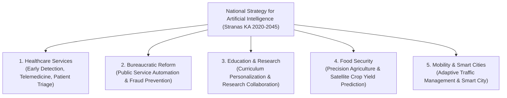

import { Accordion, Accordions } from 'fumadocs-ui/components/accordion';
import { Callout } from 'fumadocs-ui/components/callout';
import { Tab, Tabs } from 'fumadocs-ui/components/tabs';

> **Module Compiler:** Mahendar Dwi Payana  
> **Official Curriculum Source:** Thematic Academy Digital Talent Scholarship (DTS) 2021 — Agency for Human Resources Research and Development, Ministry of Communication and Informatics of the Republic of Indonesia (Kominfo) in collaboration with the ITB AI Center Team (PUI-PT AI-VLB)  
> **Original Module Authoring Team:** Prof. Dwi Hendratmo Widyantoro, Ph.D., Dr. Masayu Leylia Khodra, Dr. Nur Ulfa Maulidevi, Dr. Dessi Puji Lestari, Ir. Windy Gambetta, MBA, Dr. Nugraha Priya Utama, Prof. Ayu Purwarianti, Ph.D.

---

## 1. Introduction & Training Information

This session lays the conceptual foundation of Artificial Intelligence (AI). In the era of digitalization and the Fourth Industrial Revolution (Industry 4.0), artificial intelligence is not merely a passing *hype*, but the primary driver of automation transformation across various sectors: manufacturing, banking, healthcare, and *smart governance*.

### Learning Objectives
* **General Objective**: Participants are able to explain the scope of Artificial Intelligence training for building intelligent systems from data using Data Science methodologies.
* **Specific Objectives**:
  1. Able to explain the scope and boundaries of the Artificial Intelligence discipline.
  2. Able to design an *Intelligent Agent* using the PEAS framework (*Performance measure, Environment, Actuators, Sensors*) and identify the characteristics of its task environment.
  3. Able to map the taxonomy of AI technologies (based on *task scope*, computational problem-solving principles, and application domains).
  4. Able to understand the interconnections between AI, IoT, Cloud/Edge Computing, and Big Data Analytics.
  5. Able to identify the priorities of Indonesia's National Strategy for Artificial Intelligence (Stranas KA) along with challenges in ethics, privacy, and transparency (*Explainable AI*).

---

## 2. Definitions & Paradigms of Artificial Intelligence

Artificial Intelligence is defined from multiple scientific perspectives. The world's leading reference textbook, *Artificial Intelligence: A Modern Approach* (Stuart Russell & Peter Norvig, 2010), classifies AI definitions into **Four Dimensional Quadrants**:

<div className="my-6 rounded-2xl border border-border bg-card p-4 shadow-sm sm:p-6">
  <div className="mb-5 text-center">
    <div className="text-sm font-bold text-foreground sm:text-base">
      Four Perspectives on Defining AI
    </div>
    <div className="text-xs text-muted-foreground">Russell &amp; Norvig, 2010</div>
  </div>

  <div className="grid grid-cols-[auto_1fr_1fr] gap-2 sm:gap-3">
    {/* Row header */}
    <div />
    <div className="pb-1 text-center text-[10px] font-bold uppercase tracking-wide text-primary sm:text-xs">
      Reasoning Process (Thinking)
    </div>
    <div className="pb-1 text-center text-[10px] font-bold uppercase tracking-wide text-primary sm:text-xs">
      Behavioral Manifestation (Acting)
    </div>

    {/* Row 1: Humanly */}
    <div className="flex items-center justify-center">
      <span
        style={{ writingMode: 'vertical-rl', transform: 'rotate(180deg)' }}
        className="text-[10px] font-bold uppercase tracking-wide text-rose-600 sm:text-xs dark:text-rose-400"
      >
        Human-Like (Humanly)
      </span>
    </div>
    <div className="rounded-xl border border-blue-500/30 bg-blue-500/5 p-3 sm:p-4">
      <div className="text-xs font-bold text-blue-700 sm:text-sm dark:text-blue-300">
        Thinking Humanly
      </div>
      <div className="text-[10px] font-medium uppercase tracking-wide text-muted-foreground">
        Cognitive Science
      </div>
      <p className="mt-2 text-[11px] leading-relaxed text-muted-foreground sm:text-xs">
        Making computers think like humans through cognitive science modeling.
      </p>
      <div className="mt-2 text-[10px] font-semibold text-blue-700/80 sm:text-[11px] dark:text-blue-300/80">
        Example: Brain Cognitive Systems
      </div>
    </div>
    <div className="rounded-xl border border-emerald-500/30 bg-emerald-500/5 p-3 sm:p-4">
      <div className="text-xs font-bold text-emerald-700 sm:text-sm dark:text-emerald-300">
        Acting Humanly
      </div>
      <div className="text-[10px] font-medium uppercase tracking-wide text-muted-foreground">
        Turing Test
      </div>
      <p className="mt-2 text-[11px] leading-relaxed text-muted-foreground sm:text-xs">
        Making machines behave like humans so that they are difficult to distinguish.
      </p>
      <div className="mt-2 text-[10px] font-semibold text-emerald-700/80 sm:text-[11px] dark:text-emerald-300/80">
        Example: Human Imitation Test
      </div>
    </div>

    {/* Row 2: Rationally */}
    <div className="flex items-center justify-center">
      <span
        style={{ writingMode: 'vertical-rl', transform: 'rotate(180deg)' }}
        className="text-[10px] font-bold uppercase tracking-wide text-rose-600 sm:text-xs dark:text-rose-400"
      >
        Rational Standard (Rationally)
      </span>
    </div>
    <div className="rounded-xl border border-indigo-500/30 bg-indigo-500/5 p-3 sm:p-4">
      <div className="text-xs font-bold text-indigo-700 sm:text-sm dark:text-indigo-300">
        Thinking Rationally
      </div>
      <div className="text-[10px] font-medium uppercase tracking-wide text-muted-foreground">
        Laws of Thought
      </div>
      <p className="mt-2 text-[11px] leading-relaxed text-muted-foreground sm:text-xs">
        Formal logical reasoning (syllogisms) to draw valid conclusions.
      </p>
      <div className="mt-2 text-[10px] font-semibold text-indigo-700/80 sm:text-[11px] dark:text-indigo-300/80">
        Example: Formal Inference Logic
      </div>
    </div>
    <div className="relative rounded-xl border border-primary/40 bg-primary/10 p-3 ring-1 ring-primary/20 sm:p-4">
      <span className="absolute right-2 top-2 rounded-full bg-primary px-2 py-0.5 text-[9px] font-bold uppercase tracking-wide text-primary-foreground">
        Primary Focus
      </span>
      <div className="text-xs font-bold text-primary sm:text-sm">
        Acting Rationally
      </div>
      <div className="text-[10px] font-medium uppercase tracking-wide text-muted-foreground">
        Rational Agents
      </div>
      <p className="mt-2 text-[11px] leading-relaxed text-muted-foreground sm:text-xs">
        Agents that act to maximize the expected value of a performance measure.
      </p>
      <div className="mt-2 text-[10px] font-semibold text-primary/80 sm:text-[11px]">
        Example: Modern Intelligent Systems
      </div>
    </div>
  </div>
</div>

### Comparison Table of the 4 AI Definition Quadrants

| Dimension | *Thinking* | *Acting* |
| :--- | :--- | :--- |
| ***Humanly*** | **Thinking Humanly (Cognitive Science Approach)**<br />*"The exciting new effort to make computers think... machines with minds, in the full and literal sense."* (Haugeland, 1985)<br />*"The automation of activities that we associate with human thinking, activities such as decision-making, problem solving, learning."* (Bellman, 1978) | **Acting Humanly (Turing Test Approach)**<br />*"The art of creating machines that perform functions that require intelligence when performed by people."* (Kurzweil, 1990)<br />*"The study of how to make computers do things at which, at the moment, people are better."* (Rich & Knight, 1991) |
| ***Rationally*** | **Thinking Rationally (Laws of Thought / Logic Approach)**<br />*"The study of mental faculties through the use of computational models."* (Charniak & McDermott, 1985)<br />*"The study of the computations that make it possible to perceive, reason, and act."* (Winston, 1992) | **Acting Rationally (Rational Agent Approach)**<br />*"Computational Intelligence is the study of the design of intelligent agents."* (Poole et al., 1998)<br />*"AI is concerned with intelligent behavior in artifacts."* (Nilsson, 1998) |

<Callout type="info" title="Primary Focus of Modern Computer Science & AI Engineering">
  Modern AI development centers on the **Acting Rationally** (*Rational Agent*) quadrant. The reasons are:
  1. Human behavior is often irrational (influenced by psychological biases, emotional fatigue, and flawed mental shortcuts).
  2. Mathematical rationality is precisely defined: **taking actions that maximize expected performance (*expected utility*) based on the available percept history**, regardless of whether the internal process mimics biological human neurons or relies purely on linear algebra computation.
</Callout>

### Official European Commission Definition (AI HLEG, 2019)
The European Commission, through its *High-Level Expert Group on Artificial Intelligence*, defines AI as:
> *"Software (and possibly also hardware) systems designed by humans that, given a complex goal, act in the physical or digital dimension by perceiving their environment through data acquisition, interpreting the collected structured or unstructured data, reasoning on the knowledge, or processing the information, derived from this data and deciding the best action(s) to take to achieve the given goal."*

---

## 3. Designing an Intelligent Agent & the PEAS Framework

Fundamentally, an AI system can be modeled as an **Intelligent Agent** operating within an **Environment**:



### Mathematical Formulation of the Agent Function
The behavior of an intelligent agent is mathematically abstracted into a mapping function:

$$
f: P^* \to A
$$

Where:
* $P^*$: The complete *percept history/sequence* ever received by the sensors since the agent was first activated.
* $A$: The *action space* available that can be executed by the agent's actuators.

### PEAS Design Methodology
Before writing a single line of code, an *AI Engineer* must specify **PEAS**:
1. **Performance Measure (P)**: Objective metrics of the agent's task success (what are the success indicators?).
2. **Environment (E)**: The external world or operational ecosystem in which the agent is placed.
3. **Actuators (A)**: Output mechanisms used to manipulate or affect the environment.
4. **Sensors (S)**: Input mechanisms used to capture the state of the environment.

#### Real-World PEAS Design Examples

<Tabs items={['Autonomous Taxi Driver', 'Smart Vacuum Cleaner Robot']}>
  <Tab value="Autonomous Taxi Driver">
    * **Performance Measure**: Driving safety (zero accidents), speed in reaching the destination, compliance with traffic signs and regulations, passenger comfort, fuel/battery efficiency, fare profit maximization.
    * **Environment**: Paved highways, intersections, traffic lights, pedestrians, other vehicles, weather conditions (rain/fog), passengers inside the cabin.
    * **Actuators**: Steering wheel, accelerator pedal, brake pedal, gear transmission, turn signals, horn, navigation display screen.
    * **Sensors**: High-resolution cameras (RGB), LiDAR, ultrasonic radar (sonar), speedometer, satellite GPS, 6-axis accelerometer, OBD-II engine diagnostics sensors.
  </Tab>
  <Tab value="Smart Vacuum Cleaner Robot">
    * **Performance Measure**: Floor cleanliness level (percentage of dirt vacuumed), battery power efficiency, cleaning duration speed, minimal collisions with furniture, avoiding falling down stairs.
    * **Environment**: Ceramic/wood/carpeted floors, room walls, table and chair legs, doors, stairs, dynamic obstacles (pets, scattered cables, people walking).
    * **Actuators**: Left and right drive wheel motors, vacuum suction fan motor, rotating roller brush, water mop dispenser, LED indicator lights, voice notification speaker.
    * **Sensors**: Infrared proximity sensors, mechanical bumper sensors, cliff sensors (fall prevention), optical dust accumulation sensors, gyro / visual SLAM / LiDAR sensors for room mapping.
  </Tab>
</Tabs>

---

## 4. Analysis of 7 Task Environment Characteristics

The type of environment radically determines the choice of architecture and algorithms for an AI system. Russell & Norvig divide task environments into **7 independent dimensions**:

1. **Fully Observable vs. Partially Observable**:
   * *Fully*: The agent's sensors give comprehensive access to the entire state of the environment at every point in time (no hidden information).
   * *Partially*: Sensors are incomplete, *noisy*, or certain elements are unobservable (such as an opponent's cards in poker or fog on a highway).
2. **Deterministic vs. Stochastic**:
   * *Deterministic*: The next state of the environment is completely determined by the current state and the action executed by the agent.
   * *Stochastic*: Contains probabilistic uncertainty beyond the agent's control. If the environment is deterministic except for the actions of other intelligent agents, it is called **Strategic**.
3. **Episodic vs. Sequential**:
   * *Episodic*: The agent's experience is divided into atomic, independent episodes. The action in the current episode does not affect future episodes (e.g., classifying defective product images in a factory).
   * *Sequential*: The current action affects all future decisions and states (e.g., chess or vehicle navigation).
4. **Static vs. Dynamic**:
   * *Static*: The environment does not change while the agent is *deliberating*.
   * *Dynamic*: The environment continues changing while the agent processes its decision. If the environment itself is static but the agent's performance score decreases over time, it is called **Semi-dynamic** (e.g., chess with a clock).
5. **Discrete vs. Continuous**:
   * *Discrete*: The number of *states*, sensor readings, and possible actions can be counted distinctly (e.g., an 8x8 chessboard).
   * *Continuous*: Values flow across an infinite real continuum (e.g., steering wheel angle, speed in km/h, continuous time).
6. **Single-Agent vs. Multi-Agent**:
   * *Single-agent*: The agent operates alone to complete a task (e.g., solving a Sudoku puzzle).
   * *Multi-agent*: The environment contains other agents whose behavior may be cooperative (working together) or competitive (adversarial/competing).
7. **Known vs. Unknown**:
   * *Known*: The agent or designer completely understands the rules and causal laws of the environment (e.g., rules of chess).
   * *Unknown*: The agent must explore the environment to discover its laws and outcomes (e.g., a new game without a tutorial).

### Task Environment Comparison Matrix

| Environment Characteristic | *Chess with Clock* | *Chess without Clock* | *Autonomous Taxi* | *Robot Vacuum Cleaner* |
| :--- | :---: | :---: | :---: | :---: |
| **Observability** | Fully Observable | Fully Observable | Partially Observable | Partially Observable |
| **State Certainty** | Strategic (Deterministic) | Strategic (Deterministic) | Stochastic | Stochastic |
| **Time Dependency** | Sequential | Sequential | Sequential | Sequential |
| **Change Dynamics** | **Semi-dynamic** | **Static** | **Dynamic** | **Dynamic** |
| **State Quantization** | Discrete | Discrete | Continuous | Continuous |
| **Agent Count** | Multi-Agent (Competitive) | Multi-Agent (Competitive) | Multi-Agent (Mixed) | Single-Agent |
| **Rule Knowledge** | Known | Known | Known / Unknown (Weather) | Known |

---

## 5. Taxonomy & Classification of Artificial Intelligence Technologies

AI technologies are grouped from 3 perspectives: **task scope**, **computational principles**, and **problem domain**.



### A. By Task Scope
1. **Artificial Narrow Intelligence (ANI / Weak AI)**:
   * Specifically designed to solve **a single specific task** with very high accuracy.
   * Lacks general consciousness and cannot spontaneously transfer its capabilities to other domains.
   * *Examples*: Airline ticket reservation chatbots, skin disease image classifiers, e-commerce recommendation engines, AlphaGo.
2. **Artificial General Intelligence (AGI / Strong AI)**:
   * A computational machine possessing comprehensive intellectual capacity equivalent to humans, capable of cross-domain reasoning, solving novel problems without prior training, and adapting flexibly.
3. **Artificial Superintelligence (ASI)**:
   * A hypothetical entity that surpasses the combined cognitive abilities of all the most brilliant humans across science, artistic creativity, and social strategy.

---

### B. By Computational Working Principle

#### 1. Problem Solving Agent (Search Algorithms)
A problem-solving agent operates when the **solution state space can be defined upfront**. The agent searches for a sequence of actions connecting the initial state to the *goal state*.

* **4 Components of Problem Formulation**:
  1. *Initial State*: The starting state where the agent begins operating.
  2. *Operator / Successor Function*: The set of permissible actions to transition from one state to the next.
  3. *Goal Test*: A condition check determining whether the current state satisfies the goal criteria.
  4. *Path Cost*: Accumulated path cost (e.g., distance in kilometers, travel time, or energy consumption).



* **Mathematical Evaluation of the $A^*$ Search Algorithm**:
  The $A^*$ algorithm evaluates node $n$ using a total cost function:

  $$
  f(n) = g(n) + h(n)
  $$

  * $g(n)$: Actual cost incurred from the *initial state* to node $n$.
  * $h(n)$: Heuristic cost estimate from node $n$ to the *goal state*. If $h(n)$ is *admissible* (never overestimates the true cost), then $A^*$ is guaranteed to produce the most optimal solution (*optimal & complete*).
* **Use Cases**: *Route Planning* (finding the shortest inter-city route on GPS) and *Map Coloring* (coloring map regions so no adjacent regions share the same color using a *Constraint Satisfaction Problem*).

---

#### 2. Knowledge-Based Agent (KBS) & Symbolic AI
A knowledge-based agent utilizes an explicit knowledge base to solve problems whose solution space is **not precisely defined upfront (*ill-structured / non-deterministic*)**. Solutions are derived through logical reasoning (*inference engine*).



##### Comparison: KBS vs. Conventional Programming

| Differentiating Dimension | Knowledge-Based System (KBS) | Conventional Program |
| :--- | :--- | :--- |
| **Problem Characteristics** | *Ill-structured problem* (Solutions involve uncertainty, goals are not rigidly defined) | *Well-structured problem* (Exact solutions, deterministic algorithmic steps) |
| **Execution Mechanism** | Experts define actions/rules; execution order is decided dynamically by the *inference engine/interpreter* | The *programmer* defines both action steps and exact line-by-line execution order |
| **Core Formula** | $\text{KBS} = \text{Problem-Solving Method} + \text{Domain Knowledge} + \text{Data}$ | $\text{Conventional Program} = \text{Algorithm} + \text{Data Structure}$ |

##### 5 Knowledge Types
1. **Declarative Knowledge**: Factual knowledge about concepts, facts, and objects in the real world ("knowing what").
2. **Procedural (Imperative) Knowledge**: Knowledge about how to execute something, covering *rules*, work strategies, and operational procedures ("knowing how").
3. **Meta Knowledge**: Higher-level knowledge that explains or verifies other knowledge (reliability of a rule, domain boundaries).
4. **Heuristic Knowledge**: Practical *rules of thumb* formulated from accumulated past experience (effective in practice, even without formal proof).
5. **Structural Knowledge**: Knowledge that maps relationships between concepts, such as *is-a* (category), *kind-of* (variant), or *part-of* (component of a whole).

##### 4 Knowledge Representation Techniques
* **Production Rules**: Rules formatted as `IF <condition> THEN <action/consequence>`. Executed via *Forward Chaining* (moving from input facts to conclusions) or *Backward Chaining* (moving from a goal hypothesis to supporting facts).
* **Logical Representation**: Formal logic notation (*Propositional Logic* and *First-Order Predicate Logic*). Example: $\forall x (\text{Student}(x) \to \text{Diligent}(x))$.
* **Semantic Networks**: Directed graphs where *nodes* represent concepts/objects and labeled *arcs* represent semantic relationships between objects.
* **Frame Representation**: Hierarchical data structures containing collections of *slots* (attributes) and *fillers* (attribute values) to comprehensively describe an entity.

<Callout type="tip" title="Why Is Symbolic AI Still Needed in the Modern Era?">
  Even though statistical Machine Learning is dominant, symbolic representation (*Symbolic AI*) remains irreplaceable in terms of:
  * **Explanation**: Capable of providing a logical proof trace of why a decision was made (crucial in legal verdicts and medical diagnoses).
  * **Planning**: Constructing step-by-step action sequences that must strictly obey constraints.
  * **Diagnosis**: Tracing complex mechanical failure chains.
  
  Modern cutting-edge AI systems adopt a **Hybrid** approach (combining statistical perception + symbolic reasoning), such as **IBM Watson** and **Apple Siri**.
</Callout>

---

#### 3. Statistical & Learning Agent (Machine Learning)
Whereas in Symbolic KBS knowledge must be manually formulated by a *knowledge engineer* alongside experts, in a **Learning Agent**, the machine automatically induces knowledge directly from empirical data:



* ***Why Need Learning?***:
  1. *Designer lacks omniscience*: Humans cannot anticipate every possible variation of real-world conditions.
  2. *Unknown environments*: Agents must adapt dynamically to shifting data trends.
  3. *Perceptual complexity*: Humans know how to tell a cat's face from a dog's face in milliseconds, yet cannot manually write mathematical *if-else* rules over millions of RGB image pixels.

##### 3 Machine Learning Paradigms
1. **Supervised Learning**:
   * Given a dataset of paired input-output examples $(x_i, y_i)$.
   * Agent task: Learn a mapping function $\hat{y} = h(x)$ that minimizes prediction *error*.
   * *Applications*: Medical image classification, property price estimation regression, spam detection.
2. **Unsupervised Learning**:
   * Given an input dataset $x_i$ without any target labels.
   * Agent task: Discover *latent patterns*, natural cluster structures, or compress data dimensionality.
   * *Applications*: Banking customer profile segmentation, fraud anomaly detection, high-dimensional data visualization (PCA/t-SNE).
3. **Reinforcement Learning**:
   * The agent interacts directly with a dynamic environment through an action-perception cycle.
   * No teacher provides direct true/false labels; the agent receives feedback solely as *reward* or *punishment* signals.
   * *Applications*: Autonomous robotics, self-driving control, *game AI* (AlphaGo, AlphaStar).

---

### C. By Application Problem Domain

1. **Natural Language Processing (NLP)**:
   * Processing of human natural language text, divided into:
     * *Natural Language Understanding (NLU)*: Understanding text meaning, *Named Entity Recognition*, sentiment analysis, and topic classification.
     * *Natural Language Generation (NLG)*: Generating new text, automatic *text summarization*, and *machine translation*.
   * Inputs can originate from digital text, voice-to-text conversion (*Automatic Speech Recognition* - ASR), *Optical Character Recognition* (OCR) scanned documents, or sign language translation.
2. **Speech Processing**:
   * Technologies for processing human voice wave signals, including:
     * *Speech Recognition (ASR)*: Converting acoustic voice signals into text transcripts.
     * *Speech Synthesis (Text-to-Speech / TTS)*: Converting written text into natural spoken audio.
     * *Speaker Recognition (Voice Biometrics)*: Recognizing or verifying an individual's identity from their *voice print*.
     * *Paralinguistics*: Analyzing speaker emotion (angry, happy, sad), dialect accent, and gender estimation.
3. **Computer Vision & Image Processing**:
   * Engineering computer visual recognition from 2D images and sequential video (*frame-by-frame*).
   * *Applications*: *Face Recognition* (identity verification), physical distancing and crowd tracking, mask-wearing detection, automated manufacturing defect inspection.

---

## 6. AI in Industry 4.0 & the Big Data Ecosystem

Artificial Intelligence is the core driver of the Fourth Industrial Revolution (Industry 4.0), converging synergistically with **three other technology pillars**:



### Big Data Characteristics: The 5V Principles
1. **Volume**: Massive accumulated data sizes (terabytes, petabytes, up to zettabytes) that exceed the capacity of conventional relational databases.
2. **Velocity**: The speed at which data streams are generated and must be processed instantaneously (*real-time streaming* per second or millisecond).
3. **Variety**: Diversity of data formats: structured (SQL tables), semi-structured (JSON, XML), and unstructured (free-form narrative text, audio, images, video).
4. **Veracity**: Level of reliability, factual truth, integrity, and cleanliness of data from *noise*.
5. **Value**: The capacity to convert raw data into concrete economic added value, social impact, operational efficiency, and user satisfaction.

### 4 Elements of the Big Data Ecosystem
Data flow in a modern enterprise ecosystem passes through 4 sequential stages:
1. **Data Sources**: ERP and CRM transactional systems, OLAP databases, IoT sensors, and social media streams.
2. **Acquisition & Storage**: *Batch* (scheduled periodic) and *Streaming* (real-time) processing into distributed storage (*Distributed Storage / Data Lake* such as HDFS, GCS, S3).
3. **Analytics**: Statistical modeling, association/correlation pattern discovery, *knowledge reasoning*, as well as *Machine Learning, NLP, and Computer Vision*.
4. **Consumption**: Delivering outputs to stakeholders via Business Intelligence (BI) dashboards, analytical graph visualizations, or API integrations into production applications.

### 4 Levels of Data Analytics (*Data Analytics Spectrum*)



1. **Descriptive Analytics**: Provides a summary of current operational conditions based on historical data records (e.g., monthly sales trend reports, KPI dashboards).
2. **Diagnostic Analytics**: Investigates the *root cause* of why a deviation or anomaly occurred by correlating various historical variables (e.g., diagnosing the cause of a surge in customer *churn* in a specific region).
3. **Predictive Analytics**: Projects the probability of future events based on latent patterns in historical data using Machine Learning algorithms (e.g., rainfall estimation, credit default risk prediction).
4. **Prescriptive Analytics**: The highest level where the system not only predicts, but automatically recommends the optimal course of action along with estimated consequences for each option (e.g., GPS navigation systems suggesting dynamic rerouting to avoid sudden traffic jams, logistics warehouse inventory allocation optimization).

---

## 7. Chronology of AI Development & "Why Now?" Analysis

### Historical Timeline & Milestones of AI Triumphs Over Humans



* **1997 (IBM Deep Blue)**: Proved the superiority of heuristic chess tree search algorithms in deterministic search spaces by evaluating 200 million board positions per second.
* **2011 (IBM Watson)**: Demonstrated the power of integrating NLP, knowledge ontology representation, and distributed evidence search to understand human natural-language trivia questions instantaneously.
* **2018 (DeepMind AlphaStar)**: Defeated professional athletes in *StarCraft II*. This victory was monumental because *StarCraft II* features a *partially observable* environment, a massive continuous action space, and long-horizon sequential decision-making.
* **2019 (Microsoft Suphx)**: Won Mahjong competitions, proving AI reasoning capabilities under competitive environments with *imperfect information*.
* **2019 (DeepCubeA - UCLA)**: Found solutions to scrambled Rubik's Cubes in **1.2 seconds**, outperforming the fastest human world record at the time (3.47 seconds).

### Key "Why Now?" Factors (Why Is AI Exploding Today?)
Although theoretical concepts of artificial intelligence were proposed as early as the 1950s, exponential growth only materialized over the past decade due to the convergence of three decisive factors:
1. **Computing Hardware**: The arrival of massively parallel hardware accelerators such as **GPUs (Graphics Processing Units)**, **TPUs (Tensor Processing Units)**, and *Cloud Supercomputing* clusters capable of cutting neural network training times from months down to hours.
2. **Algorithm Breakthroughs**: **Deep Learning** algorithmic breakthroughs (such as modern *backpropagation*, batch normalization, *Residual Networks* architectures, and *Attention & Transformer* mechanisms) capable of learning hierarchical data feature representations without manual engineering.
3. **Data Availability**: An explosion in global data availability (over 90% of the world's current data was created in just the last few years), driven by global mobile internet adoption, IoT sensors, digital cameras, and e-commerce transactions.

---

## 8. Implementation in Indonesia & National AI Strategy (Stranas KA)

The Government of the Republic of Indonesia has released the official blueprint **National Strategy for Artificial Intelligence (Stranas KA) 2020–2045** to realize the Golden Indonesia 2045 vision. This document establishes **5 Primary Priority Areas**:



### Applied Implementation Examples in Indonesia
* **Public Safety Monitoring**: Utilizing *Computer Vision* on smart CCTV cameras to estimate physical crowd density, monitor mask compliance during health crises, and track citizen mobility.
* **eKYC & Biometric Verification (Dukcapil & Financial Sector)**:
  * *Face Recognition* and *Voice Biometrics* for banking *electronic-Know Your Customer* (eKYC) processes synchronized with national civil registry data (Dukcapil).
  * Delivers identity authentication **10 times faster** than conventional manual matching, reduces operational costs, and improves accessibility for persons with disabilities.
* **Document Digitization (OCR & Voice Transcription)**:
  * Automatic conversion of identity documents (e-KTP, NPWP, Passport, Driver's License), shopping *invoices*, transaction forms, and deeds into structured digital data.
* **Automated Meeting Minutes (*Meeting Analytics - Prosa.ai*)**:
  * Integrates Indonesian *Automatic Speech Recognition* (ASR), *speaker diarization*, and text analytics to extract meeting summaries in *real-time*.

---

## 9. Ethical, Regulatory & Future AI Challenges in Indonesia

Despite AI's revolutionary potential, Indonesia faces **5 critical challenges** that must be comprehensively anticipated:

1. **Regulation & Usage Ethics**:
   * Generative voice capabilities (*speech synthesis*) and video manipulation (*deepfakes*) carry high risks of misuse for producing hoaxes, social engineering fraud, and defamation.
   * National AI regulatory frameworks and ethical guidelines are needed to ensure developer accountability and legal compliance.
2. **Privacy & Personal Data Security**:
   * Training AI models requires massive volumes of data. Under the Personal Data Protection Law (UU PDP), data collection and usage must obtain data subject consent, apply *anonymization* techniques, and prevent sensitive information leaks (*PII*).
3. **Decision Transparency & Explainable AI (XAI)**:
   * Many modern machine learning models (especially *Deep Neural Networks*) operate as a *"Black Box"*.
   * In high-stakes domains (such as loan credit rejections or cancer diagnoses), AI systems must provide scientific accountability: *why was that conclusion reached?* This auditability requirement gave rise to the discipline of **Explainable AI**.
4. **Training Data Availability & Bias**:
   * AI model quality depends on the representativeness of its training data (*"Garbage In, Garbage Out"*).
   * If training data is dominated by a specific demographic, the model will produce discriminatory bias against minority groups. Training data must reflect the ethnic diversity, regional languages, and social characteristics of Indonesian society.
5. **Digital Talent Gap**:
   * Without a sufficient supply of competent digital talent to design and maintain AI systems, Indonesia risks becoming merely a consumptive target market for foreign technology.
   * Intensive training programs such as the Digital Talent Scholarship (DTS) serve as strategic instruments to prepare superior national human resources.

---

## 10. Assignments & Self-Evaluation Worksheet

Based on the official DTS 2021 training module curriculum, participants must complete the following three self-evaluation projects:

<Accordions>
  <Accordion title="Assignment 1: Comparative Analysis of Global AI Strategies">
    Choose one national AI strategy document from a developed country (for example: the United States *National AI Strategy*, Singapore's *AI Roadmap*, or the European Union's *AI Strategy*). Write a comparative critical summary covering funding focus, research pillars, data governance, and the ethical frameworks they implement, along with valuable lessons that Indonesia can adapt.
  </Accordion>

  <Accordion title="Assignment 2: PEAS Design Specification for a Smart Room Cleaning Robot">
    Design an intelligent agent architecture for a modern *Smart Cleaning Robot* by detailing:
    * **Performance Indicator**: Formulate a scoring formula for cleaning success and time/power efficiency.
    * **Environment**: Describe the physical floor conditions and obstacles encountered.
    * **Actuators**: Detail the drive motors, brushes, and suction modules controlled.
    * **Sensors**: Detail the sensor configuration (sonar, bumper, LiDAR, cliff sensor) installed to perceive the environment.
  </Accordion>

  <Accordion title="Assignment 3: Designing an AI Solution for Crisis / Pandemic Mitigation">
    Design one innovative intelligent system concept that solves healthcare challenges or mitigates social crises in society:
    * Explain the functional description and overall architecture of the technology.
    * Identify and classify the primary technique you use: is it based on **Searching (Problem Solving Agent)**, **Knowledge-Based System (Symbolic Reasoning)**, or **Machine Learning (Learning Agent)**? Explain the scientific rationale behind your choice!
  </Accordion>
</Accordions>

---

## 11. Python Implementation: Rule-Based Agent vs. Simple Search Agent Simulation

Below is a Python code example demonstrating the fundamental difference between a **Reflex Agent** (simple rule system) and a **Problem Solving Agent** (path-finding search algorithm):

```python
"""
Session 02: Intelligent Agent Comparison Demonstration
1. Simple Reflex Agent (Condition-Action)
2. Problem Solving Agent (BFS Path Search)

Compiled by: Mahendar Dwi Payana
Reference source: DTS 2021 Module (ITB AI Center Team)
"""

from collections import deque

# ==============================================================================
# 1. SIMPLE REFLEX AGENT (Based on Instantaneous Percepts)
# ==============================================================================
class ReflexVacuumAgent:
    """
    Simple reflex agent for a two-room vacuum cleaner (Room A and Room B).
    Agent function maps: [Location, Dirt_Status] -> Action
    """
    def __init__(self):
        pass

    def evaluate_action(self, location, status):
        # Condition-action rules (Production Rules)
        if status == "DIRTY":
            return "SUCK (Clean Dust)"
        elif location == "A":
            return "RIGHT (Move to Room B)"
        elif location == "B":
            return "LEFT (Move to Room A)"
        return "NO-OP (Idle)"


# ==============================================================================
# 2. PROBLEM SOLVING AGENT (Graph Solution Search with BFS)
# ==============================================================================
class RouteProblemSolvingAgent:
    """
    Problem solving agent for inter-city Route Planning.
    Searches for an optimal sequence of actions from Initial State to Goal State.
    """
    def __init__(self, road_map):
        self.road_map = road_map

    def find_shortest_path(self, start_city, goal_city):
        # Queue for Breadth-First Search (BFS)
        queue = deque([(start_city, [start_city])])
        visited = set([start_city])

        while queue:
            current_city, path = queue.popleft()

            # Goal Test
            if current_city == goal_city:
                return path

            # Successors / Neighbors
            for neighbor in self.road_map.get(current_city, []):
                if neighbor not in visited:
                    visited.add(neighbor)
                    queue.append((neighbor, path + [neighbor]))

        return None


# ==============================================================================
# EXECUTION DEMONSTRATION
# ==============================================================================
if __name__ == "__main__":
    print("=== 1. REFLEX AGENT DEMONSTRATION ===")
    vacuum = ReflexVacuumAgent()
    scenarios = [("A", "DIRTY"), ("A", "CLEAN"), ("B", "DIRTY"), ("B", "CLEAN")]
    
    for loc, stat in scenarios:
        action = vacuum.evaluate_action(loc, stat)
        print(f"Percept: [Room: {loc}, Condition: {stat:<5}] -> Agent Action: {action}")

    print("\n=== 2. PROBLEM SOLVING AGENT DEMONSTRATION (ROUTE PLANNING) ===")
    # Simple road route map (Undirected graph)
    indonesia_map = {
        "Jakarta": ["Bandung", "Cirebon"],
        "Bandung": ["Jakarta", "Cirebon", "Tasikmalaya"],
        "Cirebon": ["Jakarta", "Bandung", "Semarang"],
        "Tasikmalaya": ["Bandung", "Yogyakarta"],
        "Semarang": ["Cirebon", "Solo", "Surabaya"],
        "Yogyakarta": ["Tasikmalaya", "Solo"],
        "Solo": ["Semarang", "Yogyakarta", "Surabaya"],
        "Surabaya": ["Semarang", "Solo"]
    }

    router = RouteProblemSolvingAgent(indonesia_map)
    origin = "Jakarta"
    destination = "Surabaya"
    selected_route = router.find_shortest_path(origin, destination)

    print(f"Origin City      : {origin}")
    print(f"Destination City : {destination}")
    print(f"Shortest Route Action Sequence: {' -> '.join(selected_route)}")
```

---

## 12. References & Learning Videos

### Primary Bibliography
1. **Stuart J. Russell & Peter Norvig** (2010). *Artificial Intelligence: A Modern Approach*, 3rd Edition. Upper Saddle River, New Jersey: Prentice-Hall International, Inc.
2. **Ayu Purwarianti, Bambang Riyanto, Dessi Puji Lestari, Intan Muchtadi Alamsyah, Nugraha Priya Utama, Ridwan Sutriadi, Sapto Wahyu Indratno, & Sophi Damayanti** (2021). *Artificial Intelligence di Masa Pandemi*. Bandung: ITB Press.
3. **Agency for the Assessment and Application of Technology (BPPT)** (2020). *Strategi Nasional Kecerdasan Artifisial Indonesia 2020-2045*. Jakarta: Ministry of Research and Technology / BPPT.

### Selected Lectures & Videos (DTS 2021)
* **Introduction to AI Fundamentals**:
  * [What is Artificial Intelligence? (Introduction)](https://www.youtube.com/watch?v=s9vDgPotU-4)
  * [Artificial Intelligence in 5 Minutes](https://www.youtube.com/watch?v=wfmM5-d0Zh0)
  * [AI Ecosystem & Industrial Revolution 4.0](https://www.youtube.com/watch?v=eUpRwSrwbHY)
* **Intelligent Agent Design & PEAS**:
  * [Structure of Intelligent Agents (Russell & Norvig)](https://www.youtube.com/watch?v=XqAUPrLu8_s)
  * [Task Environment Classification (PEAS)](https://www.youtube.com/watch?v=ehXgvsl8i_I)
  * [Solving Problems by Searching](https://www.youtube.com/watch?v=NqeVTW4DUuU)
* **Knowledge-Based Systems & Reasoning**:
  * [Introduction to Knowledge-Based Systems](https://www.youtube.com/watch?v=P2DVmc4Zf7I)
  * [Inference Engine: Forward vs. Backward Chaining](https://www.youtube.com/watch?v=VhKPNctwInw)
  * [Symbolic AI vs. Machine Learning](https://www.youtube.com/watch?v=7iZWC_NtegM)
