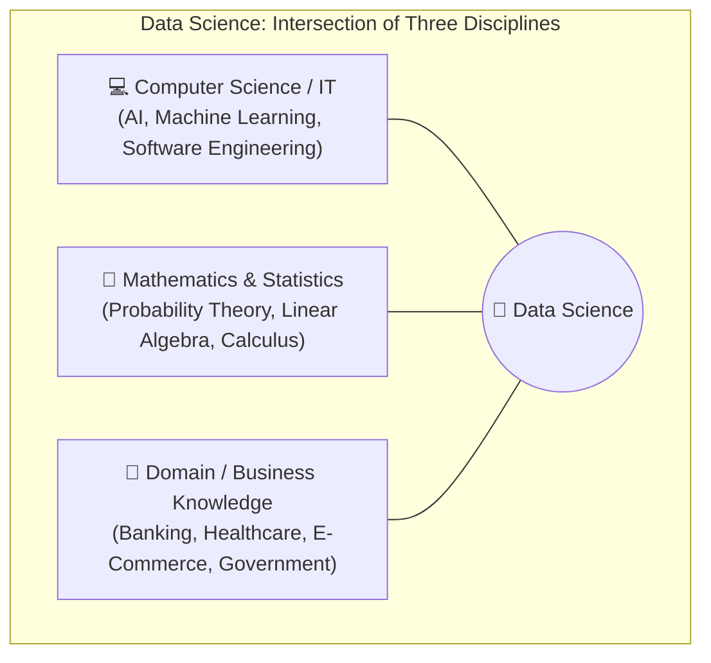
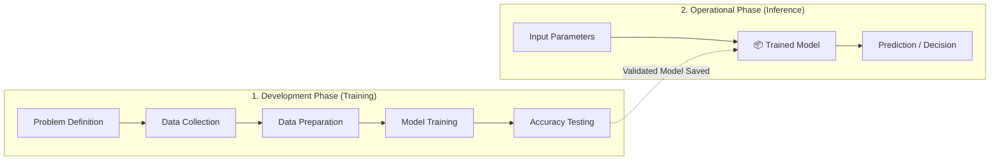
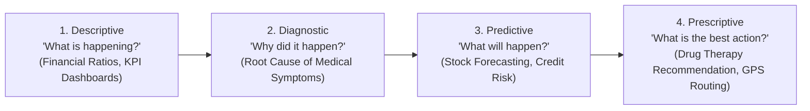
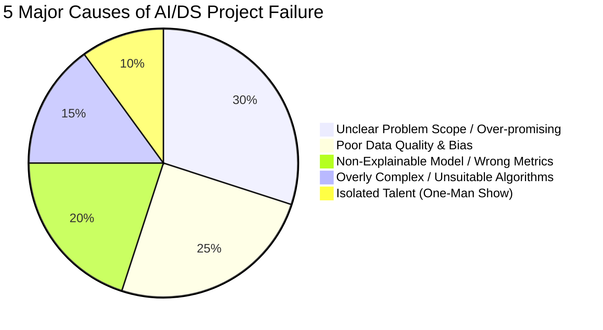
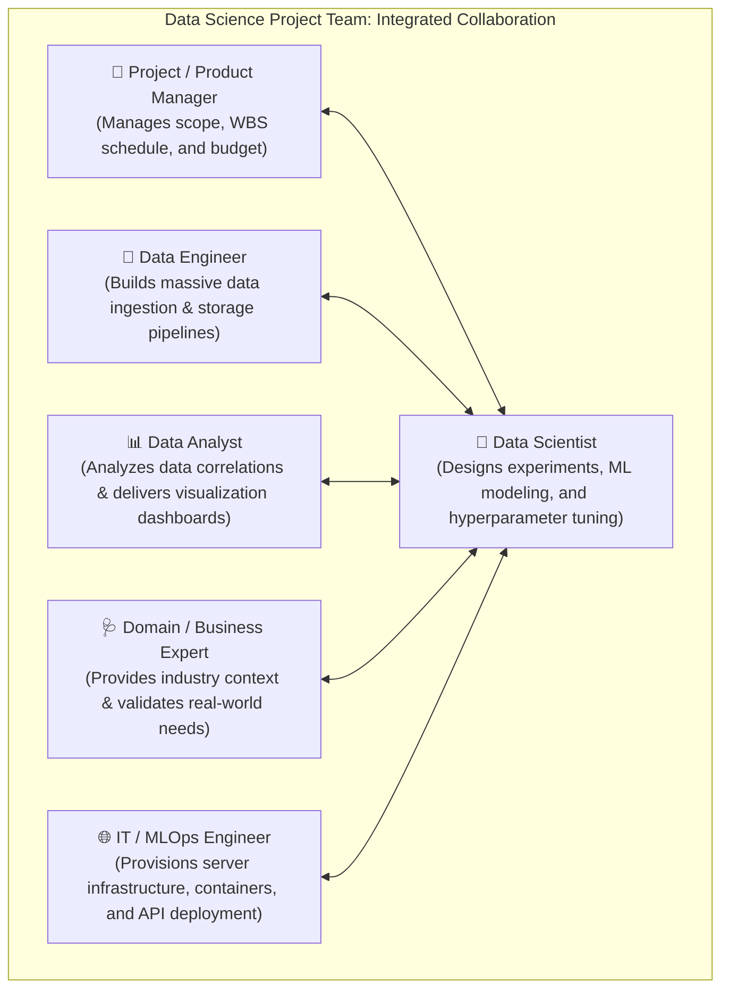
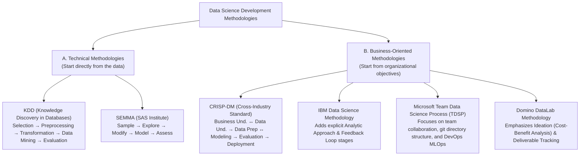
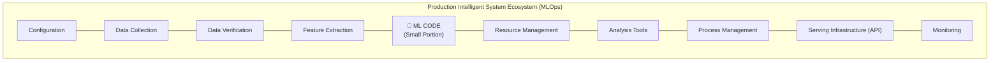

import { Accordion, Accordions } from 'fumadocs-ui/components/accordion';
import { Callout } from 'fumadocs-ui/components/callout';
import { Tab, Tabs } from 'fumadocs-ui/components/tabs';

> **Module Compiler:** Mahendar Dwi Payana  
> **Official Curriculum Source:** Thematic Academy Digital Talent Scholarship (DTS) 2021 — Agency for Human Resources Research and Development, Ministry of Communication and Informatics of the Republic of Indonesia (Kominfo)  
> **Original Module Instructor & Developer:** Ir. Windy Gambetta, MBA (School of Electrical Engineering and Informatics - STEI ITB)

---

## 1. The Urgency of Methodology in Data Science Projects

Leveraging Artificial Intelligence (*AI*) and *Machine Learning* has become a strategic priority across organizations today. However, a fundamental misconception frequently occurs in industry:

$$
\mathbf{Data\text{-}Driven\ AI\ System\ Development} \neq \mathbf{Data} + \mathbf{Machine\ Learning\ Algorithms}
$$

Simply downloading a *dataset* and running a *Machine Learning* algorithm does not guarantee an effective intelligent system with real business value. Without structured methodological guidance, the majority of data science projects end in failure.



### Two Phases of Data Utilization
To build a reliable data-driven intelligent system, projects are executed in two major phases:
1. **Development / Training Phase**: The process of extracting hidden patterns (*knowledge discovery*) from historical datasets (relational databases or *Big Data*) and freezing that knowledge into a model artifact.
2. **Operational / Usage Phase (*Inference Phase*)**: Leveraging the *deployed* model inside an application system to answer business questions instantaneously (*real-time inference*).



---

## 2. System Capability Spectrum & 7 Analytics Tasks

Intelligent systems are classified based on their analytical maturity spectrum and the target task they solve:



### 7 Types of *Analytics Tasks*

| No | Analytics Task | Output Characteristic | Real-World Industry Use Cases |
| :---: | :--- | :--- | :--- |
| **1** | **Regression / Estimation** | Continuous numerical value | Estimating fair property prices based on size and location; predicting tomorrow's stock price movement. |
| **2** | **Classification** | Discrete class/category label | Determining bank loan creditworthiness (*Current*, *Watchlist*, *Default*); detecting whether a company is at risk of bankruptcy within 2 years. |
| **3** | **Clustering** | Unlabeled grouping | Segmenting banking customers based on transaction patterns and balances; grouping patient medical records with similar clinical symptoms. |
| **4** | **Association** | Co-occurring item/event sets | *Market Basket Analysis* (finding retail items frequently bought together for *cross-selling* strategies); stock investment portfolio design. |
| **5** | **Anomaly Detection** | Rare abnormal cases | Detecting illegal credit card swipe transactions (*fraud detection*); detecting unauthorized intrusions in computer network traffic (*intrusion detection*). |
| **6** | **Sequence Mining** | Next-action sequence prediction | Predicting shopper navigation steps on e-commerce platforms (whether they will abandon cart or proceed to *checkout*); subscription cancellation (*churn*) risk analysis. |
| **7** | **Recommender System** | Preference-based item suggestions | Netflix movie recommendation engine, Spotify playlist curation, and related-product recommendations on e-commerce marketplaces. |

---

## 3. Empirical Facts: Why Do Most Data Science Projects Fail?

Global industry research reports reveal a sobering reality:
* **Gartner Research**: Over **85% of Big Data and AI projects fail** to deliver real business impact.
* **Gartner 2018**: **80% of AI projects remain "alchemy"** (isolated experiments run by a handful of scientists without being able to scale across the organization).
* **NewVantage Partners Survey 2019**: **77% of top executives** state that business adoption of Big Data and AI initiatives remains a primary challenge for their organizations.



### 5 Root Causes of Failure:
1. **Problem Scope**: Business problems are not formulated strictly and measurably. AI is often treated as a marketing buzzword, triggering unrealistic expectations (*over-promising*) beyond what the data can support.
2. **Data Issues**: Data is unavailable, sample sizes are limited, or quality is poor (many missing values, naming inconsistencies). Technical teams often do not understand the semantic meaning of field data and overlook *sampling bias*.
3. **Model Issues**: Models yield low accuracy, suffer from *overfitting*, or behave as a *Black Box* that business leaders cannot understand (*lack of explainability*).
4. **Algorithm Complexity**: Fixating on *sophisticated* algorithms simply because they are trendy, when simpler models (like Logistic Regression or Decision Trees) are far more reliable and auditable.
5. **Human Resources**: Data science projects are mistakenly treated as a *one-man show*. In reality, developing intelligent systems requires close collaboration across a multi-role team:



<Callout type="warn" title="Formal Definition of Data Science Development Methodology">
  To mitigate the failure risks above, data science projects must adopt a methodology:  
  **"An iterative method used to solve problems using data and data science approaches through a standardized sequence of steps."**
</Callout>

---

## 4. Taxonomy of Data Science Methodologies in Industry

Broadly, data science methodologies fall into two schools: **Technical Methodologies** and **Business-Oriented Methodologies**.



### A. Technical Methodologies
* **KDD (Knowledge Discovery in Databases - Fayyad et al., 1996)**: Focuses on data refinement: *Data $\to$ Selection $\to$ Preprocessing $\to$ Transformation $\to$ Data Mining $\to$ Evaluation/Interpretation*.
* **SEMMA (SAS Institute)**: An integrated iterative cycle: *Sample* (drawing representative data subsets), *Explore* (analyzing trends and anomalies), *Modify* (feature engineering and variable selection), *Model* (running machine learning algorithms), and *Assess* (evaluating pattern reliability).

### B. Business-Oriented Methodologies
* **CRISP-DM**: The most popular *de-facto* industry standard with a non-linear, iterative nature.
* **IBM Data Science Methodology**: Enhances CRISP-DM by separating the computational strategy stage (*Analytic Approach*) and embedding an explicit *feedback loop* from operational users.
* **Microsoft TDSP**: Combines data science methodology with modern software engineering discipline (Git flow, agile sprints, Cookiecutter repository standardization, Azure ML CI/CD pipeline integration).
* **Domino DataLab**: Prioritizes an early *Ideation* phase equipped with *Cost-Benefit Analysis* financial feasibility calculations before research funds are allocated.

---

## 5. Seven Generic Steps of Data Science Application Development

Referring to the ITB curriculum and industry best practices, here is a detailed breakdown of all seven project execution stages:

### 5.1 Business Understanding
The initial stage to ensure the solution built truly addresses real stakeholder needs:
* **Problem Formulation**: Converting qualitative business problems into quantitative formulations. Example: High banking *Non-Performing Loan* (NPL) ratios are reframed into a specific goal: *"How can we improve prospective borrower Credit Score assessment so that default rates decrease by 15%?"*
* **Analytics Task Mapping**: Choosing whether the NPL problem is solved via **Regression** (estimating a continuous score $0–100$) or **Classification** (grouping into risk categories: *Highly Eligible, Eligible, Less Eligible, Rejected*).
* **Performance Metric Selection**: Setting technical benchmarks aligned with business objectives:
  * Regression: *Root Mean Squared Error* (RMSE), $R^2$ Score, *Mean Absolute Error* (MAE).
  * Classification: *Precision*, *Recall*, *F1-Score*, *Log-Loss*, *ROC-AUC*.
* **Project Management & Feasibility**:
  * *Cost-Benefit Analysis (CBA)*: Weighing estimated team personnel costs, cloud compute, and data acquisition against potential revenue gains or risk mitigation savings.
  * *Situation Assessment*: Identifying internal data infrastructure availability, privacy regulations, and risk analysis.
  * *Project Plan*: Structuring a detailed *Work Breakdown Structure* (WBS) along with a timeline schedule.

---

### 5.2 Data Understanding
Collected data must be thoroughly examined before manipulation:
* **Data Collection**: Gathering data from various sources (internal ERP/CRM transactional databases, flat CSV/Excel files, Web APIs, government open data).
* **Exploratory Data Analysis (EDA)**:
  * *Univariate Analysis*: Examining descriptive statistics for each column (mean, median, standard deviation, quartile spread, and presence of *missing values*).
  * *Multivariate Analysis*: Investigating inter-feature correlations and relationships between predictor features and the target variable using statistical tests (Pearson, Spearman, ANOVA, Chi-Square).
* **Data Quality Validation**:
  * Identifying class imbalance ratios (*Imbalanced Data*). For example, in credit card transactions, fraud cases often occur at only a 1:200 ratio compared to legitimate transactions. This imbalance must be handled so the model does not yield misleading accuracy.
  * Ensuring data is free from demographic bias (gender, ethnicity, religion) to uphold *fairness*.

<Callout type="info" title="Valuable Lesson: Abraham Wald's Survivorship Bias (WWII)">
  During World War II, the U.S. military analyzed bullet holes on bomber planes that successfully returned from combat. Most damage was concentrated on the wings, fuselage, and tail. Most officers recommended adding armor plating to those areas.  
  However, statistician **Abraham Wald** gave the opposite, brilliant analysis: **Armor plating must be added to the engines, which were completely clean of bullet holes!** Why? Because planes hit in the engine never made it back (they crashed on the battlefield) and therefore never entered the observed sample data.  
  *Data Science Insight*: **Understanding missing data and selection mechanisms (Survivorship Bias) is just as important as analyzing the data visible on your screen.**
</Callout>

---

### 5.3 Data Preparation
The most intensive phase, consuming 70% to 80% of the total project lifecycle time:
1. **Data Selection**: Removing duplicate rows or columns that have no causal relevance to the target variable (e.g., national ID number, patient name, or bank account number).
2. **Data Cleansing**:
   * Imputing *missing values* using the *mean* or median for numerical data, and the mode (most frequent value) for categorical data.
   * Relationship-based imputation (e.g., missing salary filled using the average salary of employees in the same job grade).
3. **Feature Engineering**:
   * *Normalization & Standardization*: Aligning numerical feature scales (Min-Max Scaling $[0, 1]$ or Z-score Standardization) so large-magnitude features do not dominate gradient-based algorithms.
   * *Data Transformation*: Converting continuous numerical data into interval groups (*binning/bucketing*), and converting categorical variables into *One-Hot Encoding* / dummy variables.
   * *Dimensionality Reduction*: Reducing feature multicollinearity using *Principal Component Analysis* (PCA).
4. **Data Integration**: Merging/joining separate data tables into one unified *DataFrame*, ensuring data type consistency and proper handling of relational keys (*primary-foreign keys*).

---

### 5.4 Modeling
* **Modeling Scenarios**:
  * Selecting algorithms matching problem characteristics: *k-Nearest Neighbors (k-NN), Naïve Bayes, Linear/Logistic Regression, Support Vector Machines (SVM), Decision Tree, Random Forest, up to Deep Learning*.
  * Strictly splitting data into a **Training Set** and **Testing Set** at an 80:20 or 70:30 ratio (using *Stratified Splitting* for imbalanced data).
* **Parameter Experimentation Strategies**:
  * *Best Guess*: Setting initial parameters based on expert experience.
  * *One Factor at a Time (OFAT)*: Varying one parameter sequentially while holding all other parameters constant.
  * *Grid Search / Random Search*: Systematically exploring hyperparameter combinations to find the configuration with the best *Cross-Validation* score.

---

### 5.5 Model Evaluation
* **Technical Evaluation**: Testing the model against *unseen data* to measure whether it generalizes well or suffers from *overfitting*. Applying statistical hypothesis tests (*t-test* or *Wilcoxon signed-rank test*) to verify whether a new model's performance gain is scientifically significant over the *baseline* model.
* **Business Evaluation**: Ensuring model outputs can be explained transparently to management (*Explainable AI*), comply with legal regulations (*regulatory compliance*), and deliver measurable positive financial impact.
* **Process Evaluation**: Reviewing all workflow stages to ensure there is no *data leakage* before proceeding to production deployment.

---

### 5.6 Deployment
* **Model Deployment**: Packaging the trained binary model (`.joblib` or `.onnx` format) into a REST API *microservice* based on FastAPI/Flask or a Streamlit web interface application.
* **Operational Environment Challenges**: *Machine Learning* code is only a small component of the overall operational ecosystem (*Hidden Technical Debt in ML Systems*):



* **Monitoring & Model Degradation**:
  * *Data Skew*: Differences in real-world production data distribution compared to historical training data.
  * *Model Staleness / Concept Drift*: Changes in consumer behavior and population dynamics over time.
  * *Model Retraining & Decommissioning*: If model performance drops below a specified *threshold*, trigger *retraining*; or *decommission* the model if the underlying business assumptions become obsolete.

---

### 5.7 Project Evaluation
* **Project Retrospective**: Documenting *lessons learned*, technical obstacles encountered, effectiveness of WBS time allocation, and compute cost efficiency.
* **Final Reporting**: Compiling a comprehensive executive report for senior management summarizing business objective achievements, operational efficiency impact, and recommendations for next steps.

---

## 6. Python Case Study: CRISP-DM Cycle on DKI Jakarta Infant Immunization Data

Below is a practical *end-to-end* implementation of data science methodology using Python. This case study integrates **two real datasets from Open Data DKI Jakarta (2016)**:
1. **Immunization Coverage Dataset (`data-imunisasi-bayi-dki-2016.csv`)**: Number of infants receiving various immunization antigens across 6 administrative cities/regencies.
2. **Birth Target Population Dataset (`data-sasaran-bayi-dki-2016.csv`)**: Live infant birth target numbers per region serving as the official Health Office *denominator*.

### Business & Analytics Scenario:
* **Business Objective**: The DKI Jakarta Provincial Health Office wants to evaluate achievement of the national *Universal Child Immunization* target (UCI $\ge 95\%$) for the **Complete Basic Immunization (IDL)** category and identify regions with the highest *drop-out rate* between initial vaccine doses (BCG/HB0) and follow-up doses (Booster).
* **Analytics Task**: Cross-source data integration, cleaning attribute whitespace inconsistencies, engineering coverage percentage features per region, and formulating healthcare facility intervention recommendations.

```python
"""
Data Science Methodology Case Study: Evaluation of DKI Jakarta 2016 Infant Immunization Coverage
Integrated Cycle: Business Understanding -> Data Understanding -> Data Prep -> Modeling -> Evaluation

Compiled by: Mahendar Dwi Payana
Reference: DTS 2021 Data Science Methodology Module (Ir. Windy Gambetta, MBA - STEI ITB)
"""

import pandas as pd
import numpy as np

# ==============================================================================
# STAGE 1 & 2: DATA UNDERSTANDING & DATASET LOADING
# ==============================================================================
print("=" * 80)
print("STAGE 1 & 2: DATA UNDERSTANDING - DATASET LOADING AND SCHEMA INSPECTION")
print("=" * 80)

# Dataset 1: Immunization Coverage Data (2016)
url_imunisasi = "https://mahendartea.github.io/Learn-AI/data/data-imunisasi-bayi-dki-2016.csv"
# Dataset 2: Infant Birth Target Data (2016)
url_sasaran = "https://mahendartea.github.io/Learn-AI/data/data-sasaran-bayi-dki-2016.csv"

# Read datasets
df_imunisasi = pd.read_csv(url_imunisasi)
df_sasaran = pd.read_csv(url_sasaran)

print("\n1. Raw Column Structure of df_imunisasi:")
print(df_imunisasi.columns.tolist())
print(f"Immunization data shape : {df_imunisasi.shape[0]} rows, {df_imunisasi.shape[1]} columns")

print("\n2. Raw Column Structure of df_sasaran:")
print(df_sasaran.columns.tolist())
print(f"Target data shape       : {df_sasaran.shape[0]} rows, {df_sasaran.shape[1]} columns")


# ==============================================================================
# STAGE 3: DATA PREPARATION (CLEANSING & DATA INTEGRATION)
# ==============================================================================
print("\n" + "=" * 80)
print("STAGE 3: DATA PREPARATION - CLEANSING & DATA INTEGRATION")
print("=" * 80)

# 1. Cleansing: Detect and strip whitespace in column names ('tahun ' -> 'tahun')
df_imunisasi.columns = df_imunisasi.columns.str.strip()
df_sasaran.columns = df_sasaran.columns.str.strip()

# 2. Cleansing: Standardize text values (strip stray spaces in antigen & region categories)
df_imunisasi['antigen'] = df_imunisasi['antigen'].str.strip()
df_imunisasi['wilayah'] = df_imunisasi['wilayah'].str.strip()
df_sasaran['wilayah'] = df_sasaran['wilayah'].str.strip()

# 3. Data Quality Anomaly Validation: Checking IPV (Inactivated Polio Vaccine) antigen
ipv_data = df_imunisasi[df_imunisasi['antigen'] == 'IPV']
print("\nData Quality Validation Finding (IPV Antigen in 2016):")
print(ipv_data[['wilayah', 'jumlah_bayi']].to_string(index=False))
print(">> Domain Expert Note: Values of 0 are historically expected because the injectable IPV")
print("   vaccine was only piloted in West Jakarta in mid-2016.")

# 4. Data Integration: Merge both datasets on Year (tahun) and Region (wilayah)
df_merged = pd.merge(df_imunisasi, df_sasaran, on=['tahun', 'wilayah'], how='inner')
print(f"\nSuccessfully integrated data. Merged shape: {df_merged.shape}")


# ==============================================================================
# STAGE 4: FEATURE ENGINEERING & PATTERN MODELING
# ==============================================================================
print("\n" + "=" * 80)
print("STAGE 4: FEATURE ENGINEERING & COVERAGE PATTERN ANALYSIS")
print("=" * 80)

# 1. Feature Engineering: Calculate Immunization Coverage Percentage Ratio
# Formula: Coverage (%) = (Number of Immunized Infants / Target Infant Population) * 100
df_merged['persentase_cakupan'] = (df_merged['jumlah_bayi'] / df_merged['jumlah_sasaran_bayi']) * 100

# 2. Feature Engineering: Determine Universal Child Immunization Status (UCI Target >= 95%)
df_merged['status_uci'] = np.where(
    df_merged['persentase_cakupan'] >= 95.0, 
    'Achieved (>=95%)', 
    'Not Achieved (<95%)'
)

# 3. Tabular Modeling: Pivot Matrix of Coverage per Region for Key Antigens
antigen_utama = ['HB0', 'BCG', 'POLIO 1', 'DPT-HB-HIB 1', 'CAMPAK', 'IDL', 'BOOSTER CAMPAK']
pivot_cakupan = df_merged[df_merged['antigen'].isin(antigen_utama)].pivot_table(
    index='wilayah',
    columns='antigen',
    values='persentase_cakupan'
)[antigen_utama].round(2)

print("\nImmunization Coverage Percentage Matrix (%) in DKI Jakarta (2016):")
print(pivot_cakupan)


# ==============================================================================
# STAGE 5 & 6: EVALUATION & POLICY RECOMMENDATIONS (DEPLOYMENT INSIGHTS)
# ==============================================================================
print("\n" + "=" * 80)
print("STAGE 5 & 6: EVALUATION & STRATEGIC PUBLIC HEALTH RECOMMENDATIONS")
print("=" * 80)

# Filter Complete Basic Immunization (IDL) Performance Evaluation
evaluasi_idl = df_merged[df_merged['antigen'] == 'IDL'][
    ['wilayah', 'jumlah_bayi', 'jumlah_sasaran_bayi', 'persentase_cakupan', 'status_uci']
].sort_values(by='persentase_cakupan', ascending=False)

print("\nComplete Basic Immunization (IDL) Performance Evaluation by Region:")
print(evaluasi_idl.to_string(index=False))

# Drop-Out Rate Analysis (Decline from Measles First Dose to Measles Booster)
campak_1 = df_merged[df_merged['antigen'] == 'CAMPAK'].set_index('wilayah')['jumlah_bayi']
booster_campak = df_merged[df_merged['antigen'] == 'BOOSTER CAMPAK'].set_index('wilayah')['jumlah_bayi']
drop_out = ((campak_1 - booster_campak) / campak_1 * 100).round(2)

df_dropout = pd.DataFrame({
    'Measles_Dose_1': campak_1,
    'Measles_Booster': booster_campak,
    'Drop_Out_Rate (%)': drop_out
})

print("\nFollow-Up Immunization Drop-Out Analysis (Measles 1 -> Measles Booster):")
print(df_dropout)

print("\n--- STRATEGIC RECOMMENDATIONS FOR DKI JAKARTA HEALTH OFFICE ---")
print("1. Priority Intervention Regions: Thousand Islands (86.52%) and Central Jakarta (90.31%)")
print("   require strengthened mobile health posts (posyandu) and door-to-door immunization education.")
print("2. Border-Crossing Phenomenon in North Jakarta (123.49% Coverage): Indicates infants")
print("   entering from outside administrative borders (e.g., Bekasi/Bogor Regency borders)")
print("   using healthcare facilities in North Jakarta. Vaccine allocations need adjustment.")
print("3. High Measles Booster Drop-Out (>10% across all regions): An automated SMS/WhatsApp")
print("   reminder system is needed for parents when children reach 18 months of age.")
print("=" * 80)
```

---

## 7. Training Worksheets & Projects (*Assignments*)

Referring to the official DTS 2021 module instructions:

<Accordions>
  <Accordion title="Assignment 1: Comparative Analysis of Technical vs. Business Methodologies">
    Compare the KDD and SEMMA methodologies with CRISP-DM and Microsoft TDSP. Explain why placing the *Business Understanding* stage at the beginning of the process significantly mitigates the 80% failure risk of data science projects.
  </Accordion>

  <Accordion title="Assignment 2: Discussion of Success & Failure Factors in Generic Stages">
    Choose one of the 7 generic stages (Business Understanding, Data Understanding, Data Preparation, Modeling, Evaluation, Deployment, Project Evaluation). Describe in detail the potential failure risks that can occur at that stage along with preventive mitigation steps.
  </Accordion>

  <Accordion title="Assignment 3: Formulating 7 Analytics Tasks in a Real Organizational Context">
    Formulate one real-world use case for each of the 7 types of analytics tasks (Regression, Classification, Clustering, Association, Anomaly Detection, Sequence Mining, Recommendation) using the context of your workplace industry or university.
  </Accordion>
</Accordions>

---

## 8. References & Official Links

1. **Chapman, P., Clinton, J., Kerber, R., Khabaza, T., Reinartz, T., Shearer, C., & Wirth, R.** (2000). *CRISP-DM 1.0: Step-by-step data mining guide*. SPSS.
2. **Rollins, J. B.** (2015). *Foundational Methodology for Data Science*. IBM Analytics White Paper.
3. **Microsoft Corporation** (2020). *The Team Data Science Process (TDSP) Lifecycle*. Microsoft Azure Architecture Center.
4. **Domino Data Lab** (2019). *The Data Science Lifecycle: A Framework for Managing Data Science Projects*. Domino Whitepaper.
5. **Open Data DKI Jakarta** (2016). *Data Cakupan Imunisasi Bayi dan Sasaran Kelahiran Bayi Menurut Kabupaten/Kota Administrasi di Provinsi DKI Jakarta Tahun 2016*. DKI Jakarta Provincial Health Office.
