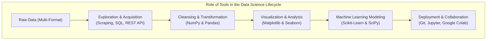
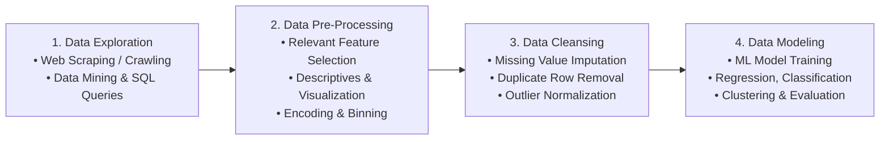
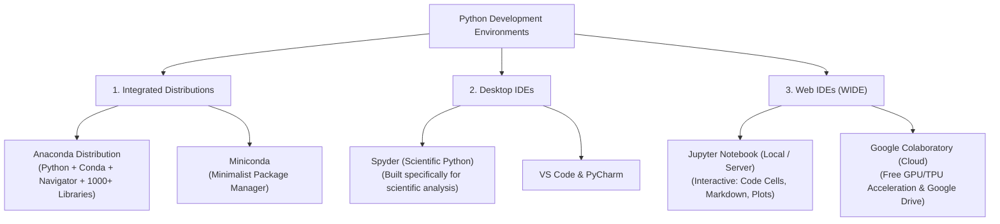
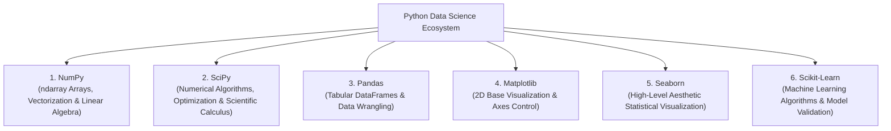
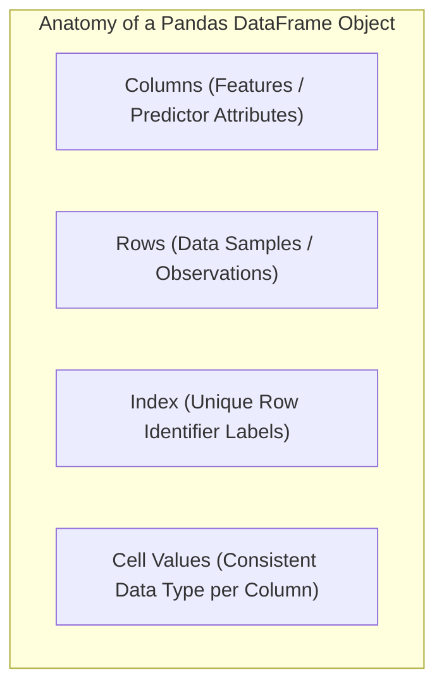

import { Accordion, Accordions } from 'fumadocs-ui/components/accordion';
import { Callout } from 'fumadocs-ui/components/callout';
import { Tab, Tabs } from 'fumadocs-ui/components/tabs';

> **Module Compiler:** Mahendar Dwi Payana  
> **Official Curriculum Source:** Thematic Academy Digital Talent Scholarship (DTS) 2021 — Agency for Human Resources Research and Development, Ministry of Communication and Informatics of the Republic of Indonesia (Kominfo)  
> **Original Module Instructor & Developer:** Rizal Dwi Prayogo, S.Si, M.Si, M.Sc (Bandung Institute of Technology - STEI ITB)

---

## 1. Introduction to Data Science Tools & Why Python?

In a *data science* project lifecycle, most of a practitioner's time and energy is spent on data processing, exploration, and modeling. Choosing the right software *tools* and programming language is a crucial factor that determines workflow efficiency, scalability, and project success.



### History & Characteristics of the Python Language
Python was created by **Guido van Rossum** in 1991 as an *open-source*, *cross-platform* (Windows, macOS, Linux) *general-purpose programming language*.

#### Key Advantages of Python:
1. **Clean Syntax & *High Readability***: Eliminates cumbersome curly braces `{}` and semicolons `;`, replacing them with clean whitespace indentation structure.
2. ***Interpreted Language***: Code is executed line-by-line instantaneously by the interpreter without a manual compilation step (*zero compilation step*), drastically shortening the *edit-test-debug* cycle.
3. ***Dynamically Typed* & Automatic Memory Management**: Object memory allocation and *garbage collection* are automatically managed by the Python runtime.
4. ***Multi-Paradigm Language***:
   * *Object-Oriented Programming (OOP)*: Facilitates modular model pipeline design much like Java or C++.
   * *Functional Programming*: Provides higher-order functions (`map`, `filter`, `lambda`, *list comprehensions*).
   * *C/C++ Interoperability*: Through libraries such as *Cython*, performance-critical code can be accelerated to match C-language execution speeds.

#### Syntax Comparison: C Language vs. Python Language

<Tabs items={['C Language', 'Python Language']}>
  <Tab value="C Language">
    ```c
    #include <stdio.h>

    int main() {
        printf("Hello World!\n");
        return 0;
    }
    ```
    *Requires header library declarations, a `main()` entry function, curly braces `{ }`, semicolons `;`, and manual compilation (`gcc main.c -o main`).*
  </Tab>
  <Tab value="Python Language">
    ```python
    print("Hello World!")
    ```
    *Extremely concise, declarative, expressive, and executed directly in an interactive console.*
  </Tab>
</Tabs>

### Global Tech Giant Adoption & Career Opportunities
Python has become the *gold standard* at leading global technology companies:
* **YouTube**: *"Google runs millions of lines of Python code. The front-end servers that power youtube.com and YouTube's APIs are written primarily in Python and serve millions of requests per second!"* — Dylan Trotter, YouTube Engineer (2017).
* **Quora**: Chose Python for its rapid development iteration speed and strong *unit testing* integration — Adam D'Angelo, CEO of Quora (2014).
* **Google, Spotify, Instagram, Netflix, NASA, Uber, Dropbox, IBM, and Reddit**: Rely on Python as the backbone of their data analytics architecture, recommendation engines, and artificial intelligence compute infrastructure.
* **Most In-Demand Job Market Skill**: According to a comprehensive *Towards Data Science* survey, Python ranks **first (77%)** on the list of most requested data science skills in global job postings, surpassing SQL (59%), R (54%), Apache Spark (26%), and AWS (26%).

---

## 2. Applying Python Across the 4 Phases of a Data Science Project



1. ***Data Exploration***: Extracting structured and unstructured data from diverse sources via *data mining*, *web scraping* (BeautifulSoup, Scrapy), Web API calls (Requests), and relational database/data warehouse queries.
2. ***Data Pre-processing***: Investigating data distribution profiles (probability distributions), descriptive statistics, *feature selection*, *class balancing*, and feature transformations (*categorical encoding, numerical binning*). Industry principle: *"Garbage In, Garbage Out"* — poorly processed data produces failing models.
3. ***Data Cleansing***: Improving raw data quality by imputing *missing values* using statistical techniques (mean, median, or mode), removing duplicate rows, standardizing date formatting, and dampening the effect of *outliers* through $[-1, 1]$ or $[0, 1]$ range normalization.
4. ***Data Modeling***: Training clean data with machine learning algorithms to solve **Regression** tasks (predicting numerical stock/commodity price movements), **Classification** tasks (predicting spam emails, fraud detection, disease diagnosis), or **Clustering** tasks (customer shopping behavior segmentation).

---

## 3. Development Environments: IDEs, WIDEs & the Git Ecosystem

To execute Python code optimally, data practitioners combine various *Development Environments*:



### A. The IPython Concept: REPL (*Read-Eval-Print-Loop*) Environment
IPython (*Interactive Python*) introduced an interactive workflow:
* **Read**: Receives and reads lines of code entered by the user.
* **Eval**: Evaluates and executes the code directly in memory.
* **Print**: Prints and displays the *output* immediately.
* **Loop**: Repeats the cycle for subsequent instructions while preserving variable state in memory.

### B. Web Integrated Development Environments (WIDE)
* **Jupyter Notebook**: Originating from SageMath mathematical software development (William Stein, 2005) and released as a browser version of IPython in December 2011. Today it is part of the multi-language **Jupyter** ecosystem (*Julia, Python, R*). Notebook documents (`.ipynb`) combine executable *Code* cells, mathematical narrative (*Markdown* with KaTeX/LaTeX), graphical plots, and interactive tables for *reproducible research*.
* **Google Colaboratory (Google Colab)**: A free *cloud notebook* service provided by Google. It offers a ready-to-use Python environment with zero local installation, equipped with hardware accelerators such as **GPUs (free NVIDIA T4, or L4/A100 on Colab Pro)** and **TPUs (Tensor Processing Units)**, plus seamless integration with Google Drive and GitHub repositories.

### C. Collaboration & Version Tracking with Git & GitHub
Data science projects require structured experiment tracking and team collaboration using **Git**:


#### 3 Main File States in Git:
1. **Modified**: You have changed files in the working directory, but the changes have not yet been marked for saving to the Git database.
2. **Staged**: You have marked modified files in the *Staging Area* as candidates for the next version snapshot.
3. **Committed**: The files are safely and permanently stored in your local repository database.

#### Basic Git Command Cheat Sheet:
```bash
# Initialize a new local repository on the main branch
git init -b main

# Check file status
git status

# Add files to the staging area
git add .

# Save changes with a descriptive message
git commit -m "feat: implement immunization data cleansing pipeline"

# Connect to a remote repository on GitHub
git remote add origin https://github.com/mahendartea/Learn-AI.git

# Upload changes to GitHub
git push -u origin main

# Fetch and merge the latest changes from teammates
git pull origin main
```

---

## 4. Deep Dive into the 6 Core Data Science Libraries

The Python data science ecosystem is supported by six foundational libraries:



---

### A. NumPy & SciPy: Numerical & Scientific Computing

#### Fatal Limitation of Standard Python Lists
In pure Python, lists are designed to hold heterogeneous objects. However, *element-wise* mathematical operations cannot be performed directly:

```python
height = [1.84, 1.79, 1.82, 1.90, 1.80]
weight = [66.5, 60.3, 64.7, 89.5, 69.8]

# Trying to calculate Body Mass Index (BMI) directly:
bmi = weight / height ** 2
# Output: TypeError: unsupported operand type(s) for ** or pow(): 'list' and 'int'
```

#### NumPy Solution: Homogeneous Array Vectorization (`ndarray`)
NumPy (*Numerical Python*) solves this by packing numerical data into $n$-dimensional homogeneous arrays (`ndarray`) stored in a *contiguous memory block* in C:

```python
import numpy as np

np_height = np.array(height)
np_weight = np.array(weight)

# Vectorized BMI calculation (Instant across millions of records!)
# Formula: BMI = Weight / (Height^2)
bmi = np_weight / (np_height ** 2)
print("Body Mass Index (BMI):", bmi.round(2))
# Output: array([19.64, 18.82, 19.53, 24.79, 21.54])
```

#### Multimodal Digital Data Representation in NumPy
Regardless of the real-world data format, everything is transformed into numerical array representations before being processed by AI algorithms:
* **Color Images (RGB)**: Represented as 3-dimensional tensors: the *Red plane*, *Green plane*, and *Blue plane*. Each pixel carries color intensity $0 - 255$ (0 = pure black, 255 = pure white), which is then normalized to the $[0, 1]$ interval.
* **Voice / Audio Signals**: Represented as 1-dimensional *time-series* arrays recording microphone sound wave amplitude at each *sampling rate* interval.

#### Linear Algebra & Matrix Broadcasting Rules
NumPy enables arithmetic operations between two arrays of different *shapes* without duplicating data in physical RAM:

$$
\begin{bmatrix} 1 & 2 & 3 \\ 4 & 5 & 6 \\ 7 & 8 & 9 \end{bmatrix} + \begin{bmatrix} 10 & 20 & 30 \end{bmatrix} = \begin{bmatrix} 11 & 22 & 33 \\ 14 & 25 & 36 \\ 17 & 28 & 39 \end{bmatrix}
$$

> **Conceptual Explanation of Broadcasting:**
> * The first matrix has shape $3 \times 3$.
> * The second vector has shape $1 \times 3$.
> * Under strict pure matrix algebra rules, this addition cannot be performed because the dimensions are not identical.
> * However, using the **NumPy Broadcasting Rule**, the second row array is virtually stretched (*broadcasted*) across all rows of the first matrix and executed with C/SIMD processor instructions without extra memory allocation.

* **SciPy (*Scientific Python*)**: Built on top of NumPy to provide advanced scientific computing algorithms, including integral/differential calculus, digital signal processing (*Fourier transforms*), optimized linear algebra, and inferential statistical testing.

---

### B. Pandas: Tabular Data Analysis & Manipulation Library

Pandas (*Panel Data*) provides two primary data object structures:
1. **Series**: A one-dimensional labeled array capable of holding any data type.
2. **DataFrame**: A two-dimensional tabular data structure (resembling an Excel *spreadsheet* or SQL database table) equipped with row indices (*index*) and column labels (*columns*).



#### Core Capabilities of Pandas:
* **Multi-Format Import & Export**: Reading and writing CSV files (`pd.read_csv`), Excel spreadsheets (`pd.read_excel`), SQL database queries (`pd.read_sql`), and binary HDF5/Parquet formats.
* **Data Cleansing & Transformation**: Handling missing values (`dropna`, `fillna`), filtering duplicate rows (`drop_duplicates`), and text manipulation (`.str` *string accessor*).
* **Precision Indexing**: Selecting rows and columns by label name (`.loc[]`) or by integer index (`.iloc[]`).
* **Aggregation & Relational Analysis**: Advanced grouping operations (`groupby`), multi-dimensional contingency tables (`pivot_table`), and dataset merging (`merge`, `join`, `concat`).

---

### C. Matplotlib & Seaborn: 2D Data Visualization

* **Matplotlib**: Created by John Hunter in 2002 as the fundamental 2D plotting library in Python. Supports full control over the graphic canvas: creating *axes*, *line charts* (`plt.plot`), *scatter plots* (`plt.scatter`), and *bar charts* (`plt.bar`).
* **Seaborn**: Built on top of Matplotlib to provide a *high-level interface* for automatically drawing more aesthetic, modern, and informative statistical graphics (such as *Heatmaps*, *Boxplots*, *Violinplots*, and correlation matrices).

---

### D. Scikit-Learn: Comprehensive Machine Learning Library

Scikit-Learn (`sklearn`) integrates comprehensive machine learning algorithms:
* **Classification**: *Support Vector Machines (SVM), Decision Tree, Random Forest, Naïve Bayes, k-Nearest Neighbors (k-NN), Logistic Regression*.
* **Regression**: *Linear Regression, Ridge, Lasso, ElasticNet, SVR*.
* **Clustering**: *K-Means Clustering, DBSCAN, Hierarchical Clustering*.
* **Dimensionality Reduction**: *Principal Component Analysis (PCA), t-SNE*.
* **Model Selection & Evaluation**: *Train-Test Split, K-Fold Cross-Validation, GridSearchCV, Confusion Matrix, ROC-AUC, Classification Report*.

## 5. Integrated Practicum & Python Case Studies

<Callout type="info" title="Download Official Practicum Jupyter Notebook Files">
All practicum instruction code for this session is available in the official training Jupyter Notebook file, ready to download and run locally (Jupyter Lab / VS Code) or in Google Colaboratory:
- **Module 4 Jupyter Notebook:** [`Get Started with Python - Modul 4.ipynb`](https://github.com/mahendartea/Learn-AI/blob/main/Get%20Started%20with%20Python%20-%20Modul%204.ipynb)
- **Dataset 1:** <DataLink file="Tab.csv"><code>Tab.csv</code></DataLink> *(Country Demographics & Land Area Data)*
- **Dataset 2:** <DataLink file="pmp_2020_baru.csv"><code>pmp_2020_baru.csv</code></DataLink> *(Education Quality Assurance Report Data)*
</Callout>

### Hands-on 1: NumPy Vector Computing vs. Python List Limitations

Referring directly to the code cells in `Get Started with Python - Modul 4.ipynb`, here is a comparison between standard Python lists and NumPy arrays:

```python
# ==========================================
# 1. LIMITATIONS OF STANDARD PYTHON LISTS
# ==========================================
height = [1.84, 1.79, 1.82, 1.90, 1.80]
weight = [66.5, 60.3, 64.7, 89.5, 69.8]

# Heterogeneous data can be combined in a list:
famz = ["Abe", 1.84, "Beb", 1.79, "Cory", 1.82, "Dad", 1.90]
print("Heterogeneous list collection:", famz)

try:
    # Calculating BMI directly on Python lists:
    bmi = weight / height ** 2
except TypeError as e:
    print(f"\n[Failed on Python List] TypeError: {e}")
    # Output: unsupported operand type(s) for ** or pow(): 'list' and 'int'

# ==========================================
# 2. VECTORIZATION SOLUTION WITH NUMPY ARRAY
# ==========================================
import numpy as np

np_height = np.array(height)
np_weight = np.array(weight)

print("\nObject type of np_height :", type(np_height)) # <class 'numpy.ndarray'>
print("Object type of np_weight :", type(np_weight)) # <class 'numpy.ndarray'>

# Instant element-wise calculation without loops:
bmi = np_weight / (np_height ** 2)
print("Vectorized BMI Result:", bmi.round(2))
# Output: [19.64, 18.82, 19.53, 24.79, 21.54]

# ==========================================
# 3. 2D ARRAYS (MATRICES) & DIMENSIONS
# ==========================================
np_2d = np.array([
    [1, 2, 3, 4, 5],
    [6, 7, 8, 9, 10]
])

print("\n2D Matrix:\n", np_2d)
print("Matrix Dimensions (Shape):", np_2d.shape) # (2, 5) -> 2 rows, 5 columns
print("Element at row 1, column 3 (index 0, 2):", np_2d[0, 2])
print("All elements of row 2 (index 1):", np_2d[1, :])

# Core 1D Series and 2D DataFrame concepts underlying Pandas:
arr_series = np.array([1, 2, 3, 4, 5])       # 1D Array -> Similar to Series
arr_df = np.array([[1, 2], [3, 4]])          # 2D Array -> Similar to DataFrame
print("\nBase 1D Series shape:", arr_series.shape)
print("Base 2D DataFrame shape:", arr_df.shape)
```

---

### Hands-on 2: Tabular Pandas Analysis with `Tab.csv` Dataset

We use a demographic dataset of Southeast and East Asian countries hosted directly on our portal:

```python
import pandas as pd

# Read Tab.csv dataset from Learn AI public URL
url_tab = "https://mahendartea.github.io/Learn-AI/data/Tab.csv"
Tab = pd.read_csv(url_tab, index_col=0)

print("=== COUNTRY TABULAR DATASET (Tab.csv) ===")
print(Tab)

# 1. Accessing attribute columns
print("\nCountry Column (Negara)  :\n", Tab["Negara"])
print("\nCapital Column (Ibukota) :\n", Tab.Ibukota)

# 2. Feature Engineering: Calculating Population Density (People per km^2)
# Population in millions, Area in km^2
Tab["Kepadatan_per_km2"] = ((Tab["Populasi"] * 1_000_000) / Tab["Area"]).round(2)

print("\nComplete Table with Population Density Feature:")
print(Tab[["Negara", "Populasi", "Area", "Kepadatan_per_km2", "Ibukota"]])
```

---

### Hands-on 3: Visualizing Education Quality Trends in SMP Cirebon (`pmp_2020_baru.csv`)

Using historical Education Quality Assurance (PMP) data from SMP Negeri 14 Kota Cirebon for the $2016 - 2020$ period:

```python
import pandas as pd
import matplotlib.pyplot as plt

# Read pmp_2020_baru.csv dataset from Learn AI portal
url_pmp = "https://mahendartea.github.io/Learn-AI/data/pmp_2020_baru.csv"
df_pmp = pd.read_csv(url_pmp)

print("=== EDUCATION QUALITY ASSURANCE DATASET (PMP) ===")
print(df_pmp[["uraian", "pmp2016", "pmp2018", "pmp2019", "pmp2020"]].head())

# Extract first row: Graduate Competency Standard (SKL)
row_skl = df_pmp.iloc[0]
tahun = ['2016', '2017', '2018', '2019', '2020']
skor_pmp = [
    row_skl['pmp2016'], 
    row_skl['pmp2017'], 
    row_skl['pmp2018'], 
    row_skl['pmp2019'], 
    row_skl['pmp2020']
]

# Visualize Education Quality Score Trend with Matplotlib
plt.figure(figsize=(8, 4.5))
plt.plot(tahun, skor_pmp, marker='o', color='#2563eb', linewidth=2.5, markersize=8, label="Actual PMP Score")
plt.title(f"Trend of {row_skl['uraian']}\n{row_skl['nama']}", fontsize=12, fontweight='bold')
plt.xlabel("Evaluation Year", fontsize=10)
plt.ylabel("Quality Score (Scale 0 - 7)", fontsize=10)
plt.ylim(0, 7.5)
plt.grid(True, linestyle='--', alpha=0.6)
plt.legend()
plt.tight_layout()
plt.show()

# Comparative Price Trend Visualization (Module 4 Notebook Cells 46-50)
year = [1980, 1990, 2000, 2010, 2020]
price = [2.5, 7.6, 9.7, 15.8, 22.9]

fig, (ax1, ax2, ax3) = plt.subplots(1, 3, figsize=(14, 4))

# 1. Line Plot (plt.plot)
ax1.plot(year, price, marker='s', color='#0284c7', linewidth=2)
ax1.set_title("1. Line Plot (plt.plot)")
ax1.set_xlabel("Year")
ax1.set_ylabel("Price ($)")
ax1.grid(True, linestyle=':', alpha=0.7)

# 2. Scatter Plot (plt.scatter)
ax2.scatter(year, price, color='#dc2626', s=70, edgecolor='black')
ax2.set_title("2. Scatter Plot (plt.scatter)")
ax2.set_xlabel("Year")
ax2.grid(True, linestyle=':', alpha=0.7)

# 3. Bar Plot (plt.bar)
ax3.bar(year, price, width=3.0, color='#16a34a', edgecolor='black', alpha=0.85)
ax3.set_title("3. Bar Plot (plt.bar)")
ax3.set_xlabel("Year")
ax3.grid(axis='y', linestyle=':', alpha=0.7)

plt.tight_layout()
plt.show()
```

---

## 6. Self-Evaluation & Independent Practicum Tasks

Based on the official Thematic Academy DTS 2021 syllabus:

<Accordions>
  <Accordion title="Assignment 1: Completing Online Hands-On Courses (Python for Data Science)">
    Participants must complete an interactive self-paced practicum module from one of the accredited online course providers:
    * Cognitive Class: *Python for Data Science* (`cognitiveclass.ai/courses/python-for-data-science`)
    * DataCamp: *Introduction to Python for Data Science* (`datacamp.com/courses/intro-to-python-for-data-science`)
    * Microsoft Learn: *Build real-world applications with Python* (`docs.microsoft.com/en-us/learn/paths/python-language/`)
    * edX / Microsoft: *Introduction to Python for Data Science (DAT208x)*
  </Accordion>

  <Accordion title="Assignment 2: Exploring 3-Dimensional NumPy Matrices">
    Write a Python script to generate a random $3 \times 4 \times 5$ matrix using `np.random.rand()`. Perform *slicing* operations to extract the sub-matrix on the second plane, and compute its mean, median, and standard deviation!
  </Accordion>

  <Accordion title="Assignment 3: Population Data Analysis & Bar Chart Visualization">
    Use the provided `Tab.csv` dataset. Create a *horizontal bar chart* comparing population density per km² across all five countries. Add text annotations highlighting the countries with the highest and lowest densities!
  </Accordion>
</Accordions>

---

## 7. References & Official Links

1. **Rizal Dwi Prayogo** (2021). *Modul Pelatihan: Tools Proyek Data Science*. Thematic Academy Digital Talent Scholarship 2021, Ministry of Communication and Informatics RI & STEI ITB.
2. **Jake VanderPlas** (2016). *Python Data Science Handbook: Essential Tools for Working with Data*. Sebastopol, CA: O'Reilly Media.
3. **Laura Igual & Santi Seguí** (2017). *Introduction to Data Science: A Python Approach to Concepts, Techniques and Applications*. Springer International Publishing.
4. **Arfika Nurhudatiana** (2019). *Analisis dan Visualisasi Data Dengan Python*. Jakarta: Pintaria.
