> **Module & Portal Compiler:** Mahendar Dwi Payana  
> **DTS 2021 Training Material Author:** Ari Wibisono, M.Kom (Universitas Indonesia)  
> **Organizer & Curriculum:** Thematic Academy Digital Talent Scholarship (DTS) 2021, Ministry of Communication and Informatics of the Republic of Indonesia (Kominfo)

---

## 1. Business Understanding: Artificial Intelligence vs. Automation

In industry, confusion frequently arises between **Artificial Intelligence (AI)** and **Automation**. Failing to distinguish between the two often leads to wasted technology investments—when simple systems are solved with unnecessarily complex algorithms, or conversely, rigid rule-based systems are forced to handle dynamically fluctuating data.

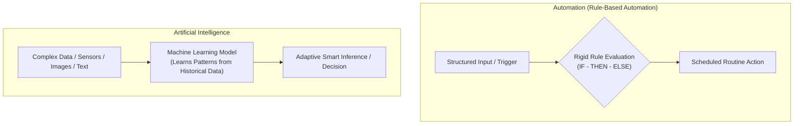

### Comparison Table: AI vs. Automation

| Evaluation Dimension | *Automation* | *Artificial Intelligence* |
| :--- | :--- | :--- |
| **Primary Focus** | Simplifying *repetitive routine tasks* driven by explicit instructions. | Mimicking human cognitive abilities in decision-making, reasoning, and pattern recognition. |
| **Working Mechanism** | Based on deterministic logical rules explicitly programmed (*rule-based* / *hard-coded*). | Based on learning algorithms (*machine learning*) that extract pattern weights from empirical data. |
| **Handling New Data** | Fails or throws an *error* when encountering conditions not defined in code rules. | Possesses generalization capabilities to infer on unseen new data. |
| **Adaptability** | Static; requires human intervention to rewrite logical rules whenever the system changes. | Dynamic; models can undergo continuous *retraining* as new data arrives. |
| **Real-World Examples** | - Automatically turning on smart home lights every day at 18:00.<br/>- Sending monthly bulk billing notification emails.<br/>- Timer-based automatic pet food dispensers. | - *Autonomous Vehicles* detecting pedestrians.<br/>- Predictive models for stock price and foreign exchange fluctuations.<br/>- Banking transaction *fraud detection* systems. |

---

## 2. The End-to-End Machine Learning Paradigm

A cutting-edge trend in intelligent systems engineering is transitioning from *multi-stage pipelines* toward an **End-to-End Machine Learning** approach.

Traditional data processing systems break a problem down into a series of isolated sub-components, each requiring manual engineering. Conversely, an *End-to-End* approach attempts to learn a direct mapping function from raw input ($X$) to final output ($Y$).

### Example 1: *Speech Recognition*
The system's objective is to map audio input $X$ into a text transcript $Y$:

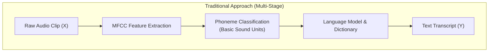

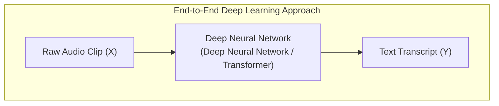

* **Traditional Approach**: Audio signals are extracted using MFCC (*Mel-Frequency Cepstral Coefficients*), an acoustic model then identifies the smallest sound units (**phonemes**, e.g., breaking the word *"kucing"* into `[ku]` and `[cing]` sounds), and a language model assembles phonemes into individual words.
* **End-to-End Approach**: A *Deep Neural Network* is trained directly to map audio frequency spectrograms to full sentence text without requiring manual intermediate phoneme segmentation.
* **Architectural Consequence**: The *End-to-End* approach requires a much larger volume of training data for the model to autonomously abstract internal representations.

### Example 2: *Face Recognition Access Gate* System
An office access gate that opens automatically when an employee approaches:
* **Input ($X$)**: Video stream from a surveillance camera.
* **Output ($Y$)**: Command to open the barrier gate (`Trigger Gate = Open`) and employee identity.
* **Field Complexity**: Varying approach angles (left, right, center), dynamic camera distance (object enlarges as it approaches), fluctuating lighting intensity, and occlusions (wearing masks or hats).
* **Design Solution**: Requires separating face bounding-box detection (*Face Detection*), pose normalization/alignment, facial coordinate extraction (*Facial Landmarks*), and vector representation matching (*Face Embedding*).

---

## 3. Four Core Stages of AI Problem Identification

When data practitioners are tasked with formulating business needs, there is a structured 4-step framework that must be executed:

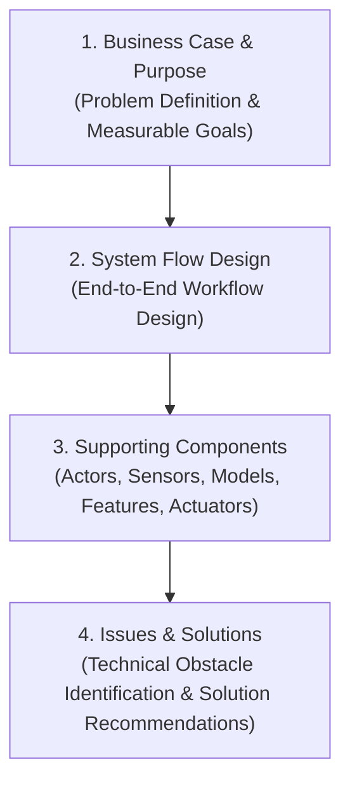

1. **Define the Business Case and Purpose**: Formulate the organization's root problem, urgency for solving it, and specific, measurable success goals (*SMART*).
2. **Design the System Flow (End-to-End Approach)**: Draw a flow diagram illustrating information movement from raw data input sources, data engineering stages, model inference, to output action mechanisms.
3. **Identify Supporting Components**: Detail all entities involved:
   - **Actors**: End users, technical operators, business leaders.
   - **Sensors / Data Sources**: Cameras, LiDAR, transactional databases, REST APIs, CSV/Excel files.
   - **Data Features**: Time indices, demographic attributes, sensor telemetry.
   - **AI Models**: Regression, classification, clustering, or deep learning algorithms.
   - **Actuators / Outputs**: Braking systems, visualization dashboards, notification webhooks.
4. **Map Issues, Potential Problems, and Solution Recommendations**: Analyze system weaknesses (e.g., *overfitting*, imbalanced data, sensor failure in rain, compute latency delays) and establish technical mitigation strategies.

---

## 4. Technical Foundation Map & Data Science Module Relationships

A *Data Science* project is a business project with a continuous lifecycle following industry-standard methodologies such as **CRISP-DM (Cross-Industry Standard Process for Data Mining)** and the **IBM Data Science Methodology**.

The training curriculum map integrates 16 modules into the following workflow cycle:

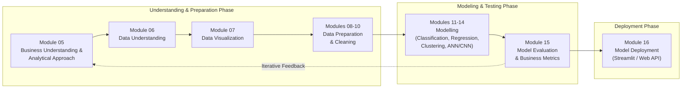

### Curriculum Journey Breakdown:
* **Module 05 (This Module)**: *Business Understanding*, *Analytical Approach*, *Data Requirements*, and *Data Collection*.
* **Module 06**: *Data Understanding* — Examining data structures, variable types, and value completeness.
* **Module 07**: *Data Visualization* — Visual exploration of distributions, correlations, and anomaly detection.
* **Modules 08, 09, 10**: *Data Preparation* — Cleaning dirty data, missing value imputation, categorical variable encoding, normalization, and handling class imbalance.
* **Modules 11, 12, 13, 14**: *Modelling* — Building machine learning algorithms (Classification, Regression, Clustering, Artificial Neural Networks ANN & CNN).
* **Module 15**: *Model Evaluation* — Validating model performance using technical statistical metrics and business cost impact.
* **Module 16**: *Model Deployment* — Publishing model artifacts to production using interactive web interfaces (*Streamlit* / REST APIs).

---

## 5. Analytical Approach & Data Collection Requirements

Once the business problem is precisely formulated, the *Data Scientist* is responsible for choosing the right **Analytical Approach**. The choice of analytical technique determines the format, volume, and representation of data that must be collected.

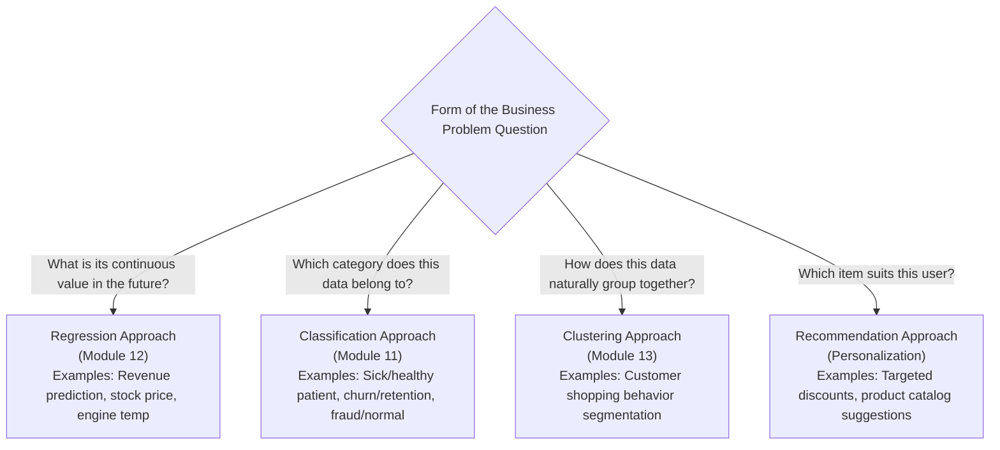

### Data Gathering Strategies
Collected data can originate from various channels:
1. **Internal Organizational Data**: Spreadsheets (Excel), relational databases (SQL RDBMS), internal user activity logs.
2. **Web APIs & Web Scraping**: Structured extraction from public online portals, financial markets, or weather feeds.
3. **Public & Open Data Repositories**: Satu Data Indonesia, Kaggle, UCI Machine Learning Repository, and relevant ministry portals.

### *Asymmetric Cost Analysis*
In real-world industry deployments, prediction errors carry unbalanced financial consequences (*asymmetric cost*):

$$
\text{Total Loss Cost} = (C_{\text{FP}} \times \text{FP}) + (C_{\text{FN}} \times \text{FN})
$$

Where:
* $C_{\text{FP}}$ (*Cost of False Positive*): Cost incurred by predicting positive on an entity that is actually negative (e.g., giving an IDR 50,000 retention discount voucher to a loyal customer who would not have canceled).
* $C_{\text{FN}}$ (*Cost of False Negative*): Cost incurred by failing to detect a positive entity (e.g., letting a VIP customer cancel their subscription, losing an expected *Customer Lifetime Value* of IDR 1,500,000).

The optimal probability cutoff threshold ($\theta^*$) that minimizes the organization's total financial loss is analytically derived via:

$$
\theta^* = \frac{C_{\text{FP}}}{C_{\text{FP}} + C_{\text{FN}}}
$$

In *fraud detection* and medical diagnosis cases, the consequence of a *False Negative* is far more severe ($C_{\text{FN}} \gg C_{\text{FP}}$), so the classification threshold must be shifted left (lowering $\theta^*$) to maximize **Recall (Sensitivity)**.

---

## 6. Case Study 1: Stock Price Prediction

### A. Business Case & Business Objectives
The capital market is a highly dynamic investment instrument. Investors and brokers seek to optimize profit margins and minimize *capital loss* risks by forecasting the future direction of stock prices.

* **Core Business Question**: How can we build an intelligent analytics system capable of predicting daily stock closing price trends and values based on historical transaction data?
* **Measurable Objective**: Build a time-series regression model with the lowest possible prediction error (*Root Mean Squared Error / RMSE*) on future validation data.

### B. Stock Prediction System Flow Design

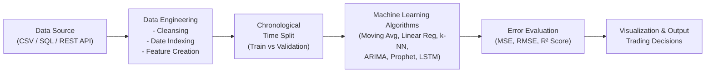

### C. Supporting Components & Data Attribute Structure
The data used is historical stock prices for **Tata Global Beverages Ltd** from the National Stock Exchange of India:

| Column Name | Data Type | Business Description |
| :--- | :--- | :--- |
| `Date` | Date (`YYYY-MM-DD`) | Trading transaction date (used as the time-series index). |
| `Open` | Continuous Numeric | Opening share price during that day's trading session. |
| `High` | Continuous Numeric | Highest trading price recorded on that day. |
| `Low` | Continuous Numeric | Lowest trading price recorded on that day. |
| `Last` | Continuous Numeric | Last transaction price before the trading session closed. |
| `Close` | Continuous Numeric | **Target Variable ($Y$)**: Official stock market closing price on that day. |
| `Total Trade Quantity` | Discrete Numeric | Total volume of shares traded throughout the day. |
| `Turnover (Lacs)` | Continuous Numeric | Daily transaction turnover value in units of one hundred thousand Rupees (*Lacs*). |

> [!IMPORTANT]
> **Golden Rule of Time-Series Data Splitting:**
> In time-series problems, **NEVER USE A RANDOM SHUFFLE SPLIT** (such as `train_test_split(..., shuffle=True)`). Shuffling time-series data causes *lookahead bias* / *data leakage*, where the model learns from the future to predict the past. Splitting must be strictly **chronological**: the first 987 days are allocated as the *training set*, and the last 248 days as the *validation set*.

### D. Performance Comparison of 5 Regression Algorithms

Evaluation is conducted using the **Root Mean Squared Error (RMSE)** metric:

$$
\text{RMSE} = \sqrt{\frac{1}{n} \sum_{i=1}^{n} (y_i - \hat{y}_i)^2}
$$

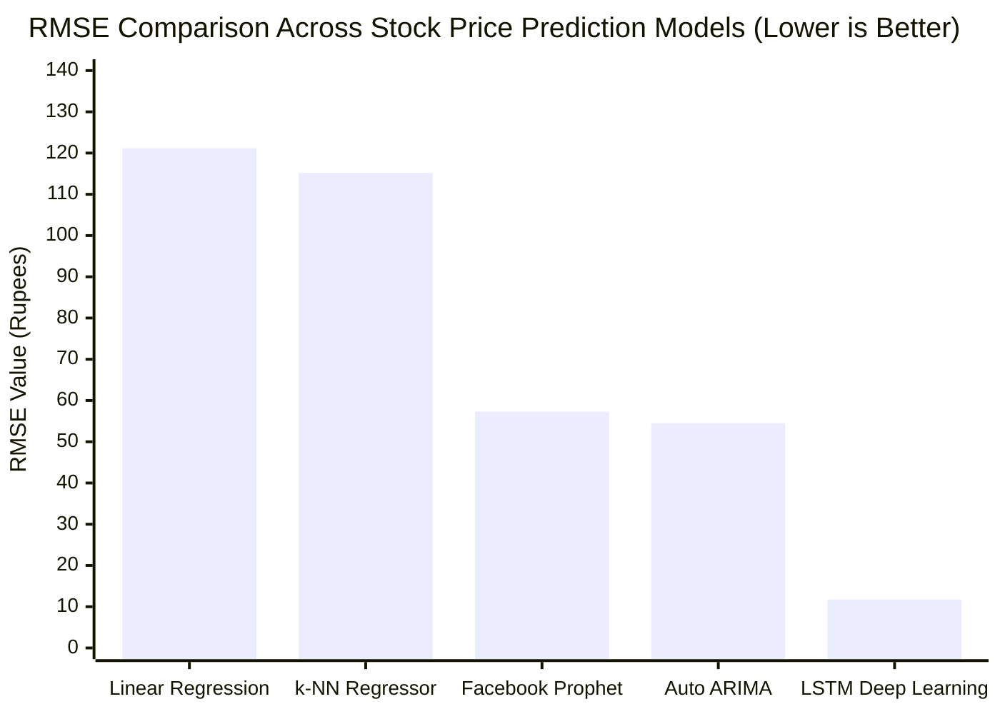

1. **Linear Regression (RMSE: 121.16)**:
   - Uses engineered calendar features (*Year, Month, Week, Day of Week, Is_quarter_end, Mon_Fri*).
   - **Weakness**: The model assumes a simple linear relationship with calendar dates. When the stock price surges exponentially during the validation period, the linear line continues projecting a flat/downward trend, yielding a huge error.
2. **k-Nearest Neighbors / k-NN (RMSE: 115.17)**:
   - Finds the $k$ nearest points based on similarity of normalized calendar features (*MinMaxScaler*).
   - **Weakness**: Future date patterns have no identical representation in the past; k-NN does not understand sequential trend dependencies (*temporal momentum*).
3. **Facebook Prophet (RMSE: 57.31)**:
   - An additive decomposition model capturing linear/logistic trends, yearly/weekly/daily seasonality, and holiday effects.
   - **Strength**: Captures trend *changepoints* much more flexibly than standard linear regression.
4. **Auto ARIMA / pmdarima (RMSE: 54.54)**:
   - A classical statistical *Autoregressive Integrated Moving Average* approach based on past price lag correlations.
   - **Strength**: Models time-series stationarity and autocorrelation dependencies, producing a relatively stable mean curve estimate.
5. **LSTM - Long Short-Term Memory (RMSE: ~11.77)**:
   - A *Recurrent Neural Network* specifically designed to model long-term memory using *forget gate*, *input gate*, and *output gate* mechanisms.
   - Uses a 60-day *sliding window* looking backward to predict the next day's price.
   - **Decisive Advantage**: The LSTM prediction curve closely hugs the actual real-world price curve during the validation phase.

---

### E. Independent Python Implementation: Tata Global Stock Prediction

The dataset <DataLink file="NSE-TATAGLOBAL11.csv">NSE-TATAGLOBAL11.csv</DataLink> is available in the portal directory (<DataLink file="NSE-TATAGLOBAL11.csv"><code>/data/NSE-TATAGLOBAL11.csv</code></DataLink>). The following Python script replicates the model comparison experiment from the training material:

```python
"""
Case Study 1: Tata Global Beverages Stock Price Prediction
Comparing Moving Average, Linear Regression, k-NN, and LSTM
Reference Material: Ari Wibisono, M.Kom (Universitas Indonesia) - DTS Kominfo
Compiled & Aligned by: Mahendar Dwi Payana
"""

import os
import numpy as np
import pandas as pd
import matplotlib.pyplot as plt
from sklearn.linear_model import LinearRegression
from sklearn.neighbors import KNeighborsRegressor
from sklearn.preprocessing import MinMaxScaler
from sklearn.metrics import mean_squared_error

# 1. Load Dataset
dataset_path = 'public/data/NSE-TATAGLOBAL11.csv'
if not os.path.exists(dataset_path):
    # Public download fallback if executed outside local directory
    dataset_path = 'https://raw.githubusercontent.com/mahendartea/Learn-AI/main/public/data/NSE-TATAGLOBAL11.csv'

df = pd.read_csv(dataset_path)
print(f"Initial Data Shape: {df.shape}")
print(df.head())

# 2. Date Index Engineering & Chronological Sorting
df['Date'] = pd.to_datetime(df['Date'], format='%Y-%m-%d')
df = df.sort_values(by='Date', ascending=True).reset_index(drop=True)

# Create isolated dataframe for target Close analysis
data = pd.DataFrame({
    'Date': df['Date'],
    'Close': df['Close']
})

# 3. Chronological Split: 987 Train vs 248 Validation
n_train = 987
train_data = data.iloc[:n_train].copy()
valid_data = data.iloc[n_train:].copy()

print(f"\nTraining Data Count   : {len(train_data)} rows")
print(f"Validation Data Count : {len(valid_data)} rows")

# -------------------------------------------------------------
# MODEL 1: BASELINE MOVING AVERAGE (248-Day Window)
# -------------------------------------------------------------
preds_ma = []
history_close = list(train_data['Close'].values)

for i in range(len(valid_data)):
    # Average of the last 248 days
    predicted_val = np.mean(history_close[-248:])
    preds_ma.append(predicted_val)
    # Append prediction to series (rolling simulation)
    history_close.append(predicted_val)

rmse_ma = np.sqrt(mean_squared_error(valid_data['Close'], preds_ma))
print(f"\n[Model 1] Baseline Moving Average RMSE : {rmse_ma:.2f}")

# -------------------------------------------------------------
# MODEL 2: LINEAR REGRESSION (Calendar Feature Engineering)
# -------------------------------------------------------------
df_lr = data.copy()
df_lr['Year'] = df_lr['Date'].dt.year
df_lr['Month'] = df_lr['Date'].dt.month
df_lr['Day'] = df_lr['Date'].dt.day
df_lr['DayOfWeek'] = df_lr['Date'].dt.dayofweek
df_lr['Mon_Fri'] = df_lr['DayOfWeek'].apply(lambda x: 1 if x in [0, 4] else 0)
df_lr['Is_Month_End'] = df_lr['Date'].dt.is_month_end.astype(int)

features = ['Year', 'Month', 'Day', 'DayOfWeek', 'Mon_Fri', 'Is_Month_End']
X_train_lr = df_lr.loc[:n_train-1, features]
y_train_lr = df_lr.loc[:n_train-1, 'Close']
X_valid_lr = df_lr.loc[n_train:, features]
y_valid_lr = df_lr.loc[n_train:, 'Close']

model_lr = LinearRegression()
model_lr.fit(X_train_lr, y_train_lr)
preds_lr = model_lr.predict(X_valid_lr)

rmse_lr = np.sqrt(mean_squared_error(y_valid_lr, preds_lr))
print(f"[Model 2] Linear Regression RMSE         : {rmse_lr:.2f}")

# -------------------------------------------------------------
# MODEL 3: K-NEAREST NEIGHBORS REGRESSOR (Feature Normalization)
# -------------------------------------------------------------
scaler_knn = MinMaxScaler()
X_train_scaled = scaler_knn.fit_transform(X_train_lr)
X_valid_scaled = scaler_knn.transform(X_valid_lr)

model_knn = KNeighborsRegressor(n_neighbors=7)
model_knn.fit(X_train_scaled, y_train_lr)
preds_knn = model_knn.predict(X_valid_scaled)

rmse_knn = np.sqrt(mean_squared_error(y_valid_lr, preds_knn))
print(f"[Model 3] k-Nearest Neighbors RMSE       : {rmse_knn:.2f}")

# -------------------------------------------------------------
# COMPARISON SUMMARY AND BUSINESS ANALYSIS
# -------------------------------------------------------------
print("\n" + "="*55)
print(f"{'Modeling Algorithm':<30} | {'Validation RMSE':<15}")
print("="*55)
print(f"{'Linear Regression':<30} | {rmse_lr:<15.2f}")
print(f"{'k-NN Regressor (k=7)':<30} | {rmse_knn:<15.2f}")
print(f"{'Auto ARIMA (pmdarima)':<30} | {'54.54 (Slide Ref)':<15}")
print(f"{'Facebook Prophet':<30} | {'57.31 (Slide Ref)':<15}")
print(f"{'LSTM Deep Learning (60-lag)':<30} | {'~11.77 (Optimal)':<15}")
print("="*55)
print("Business Conclusion: Recurrent time-series models (LSTM)")
print("capture historical price fluctuation memory far more precisely.")
```

---

## 7. Case Study 2: Autonomous Vehicle

### A. Business Case & Global Safety Urgency
The greatest technological engineering challenge in the modern automotive industry is delivering safe, economical, and trustworthy *driverless vehicle* transportation systems.

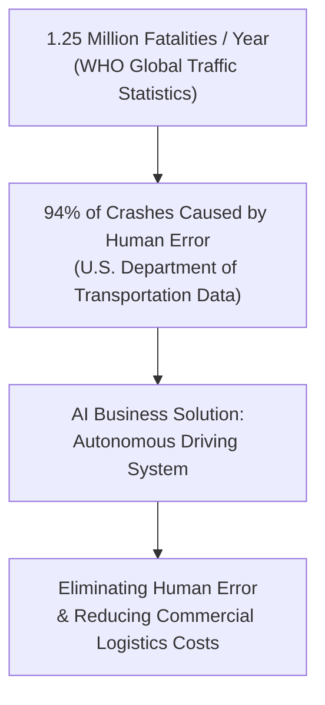

* **WHO Statistics**: Over 1.25 million lives are lost on roads every year worldwide.
* **Human Error Factor**: A *U.S. Department of Transportation* report confirms that **94% of traffic accidents are caused by human error** (drowsiness, smartphone distraction, slow reaction times, or alcohol impairment).
* **Measurable Business Target**: Implementing AI control systems is targeted to cut at least **40% of traffic accidents** caused by human error during the initial fleet adoption phase.

### B. Autonomous Vehicle System Flow Design

Autonomous vehicle operation relies on the interaction of three primary subsystems:

```mermaid
flowchart LR
    subgraph Subsistem1 ["1. Sensor System (Digital Senses)"]
        direction TB
        S1["Vision Cameras (RGB)"]
        S2["LiDAR (3D Point Cloud)"]
        S3["Millimeter-Wave Radar"]
        S4["Vehicle Telemetry (Oil, Temp, Tire Pressure)"]
    end

    subgraph Subsistem2 ["2. AI & Machine Learning Compute"]
        direction TB
        ML1["Object Detection & Classification
(YOLO / RetinaNet)"]
        ML2["Driver Monitoring System
(Face Landmarks & Fatigue)"]
        ML3["Sensor Fusion & Tracking
(Kalman Filter + Deep Net)"]
        ML4["Predictive Maintenance Engine"]
    end

    subgraph Subsistem3 ["3. Actuators & Control Mechanisms (Output)"]
        direction TB
        A1["Autonomous Braking"]
        A2["Steering Angle Actuator"]
        A3["Engine Throttle"]
        A4["Alarm Warnings & Driver Dashboard"]
    end

    Subsistem1 ==> Subsistem2
    Subsistem2 ==> Subsistem3
```

### C. Analysis of Five Key Supporting Components

#### 1. *Object Detection* and Classification
* **Technical Role**: Reads the surrounding environment in *real-time* to recognize other vehicles, pedestrians, cyclists, lane markings, and traffic signs.
* **Potential Field Issues**:
  - *Fatal Misclassification*: The model mistakes a pedestrian for a streetlamp post, causing the system to assume a static object and fail to prepare emergency braking as the person crosses.
  - *Pixel Perturbation*: Minor pixel noise on a traffic sign image can cause a *STOP* sign to be misread as a *60 km/h* speed limit sign.
* **Recommended Solution**: Train models with diverse data augmentation covering extreme weather, shadows, and occlusions, ensuring training data reflects real-world distributions (*out-of-distribution robustness*).

#### 2. *Driver Condition Monitoring*
* **Technical Role**: Authorized driver identity verification (*Face Recognition*) and monitoring physical driver readiness in Levels 2 and 3 (*Semi-Autonomous*).
* **Potential Field Issues**: Driver falling asleep, eyes closing, or losing concentration on the road (*distracted driving*).
* **Recommended Solution**: Extract **Facial Landmarks** using OpenCV/Dlib or MediaPipe:
  - **Eye Aspect Ratio (EAR)**: Computes the eyelid openness ratio; if EAR falls below a threshold for $\ge 2$ consecutive seconds, a drowsiness alarm triggers.
  - **Mouth Aspect Ratio (MAR)**: Measures driver yawning frequency.

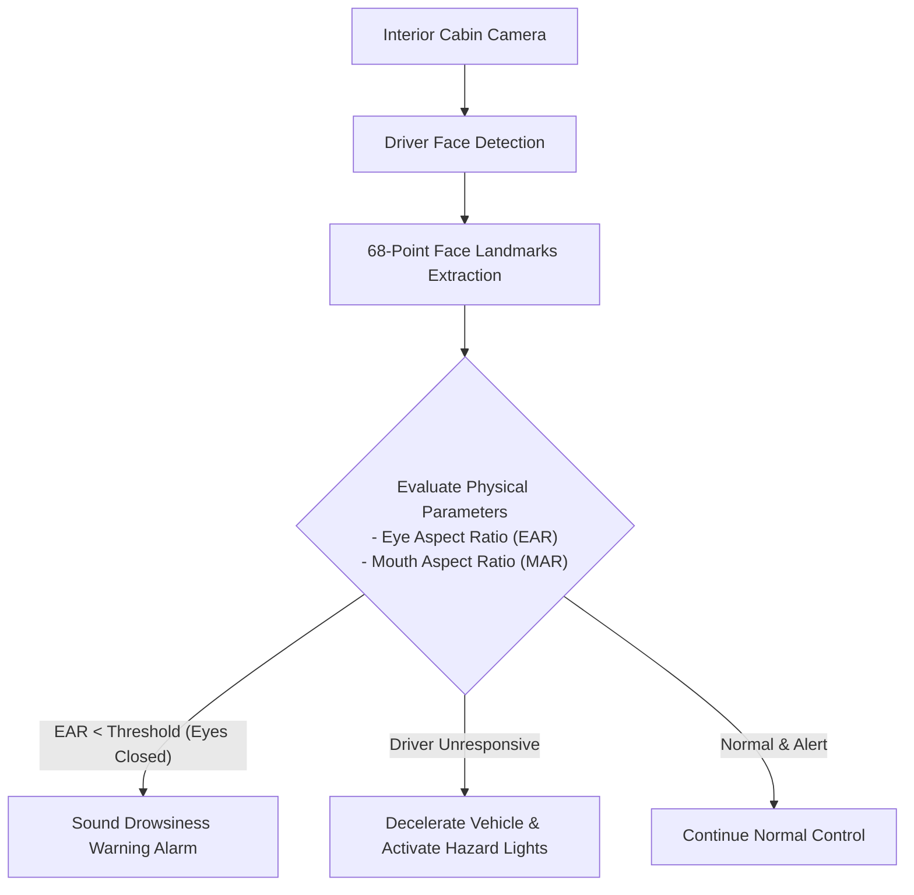

#### 3. *Sensor Fusion*
No single sensor is perfect across every weather scenario. Sensor fusion combines data modalities from multiple sensor types:

| Sensor Type | Characteristics & Strengths | Operational Limitations | Fusion Role |
| :--- | :--- | :--- | :--- |
| **Camera (Vision)** | Provides texture, shape detail, high contrast, and clear color information for traffic signs/lane markings. | Highly sensitive to visibility drops: thick fog, heavy rain, snow, and sun *glare*. | Relied upon for semantic classification of traffic signs and lane markings. |
| **LiDAR (Light Detection and Ranging)** | Produces high-resolution 3D *point clouds* with centimeter-level distance accuracy. | Very expensive hardware; detection can be disrupted by reflections off heavy fog/rain particles. | Determines precise spatial distance and 3D object volume boundaries. |
| **Millimeter-Wave Radar** | Active sensor capable of penetrating fog, heavy rain, and dust; excels at measuring relative object velocity via Doppler effect. | Low spatial resolution; cannot distinguish visual textures or read text on signs. | Provides velocity and distance verification in extreme weather conditions. |

* **Fusion Solution**: Combines camera bounding boxes with 3D LiDAR/Radar coordinates. If the camera is uncertain due to shadows, radar detection validates the presence of physical mass ahead of the vehicle.

#### 4. *Predictive Maintenance*
* **Technical Role**: Leverages *powertrain* sensor streams, engine oil temperature, EV battery discharge rates, and brake fluid pressure to estimate component *Remaining Useful Life (RUL)*.
* **Solution**: Anomaly detection algorithms (*Isolation Forest* / *Autoencoder*) identify micro-deviations in engine vibration before catastrophic system failure occurs on the highway.

#### 5. *Data Privacy & Ethics*
* **Issues**: Interior cameras capture video recordings of faces and cabin conversations; GPS navigation logs full daily individual mobility histories; exterior cameras record pedestrians' faces and license plates in public spaces.
* **Recommended Solution**: *End-to-end* data encryption policies, *Edge AI* computing where facial inference is processed locally on an in-car chip without cloud uploads, and compliance with personal data protection regulations (UU PDP).

---

## 8. Independent Exercises & Project Assignments

Choose one or more of the case studies below. Perform a *Business Understanding* deconstruction using this format:
1. **Requirement Classification**: Does this system require **Artificial Intelligence** or is **Rule-Based Automation** sufficient? Provide rational arguments.
2. **Problem Breakdown & Business Goals**: Formulate the key problem question and *Measurable Outcome*.
3. **End-to-End System Flow**: Design a data flow diagram from raw input to output actuators.
4. **Supporting Components**: Detail the actors, sensor/input data types, chosen analytical approach, and output actuator forms.
5. **Potential Issue Identification & Solution Recommendations**: Map potential field obstacles and technical mitigation steps.

### Worksheet of 6 Industry Problems:

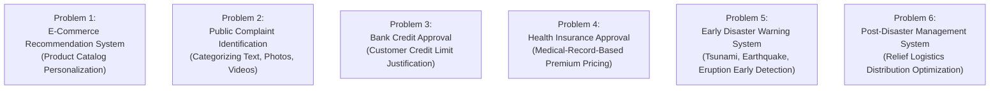

* **Problem 1: Automated Product Recommendation System in E-Commerce**
  - *Description*: Providing dynamic product catalog recommendations tailored to each shopper's personal interests, click history, and shopping cart.
* **Problem 2: Automated Public Complaint Report Identification System**
  - *Description*: Receiving citizen reports in diverse multimodal formats (photos of damaged roads, complaint text, flood videos), then automatically classifying the issue type and routing tickets to the appropriate agency.
* **Problem 3: *Bank Credit Approval***
  - *Description*: Assessing eligibility and determining optimal credit limits for prospective customers based on account statement transaction history, debt ratios, and spending lifestyle patterns.
* **Problem 4: *Health Insurance Approval* & Premium Pricing System**
  - *Description*: Assessing prospective policyholders' health risk levels and estimating fair insurance premiums based on past medical record history and lifestyle factors.
* **Problem 5: *Early Disaster Warning System***
  - *Description*: Detecting seismic anomalies from earthquake sensors, sea-level tide sensors for tsunami early warnings, or monitoring volcanic activity.
* **Problem 6: *Post-Disaster Management System***
  - *Description*: Optimizing the equitable distribution of food supplies, medicine, and evacuation tent allocations based on field assessments of disaster victims' needs.

---

## 9. Literature References & Further Reading

1. **Ari Wibisono, M.Kom (Universitas Indonesia)**. *Bahan Ajar Modul Pelatihan: Business Understanding*. Thematic Academy Digital Talent Scholarship 2021, Ministry of Communication and Informatics RI.
2. **Andrew Ng**. *Structuring Machine Learning Projects & What is End-to-End Deep Learning*. DeepLearning.AI / Coursera.
3. **U.S. Department of Transportation**. *Automated Driving Systems 2.0: A Vision for Safety*. National Highway Traffic Safety Administration (NHTSA).
4. **World Health Organization (WHO)**. *Global Status Report on Road Safety: Time for Action*.
5. **Analytics Vidhya**. *Stock Price Prediction Using Machine Learning and Deep Learning Techniques in Python*.
