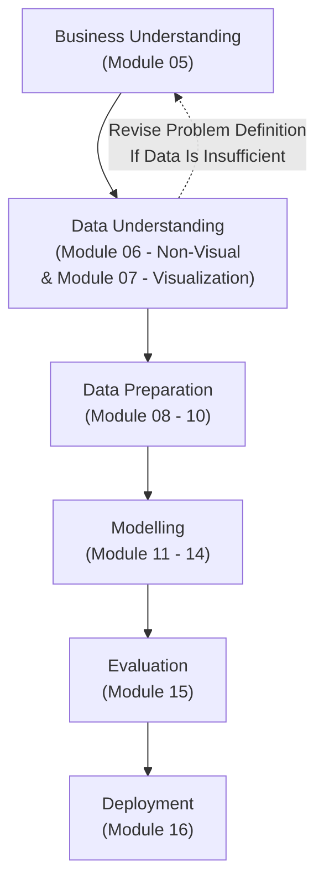
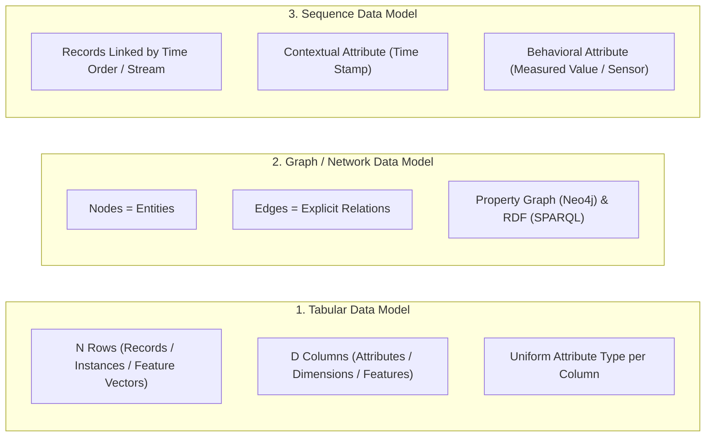
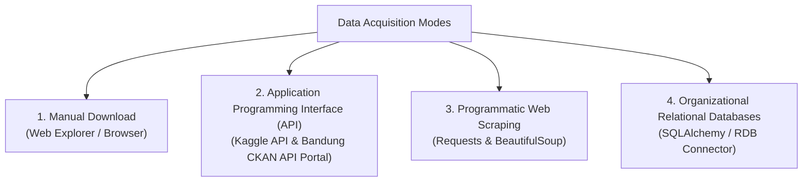
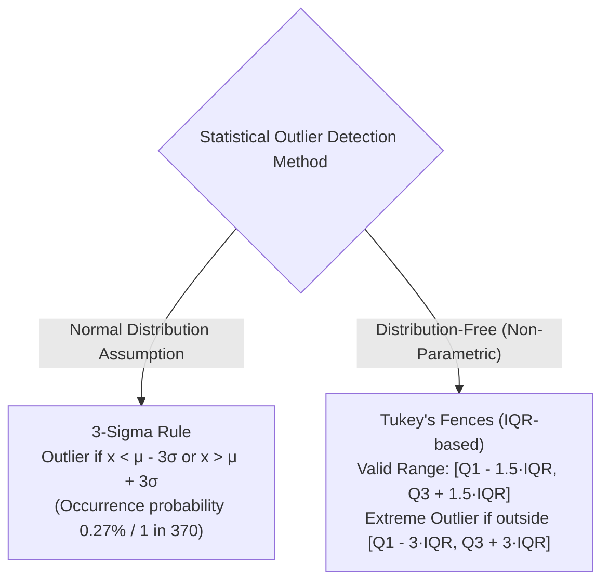

> **Module & Portal Compiler:** Mahendar Dwi Payana  
> **DTS 2021 Training Material Author:** Adila Alfa Krisnadhi, Ph.D. (Universitas Indonesia)  
> **Organizer & Curriculum:** Thematic Academy Digital Talent Scholarship (DTS) 2021, Ministry of Communication and Information Technology RI (Kominfo)

---

## 1. Concept & Role of Data Understanding in the CRISP-DM Cycle

Within the **CRISP-DM (Cross-Industry Standard Process for Data Mining)** methodology framework, data understanding is conducted immediately after business objectives are clearly defined.



### Why Is Data Understanding Necessary?
Data is the primary **raw material** for AI and Data Science solutions. Data from each source cannot necessarily be processed immediately because of:
1. **Different Intents & Purposes**: Historical datasets are often created for operational transactional purposes rather than predictive analytics.
2. **Fragmented Origin State**: Data may reside in separate silos (marketing databases, server logs, CRM) or be intricately integrated.
3. **Variation in Richness & Reliability**: Attribute completeness, measurement precision, and data cleanliness vary widely.
4. **Availability & Access**: Assessing whether data is available for free (*open license*), paid, requires special permissions, or is not yet available and therefore requires independent survey/collection instruments.

### Four Core Steps of the Data Examination Process
1. **Identify Data "Touchpoints" with Business Processes**: Examine the parts of organizational business processes influenced by data and map user domain expertise.
2. **Determine Primary Data Sources & Access Mechanisms**: Map internal/external sources and evaluate barriers to data accessibility.
3. **Assess the Business Value Added of Data**: Evaluate whether the quality and quantity of available data can deliver the targeted financial/operational impact.
4. **Identify Additional Data Sources for Improvement**: Search for secondary data (*enrichment features*) from public domains or third parties capable of improving model predictive power.

---

## 2. Sources, Structures, Types, and Data Models

### A. Taxonomy of Data Sources
* **Internal Sources**: Spreadsheet files (Excel, CSV, JSON), Relational Databases (PostgreSQL, MySQL, Oracle via SQL), free-text documents, and multimedia files (audio/video).
* **External Sources (Open Data Repositories)**:
  - National & Regional Government: [Satu Data Indonesia](https://data.go.id), [Open Data Jakarta](https://data.jakarta.go.id), [Open Data Kota Bandung](http://data.bandung.go.id), [Statistics Indonesia (BPS)](https://www.bps.go.id), [Geospatial Information Agency (BIG)](https://tanahair.indonesia.go.id/).
  - Global & Academic: [Kaggle Datasets](https://www.kaggle.com/datasets), [UCI Machine Learning Repository](https://archive.ics.uci.edu/ml/index.php), [Google Dataset Search](https://datasetsearch.research.google.com), [World Bank Open Data](https://data.worldbank.org), [WHO Data](https://www.who.int/data), [UNICEF Data](https://data.unicef.org), [DBPedia](https://www.dbpedia.org), [Wikidata](https://www.wikidata.org).

### B. Hierarchical Structure of Data
1. **Datum**: The smallest unit of data; a single value for a variable (e.g., age `24` or street name `"Jl. Sudirman"`). A single datum has no meaning without explanatory context.
2. **Data**: A collection of data items carrying a unified meaning that describes a single entity/object.
3. **Dataset**: A collection of data organized together.
4. **Metadata**: Data that describes other data (e.g., attribute names, data format types, update dates, units of measurement).

### C. Classification of Data Structure Nature
* **Structured Data**: Follows a strict data model defined before the data is created. Individual data items are clearly distinguishable and can be queried directly (e.g., SQL relational database tables, CSV spreadsheets).
* **Unstructured Data**: Lacks a predefined data model, exhibiting irregularity and semantic ambiguity (e.g., free text in emails, audio recordings, surveillance video).
* **Semi-Structured Data**: Does not follow a formal relational table structure, yet contains *tags*, markers, or key-value pairs that separate semantic hierarchies (e.g., JSON documents, XML, HTML trees).

---

### D. Taxonomy of Basic Data Measurement Scales (Stanley S. Stevens, 1946)

Based on Stevens' theory of measurement, elementary data types are classified into 4 scale levels:

| Characteristic | Nominal Scale (Categorical) | Ordinal Scale | Interval Scale | Ratio Scale |
| :--- | :--- | :--- | :--- | :--- |
| **Nature of Underlying Set** | Discrete, no inherent order. | Discrete, possesses intrinsic order. | Continuous / ordered numeric; differences indicate exact distance. | Continuous / ordered numeric; expresses multiplicative quantity ratios. |
| **Real Examples** | Color (Red, Green, Blue), Gender, Car Brand. | Class rank, Letter grades (A, B, C, D, E), Satisfaction level. | Temperature in Celsius (°C), Calendar year, Compass bearing degrees. | Car price (Rp), Load weight (kg), Road length (km), Kelvin temperature (K). |
| **Meaning of Measurement** | *Membership*. | *Membership*, *Comparison* (ranking / ordering). | *Membership*, *Comparison*, *Difference*. | *Membership*, *Comparison*, *Difference*, *Magnitude* (absolute amount). |
| **Mathematical Operations** | $=, \ne$ | $=, \ne, <, >$ | $=, \ne, <, >, +, -$ | $=, \ne, <, >, +, -, \times, \div$ |
| **Typical Central Tendency** | **Mode** | **Mode, Median** | **Mode, Median, Arithmetic Mean** | **Mode, Median, Arithmetic, Geometric, Harmonic Mean** |
| **Typical Dispersion Measures** | *Grouping* | *Grouping*, *Range*, Interquartile Range (IQR) | *Grouping*, *Range*, IQR, Variance, Standard Deviation | *Grouping*, *Range*, IQR, Variance, Standard Deviation, Coefficient of Variation |
| **Has a True Zero?** | No | No | **No** (0°C does not mean the absence of heat) | **Yes** (Rp 0 means the absolute absence of cash) |

---

### E. Three Main Structured Data Models



1. **Tabular Data Model**: The most common format in industry, composed of $n$ rows (*records*) and $d$ columns (*attributes*). Relationships between attributes are emphasized for the same object entity.
2. **Graph / Network Data Model**: Consists of *nodes* and *edges* to express complex interconnections (e.g., social networks, molecular structures, fraud transaction graphs).
3. **Sequence Data Model**: A collection of data whose dependency structure is implied by the order in which data items appear. When the contextual attribute is a *timestamp*, sequence data is called a **Time Series**.

---

## 3. Data Acquisition & Retrieval Techniques

There are four data retrieval modes commonly applied by a *Data Scientist*:



### A. Data Retrieval via Kaggle API
Kaggle provides an official Python-based API to automate searching and downloading datasets:

```bash
# 1. Install the Kaggle library
pip install kaggle

# 2. Place the kaggle.json authentication token
# Downloaded from Kaggle Profile -> Account -> Create New API Token
# Place at ~/.kaggle/kaggle.json (Linux/macOS) or C:\Users\<Username>\.kaggle\kaggle.json (Windows)
chmod 600 ~/.kaggle/kaggle.json

# 3. Search datasets by keyword
kaggle datasets list -s "goal leagues"

# 4. Automatic download and extraction
kaggle datasets download shreyanshkhandelwal/goal-dataset-top-5-european-leagues
unzip -o goal-dataset-top-5-european-leagues.zip
```

### B. Data Retrieval via CKAN API (Bandung Open Data Portal)
The Bandung Open Data Portal (`data.bandung.go.id`) is built using the open-source framework **CKAN (Comprehensive Knowledge Archive Network)**:

```python
import requests
import json
from tqdm import tqdm

# 1. Retrieve the list of all available dataset packages
url_list = "http://data.bandung.go.id/api/3/action/package_list"
resp_list = requests.get(url_list)
data_packages = json.loads(resp_list.text).get('result', [])
print(f"Total Indexed Datasets: {len(data_packages)}")

# 2. Search datasets using the keyword parameter 'q'
url_search = "http://data.bandung.go.id/api/3/action/package_search"
resp_search = requests.get(url_search, params=[('q', 'sekolah dasar')])
search_results = json.loads(resp_search.text)['result']
print(f"Results Found: {search_results['count']} datasets")

# 3. Retrieve file download URL details (resources)
package_name = "jumlah-guru-sd-negeri-di-kota-bandung-berdasarkan-sekolah"
url_detail = "http://data.bandung.go.id/api/3/action/package_show"
resp_detail = requests.get(url_detail, params=[('id', package_name)])
resources = json.loads(resp_detail.text)['result']['resources']

# 4. Download files with a tqdm progress bar
for res in resources:
    download_url = res['url']
    filename = download_url.split('/')[-1]
    response = requests.get(download_url, stream=True)
    with open(filename, "wb") as handle:
        for chunk in tqdm(response.iter_content(chunk_size=1024), desc=filename):
            if chunk:
                handle.write(chunk)
    print(f"Finished downloading: {filename}")
```

### C. Web Scraping & SQL Database Access
* **Web Scraping**: Extracting data directly from HTML pages using `requests` and `BeautifulSoup`. You must pay attention to DOM structure, *rate limiting*, the `robots.txt` file, and website legal licenses.
* **Relational Databases (RDB)**: Pulling data using SQL queries via `SQLAlchemy` and `pandas.read_sql()`. Credentials (host, user, password) must be protected using *environment variables*.

---

## 4. Mathematical Formulation of Descriptive Statistical Analysis

Non-visual statistical data examination methods focus on summarizing numeric and categorical data characteristics without relying on graphical visualization.

### A. Measures of Central Tendency

#### 1. Arithmetic Mean
Given a sample dataset $S = \{x_1, x_2, \dots, x_N\}$:

$$
\mu_S = \bar{x} = \frac{1}{N}\sum_{i=1}^{N} x_i = \frac{x_1 + x_2 + \dots + x_N}{N}
$$

* **Essential Property**: The sum of deviations of all data points from their mean equals zero:
  $$ \sum_{i=1}^{N} (\mu_S - x_i) = 0 $$
* **Weakness**: The arithmetic mean is **not robust**; its value is easily distorted by extreme outliers or *skewed* distributions.

#### 2. Median (Middle Value)
The data value that divides an ordered sample into two equal halves:
* If $N$ is odd: The value at position $\left(\frac{N+1}{2}\right)$.
* If $N$ is even: The average of the two middle values at positions $\left(\frac{N}{2}\right)$ and $\left(\frac{N}{2} + 1\right)$.
* **Essential Property**: **Robust** against outliers, making it ideal for representing asymmetric distributions (such as household income data).

#### 3. Mode (Most Frequent Value)
The value with the highest frequency of occurrence. Used for nominal and ordinal data. Data can be *unimodal* (one peak) or *multimodal* (more than one peak of highest frequency).

---

### B. Measures of Dispersion

#### 1. Range
The difference between the highest and lowest values in a sample:

$$
\text{Range} = \max(S) - \min(S)
$$

#### 2. Quantiles, Quartiles, and Interquartile Range (IQR)
* **Quartile 1 ($Q_1$)**: The 25th percentile cutoff ($25\%$ of data lies below it).
* **Quartile 2 ($Q_2$)**: The median or 50th percentile.
* **Quartile 3 ($Q_3$)**: The 75th percentile cutoff ($75\%$ of data lies below it).
* **Interquartile Range (IQR)**:
  $$ \text{IQR} = Q_3 - Q_1 $$

#### 3. Sample Variance & Standard Deviation
Computed using **Bessel's correction ($N-1$)** to produce an unbiased estimator of population variance:

$$
\sigma_S^2 = \frac{1}{N-1}\sum_{i=1}^{N} (x_i - \mu_S)^2
$$

$$
\sigma_S = \sqrt{\sigma_S^2}
$$

Interpretation: Standard deviation reflects precision and the degree of uncertainty in data measurements. The smaller its value, the more tightly the data points cluster around the central value.

---

### C. Statistical Outlier Detection



1. **3-Sigma Rule**:
   - If data is normally distributed, the interval $[\mu - \sigma, \mu + \sigma]$ covers $68.27\%$, $[\mu - 2\sigma, \mu + 2\sigma]$ covers $95.45\%$, and $[\mu - 3\sigma, \mu + 3\sigma]$ covers $99.73\%$ of the data.
   - A data point $x_i$ is categorized as an outlier if:
     $$ x_i < \mu_S - 3\sigma_S \quad \text{or} \quad x_i > \mu_S + 3\sigma_S $$
   - **Weakness**: Assumes data normality, and $\mu$ and $\sigma$ themselves are affected by the presence of those outliers.
2. **Tukey's Fences**:
   - Does not require a normal distribution assumption:
     $$ \text{Mild Outlier: } x_i < Q_1 - 1.5(\text{IQR}) \quad \text{or} \quad x_i > Q_3 + 1.5(\text{IQR}) $$
     $$ \text{Extreme Outlier: } x_i < Q_1 - 3(\text{IQR}) \quad \text{or} \quad x_i > Q_3 + 3(\text{IQR}) $$

---

### D. Pearson Linear Correlation Coefficient (PCC)

Measures the degree of linear association between two numeric variables $X$ and $Y$:

$$
r_{xy} = \frac{1}{(N-1)s_x s_y} \sum_{i=1}^{N} (x_i - \mu_x)(y_i - \mu_y)
$$

Where $s_x$ and $s_y$ are the sample standard deviations of variables $X$ and $Y$.
* **Value Range**: $-1 \le r_{xy} \le +1$.
  - $r_{xy} = +1$: Perfect positive linear correlation.
  - $r_{xy} = -1$: Perfect negative linear correlation.
  - $r_{xy} = 0$: No linear correlation.
* **Fundamental Caution**: $r_{xy} = 0$ **does not mean the two variables are independent**; it only proves the absence of a linear relationship (the variables may still be related quadratically, sinusoidally, or through other non-linear patterns).

---

## 5. Case Study 1: Statistical Exploration of Car Characteristics (`automobileEDA.csv`)

This case study uses a comprehensive automotive dataset with dimensions of 201 rows and 29 features. The dataset is provided in the portal's public directory: <DataLink file="automobileEDA.csv"><code>automobileEDA.csv</code></DataLink>.

```python
# Case Study 1: Non-Visual Descriptive Statistical Analysis of Automobile Dataset
# Examining Variable Types, Pearson Correlation, and Category Frequencies
# Based on DTS 2021 Curriculum & Notebook DA0101EN
# Compiled by: Mahendar Dwi Payana

import pandas as pd
import numpy as np

# 1. Load the Automobile Dataset
url_car = "https://mahendartea.github.io/Learn-AI/data/automobileEDA.csv"
df = pd.read_csv(url_car)

print(f"Automobile Dataset Dimensions: {df.shape[0]} rows, {df.shape[1]} columns\n")
print(df.head(3))

# 2. Inspect Column Data Types (dtypes)
print("\n=== VARIABLE DATA TYPES ===")
print(df.dtypes)
# Analytical Question: The data type of 'peak-rpm' is float64

# 3. Pearson Linear Correlation Analysis (df.corr)
print("\n=== SPECIFIC CORRELATION: BORE, STROKE, COMPRESSION, HORSEPOWER ===")
sub_corr = df[['bore', 'stroke', 'compression-ratio', 'horsepower']].corr()
print(sub_corr.round(3))

# Strongest correlations against the target variable 'price'
print("\n=== FEATURE CORRELATION WITH PRICE ===")
corr_price = df.corr(numeric_only=True)['price'].sort_values(ascending=False)
print(corr_price.round(3))

# 4. Continuous Numeric Statistical Summary (describe)
print("\n=== NUMERIC DESCRIPTIVE STATISTICS SUMMARY ===")
print(df[['wheel-base', 'curb-weight', 'engine-size', 'horsepower', 'price']].describe().round(2))

# 5. Categorical Statistical Summary (describe include=['object'])
print("\n=== CATEGORICAL STATISTICS SUMMARY ===")
print(df.describe(include=['object']))

# 6. Frequency Distribution Analysis (value_counts)
print("\n=== DRIVE-WHEELS SYSTEM FREQUENCY ===")
drive_wheels_counts = df['drive-wheels'].value_counts().to_frame()
drive_wheels_counts.rename(columns={'drive-wheels': 'value_counts'}, inplace=True)
drive_wheels_counts.index.name = 'drive-wheels'
print(drive_wheels_counts)

print("\n=== ENGINE LOCATION FREQUENCY ===")
engine_loc_counts = df['engine-location'].value_counts().to_frame()
engine_loc_counts.rename(columns={'engine-location': 'value_counts'}, inplace=True)
engine_loc_counts.index.name = 'engine-location'
print(engine_loc_counts)
```

### Key Analytical Findings from the Automotive Case:
1. **Strongest Correlations with Price**: Features `engine-size` ($r = 0.872$), `curb-weight` ($r = 0.834$), and `horsepower` ($r = 0.810$) have very strong positive linear relationships with car selling price.
2. **Fuel Efficiency**: `highway-mpg` ($r = -0.705$) and `city-mpg` ($r = -0.687$) correlate strongly and negatively with price, proving that high-performance premium cars tend to consume more fuel.
3. **Category Imbalance**: Drive-wheel systems are dominated by `fwd` (118 units) and `rwd` (75 units), while `4wd` accounts for only 8 units. Engine location is almost entirely in the front (`front`: 198 units), while only 3 units are in the rear (`rear`), indicating a sharp *class imbalance* in that feature.

---

## 6. Case Study 2: English Premier League Player Performance Analysis (`epl-goalScorer(20-21).csv`)

This case study examines the performance dataset of 522 English Premier League (EPL) players from the 2020/2021 season based on training materials by Adila Alfa Krisnadhi, Ph.D.

```python
# Case Study 2: Descriptive Statistical Review of EPL 2020/2021 Season Players
# Skewness Check, Tukey Outlier Detection, and Team Aggregation
# Compiled by: Mahendar Dwi Payana

import pandas as pd
import numpy as np

def analyze_epl_statistics(df_epl):
    # 1. Clean index columns and numeric identifiers
    df_noid = df_epl.iloc[:, 2:] if 'id' in df_epl.columns else df_epl.copy()
    
    # 2. Central Tendency Comparison: Mean vs Median (Testing Skewness)
    print("=== CENTRAL TENDENCY COMPARISON ===")
    metrics = ['goals', 'games', 'assists', 'shots']
    mean_vals = df_noid[metrics].mean()
    median_vals = df_noid[metrics].median()
    
    comp_df = pd.DataFrame({
        'Mean (Average)': mean_vals.round(2),
        'Median (Middle Value)': median_vals.round(2),
        'Skew Distribution': ['Right-Skewed (Mean > Median)' if m > md else 'Symmetric / Left' 
                              for m, md in zip(mean_vals, median_vals)]
    })
    print(comp_df)
    
    # 3. Outlier Detection Using Tukey's Fences (IQR)
    q1 = df_noid['goals'].quantile(0.25)
    q3 = df_noid['goals'].quantile(0.75)
    iqr = q3 - q1
    outlier_threshold = q3 + 1.5 * iqr
    
    outliers_goals = df_noid[df_noid['goals'] > outlier_threshold][['player_name', 'team_title', 'goals']]
    print(f"\n=== GOAL SCORER OUTLIERS (Tukey Threshold > {outlier_threshold} Goals) ===")
    print(outliers_goals.sort_values(by='goals', ascending=False).head(10))
    
    # 4. Mode & Club Frequency Analysis
    print("\n=== TOP CLUB FREQUENCIES (Player Transfer Detection) ===")
    print(df_noid['team_title'].value_counts().head(8))
    
    # 5. Grouped Mean Goals Aggregation (Groupby)
    print("\n=== AVERAGE GOAL CONTRIBUTION PER PLAYER BY TEAM ===")
    team_goals = df_noid.groupby('team_title')[['goals']].mean().sort_values(by='goals', ascending=False)
    print(team_goals.head(5))
    print("...")
    print(team_goals.tail(3))
```

### Football Business Insights:
* **Goal Asymmetry**: The average number of goals is 1.86 goals/player, while the median is 1.00 goal/player. This reflects a *right-skewed* distribution, where the majority of players rarely score goals, and only a handful of star players (Harry Kane 23 goals, Mohamed Salah 22 goals, Bruno Fernandes 18 goals) emerge as productive outliers.
* **Club Entity Anomaly**: There are 28 unique value combinations in `team_title` even though the EPL only has 20 clubs. Closer inspection reveals 8 players recorded as playing for two different clubs within the same season due to mid-season loans/transfers (for example, the label `"Arsenal,Newcastle United"` for Joe Willock).

---

## 7. Summary of Pandas Statistical Function Library

| Function Name | Computation Result Description | Applicable Data Types |
| :--- | :--- | :--- |
| `df.count()` | Number of non-null / non-`NA` observations. | All data types |
| `df.mean()` | Sample arithmetic mean. | Interval, Ratio |
| `df.median()` | Middle value of sample data. | Ordinal, Interval, Ratio |
| `df.mode()` | Value with the highest frequency of occurrence. | All data types |
| `df.std()` | Sample standard deviation with Bessel's correction ($N-1$). | Interval, Ratio |
| `df.var()` | Sample variance with Bessel's correction. | Interval, Ratio |
| `df.min()` / `df.max()` | Minimum and maximum data values. | Ordinal, Interval, Ratio |
| `df.quantile(q)` | Cutoff value at quantile $q$ ($0 \le q \le 1$). | Ordinal, Interval, Ratio |
| `df.skew()` | Distribution skewness measure (*3rd standardized moment*). | Interval, Ratio |
| `df.kurt()` | Distribution tail peakedness/kurtosis measure (*4th standardized moment*). | Interval, Ratio |
| `df['col'].value_counts()` | Frequency table of each unique category. | Nominal, Ordinal |
| `df.corr(method='pearson')` | Symmetric Pearson linear correlation coefficient matrix. | Interval, Ratio |
| `df.describe(include='all')` | Combined numeric & categorical statistical summary. | All data types |

---

## 8. Independent Practice Assignments (Daily Tasks)

### Assignment 1: Automating Open Dataset Downloads via Kaggle API
1. Set up a Python working environment and configure your `kaggle.json` token.
2. Search for two open datasets on social or economic themes using the command `kaggle datasets list -s <keyword>`.
3. Download and extract both dataset files programmatically using Python `subprocess` or a *shell script*.

### Assignment 2: Data Understanding of Gas Station Transactions (*Gas Station Transaction Dataset*)
Use the banking / gas station customer transaction dataset (`transaction_1k`) from the BI CCS Hackathon repository:
1. Build a table listing the **Top 5 Customers** with the largest accumulated transaction amounts!
2. Build a list of the **Top 5 Gas Stations** with the highest transaction volume!
3. Build a list of the **Top 5 Best-Selling Fuel/Non-Fuel Product Types**!
4. Compute daily descriptive statistical summaries for the 23rd, 24th, 25th, and 26th!
5. Identify *peak hours* and the day with the largest surge in transactions!
6. From a *Business Understanding* perspective, explain the strategic usefulness of this customer profile analysis for bank management and retail fuel operators!

---

## 9. Literature References & Further Reading

1. **Adila Alfa Krisnadhi, Ph.D. (Universitas Indonesia)**. *Training Module Material: Data Understanding 1*. Thematic Academy Digital Talent Scholarship 2021, Ministry of Communication and Information Technology RI.
2. **Stanley S. Stevens**. *On the Theory of Scales of Measurement*. Science 103 (2684): 677–680, 1946.
3. **Joel Grus**. *Data Science from Scratch: First Principles with Python*, 2nd Edition. O'Reilly Media, 2019.
4. **Charu C. Aggarwal**. *Data Mining: The Textbook*. Springer, 2015.
5. **Matt Taddy**. *Business Data Science: Combining Machine Learning and Economics to Optimize, Automate, and Accelerate Business Decisions*. McGraw-Hill, 2019.
6. **Cognitive Class**. *Data Analysis with Python (Course DA0101EN)*. IBM Developer Skills Network.
