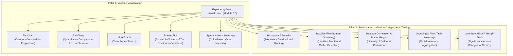
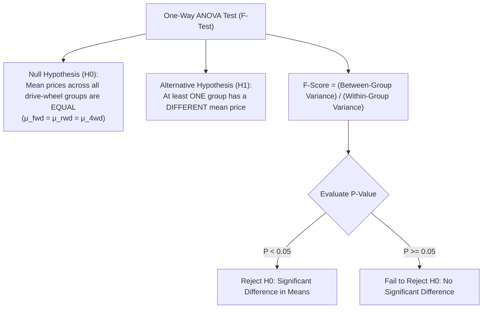

> **Module & Portal Compiler:** Mahendar Dwi Payana  
> **DTS 2021 Training Material Author:** Ari Wibisono, M.Kom (Universitas Indonesia)  
> **Organizer & Curriculum:** Thematic Academy Digital Talent Scholarship (DTS) 2021, Ministry of Communication and Information Technology RI (Kominfo)

---

## 1. Data Visualization Taxonomy: Variable vs. Statistical

Data visualization in data science is divided into two main pillars:



---

## 2. Pillar 1: Variable Visualization (Matplotlib & Seaborn)

### A. Pie Chart
A pie chart is used to display the proportional contribution of each category relative to the whole ($100\%$).
* **When It Is Effective**: When the number of categories is small ($3$ to $7$ classes).
* **When to Avoid**: If there are too many categories ($>10$ classes), the slices become very thin and confuse the reader (*visual clutter*).

```python
import matplotlib.pyplot as plt

flavors = ('Chocolate', 'Vanilla', 'Pistachio', 'Mango', 'Strawberry')
votes = (12, 11, 4, 8, 7)
colors = ('#8B4513', '#FFF8DC', '#93C572', '#E67F0D', '#D53032')
explode = (0, 0, 0, 0.1, 0)  # Highlight Mango slice by pulling it out 10%

plt.figure(figsize=(7, 7))
plt.title('Favorite Ice Cream Flavor Survey Results', fontsize=14, pad=15)
plt.pie(
    votes,
    labels=flavors,
    autopct='%1.1f%%',
    colors=colors,
    explode=explode,
    shadow=True,
    startangle=140
)
plt.show()
```

---

### B. Bar Chart
A bar chart is the best comparative visual instrument for comparing quantitative magnitudes across discrete categories. Bar charts can display dozens of categories far more clearly than pie charts.

```python
import matplotlib.pyplot as plt
import numpy as np
import pandas as pd

countries = ('Argentina', 'Bolivia', 'Brazil', 'Chile', 'Colombia', 'Ecuador',
             'Falkland Islands', 'French Guiana', 'Guyana', 'Paraguay', 'Peru',
             'Suriname', 'Uruguay', 'Venezuela')
populations = (45076704, 11626410, 212162757, 19109629, 50819826, 17579085,
               3481, 287750, 785409, 7107305, 32880332, 585169, 3470475, 28258770)

# Construct DataFrame & sort by population
df_pop = pd.DataFrame({'Country': countries, 'Population': populations})
df_pop.sort_values(by='Population', inplace=True)

# Conditional coloring: Highlight Colombia in red
colors = ['#0000FF' for _ in range(len(df_pop))]
colors[-2] = '#FF0000'  # Colombia is the 2nd most populous country

plt.figure(figsize=(12, 6))
plt.bar(df_pop['Country'], df_pop['Population'] / 1e6, color=colors)
plt.xticks(rotation=90)
plt.ylabel('Population (Millions)')
plt.title('Populations of South American Countries (Highlight: Colombia)')
plt.grid(axis='y', linestyle='--', alpha=0.7)
plt.tight_layout()
plt.show()
```

---

### C. Line Graph
A line graph illustrates continuous changes of a variable along an ordered axis (most often time or a process sequence). It is very useful for comparing actual value curves against model-predicted values.

```python
import matplotlib.pyplot as plt

hour = [0, 2, 4, 6, 8, 10, 12, 14, 16, 18, 20, 22, 24]
temp_actual = [2, 1, 0, 0, 1, 5, 8, 9, 8, 5, 3, 2, 2]
temp_predicted = [2, 2, 1, 0, 1, 3, 7, 8, 8, 6, 4, 3, 3]

plt.figure(figsize=(9, 5))
plt.plot(hour, temp_actual, marker='o', color='#1f77b4', label='Actual Temperature (°C)')
plt.plot(hour, temp_predicted, marker='x', linestyle='--', color='#ff7f0e', label='Model Predicted Temperature (°C)')
plt.title('Daily Temperature Fluctuation in Kirkland, WA, USA')
plt.xlabel('Hour (0 - 24)')
plt.ylabel('Temperature (°C)')
plt.legend()
plt.grid(True, linestyle=':', alpha=0.6)
plt.show()
```

---

### D. Scatter Plot
A scatter plot maps pairs of two continuous numeric variables $(x_i, y_i)$ to evaluate whether there is a functional relationship, natural clustering, or anomalies (*outliers*).

```python
import matplotlib.pyplot as plt

# Physical characteristics data of Lemon vs Lime
lemon_diam = [6.44, 6.87, 7.70, 8.85, 8.15, 9.96, 7.21, 10.04, 10.20, 11.06]
lemon_wt = [112.05, 114.58, 116.71, 117.40, 128.93, 132.93, 138.92, 145.98, 148.44, 152.81]

lime_diam = [6.15, 7.00, 7.00, 7.69, 7.95, 7.51, 10.46, 8.72, 9.53, 10.09]
lime_wt = [112.76, 125.16, 131.36, 132.41, 138.08, 142.55, 156.86, 158.67, 163.28, 166.74]

plt.figure(figsize=(8, 6))
plt.scatter(lemon_diam, lemon_wt, color='gold', edgecolor='black', s=80, label='Lemon (Yellow)')
plt.scatter(lime_diam, lime_wt, color='forestgreen', edgecolor='black', s=80, label='Lime (Green)')
plt.title('Physiological Characteristics Comparison: Lemon vs Lime')
plt.xlabel('Fruit Diameter (cm)')
plt.ylabel('Fruit Weight (grams)')
plt.legend()
plt.grid(True, linestyle='--', alpha=0.5)
plt.show()
```

---

### E. Heatmap (Matrix Heat Map)
A heatmap maps a two-dimensional table matrix into a color spectrum gradient. It is highly effective for examining cyclical temporal patterns and multivariable density.

```python
import seaborn as sns
import matplotlib.pyplot as plt

cities = ['New York', 'Beijing', 'Tokyo', 'Osaka', 'Shanghai', 'Cairo',
          'Delhi', 'Karachi', 'Dhaka', 'Mexico City', 'Mumbai', 'Sao Paulo']
months = ['Jan', 'Feb', 'Mar', 'Apr', 'May', 'Jun', 'Jul', 'Aug', 'Sep', 'Oct', 'Nov', 'Dec']

temperatures = [
    [4, 6, 11, 18, 22, 27, 29, 29, 25, 18, 13, 7],    # New York
    [2, 5, 12, 21, 27, 30, 31, 30, 26, 19, 10, 4],    # Beijing
    [10, 10, 14, 19, 23, 26, 30, 31, 27, 22, 17, 12], # Tokyo
    [9, 10, 14, 20, 25, 28, 32, 33, 29, 23, 18, 12],  # Osaka
    [8, 10, 14, 20, 24, 28, 32, 32, 27, 23, 17, 11],  # Shanghai
    [19, 21, 24, 29, 33, 35, 35, 35, 34, 30, 25, 21], # Cairo
    [20, 24, 30, 37, 40, 39, 35, 34, 34, 33, 28, 22], # Delhi
    [26, 28, 32, 35, 36, 35, 33, 32, 33, 35, 32, 28], # Karachi
    [25, 29, 32, 33, 33, 32, 32, 32, 32, 31, 29, 26], # Dhaka
    [22, 24, 26, 27, 27, 26, 24, 25, 24, 24, 23, 23], # Mexico City
    [31, 32, 33, 33, 34, 32, 30, 30, 31, 34, 34, 32], # Mumbai
    [29, 29, 28, 27, 23, 23, 23, 25, 25, 26, 27, 28], # Sao Paulo
]

plt.figure(figsize=(10, 7))
sns.heatmap(temperatures, yticklabels=cities, xticklabels=months, cmap='coolwarm', annot=True, fmt='d')
plt.title('Monthly Average Temperature Heatmap of 12 World Cities (°C)')
plt.show()
```

---

## 3. Pillar 2: Statistical Visualization & Inferential Testing

### A. Histogram & Determining Bin Width (*Binning*)
A histogram divides the range of a continuous variable into a number of discrete intervals (*bins*) and counts the frequency of data falling into each bin.
* **Bin Selection Tradeoff**:
  - If `bins` is too small (e.g., $2$), distributional information is lost (*under-smoothing*).
  - If `bins` is too large (e.g., $200$), the chart becomes jagged and filled with noise (*over-smoothing*).
  - A balanced standard value ranges between **$20$ and $30$ bins**.

```python
# Car price histogram with 30 bins
df['price'].hist(bins=30, color='#1f77b4', edgecolor='black', figsize=(9, 5))
plt.title('Car Price Frequency Distribution (automobileEDA.csv)')
plt.xlabel('Price ($)')
plt.ylabel('Frequency')
plt.grid(axis='x', alpha=0.3)
plt.show()
```

---

### B. Linear Correlation vs. Causation

> [!WARNING]
> **Correlation Is Not Causation**: The presence of a strong linear correlation ($r \approx 1$ or $r \approx -1$) only proves that two variables move together in the same or opposite direction, but it **DOES NOT PROVE** that the first variable causes changes in the second variable. Proving causality requires controlled experiments (*A/B Testing*) or instrumental variable analysis (*Econometrics*).

#### Evaluating Statistical Significance Levels (P-Value):
* $p < 0.001$: Very strong evidence that the correlation is statistically significant.
* $p < 0.05$: Moderate evidence that the correlation is significant.
* $p < 0.1$: Weak evidence.
* $p \ge 0.1$: No statistically significant evidence of correlation.

```python
from scipy import stats
import seaborn as sns
import matplotlib.pyplot as plt

# 1. Strong Positive Linear Correlation: engine-size vs price (r = 0.872, p < 0.001)
plt.figure(figsize=(8, 5))
sns.regplot(x="engine-size", y="price", data=df, scatter_kws={'color': '#1f77b4'}, line_kws={'color': 'red'})
plt.title('Strong Positive Linear Correlation: Engine Size vs Price (r = 0.87)')
plt.show()

# 2. Strong Negative Linear Correlation: highway-mpg vs price (r = -0.705, p < 0.001)
plt.figure(figsize=(8, 5))
sns.regplot(x="highway-mpg", y="price", data=df, scatter_kws={'color': '#2ca02c'}, line_kws={'color': 'red'})
plt.title('Strong Negative Linear Correlation: Highway MPG vs Price (r = -0.70)')
plt.show()

# 3. Weak Linear Relationship: peak-rpm vs price (r = -0.102, p = 0.15)
plt.figure(figsize=(8, 5))
sns.regplot(x="peak-rpm", y="price", data=df, scatter_kws={'color': '#7f7f7f'}, line_kws={'color': 'red'})
plt.title('Weak Linear Relationship: Peak RPM vs Price (Flat Line, r = -0.10)')
plt.show()
```

---

### C. Boxplot (Box-and-Whisker Plot) for Categorical Variables
A boxplot maps the statistical *Five-Number Summary*: minimum value, first quartile ($Q_1$), median ($Q_2$), third quartile ($Q_3$), maximum value, as well as *outlier* points.

```python
plt.figure(figsize=(10, 6))
sns.boxplot(x="body-style", y="price", data=df)
plt.title('Price Distribution by Car Body Style')
plt.xlabel('Body Style')
plt.ylabel('Price ($)')
plt.show()
```

---

### D. Grouping, Pivot Table, and Aggregation Heatmap Visualization
Multidimensional aggregation enables data to be grouped by two categorical variables simultaneously, then transformed into a pivot table matrix:

```python
# 1. Group by drive-wheels and body-style
df_gptest = df[['drive-wheels', 'body-style', 'price']]
grouped_test1 = df_gptest.groupby(['drive-wheels', 'body-style'], as_index=False).mean()

# 2. Transform into a 2D Pivot Table
grouped_pivot = grouped_test1.pivot(index='drive-wheels', columns='body-style', values='price')
grouped_pivot = grouped_pivot.fillna(0)  # Fill combinations with no data samples

# 3. Pivot Heatmap Visualization
plt.figure(figsize=(10, 6))
sns.heatmap(grouped_pivot, cmap='RdBu_r', annot=True, fmt='.0f', cbar_kws={'label': 'Average Price ($)'})
plt.title('Average Car Price Heatmap: Drive Wheels vs Body Style')
plt.show()
```

---

### E. One-Way Analysis of Variance (One-Way ANOVA)

ANOVA (*Analysis of Variance*) is a parametric hypothesis testing method used to test whether there is a statistically significant difference in means across **three or more categorical groups**.



#### ANOVA Computation on the Automobile Dataset:

```python
from scipy import stats

# Group prices by drive-wheels system
grouped_test2 = df[['drive-wheels', 'price']].groupby(['drive-wheels'])

# 1. Combined ANOVA Test for All Three Groups (fwd, rwd, 4wd)
f_val, p_val = stats.f_oneway(
    grouped_test2.get_group('fwd')['price'],
    grouped_test2.get_group('rwd')['price'],
    grouped_test2.get_group('4wd')['price']
)
print(f"Total ANOVA Result (fwd, rwd, 4wd) : F-Score = {f_val:.4f}, P-Value = {p_val:.4e}")
# Output: F = 67.9541, P = 3.3945e-23 (Highly Significant!)

# 2. Pairwise Test: fwd vs rwd
f_val_fr, p_val_fr = stats.f_oneway(
    grouped_test2.get_group('fwd')['price'],
    grouped_test2.get_group('rwd')['price']
)
print(f"Pairwise ANOVA (fwd vs rwd)       : F-Score = {f_val_fr:.4f}, P-Value = {p_val_fr:.4e}")
# Output: F = 130.5533, P = 2.2355e-23 (Extreme Difference!)

# 3. Pairwise Test: 4wd vs fwd
f_val_4f, p_val_4f = stats.f_oneway(
    grouped_test2.get_group('4wd')['price'],
    grouped_test2.get_group('fwd')['price']
)
print(f"Pairwise ANOVA (4wd vs fwd)       : F-Score = {f_val_4f:.4f}, P-Value = {p_val_4f:.4f}")
# Output: F = 0.6655, P = 0.4162 (P >= 0.05 -> NOT SIGNIFICANT!)
```

> [!IMPORTANT]
> **Automotive Inferential Analysis Conclusion**:
> Although the overall ANOVA test shows $F = 67.95$ ($P < 0.001$), pairwise testing proves that the statistically significant price difference **only occurs between RWD vs. FWD cars** ($F = 130.55$). Conversely, **4WD and FWD cars have prices that do not differ significantly** ($P = 0.4162 > 0.05$).

---

## 4. Case Studies & Official Independent Exercise Solutions

Below are the complete implementations and analytical discussions for 5 practical exercises referenced from the notebook [`05124873011-3.ipynb`](https://github.com/mahendartea/Learn-AI/blob/main/05124873011-3.ipynb):

### Exercise 1: Bitcoin Price Trend Analysis (2018 vs. 2019)
* **Problem**: Compare 52 weeks of Bitcoin closing prices in 2018 and 2019 to determine which year delivered better returns for investors.
* **Selected Visualization Type**: **Dual Line Graph**.
* **Reason for Selection**: A line graph optimally displays sequential temporal movement (*momentum*) from week to week.

```python
import matplotlib.pyplot as plt
import numpy as np

# 52 weeks of Bitcoin price data for 2018 and 2019
weeks = np.arange(1, 53)
prices_2018 = [14292.2, 12858.9, 11467.5, 9241.1, 8559.6, 11073.5, 9704.3, 11402.3,
               8762.0, 7874.9, 8547.4, 6938.2, 6905.7, 8004.4, 8923.1, 9352.4,
               9853.5, 8459.5, 8245.1, 7361.3, 7646.6, 7515.8, 6505.8, 6167.3,
               6398.9, 6765.5, 6254.8, 7408.7, 8234.1, 7014.3, 6231.6, 6379.1,
               6734.8, 7189.6, 6184.3, 6519.0, 6729.6, 6603.9, 6596.3, 6321.7,
               6572.2, 6494.2, 6386.2, 6427.1, 5621.8, 3920.4, 4196.2, 3430.4,
               3228.7, 3964.4, 3706.8, 3785.4]

prices_2019 = [3597.2, 3677.8, 3570.9, 3502.5, 3661.4, 3616.8, 4120.4, 3823.1,
               3944.3, 4006.4, 4002.5, 4111.8, 5046.2, 5051.8, 5290.2, 5265.9,
               5830.9, 7190.3, 7262.6, 8027.4, 8545.7, 7901.4, 8812.5, 10721.7,
               11906.5, 11268.0, 11364.9, 10826.7, 9492.1, 10815.7, 11314.5, 10218.1,
               10131.0, 9594.4, 10461.1, 10337.3, 9993.0, 8208.5, 8127.3, 8304.4,
               7957.3, 9230.6, 9300.6, 8804.5, 8497.3, 7324.1, 7546.6, 7510.9,
               7080.8, 7156.2, 7321.5, 7376.8]

plt.figure(figsize=(12, 6))
plt.plot(weeks, prices_2018, color='blue', label='Year 2018 (Bearish)')
plt.plot(weeks, prices_2019, color='red', alpha=0.8, label='Year 2019 (Bullish Recovery)')
plt.title('Weekly Bitcoin Price Performance Comparison (2018 vs 2019)')
plt.xlabel('Week Number')
plt.ylabel('Closing Price ($)')
plt.legend()
plt.grid(True, linestyle='--', alpha=0.5)
plt.show()
```

* **Analytical Conclusion**: Year **2019 delivered far better returns** for investors because Bitcoin experienced a positive growth trend from around \$3,500 up to its peak in week 24 (\>\$11,900). In contrast, 2018 was a prolonged downturn (*bear market*) where the price plunged from \$14,000 to \$3,700.

---

### Exercise 2: Candy Distribution & Snickers Probability
* **Problem**: Calculate the percentage probability of randomly picking a Snickers candy from a bag containing 5 candy brands.
* **Selected Visualization Type**: **Pie Chart**.

```python
candy_names = ['Kit Kat', 'Snickers', 'Milky Way', 'Toblerone', 'Twix']
candy_counts = [52, 39, 78, 13, 78]
total_candies = sum(candy_counts)

# Snickers probability: 39 / 260 = 0.15 (15%)
explode = [0, 0.15, 0, 0, 0]  # Highlight Snickers
colors = ['#FF9999', '#66B2FF', '#99FF99', '#FFCC99', '#D1C4E9']

plt.figure(figsize=(7, 7))
plt.pie(
    candy_counts,
    labels=candy_names,
    autopct='%1.1f%%',
    explode=explode,
    colors=colors,
    shadow=True,
    startangle=90
)
plt.title('Candy Share Distribution in the Bag')
plt.show()
print(f"Probability of picking a Snickers candy: {candy_counts[1] / total_candies * 100:.1f}%")
```

---

### Exercise 3: Eliminating the Worst-Performing Dessert Menu Items (Dessert Sales)
* **Problem**: Identify the 3 lowest-selling dessert menu items in a week to remove from the restaurant menu.
* **Selected Visualization Type**: **Sorted Horizontal Bar Chart**.

```python
dessert_sales = {
    'Lava Cake': 14, 'Mousse': 5, 'Chocolate Cake': 12, 'Ice Cream': 19,
    'Truffles': 6, 'Brownie': 8, 'Chocolate Chip Cookie': 12, 'Chocolate Pudding': 9,
    'Souffle': 10, 'Chocolate Cheesecake': 17, 'Chocolate Chips': 2, 'Fudge': 9, 'Mochi': 13
}

# Convert and sort data
s_desserts = pd.Series(dessert_sales).sort_values(ascending=True)

# Highlight the 3 lowest items in red
colors = ['#D9534F' if i < 3 else '#5BC0DE' for i in range(len(s_desserts))]

plt.figure(figsize=(10, 6))
plt.barh(s_desserts.index, s_desserts.values, color=colors)
plt.title('Weekly Dessert Sales Ranking (Eliminate Bottom 3)')
plt.xlabel('Quantity Sold (Servings)')
plt.grid(axis='x', linestyle='--', alpha=0.6)
plt.show()

print("Three desserts recommended for removal from the menu:")
for item, count in s_desserts.head(3).items():
    print(f"- {item}: only {count} servings sold")
```

* **Decision Recommendation**: The three menu items to remove are **Chocolate Chips** ($2$ servings), **Mousse** ($5$ servings), and **Truffles** ($6$ servings).

---

### Exercise 4: Employee Computer Workload Profiling (CPU Usage)
* **Problem**: Analyze a $7 \times 24$-hour CPU load matrix to detect lunch break hours, late-night overtime habits, and weekend activity.
* **Selected Visualization Type**: **2D Heatmap**.

```python
import seaborn as sns
import matplotlib.pyplot as plt
import pandas as pd

days = ['Monday', 'Tuesday', 'Wednesday', 'Thursday', 'Friday', 'Saturday', 'Sunday']
cpu_usage = [
    [2, 2, 4, 2, 4, 1, 1, 4, 4, 12, 22, 23, 45, 9, 33, 56, 23, 40, 21, 6, 6, 2, 2, 3],       # Monday
    [1, 2, 3, 2, 3, 2, 3, 2, 7, 22, 45, 44, 33, 9, 23, 19, 33, 56, 12, 2, 3, 1, 2, 2],       # Tuesday
    [2, 3, 1, 2, 4, 4, 2, 2, 1, 2, 5, 31, 54, 7, 6, 34, 68, 34, 49, 6, 6, 2, 2, 3],          # Wednesday
    [1, 2, 3, 2, 4, 1, 2, 4, 1, 17, 24, 18, 41, 3, 44, 42, 12, 36, 41, 2, 2, 4, 2, 4],       # Thursday
    [4, 1, 2, 2, 3, 2, 5, 1, 2, 12, 33, 27, 43, 8, 38, 53, 29, 45, 39, 3, 1, 1, 3, 4],       # Friday
    [2, 3, 1, 2, 2, 5, 2, 8, 4, 2, 3, 1, 5, 1, 2, 3, 2, 6, 1, 2, 2, 1, 4, 3],                # Saturday
    [1, 2, 3, 1, 1, 3, 4, 2, 3, 1, 2, 2, 5, 3, 2, 1, 4, 2, 45, 26, 33, 2, 2, 1]              # Sunday
]

plt.figure(figsize=(14, 6))
sns.heatmap(cpu_usage, yticklabels=days, xticklabels=range(24), cmap='magma', annot=True, fmt='d')
plt.title('Employee CPU Workload Utilization Heatmap (7 Days x 24 Hours)')
plt.xlabel('Hour of Day (0 - 23)')
plt.ylabel('Day')
plt.show()
```

* **Investigation Answers**:
  1. **Lunch Break Hour**: Detected at **13:00 (1:00 PM)**, where CPU utilization across all workdays (Monday through Friday) drops sharply to $3\% - 9\%$.
  2. **Weekend Activity**: Employees **do not work on weekends**; Saturday CPU load averages only $1\% - 8\%$.
  3. **Evening Overtime**: Occurs on **Wednesday evening** (17:00–19:00 CPU reaches $49\% - 68\%$), **Tuesday evening** (17:00 reaches $56\%$), and there is preparation activity on **Sunday evening** at 18:00 ($45\%$).

---

### Exercise 5: Estimating the Center Point of a Mushroom Ring (Fairy Ring)
* **Problem**: Estimate the center coordinate point of a mushroom colony growing outward in a ring from observed spatial coordinates.
* **Selected Visualization Type**: **2D Scatter Plot**.

```python
import matplotlib.pyplot as plt
import numpy as np

x = [4.61, 5.08, 5.18, 7.82, 10.46, 7.66, 7.6, 9.32, 14.04, 9.95, 4.95, 7.23, 
     5.21, 8.64, 10.08, 8.32, 12.83, 7.51, 7.82, 6.29, 0.04, 6.62, 13.16, 6.34, 
     0.09, 10.04, 13.06, 9.54, 11.32, 7.12, -0.67, 10.5, 8.37, 7.24, 9.18, 
     10.12, 12.29, 8.53, 11.11, 9.65, 9.42, 8.61, -0.67, 5.94, 6.49, 7.57, 3.11,
     8.7, 5.28, 8.28, 9.55, 8.33, 13.7, 6.65, 2.4, 3.54, 9.19, 7.51, -0.68,
     8.47, 14.82, 5.31, 14.01, 8.75, -0.57, 5.35, 10.51, 3.11, -0.26, 5.74,
     8.33, 6.5, 13.85, 9.78, 4.91, 4.19, 14.8, 10.04, 13.47, 3.28]

y = [-2.36, -3.41, 13.01, -2.91, -2.28, 12.83, 13.13, 11.94, 0.93, -2.76, 13.31,
     -3.57, -2.33, 12.43, -1.83, 12.32, -0.42, -3.08, -2.98, 12.46, 8.34, -3.19,
     -0.47, 12.78, 2.12, -2.72, 10.64, 11.98, 12.21, 12.52, 5.53, 11.72, 12.91,
     12.56, -2.49, 12.08, -1.09, -2.89, -1.78, -2.47, 12.77, 12.41, 5.33, -3.23,
     13.45, -3.41, 12.46, 12.1, -2.56, 12.51, -2.37, 12.76, 9.69, 12.59, -1.12,
     -2.8, 12.94, -3.55, 7.33, 12.59, 2.92, 12.7, 0.5, 12.57, 6.39, 12.84,
     -1.95, 11.76, 6.82, 12.44, 13.28, -3.46, 0.7, -2.55, -2.37, 12.48, 7.26,
     -2.45, 0.31, -2.51]

# Estimate the center of the ring using the mean of coordinates
center_x = np.mean(x)
center_y = np.mean(y)

plt.figure(figsize=(8, 8))
plt.scatter(x, y, color='forestgreen', alpha=0.7, label='Mushroom Points')
plt.scatter([center_x], [center_y], color='red', marker='X', s=200, label=f'Estimated Center ({center_x:.2f}, {center_y:.2f})')
plt.title('Fairy Ring Spatial Distribution & Growth Center Estimate')
plt.xlabel('X Coordinate')
plt.ylabel('Y Coordinate')
plt.legend()
plt.grid(True, linestyle=':', alpha=0.6)
plt.axis('equal')
plt.show()
```

* **Estimated Answer**: The center coordinate of the mushroom colony growth is around $(\bar{x}, \bar{y}) \approx (7.50, 4.98)$.

---

## 5. Literature References & DTS Kominfo Modules

1. **Ari Wibisono, M.Kom (Universitas Indonesia)**. *Training Module Material: Data Understanding 2 (Visualization)*. Thematic Academy Digital Talent Scholarship 2021, Ministry of Communication and Information Technology RI.
2. **Cognitive Class**. *Data Analysis with Python (Course Number: DA0101EN)*. IBM Developer Skills Network.
3. **John W. Tukey**. *Exploratory Data Analysis*. Addison-Wesley, 1977.
4. **Matplotlib Development Team**. *Matplotlib: Visualization with Python*. https://matplotlib.org/
5. **Michael Waskom**. *Seaborn: Statistical Data Visualization*. Journal of Open Source Software, 2021.
