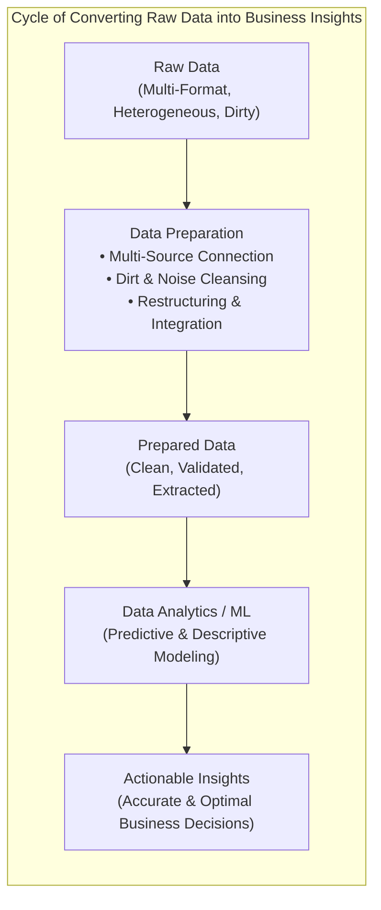
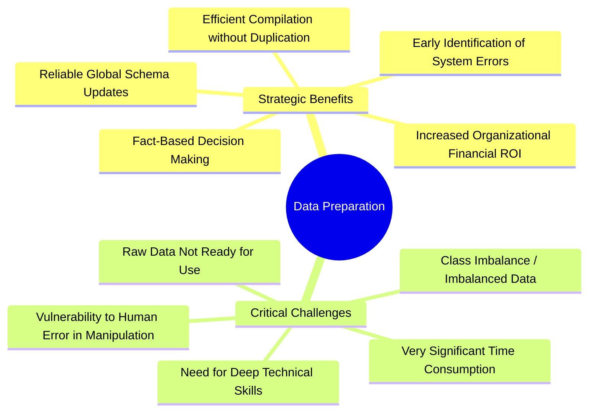
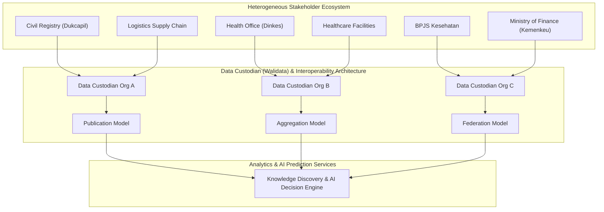
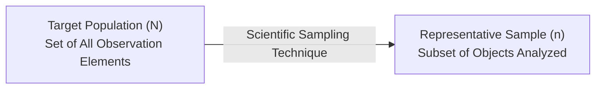
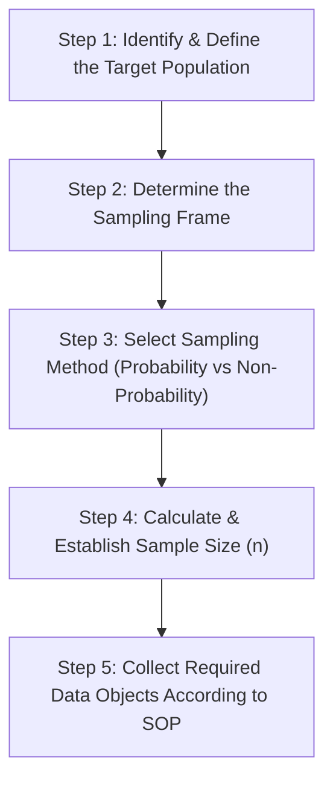
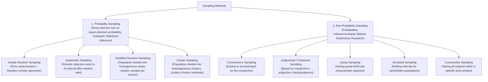
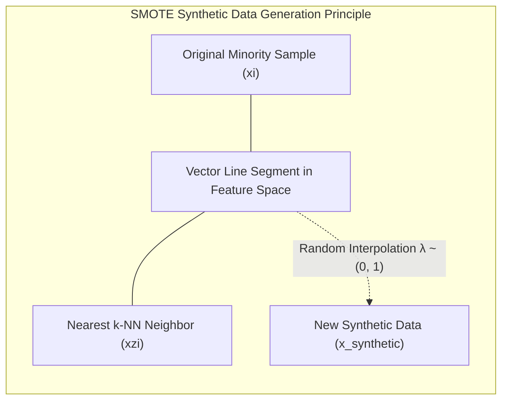

import { Accordion, Accordions } from 'fumadocs-ui/components/accordion';
import { Callout } from 'fumadocs-ui/components/callout';
import { Tab, Tabs } from 'fumadocs-ui/components/tabs';

> **Module & Portal Compiler:** Mahendar Dwi Payana  
> **DTS 2021 Training Material Authors:** Dr. rer. nat. I Made Wiryana, S.Kom., S.Si., MAppSc, Dr. Miftah Andriansyah, and Dr. Astie Darmayantie (Universitas Gunadarma)  
> **Organizer & Curriculum:** Thematic Academy Digital Talent Scholarship (DTS) 2021, Ministry of Communication and Information Technology RI (Kominfo)

---

## 1. Position of Data Preparation in CRISP-DM & Industry Reality

### A. Terminology & Operational Definitions
In international data science literature, data preparation has several complementary equivalent terms:
* **Data Pre-processing**: The initial sequence of steps to transform unstructured raw data into a structured format ready to be consumed by analytical algorithms.
* **Data Manipulation**: Row filtering operations, sorting, merging/joining, hierarchical restructuring (*pivoting/melting*), and creating new attributes.
* **Data Cleansing / Normalization**: The process of identifying, correcting, or eliminating corrupt, inaccurate, incomplete data, or data whose format conflicts with domain standards.



### B. Industry Fact: 60–80% Share of a Data Scientist's Work
Based on global market research by **Forbes & CrowdFlower (2016)** and the **Aberdeen Group** study:
* Data scientists spend **60% to 80% of their time and energy** solely collecting, cleaning, and organizing data.
* **65% of enterprise organizations** state that simplifying access and providing quality data is the most important analytics initiative.
* **Primary industry data preparation activities**:
  1. *Ensuring quality of data* (68%)
  2. *Extracting data from sources* (63%)
  3. *Establishing governance & security* (61%)
  4. *Accessing data for integration* (51%)
* **GIGO Principle (*Garbage In, Garbage Out*)**: No matter how sophisticated the *Deep Learning* model architecture or *Gradient Boosting* algorithm used, if the input data is flawed (*noisy*, biased, inconsistent), the prediction results will inevitably mislead and jeopardize organizational strategic decisions.

### C. Strategic Benefits vs. Challenges of Data Preparation



---

## 2. Multi-Source Data Governance & Interoperability

In national-scale or large corporate implementations, data science data does not come from a single file, but is distributed across various agencies or work units (*stakeholders*).



### A. Three Levels of Data Integration
1. **Presentation Integration**: Integration occurs at the *User Interface* layer. There is no direct logical interconnection between databases; it merely displays snippets from various applications on a single *dashboard* screen.
2. **Data Integration (Database Level)**: Performed directly on physical database schemas. Data exchange is facilitated using standard metadata, XML/JSON schemas, and schema translators (**XSD & XSLT Translation**). If the data model changes, the integration rules must be adjusted accordingly.
3. **Functional Integration**: Integration is performed at the *Business Logic / Service Layer* through REST API interfaces, Message Queues, or *Microservices* architectures.

### B. Relational Databases vs. Knowledge Ontologies
In the context of intelligent data exchange, data practitioners distinguish two storage paradigms:

| Comparison Parameter | Relational Database (RDBMS) | Ontology-Based System (Semantic Web) |
| :--- | :--- | :--- |
| **World Assumption** | **Closed World Assumption (CWA)**: Information not recorded in a table is considered *false*. | **Open World Assumption (OWA)**: Information not yet recorded is considered *unknown*, not false. |
| **Primary Focus** | Tabular data storage, transaction efficiency, and referential integrity. | Capturing semantic meaning (*meaning/context*) and relationships between knowledge entities. |
| **Integrity Enforcement** | Rigid *constraints* (*Foreign Key*, *Unique*, *Check Constraints*) that often hide conceptual meaning. | Declarative *Ontology Axioms* that express domain rules explicitly. |
| **Hierarchical Structure** | Rarely uses natural taxonomic hierarchies. | The `is-a` subsumption relation hierarchy (*ISA Hierarchy*) serves as the main backbone. |
| **Interoperability** | Table schemas are local; cross-system integration requires manual mappings that are fragile. | URI/RDF-based schemas are global, *reusable*, and support automated inference. |

---

## 3. Data Object Selection & Scientific Sampling Methodology

Before executing code manipulation, a data analyst must determine population boundaries and sampling techniques to ensure that the selected data objects truly represent the phenomenon under study.



### A. Concepts of Population & Sample
* **Population**: A generalization area consisting of objects/subjects that possess certain quantities and characteristics determined by the researcher to be studied and from which conclusions are drawn (Sugiyono, 2011; Supardi, 1993).
  * *Finite Population*: The number of population members can be counted precisely (e.g., 1,000 employees of Company X, 34 provinces in Indonesia).
  * *Infinite Population*: The number of members is unlimited or cannot be counted exactly (e.g., number of grains of sand on a beach, number of future web user clicks).
* **Sample**: A portion of the quantity and characteristics possessed by the population that serves as a representative proxy for the entire population.

### B. Five Stages of the Formal Sampling Process


### C. Taxonomy of Sampling Methods



#### Comprehensive Comparison of Probability vs. Non-Probability Sampling:

| Evaluation Dimension | Probability Sampling | Non-Probability Sampling |
| :--- | :--- | :--- |
| **Randomness** | Strictly random (*Randomized mechanism*). | Non-random (*Non-random mechanism*). |
| **Population Representation** | Highly representative; *unbiased* estimates. | Tends to be *biased*; reflects accessibility preferences. |
| **Analytical Goal** | Parametric inference and conclusive quantitative hypothesis testing. | Exploratory studies, qualitative research, *Focus Group Discussions* (FGD). |
| **Result Generalization** | Validly generalized to the entire target population. | Limited to observed subjects; cannot be fully generalized. |
| **Information Requirement** | Requires a complete *Sampling Frame* of all population members. | Does not require a complete sampling frame. |

---

## 4. Handling Class Imbalance (Imbalanced Dataset) & Resampling

In real-world applications, target class distributions are often extremely asymmetric:
* **Banking Fraud Detection**: Fraudulent transactions are generally less than $0.1\%$ to $1\%$ of millions of daily transactions.
* **Rare Cancer Diagnosis**: Positive cases represent only a tiny fraction of thousands of screened patients.
* **Cyber Network Intrusion Detection**: Cyberattack packets are minority anomalies amid normal traffic.

### A. The Danger of the Accuracy Paradox
If a dataset has $99.8\%$ legitimate transactions and $0.2\%$ fraudulent transactions, a naive model that always predicts "Legitimate Transaction" will achieve an accuracy of:

$$
\text{Accuracy} = \frac{998}{1000} = 99.8\%
$$

Although the accuracy looks spectacular on paper, the model has **0% operational effectiveness** because it fails to detect a single fraud case.

### B. Appropriate Evaluation Metrics for Imbalanced Data
Therefore, model evaluation on imbalanced datasets **must** use asymmetric metrics:
1. **Recall / Sensitivity**: Measures the proportion of actual positive cases successfully detected:
   $$
   \text{Recall} = \frac{TP}{TP + FN}
   $$
2. **Precision**: Measures the proportion of positive predictions that are truly accurate:
   $$
   \text{Precision} = \frac{TP}{TP + FP}
   $$
3. **F1-Score**: The harmonic mean of Precision and Recall:
   $$
   F_1 = 2 \times \frac{\text{Precision} \times \text{Recall}}{\text{Precision} + \text{Recall}} = \frac{2TP}{2TP + FP + FN}
   $$
4. **Matthews Correlation Coefficient (MCC)**: The most objective correlation metric for imbalanced binary classification:
   $$
   \text{MCC} = \frac{(TP \times TN) - (FP \times FN)}{\sqrt{(TP + FP)(TP + FN)(TN + FP)(TN + FN)}}
   $$
   *MCC ranges over $[-1, 1]$, where $+1$ represents perfect prediction, $0$ random, and $-1$ total disagreement.*

### C. Three Data Resampling Techniques
1. **Undersampling (Bootstrap)**: Randomly reduces the number of samples in the *majority class* until its proportion matches the minority class.
   * *Advantage*: Speeds up model training time.
   * *Disadvantage*: Risks discarding valuable information from the majority class.
2. **Oversampling (Bootstrap / Random)**: Duplicates observed samples in the *minority class* *with replacement*.
   * *Advantage*: Preserves all dataset information.
   * *Disadvantage*: Prone to triggering *overfitting* because the model memorizes identical duplicate records.
3. **Synthetic Minority Over-sampling Technique (SMOTE)**:
   Introduced by **Nitesh V. Chawla et al. (2002)**. Rather than duplicating existing records, SMOTE generates **new synthetic data** in *feature space* using interpolation between a minority sample $x_i$ and its nearest neighbor ($k$-NN):

$$
x_{\text{synthetic}} = x_i + \lambda \times (x_{zi} - x_i), \quad \lambda \sim U(0, 1)
$$



---

## 5. Feature Selection & Data Types

Feature selection is the systematic process of choosing the subset of predictor variables that contribute most to the target variable, while eliminating redundant or *noisy* attributes.

### A. Three Main Benefits of Feature Selection
1. **Reduces Overfitting**: The fewer irrelevant attributes there are, the less likely the algorithm is to learn random *noise* as genuine patterns.
2. **Improves Accuracy & Predictive Power**: Removing *misleading features* produces a cleaner *decision boundary*.
3. **Shortens Training & Computation Time**: Lowering data dimensionality accelerates optimization convergence and saves RAM allocation.

### B. Taxonomy of Feature Selection Approaches
* **Unsupervised Feature Selection**: Ignores the target variable; filters features based on internal correlation among predictors or low-variance thresholds.
* **Supervised Feature Selection**: Evaluates the direct association between each predictor feature and the target variable:
  1. *Filter Methods*: Ranks features using univariate statistical tests (e.g., Chi-Square $\chi^2$, ANOVA $F$-test, Mutual Information).
  2. *Embedded Methods*: Features are selected intrinsically while training tree-based algorithms (e.g., *Feature Importance* from `ExtraTreesClassifier` or `RandomForestClassifier`).
  3. *Wrapper Methods*: Recursively evaluates feature subset combinations (e.g., *Recursive Feature Elimination / RFE*).

---

## 6. Data Validation vs. Data Verification

Many beginners equate verification and validation. In engineering and data science standards, the two have very different orientations:

| Parameter | Data Verification | Data Validation |
| :--- | :--- | :--- |
| **Core Question** | *Was the data built and collected according to established rules/procedures?* | *Is the collected data accurate, meaningful, and able to answer business analytical needs?* |
| **Evaluation Criteria** | **True vs. False**. | **Strong vs. Weak**. |
| **Work Focus** | Administrative documentation, format compliance, physical file checks (e.g., ID card/registration form completeness). | Substantive checks, measurement instrument reliability, bias detection, real-world sample representation. |
| **Nature of Testing** | Follows internal organizational standard operating procedures. | Tests empirical alignment against objective field phenomena. |

### Checklist of 8 Critical Data Quality Validation Aspects
1. **Data Type**: Ensuring columns are typed as integer, float, datetime, or string as needed (e.g., price and year must not remain stored as `object`).
2. **Data Range**: Identifying biologically or logically impossible values (e.g., `Age = 222` or `Salary = -10`).
3. **Uniqueness**: Ensuring primary identity attributes are unique without repetition (e.g., Postal Code, Employee ID, Book ISBN).
4. **Expression Consistency**: Standardizing abbreviations in writing (e.g., `"Jalan"`, `"Jl."`, and `"Jln."`).
5. **Date Formatting**: Resolving day and month formatting ambiguities (e.g., ISO standard `YYYY-MM-DD` vs `DD-MM-YYYY`).
6. **Missing Values / Nulls**: Identifying the percentage of empty values and documenting the reasons and handling strategies.
7. **Misspelling / Typo**: Detecting string spelling variations (e.g., `"Jakarta Selatn"` vs `"Jakarta Selatan"`).
8. **Domain Validity**: Verifying categorical value compliance with official rules (e.g., in Indonesia, official religion options are limited to 6, ID card gender options to 2).

### Standard Parameters for a Data Cleaning Documentation Report
A formal data cleaning and validation report must include:
1. *Dataset Description & Source*: Origin, acquisition date, and initial data structure.
2. *Identified Noise & Anomalies*: Breakdown of duplicate row counts, percentage of null values per column, inconsistent formats, and *outlier* data.
3. *Remediation Techniques Applied*: Specific methods chosen (mean/median imputation, regex string interpolation, index transformation, column removal).
4. *Irrecoverable Attributes / Records*: Rational justification for why certain records or columns had to be permanently deleted.
5. *Post-Cleansing Data Verification*: Comparative evaluation of table dimensions (*before vs after*), inspection of updated data types, and integrity confirmation.

---

## 7. Integrated Python Lab & Real Dataset Implementation

<Callout type="info" title="Download Official Module 8 Practice Datasets">
All official dataset files used in this module are available locally on the Learn AI portal:
1. **Mobile Price Classification Dataset:** <DataLink file="mobile_price_train.csv"><code>mobile_price_train.csv</code></DataLink> *(20 Specification Features & Price Class)*
2. **British Library Dataset:** <DataLink file="BL-Flickr-Images-Book.csv"><code>BL-Flickr-Images-Book.csv</code></DataLink> *(19th-Century Book Metadata Collection)*
3. **US University Towns Dataset:** <DataLink file="university_towns.txt"><code>university_towns.txt</code></DataLink> *(Hierarchical State-Town Text Data)*
4. **Olympics Medal Dataset:** <DataLink file="olympics.csv"><code>olympics.csv</code></DataLink> *(Winter & Summer Medal Data)*
</Callout>

---

### Hands-on Part I: Three Feature Selection Techniques (`mobile_price_train.csv`)

Uses the mobile device specification dataset (*Mobile Price Classification*) to predict `price_range` (scale 0: low cost up to 3: very expensive).

```python
import pandas as pd
import numpy as np
import matplotlib.pyplot as plt
import seaborn as sns
from sklearn.feature_selection import SelectKBest, chi2
from sklearn.ensemble import ExtraTreesClassifier

# 1. Load Mobile Price dataset
url_mobile = "https://mahendartea.github.io/Learn-AI/data/mobile_price_train.csv"
data = pd.read_csv(url_mobile)

print(f"Initial Dataset Dimensions: {data.shape[0]} rows, {data.shape[1]} columns")

# Separate Independent Features (X) and Dependent Target (y)
X = data.iloc[:, 0:20]  # Columns 0 through 19
y = data.iloc[:, -1]    # Last column: price_range

# ==========================================================
# METHOD 1: UNIVARIATE SELECTION (Chi-Square Statistic)
# ==========================================================
# Chi-Square requires all values to be non-negative
bestfeatures = SelectKBest(score_func=chi2, k=10)
fit = bestfeatures.fit(X, y)

dfscores = pd.DataFrame(fit.scores_)
dfcolumns = pd.DataFrame(X.columns)

# Combine feature scores into a clean DataFrame
featureScores = pd.concat([dfcolumns, dfscores], axis=1)
featureScores.columns = ['Feature_Spec', 'Chi2_Score']

print("\n=== TOP 10 BEST FEATURES (UNIVARIATE CHI-SQUARE) ===")
top_chi2 = featureScores.nlargest(10, 'Chi2_Score')
print(top_chi2.to_string(index=False))

# ==========================================================
# METHOD 2: FEATURE IMPORTANCE (Extra Trees Classifier)
# ==========================================================
model_trees = ExtraTreesClassifier(n_estimators=100, random_state=42)
model_trees.fit(X, y)

feat_importances = pd.Series(model_trees.feature_importances_, index=X.columns)

plt.figure(figsize=(10, 6))
feat_importances.nlargest(10).plot(kind='barh', color='#2563eb', edgecolor='black')
plt.title("Top 10 Most Important Features Based on Extra Trees Classifier", fontsize=12, fontweight='bold')
plt.xlabel("Relative Importance Score")
plt.ylabel("Specification Feature")
plt.gca().invert_yaxis()
plt.grid(axis='x', linestyle='--', alpha=0.6)
plt.tight_layout()
plt.show()

# ==========================================================
# METHOD 3: CORRELATION MATRIX WITH SEABORN HEATMAP
# ==========================================================
# Compute Pearson correlation matrix
corrmat = data.corr()
top_corr_features = corrmat.index

plt.figure(figsize=(16, 14))
sns.heatmap(
    data[top_corr_features].corr(),
    annot=True,
    fmt=".2f",
    cmap="RdYlGn",
    linewidths=0.5,
    cbar_kws={'label': 'Pearson Correlation Coefficient (r)'}
)
plt.title("Correlation Heatmap of Mobile Specs vs Price Range", fontsize=14, fontweight='bold')
plt.tight_layout()
plt.show()

# Specific Examination of Feature Relationships with price_range:
corr_target = corrmat['price_range'].sort_values(ascending=False)
print("\n=== FEATURE CORRELATION WITH PRICE (price_range) ===")
print(corr_target)
```

> **Key Feature Selection Lab Findings:**
> 1. **RAM Is the Absolute Determinant**: Across all three methods, the `ram` feature consistently emerges as the strongest predictor ($\chi^2$ score $= 931,267.52$, *Relative Importance* $\approx 40\%$, and correlation $r = +0.92$).
> 2. **Battery & Display Support**: The next most influential variables are `battery_power` ($r = 0.20$), `px_width` ($r = 0.17$), and `px_height` ($r = 0.15$).
> 3. **Weak/Redundant Features**: Features such as `clock_speed` ($r = -0.006$), `m_dep` ($r = 0.0008$), and `n_cores` ($r = 0.004$) have near-zero correlation and can be removed to speed up computation without sacrificing model accuracy.

---

### Hands-on Part II: Complex Data Cleaning

Below are cleaning case studies on three *messy data* formats in accordance with the module:

#### Case Study 1: British Library Book Collection (`BL-Flickr-Images-Book.csv`)
Challenges: Many empty library metadata columns, arbitrary numeric indices, publication years mixed with square brackets (e.g., `1879 [1878]`), and inconsistent formatting of publisher city names.

```python
import pandas as pd
import numpy as np

# 1. Read the book dataset
url_books = "https://mahendartea.github.io/Learn-AI/data/BL-Flickr-Images-Book.csv"
df = pd.read_csv(url_books)
print("Initial British Library Dimensions:", df.shape)

# 2. Drop unnecessary metadata columns
to_drop = [
    'Edition Statement',
    'Corporate Author',
    'Corporate Contributors',
    'Former owner',
    'Engraver',
    'Contributors',
    'Issuance type',
    'Shelfmarks'
]
df.drop(columns=to_drop, inplace=True)
print("Dimensions After Dropping Columns:", df.shape)

# 3. Set Index Using Unique Identifier
print("Is the Identifier column unique?", df['Identifier'].is_unique) # True
df.set_index('Identifier', inplace=True)

# Access row using Label-based Indexing (.loc):
print("\nSample Book Record ID 206:")
print(df.loc[206][['Place of Publication', 'Date of Publication', 'Title', 'Author']])

# 4. Clean Date of Publication Column with Regex
# Pattern: ^(\d{4}) -> 4 digits at the beginning of the string
extr = df['Date of Publication'].str.extract(r'^(\d{4})', expand=False)
df['Date of Publication'] = pd.to_numeric(extr)
print("\nPercentage of Missing Dates Post-Extraction:", df['Date of Publication'].isnull().mean().round(4))

# 5. Clean Place of Publication Column with np.where
pub = df['Place of Publication']
london = pub.str.contains('London')
oxford = pub.str.contains('Oxford')

# Nested np.where (vectorized multi-level If-Then):
# If contains 'London' -> 'London', if 'Oxford' -> 'Oxford', otherwise -> replace hyphens with spaces
df['Place of Publication'] = np.where(
    london, 
    'London',
    np.where(oxford, 'Oxford', pub.str.replace('-', ' '))
)

print("\n=== FIRST 5 CLEANED BOOK RECORDS ===")
print(df[['Place of Publication', 'Date of Publication', 'Publisher', 'Title']].head())
```

---

#### Case Study 2: Text Extraction of US University Towns (`university_towns.txt`)
Challenges: Data is stored in a semi-structured line-based text format, where *State* names are marked with `[edit]`, followed by *Region* names and university names mixed with bracketed citations `[1]` or parentheses `(University of ...)`.

```python
import pandas as pd
import urllib.request

url_towns = "https://mahendartea.github.io/Learn-AI/data/university_towns.txt"

# 1. Line-by-line parsing using the State vs Town pattern
university_towns = []
req = urllib.request.Request(url_towns, headers={'User-Agent': 'Mozilla/5.0'})
with urllib.request.urlopen(req) as resp:
    lines = [line.decode('utf-8') for line in resp.readlines()]

current_state = ""
for line in lines:
    if '[edit]' in line:
        current_state = line
    else:
        university_towns.append((current_state, line))

# 2. Wrap into a Pandas DataFrame
towns_df = pd.DataFrame(university_towns, columns=['State', 'RegionName'])

# 3. Element-wise text cleaning function for the entire DataFrame
def clean_citystate(item):
    if not isinstance(item, str):
        return item
    if ' (' in item:
        item = item[:item.find(' (')]
    if '[' in item:
        item = item[:item.find('[')]
    return item.strip()

# Apply the cleaning function to every element of the DataFrame
# (In modern Pandas, .map() replaces .applymap())
towns_df = towns_df.map(clean_citystate)

print("=== FIRST 10 CLEANED US UNIVERSITY TOWNS ===")
print(towns_df.head(10))
```

---

#### Case Study 3: Fixing Messy Headers in Olympics Data (`olympics.csv`)
Challenges: Row 0 of the original CSV contains meaningless numeric indices `0, 1, 2...`, while row 1 contains confusingly abbreviated column headers such as `? Summer`, `01 !`, `02 !`, and `Unnamed: 0`.

```python
import pandas as pd

url_olympics = "https://mahendartea.github.io/Learn-AI/data/olympics.csv"

# 1. Skip the dirty row using header=1
olympics_df = pd.read_csv(url_olympics, header=1)

# 2. Map a dictionary of descriptive and standardized column names
new_names = {
    'Unnamed: 0': 'Country',
    '? Summer': 'Summer_Olympics',
    '01 !': 'Gold_Summer',
    '02 !': 'Silver_Summer',
    '03 !': 'Bronze_Summer',
    'Total': 'Total_Summer',
    '? Winter': 'Winter_Olympics',
    '01 !.1': 'Gold_Winter',
    '02 !.1': 'Silver_Winter',
    '03 !.1': 'Bronze_Winter',
    'Total.1': 'Total_Winter',
    '? Games': 'Total_Games',
    '01 !.2': 'Gold_Total',
    '02 !.2': 'Silver_Total',
    '03 !.2': 'Bronze_Total',
    'Combined total': 'Combined_Total'
}

# 3. Rename columns using rename()
olympics_df.rename(columns=new_names, inplace=True)

print("=== COUNTRY OLYMPIC MEDAL RECORDS ===")
cols_display = ['Country', 'Summer_Olympics', 'Gold_Summer', 'Winter_Olympics', 'Gold_Winter', 'Combined_Total']
print(olympics_df[cols_display].head(8).to_string(index=False))
```

---

## 8. Evaluation Sheet & Independent Practical Assignments

Based on the practical syllabus:

<Accordions>
  <Accordion title="Assignment 1: Dataset Balancing Implementation with SMOTE (Imbalanced Data Lab)">
    Use the `imbalanced-learn` library (`imblearn.over_sampling.SMOTE`) on a synthetic or real binary classification case. Create a comparison of evaluation metrics (Accuracy vs Recall vs F1-Score) before and after applying SMOTE using the `RandomForestClassifier` algorithm. Visually demonstrate how the class distribution changes to a balanced 50:50 ratio!
  </Accordion>

  <Accordion title="Assignment 2: Complex Regex Extraction on Mixed Address & Phone Formats">
    Given an unstructured text column containing mixed addresses and phone numbers: `"Jl. Jend. Sudirman No. 45, Jakarta Selatan (021-5551234)"`. Build a Regular Expression (`re`) extraction function to separate the text into 4 clean columns: `Nama_Jalan` (Street Name), `Nomor_Bangunan` (Building Number), `Kota` (City), and `Nomor_Telepon` (Phone Number)!
  </Accordion>

  <Accordion title="Assignment 3: Preparing a Data Cleaning & Validation Documentation Report">
    Choose one dataset that you use in your final project (Capstone). Draft a formal table-formatted documentation report covering the 5 standard documentation parameters: Dataset description, identified noise types, remediation approaches taken, excluded attributes/rows, and a post-cleansing data quality evaluation summary!
  </Accordion>
</Accordions>

---

## 9. Literature References & Official Links

1. **I Made Wiryana, Miftah Andriansyah, & Astie Darmayantie** (2021). *Training Module: Data Preparation — Object Selection, Cleansing, and Data Validation*. Thematic Academy Digital Talent Scholarship 2021, Ministry of Communication and Information Technology RI & Universitas Gunadarma.
2. **Nitesh V. Chawla, Kevin W. Bowyer, Lawrence O. Hall, & W. Philip Kegelmeyer** (2002). *SMOTE: Synthetic Minority Over-sampling Technique*. Journal of Artificial Intelligence Research (JAIR), 16, 321-357.
3. **Gil Press** (2016). *Cleaning Big Data: Most Time-Consuming, Least Enjoyable Data Science Task, Survey Says*. Forbes Insights & CrowdFlower.
4. **Ilker Etikan & Kabiru Bala** (2017). *Sampling and Sampling Methods*. Biometrics & Biostatistics International Journal, 5(6), MedCrave Publishing.
5. **Real Python** (2018). *Python Data Cleaning: NumPy, Pandas, and Python's Built-in Methods*. Real Python Tutorials.
