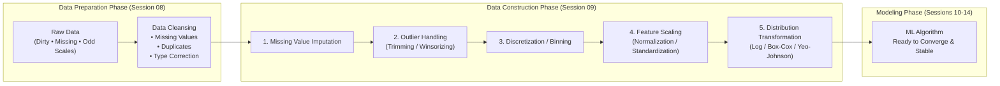
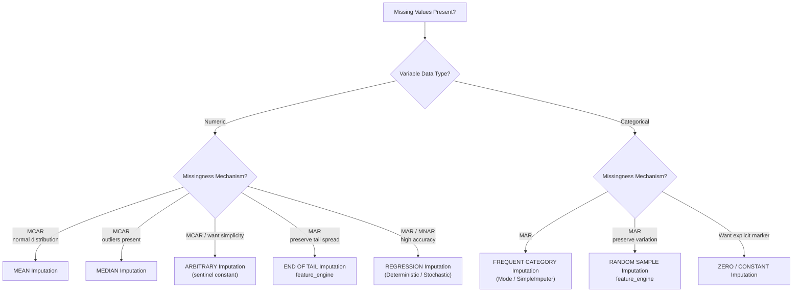

import { Accordion, Accordions } from 'fumadocs-ui/components/accordion';
import { Callout } from 'fumadocs-ui/components/callout';
import { Tab, Tabs } from 'fumadocs-ui/components/tabs';

> **Module & Portal Compiler:** Mahendar Dwi Payana  
> **DTS 2021 Training Material Author:** Universitas Gunadarma Team — Thematic Academy Digital Talent Scholarship 2021  
> **Organizer & Curriculum:** Ministry of Communication and Information Technology RI (Kominfo) & School of Electrical Engineering and Informatics (STEI) ITB

---

## 1. Learning Objectives & Scope

After data has been cleaned and validated in the previous session, raw data is not necessarily in an optimal numerical representation for the modeling process. This module discusses **Data Construction** techniques starting from data transformation analysis, their application to numerical features, and documenting transformation results.

> **Scope Note:** Session 09 focuses on **value representation transformation** (imputation, discretization, scaling, distribution normalization). Meanwhile, **substantive creation of new features** (categorical encoding, cyclical features, domain interactions) is discussed in **Session 10**.

---

## 2. Position of Data Construction in the CRISP-DM Cycle

In the **CRISP-DM** methodology, data construction bridges the *Data Preparation* phase with *Modeling*. It is the stage of "translating" data so it can be consumed by mathematical algorithms that are sensitive to scale, distribution, and missing values.



### Fundamental Principle: *Garbage In, Garbage Out* at the Representation Level

Even a dataset that is "clean" of null values can fail to produce an optimal model if its representation is wrong. The three most common representation issues in industry:

1. **Non-Uniform Scales**: A `Salary` feature (tens of millions range) dominates an `Age` feature (tens range) in Euclidean distance calculations.
2. **Disguised Missing Values**: A value of `0` in a medical column (e.g., `Glucose = 0`) is actually a *missing value*, not a real measurement.
3. **Skewed Distributions**: Financial variables such as house prices or account balances are right-skewed, violating the normality assumptions of linear models.

---

## 3. Missing Value Imputation Strategies

> **Definition:** **Imputation** is the process of replacing missing values/data (`NaN`, `blank`) with substitute values considered most statistically plausible.

Choosing an imputation technique **must** consider two dimensions simultaneously: (a) the variable's **data type** (numeric vs categorical), and (b) the **missing data mechanism**.

### A. Missing Data Mechanisms

The concept of missing data mechanisms was introduced by **Rubin (1976)** and serves as the foundation for selecting valid imputation techniques:

| Mechanism | Full Name | Description | Appropriate Imputation Techniques |
| :--- | :--- | :--- | :--- |
| **MCAR** | *Missing Completely At Random* | Missingness does not depend on any variable. Example: random sensor failure. | Mean / Median |
| **MAR** | *Missing At Random* | Missingness depends on **other observed variables**. Example: men are more reluctant to fill in a weight column. | Mode, Random Sample, Regression |
| **MNAR** | *Missing Not At Random* | Missingness depends on **the value itself**. Example: high-income individuals hide their earnings. | Specialized modeling / sensitivity analysis |

### B. Decision Tree for Selecting an Imputation Technique



---

### 3.1 Mean or Median Imputation

The simplest technique for **numeric** data types, and best suited for **MCAR** data. Mean is used when the distribution is symmetric; **Median** is used when *outliers* are present because the median is resistant to extreme values.

```python
import pandas as pd
import numpy as np

# -----------------------------------------------------------
# Example 1: MEAN Imputation across multiple columns at once
# -----------------------------------------------------------
cols = {
    'col1': [2, 9, 19],
    'col2': [5, np.nan, 17],
    'col3': [3, 9, np.nan],
    'col4': [6, 0, 9],
    'col5': [np.nan, 7, np.nan]
}
data = pd.DataFrame(cols)

# fillna(data.mean()) fills each column's NaN with its own column mean
data_mean = data.fillna(data.mean())
print(data_mean)

# -----------------------------------------------------------
# Example 2: MEAN Imputation on a single column
# -----------------------------------------------------------
age = pd.DataFrame({'age': [29, 43, np.nan, 25, 34, np.nan, 50]})

# Median is more appropriate when potential outliers exist
print("Mean   :", age['age'].mean())    # 36.2
print("Median :", age['age'].median())  # 34.0

print(age.fillna(age.mean()))    # MEAN Imputation
print(age.fillna(age.median()))  # MEDIAN Imputation
```

> **Numerical Verification:** Mean $(29 + 43 + 25 + 34 + 50) / 5 = 181/5 = 36.2$, while the median of $[25, 29, 34, 43, 50]$ is **34**. Notice that the mean is pulled upward by the value 50, whereas the median is not.

---

### 3.2 Arbitrary Value Imputation

*Arbitrary* imputation replaces missing values with a **custom constant** chosen by the analyst (e.g., `99`, `-1`, or `999`). Suitable for numeric data when the presence of a missing value itself carries meaning and **must remain trackable** (as a *flag* / marker).

```python
age = pd.DataFrame({'age': [29, 43, np.nan, 25, 34, np.nan, 50]})

# Replace NaN with an arbitrary value, e.g., 99
data_arbitrary = age.fillna(99)
print(data_arbitrary)
```

> [!CAUTION]
> **Danger of Arbitrary Values:** Using `99` in an `Age` column will **distort** the mean, variance, and distances when computed. Sentinel values such as `99` or `-1` are only safe if the feature is later encoded as a categorical marker rather than used as a continuous value.

---

### 3.3 End of Tail Imputation

*End of tail* imputation replaces missing values with a value at the **edge of the distribution** (right or left tail). The `feature_engine` library provides `EndTailImputer` with several modes:

* `imputation_method='gaussian'` → $\mu + k\sigma$ (default $k=3$) for the right tail.
* `imputation_method='iqr'` → $Q_3 + k \cdot \text{IQR}$.
* `imputation_method='max'` → directly uses the maximum value.

```python
# pip install feature_engine
from feature_engine.imputation import EndTailImputer

age = pd.DataFrame({'age': [29, 43, np.nan, 25, 34, np.nan, 50]})

# Create imputer: gaussian (mean + 3*std) on the right tail
imputer = EndTailImputer(imputation_method='gaussian', tail='right')
imputer.fit(age)

# Transform data (returns a DataFrame object)
test_t = imputer.transform(age)
print(test_t)
```

> **Numerical Verification:** The mean of $[29, 43, 25, 34, 50] = 36.2$, sample standard deviation $\approx 9.93$. Right-tail value $\approx 36.2 + 3(9.93) \approx 66.0$, so both `NaN` values are filled with that value.

---

### 3.4 Frequent Category / Mode Imputation

For **categorical** data types, the best replacement value is the **most frequently occurring category** (*mode*). `sklearn.impute.SimpleImputer(strategy='most_frequent')` works for both numeric and string data.

```python
from sklearn.impute import SimpleImputer

make = pd.DataFrame({
    'make': ['Ford', 'Ford', 'Fiat', 'BMW', 'Ford', 'Kia',
             np.nan, 'Fiat', 'Ford', np.nan, 'Kia']
})

# strategy='most_frequent' -> fills with MODE
imp = SimpleImputer(strategy='most_frequent')

# fit_transform: fit computes mode, transform fills NaN
data_imputed = imp.fit_transform(make)
print(data_imputed.ravel())
```

> **Result:** The `'Ford'` category appears 4 times (the highest), so both `NaN` values are imputed as `'Ford'`. Note that `fit_transform` returns a 2D NumPy array, not a DataFrame.

---

### 3.5 Random Sample Imputation

Unlike mode imputation which always assigns the same value, *random sample imputation* replaces missing values with a **random value drawn from the distribution of observed values** of that variable. This technique preserves the original data diversity (*variance*), making it more suitable for MAR.

```python
from feature_engine.imputation import RandomSampleImputer

data = pd.DataFrame({
    'Gender': ['Male', 'Male', np.nan, 'Female', 'Male', np.nan, 'Female'],
    'Age': [29, np.nan, 43, 25, 34, 50, np.nan]
})

# random_state ensures reproducibility of random results
imputer = RandomSampleImputer(random_state=29)
imputer.fit(data)

test_t = imputer.transform(data)
print(test_t)
```

> **Key Concept:** The replacement value is not an average, but one of the real values that actually appeared. For example, in the `Age` column, `NaN` is filled randomly with one of $\{29, 43, 25, 34, 50\}$. Compare this to mean imputation, which would always produce `36.2`.

---

### 3.6 Zero / Constant Imputation

The simplest alternative for categorical variables is filling missing values with `0` or an explicit constant like `'Unknown'`. Suitable when "absence of data" is meaningful information.

```python
age = pd.DataFrame({'age': [29, 43, np.nan, 25, 34, np.nan, 50]})

# Fill NaN with zero
data_constant = age.fillna(0)
print(data_constant)
```

---

### 3.7 Regression Imputation: Deterministic

To improve accuracy, missing values can be **predicted** using a linear regression model trained on other complete features. This technique produces **far more precise** imputations than the mean, but ignores random variation (*random error*) around the regression line.

**Case Study: `diabetes.csv` Dataset (Pima Indians Diabetes)**

This dataset contains `0` values that are medically impossible (for example, blood pressure or BMI cannot be zero). Those `0` values are treated as *missing values*.

```python
import pandas as pd
import numpy as np
import matplotlib.pyplot as plt
import seaborn as sns
import missingno as mno
from sklearn import linear_model

# %matplotlib inline  (for Jupyter only)

# 1. Load dataset & mark 0 values as NaN
df = pd.read_csv("https://mahendartea.github.io/Learn-AI/data/diabetes.csv")
print(df.head(3))
print(df.info())
print(df.describe())

# 2. Replace 0.0 with NaN in medical columns
for col in ["Glucose", "BloodPressure", "SkinThickness", "Insulin", "BMI"]:
    df.loc[df[col] == 0.0, col] = np.nan

# 3. Count missing values per medical column
print(df.isnull().sum()[1:6])

# 4. Visualize missing value patterns with missingno
mno.matrix(df, figsize=(20, 6))

# 5. Columns to be imputed
missing_columns = ["Glucose", "BloodPressure", "SkinThickness", "Insulin", "BMI"]

# 6. Random imputation function to populate initial estimates
def random_imputation(df, feature):
    number_missing = df[feature].isnull().sum()
    observed_values = df.loc[df[feature].notnull(), feature]
    df.loc[df[feature].isnull(), feature + '_imp'] = np.random.choice(
        observed_values, number_missing, replace=True
    )
    return df

for feature in missing_columns:
    df[feature + '_imp'] = df[feature]
    df = random_imputation(df, feature)

# 7. Deterministic Linear Regression
deter_data = pd.DataFrame(columns=["Det" + name for name in missing_columns])

for feature in missing_columns:
    deter_data["Det" + feature] = df[feature + "_imp"]
    parameters = list(set(df.columns) - set(missing_columns) - {feature + '_imp'})

    model = linear_model.LinearRegression()
    model.fit(X=df[parameters], y=df[feature + '_imp'])

    # Fill only at indices that were originally missing
    deter_data.loc[df[feature].isnull(), "Det" + feature] = \
        model.predict(df[parameters])[df[feature].isnull()]

print(deter_data.describe().T)
```

> **Deterministic Characteristic:** Every row with the same feature combination receives an **identical** imputed value. Consequently, **data variance shrinks** (*underestimate of variance*) and inter-feature correlations become artificially strong. Post-imputation statistics (`describe()`) appear "cleaner" than reality.

---

### 3.8 Regression Imputation: Stochastic

**Stochastic** regression imputation adds *random error* (Gaussian noise) to the regression prediction, making inter-variable correlation reproduction more realistic and preventing variance compression.

$$\hat{y}_{\text{stochastic}} = \hat{y}_{\text{regression}} + \varepsilon, \qquad \varepsilon \sim \mathcal{N}(0, \sigma_{\text{residual}})$$

```python
# Stochastic Regression Imputation
random_data = pd.DataFrame(columns=["Ran" + name for name in missing_columns])

for feature in missing_columns:
    random_data["Ran" + feature] = df[feature + '_imp']
    parameters = list(set(df.columns) - set(missing_columns) - {feature + '_imp'})

    model = linear_model.LinearRegression()
    model.fit(X=df[parameters], y=df[feature + '_imp'])

    predict = model.predict(df[parameters])

    # Standard error = standard deviation of residuals on observed rows
    std_error = (predict[df[feature].notnull()]
                 - df.loc[df[feature].notnull(), feature + '_imp']).std()

    # Prediction + Gaussian noise
    random_predict = np.random.normal(
        size=df[feature].shape[0], loc=predict, scale=std_error
    )
    random_data.loc[(df[feature].isnull()) & (random_predict > 0), "Ran" + feature] = \
        random_predict[(df[feature].isnull()) & (random_predict > 0)]

print(random_data.describe().T)
```

> **Visual Comparison:** Histograms of the original column (blue) and the imputed column (red) can be compared to see how well imputation replicates the original spread. Deterministic tends to be "too narrow," whereas stochastic more closely resembles the original distribution but risks generating negative values (mitigated by the `> 0` filter).

---

### 3.9 Imputation Technique Comparison Summary

| No | Technique | Data Type | Library | Ideal Mechanism | Strengths | Limitations |
| :---: | :--- | :--- | :--- | :---: | :--- | :--- |
| 1 | **Mean / Median** | Numeric | Pandas `.fillna()` | MCAR | Fast, simple | Compresses variance; median is more outlier-resistant |
| 2 | **Arbitrary** | Numeric | Pandas `.fillna()` | — | Tracks missingness as a flag | Distorts statistics if used as continuous |
| 3 | **End of Tail** | Numeric | `feature_engine` | MAR | Preserves tail distribution | Extreme values amplify skewness |
| 4 | **Frequent / Mode** | Categorical | `sklearn` | MAR | Stable for dominant categories | Ignores category diversity |
| 5 | **Random Sample** | Categorical/Numeric | `feature_engine` | MAR | Preserves original distribution | Non-deterministic (needs `random_state`) |
| 6 | **Zero / Constant** | Categorical | Pandas `.fillna()` | — | Explicit & easy to audit | Creates bias if zero is meaningful |
| 7 | **Deterministic Regression** | Numeric | `sklearn` | MAR | Accurately leverages feature correlations | Compresses variance; *data leakage* risk |
| 8 | **Stochastic Regression** | Numeric | `sklearn` | MAR | Realistically preserves variance & correlation | Complex; potential negative values |

<Callout type="warn" title="Anti-Data Leakage Rule">
Imputation statistics (mean, median, mode, regression coefficients) **MUST be computed exclusively from the training set** and then applied to the *test set*. If imputation is fit on the entire dataset prior to *train-test split*, information from the test set leaks into training and evaluation metrics become *falsely optimistic*.
</Callout>

---

## 4. Outlier Handling: Trimming vs. Winsorizing

Once missing values are handled, remaining *outliers* can be addressed with two fundamentally different strategies:

| Aspect | **Trimming** | **Winsorizing** |
| :--- | :--- | :--- |
| **Action on outliers** | **Removes** outlier observations from the dataset | **Replaces** outlier values with boundary percentile values |
| **Impact on row count** | Decreases (data permanently lost) | Unchanged (no rows are dropped) |
| **Impact on mean** | Changes because extreme rows are removed | Preserved via boundary values |
| **Risk** | Loss of information from extreme observations | Creates value clustering at boundaries (*ties*) |
| **Library** | `scipy.stats.mstats.trima` | `scipy.stats.mstats.winsorize` |

```python
import numpy as np
from scipy.stats.mstats import winsorize, trima

# Array 1 to 10
a = np.array([10, 4, 9, 8, 5, 3, 7, 2, 1, 6])

# -----------------------------------------------------------
# WINSORIZE: replace lowest 10% & highest 20% values
# with values at those boundary percentiles
# -----------------------------------------------------------
wins = winsorize(a, limits=[0.1, 0.2])
print(wins)
# [9 4 9 8 5 3 7 2 2 6]
#  10 -> 9 (upper bound), 1 -> 2 (lower bound)

# -----------------------------------------------------------
# TRIMA: trim (discard) values outside the range [2, 8]
# -----------------------------------------------------------
trims = trima(a, limits=(2, 8))
print(trims)
# [4 5 3 7 2 6]  -> only values within the range remain
```

> **When to Choose Which?**
> * Use **Trimming** when outliers are believed to be measurement *errors* and their count is very small.
> * Use **Winsorizing** when the sample size is small and dropping rows is too risky, yet you still want to dampen extreme influence.

---

## 5. Data Discretization (Binning Process)

> **Definition:** **Binning** is the process of converting a **continuous** (measured) variable into a **discrete** (counted) variable by dividing it into a number of intervals (*bins*) or categories.

### Why Perform Binning?

1. **Reduces the influence of noise** and minor outliers.
2. **Handles non-linear relationships** between features and target (decision trees can split categories).
3. **Simplifies business interpretation** (e.g., "Cheap", "Standard", "Expensive").
4. **Stabilizes volatile variables**.

### Practice Dataset `bins.csv`

| Item | Harga (Price) | Item | Harga (Price) |
| :--- | ---: | :--- | ---: |
| Item_1 | 1.500 | Item_7 | 39.900 |
| Item_2 | 3.300 | Item_8 | 91.000 |
| Item_3 | 11.000 | Item_9 | 64.700 |
| Item_4 | 87.500 | Item_10 | 6.000 |
| Item_5 | 45.000 | Item_11 | 19.000 |
| Item_6 | 28.600 | Item_12 | 2.700 |

### A. Binning with `pd.cut()` and `np.linspace()` — Equal Interval Width

`numpy.linspace(min, max, n)` divides the range $[\min, \max]$ into $n-1$ intervals of **identical width**.

```python
import pandas as pd
import numpy as np

df = pd.read_csv('https://mahendartea.github.io/Learn-AI/data/bins.csv')

# Create 4 cut points (3 intervals) with linear spacing
bins = np.linspace(min(df['Harga']), max(df['Harga']), 4)
print(bins)
# [  1500.        31333.333333   61166.666667   91000.        ]

categories = ['Cheap', 'Standard', 'Expensive']
df['Harga Binned'] = pd.cut(df['Harga'], bins, labels=categories, include_lowest=True)
print(df)
```

**Resulting division:**

| Bin | Interval (Rp) | Items |
| :--- | :--- | :--- |
| **Cheap** | 1,500 – 31,333 | Item_1, Item_2, Item_3, Item_6, Item_10, Item_11, Item_12 |
| **Standard** | 31,333 – 61,167 | Item_5, Item_7 |
| **Expensive** | 61,167 – 91,000 | Item_4, Item_8, Item_9 |

> `include_lowest=True` ensures the minimum value (1,500) is **included** in the first bin (preventing an open left boundary `(1500, ...]` from excluding it).

### B. Binning with `pd.interval_range()` — Explicit Interval Width

When bin widths must be **manually specified** (e.g., every Rp10,000) without depending on the data's min/max:

```python
df = pd.read_csv('https://mahendartea.github.io/Learn-AI/data/bins.csv')

# Interval from 0 to 100,000 with width 10,000
interval_range = pd.interval_range(start=0, freq=10000, end=100000)
df['Harga Binned 2'] = pd.cut(df['Harga'], bins=interval_range)
print(df)
```

Produces 10 regular bins: `(0,10000]`, `(10000,20000]`, `(20000,30000]`, … , `(90000,100000]`.

### C. Binning with `pd.qcut()` — Equal Frequency (Quantile Binning)

Unlike `cut()`, which divides the **value range** into equal sizes, `qcut()` divides the data so that each bin contains an **(approximately) equal number of observations**. This is useful for heavily *skewed* data.

```python
df = pd.read_csv('https://mahendartea.github.io/Learn-AI/data/bins.csv')

# Divide into 3 equal-frequency groups (terciles)
df['Harga Binned 3'] = pd.qcut(df['Harga'], 3)
print(df)
```

**Tercile cut points:** `(1.499, 11.000]`, `(11.000, 45.000]`, `(45.000, 91.000]` → each contains 4 items.

| Method | Splitting Principle | Best For |
| :--- | :--- | :--- |
| `pd.cut()` + `linspace` | **Equal** interval widths | Relatively uniformly distributed data |
| `pd.interval_range()` + `cut` | **Explicit/manual** interval widths | Domain requirements (fixed price tiers) |
| `pd.qcut()` | **Equal** member count per bin | Skewed data / balanced bin counts |

---

## 6. Feature Scaling

### A. Algorithm Sensitivity to Feature Scale

| Algorithm Category | Affected by Scale? | Mathematical Reason |
| :--- | :---: | :--- |
| **Distance-based**<br />KNN, K-Means, SVM, PCA | **VERY HIGH** | Euclidean distance $\sqrt{\sum (x_i - y_i)^2}$ will be 99% dominated by features on the scale of tens of millions (e.g., Income) compared to unit-scale features (e.g., Age). |
| **Gradient Descent-based**<br />Linear Regression, Logistic Regression, Neural Networks (ANN) | **VERY HIGH** | The *loss function* contour surface becomes elongated and flat (*oscillatory steps*), slowing down optimizer convergence (SGD/Adam). |
| **Tree-based**<br />Decision Tree, Random Forest, XGBoost | **NOT AFFECTED** | Trees split data (*node splitting*) based on value ranking (*rank-based threshold*), not absolute distance. |

> **Scale Problem Illustration:** In `scalling.csv`, the `Age` column has range $[27, 50]$ (span 23) whereas `Income` has range $[48000, 83000]$ (span 35000). Without scaling, the distance between two people is almost **entirely** determined by `Income`; a 20-year age difference becomes negligible.

### B. Normalizer — Row-Wise Scaling (Unit Vector / L2 Norm)

`sklearn.preprocessing.Normalizer` scales **each row** (not column) so that it has a norm (vector length) = 1. Useful for data where compositions are compared (e.g., text TF-IDF).

$$x'_{\text{row}} = \frac{x_{\text{row}}}{\lVert x_{\text{row}} \rVert_2}, \qquad \lVert x \rVert_2 = \sqrt{\sum_i x_i^2}$$

```python
from sklearn.preprocessing import Normalizer
import pandas as pd

data = pd.read_csv("https://mahendartea.github.io/Learn-AI/data/scalling.csv")

# L2 Normalizer: each ROW is normalized so its vector length = 1
max_abs = Normalizer(norm='l2')
max_abs.fit(data)
train_scaled = max_abs.transform(data)
print(train_scaled)
```

> **Important Note:** Because `Age` and `Income` differ greatly in magnitude, L2 normalization on the row `[44, 72000]` yields `[0.000611, 0.999999]` — age practically "vanishes". `Normalizer` is **not** suitable for heterogeneous features like this; use it for data with uniform units (text, proportions).

### C. Min-Max Normalization (Fixed Range $[0,1]$)

Transforms all values into the interval $[0, 1]$:

$$
X_{\text{norm}} = \frac{X - X_{\text{min}}}{X_{\text{max}} - X_{\text{min}}}
$$

* **Characteristics**: Preserves data proportions, but is **highly sensitive** to extreme outliers.

### D. Z-Score Standardization (Mean = 0, Std = 1)

Centers data at mean $\mu = 0$ and standard deviation $\sigma = 1$:

$$
Z = \frac{X - \mu}{\sigma}
$$

* **Characteristics**: Optimal for algorithms that assume normally distributed (Gaussian) data, as well as for PCA and regularized regression.

```python
import pandas as pd
from sklearn.preprocessing import StandardScaler

data = pd.read_csv("https://mahendartea.github.io/Learn-AI/data/scalling.csv")

scaler = StandardScaler()
scaler.fit(data)                 # learn mu and sigma ONLY from training data
train_scaled = scaler.transform(data)
print(train_scaled)
```

### E. Robust Scaling (Outlier-Resistant)

Uses the median and Interquartile Range (IQR), making it unaffected by outliers:

$$
X_{\text{robust}} = \frac{X - \text{Median}(X)}{Q_3 - Q_1}
$$

```python
from sklearn.preprocessing import RobustScaler

data = pd.read_csv("https://mahendartea.github.io/Learn-AI/data/scalling.csv")
robust_scaled = RobustScaler().fit_transform(data)
print(robust_scaled)
```

### F. Comparison of Four Scalers (`scalling.csv` Dataset)

| Scaler | Formula | Output Range | Mean | Std | Sensitive to Outliers? |
| :--- | :--- | :--- | :---: | :---: | :---: |
| **Min-Max** | $(x - \min)/(\max - \min)$ | $[0, 1]$ exact | ≈ 0.5 | varies | **YES** |
| **Standard (Z-Score)** | $(x - \mu)/\sigma$ | unbounded | **0** | **1** | Moderately |
| **Robust** | $(x - \text{median})/\text{IQR}$ | unbounded | ≈ median-shift | varies | **NO** |
| **Normalizer (L2)** | $x / \lVert x \rVert_2$ | $[-1, 1]$ per row | varies | — | No (row-wise) |

<Callout type="warn" title="Common Pitfall: 'Normalization' That Isn't Normalization">
In many tutorials (including the original module notebook), the following code appears:

```python
means = data.mean(axis=0)
max_min = data.max(axis=0) - data.min(axis=0)
train_scaled = (data - means) / max_min
```

This formula is **NOT** Min-Max scaling that produces the $[0,1]$ range! It centers the mean to 0 (like standardization) but divides by the **range** (not the standard deviation). The result contains negative values and is not bounded to $[0,1]$. For proper Min-Max scaling, use `MinMaxScaler` or $(x - \min)/(\max - \min)$.
</Callout>

---

## 7. Non-Linear Distribution Transformations (Normalizing Skewness)

Real-world industry data (house prices, sales volume, account balances) is almost always *right-skewed*. *Power transformations* stabilize variance and bring distributions closer to Gaussian.

### A. Logarithmic Transformation (`Log1p`)

$$
y = \ln(x + 1)
$$

Used for non-negative data ($x \ge 0$). Adding 1 (`log1p`) prevents $\ln(0) = -\infty$.

### B. Box-Cox Transformation

Automatically searches for the optimal parameter $\lambda$ to maximize normality (only for $y > 0$):

$$
y^{(\lambda)} = \begin{cases} \dfrac{y^\lambda - 1}{\lambda}, & \lambda \neq 0 \\[6pt] \ln(y), & \lambda = 0 \end{cases}
$$

### C. Yeo-Johnson Transformation

An enhancement of Box-Cox that **supports zero and negative values**:

$$
y^{(\lambda)} = \begin{cases} \dfrac{(y+1)^\lambda - 1}{\lambda}, & y \ge 0,\ \lambda \neq 0 \\[6pt] \ln(y+1), & y \ge 0,\ \lambda = 0 \\[6pt] -\dfrac{(-y+1)^{2-\lambda} - 1}{2-\lambda}, & y < 0,\ \lambda \neq 2 \\[6pt] -\ln(-y+1), & y < 0,\ \lambda = 2 \end{cases}
$$

```python
import numpy as np
import pandas as pd
from sklearn.preprocessing import PowerTransformer, MinMaxScaler

def evaluate_transformers(data_series):
    """Compare statistical expressions before & after transformation."""
    X = data_series.values.reshape(-1, 1)
    results = {
        "Original": data_series.values,
        "Log1p": np.log1p(data_series.values),
        "Yeo-Johnson": PowerTransformer(method='yeo-johnson').fit_transform(X).ravel(),
    }
    # Box-Cox requires strictly positive values (> 0)
    if (data_series > 0).all():
        results["Box-Cox"] = PowerTransformer(method='box-cox').fit_transform(X).ravel()

    res_df = pd.DataFrame(results)
    print(res_df.describe().round(3).T[['mean', 'std', 'min', '50%', 'max']])
    return res_df

if __name__ == "__main__":
    np.random.seed(42)
    skewed_data = pd.Series(np.random.exponential(scale=1000, size=500) + 10)
    skewed_data.iloc[0] = 50000  # synthetic outlier
    evaluate_transformers(skewed_data)
```

> **How to Measure Success:** Compare *skewness* or normality tests (`scipy.stats.shapiro`, `scipy.stats.normaltest`) before and after transformation. A skewness value approaching 0 indicates the distribution is becoming more symmetric.

---

## 8. Integrated Python Lab: Data Construction Pipeline

<Callout type="info" title="Download Official Module 9 Practice Datasets">
All official module datasets are available on the Learn AI portal:
1. **`diabetes.csv`** — <DataLink file="diabetes.csv">Download</DataLink> *(768 Pima Indians medical records; regression imputation)*
2. **`bins.csv`** — <DataLink file="bins.csv">Download</DataLink> *(12 price items; binning practice)*
3. **`scalling.csv`** — <DataLink file="scalling.csv">Download</DataLink> *(Age & Income; scaling practice)*
</Callout>

The following pipeline summarizes all data construction stages in one end-to-end runnable workflow:

```python
"""
Numerical Data Construction & Transformation Pipeline
Lab source: Module 9 - Data Transformation (DTS 2021, Universitas Gunadarma)
Recompiled by: Mahendar Dwi Payana
"""
import numpy as np
import pandas as pd
from sklearn.experimental import enable_iterative_imputer  # noqa: F401
from sklearn.impute import SimpleImputer, IterativeImputer
from sklearn.preprocessing import MinMaxScaler, StandardScaler, RobustScaler
from scipy.stats.mstats import winsorize

np.random.seed(42)
BASE = "https://mahendartea.github.io/Learn-AI/data"

# ============================================================
# STAGE 1: Impute 0 Values -> NaN then fill with Median
# ============================================================
df = pd.read_csv(f"{BASE}/diabetes.csv")
med_cols = ["Glucose", "BloodPressure", "SkinThickness", "Insulin", "BMI"]
for col in med_cols:
    df.loc[df[col] == 0.0, col] = np.nan

print("Missing values before imputation:")
print(df[med_cols].isnull().sum())

imputer = SimpleImputer(strategy="median")
df[med_cols] = imputer.fit_transform(df[med_cols])
print("\nMissing values after imputation:", df[med_cols].isnull().sum().sum())

# ============================================================
# STAGE 2: Winsorizing Numeric Feature Outliers
# ============================================================
# Cap the lowest 5% and highest 5% values
df["BMI_wins"] = winsorize(df["BMI"], limits=[0.05, 0.05])

# ============================================================
# STAGE 3: Price Column Binning (bins.csv)
# ============================================================
bins_df = pd.read_csv(f"{BASE}/bins.csv")
edges = np.linspace(bins_df["Harga"].min(), bins_df["Harga"].max(), 4)
bins_df["Price_Class"] = pd.cut(
    bins_df["Harga"], edges, labels=["Cheap", "Standard", "Expensive"], include_lowest=True
)
print("\nPrice Binning Results:")
print(bins_df["Price_Class"].value_counts())

# ============================================================
# STAGE 4: Feature Standardization (scalling.csv)
# ============================================================
scale_df = pd.read_csv(f"{BASE}/scalling.csv")
scaler = StandardScaler()
scaled = pd.DataFrame(
    scaler.fit_transform(scale_df),
    columns=[c + "_z" for c in scale_df.columns]
)
print("\nPost-Standardization Statistics (mean ~ 0, std ~ 1):")
print(scaled.describe().round(3).loc[["mean", "std"]])
```

---

## 9. Evaluation Sheet & Independent Practical Assignments

<Accordions>
  <Accordion title="Assignment 1: Comparing Three Imputation Techniques on diabetes.csv">
    Apply three different imputation techniques to the `Insulin` column, which has **48.70% missing values**: (a) median imputation, (b) deterministic regression imputation, and (c) stochastic regression imputation. Compare the **mean, standard deviation, and skewness** of the three results, then conclude which technique best preserves the original distribution characteristics. Display a comparative histogram!
  </Accordion>

  <Accordion title="Assignment 2: Analyzing the Impact of Binning on Non-Linear Relationships">
    Use the `bins.csv` dataset. Compare the results of `pd.cut()` (equal width) with `pd.qcut()` (equal frequency). Explain why `qcut()` is more appropriate for heavily skewed data, and when `cut()` is instead preferred by business practitioners. Include a table of member counts for each bin!
  </Accordion>

  <Accordion title="Assignment 3: Case Study on Trimming vs. Winsorizing">
    Use the `SkinThickness` column in `diabetes.csv` (which contains extreme values). Apply (a) `trima()` to trim at the 5th and 95th percentiles, and (b) `winsorize()` with limits `[0.05, 0.05]`. Document the differences in **row count**, **mean**, and **standard deviation** before and after both treatments!
  </Accordion>

  <Accordion title="Assignment 4: Formal Data Construction Documentation">
    Select one dataset from your final project (Capstone). Prepare a **data construction documentation report** containing: (1) initial feature representation, (2) chosen transformation techniques along with their statistical justification, (3) transformation results in a before-and-after table, and (4) further transformation recommendations for the modeling stage!
  </Accordion>
</Accordions>

---

## 10. Literature References & Official Links

1. **Universitas Gunadarma Team** (2021). *Module 9 — Data Transformation*. Thematic Academy Digital Talent Scholarship 2021, Ministry of Communication and Information Technology RI.
2. **Donald B. Rubin** (1976). *Inference and Missing Data*. Biometrika, 63(3), 581–592. *(MCAR, MAR, MNAR concepts)*.
3. **George E. P. Box & David R. Cox** (1964). *An Analysis of Transformations*. Journal of the Royal Statistical Society, Series B, 26(2), 211–252. *(Box-Cox transformation)*.
4. **Ing-Khiong Yeo & Richard A. Johnson** (2000). *A New Family of Power Transformations to Improve Normality or Symmetry*. Biometrika, 87(4), 954–959. *(Yeo-Johnson transformation)*.
5. **Felipe Flores** (2021). *Feature-engine: A Python package for feature engineering*. [feature-engine.trainindata.com](https://feature-engine.trainindata.com).
6. **Scikit-learn Developers**. *Preprocessing Data: Standardization, Normalization, and Power Transforms*. [scikit-learn.org](https://scikit-learn.org/stable/modules/preprocessing.html).
