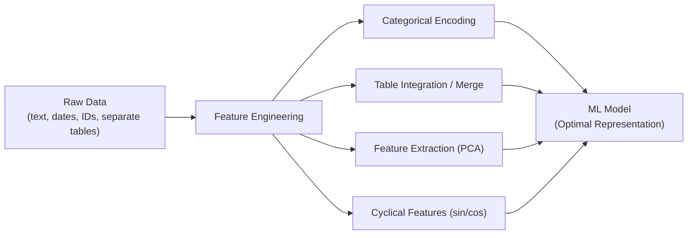
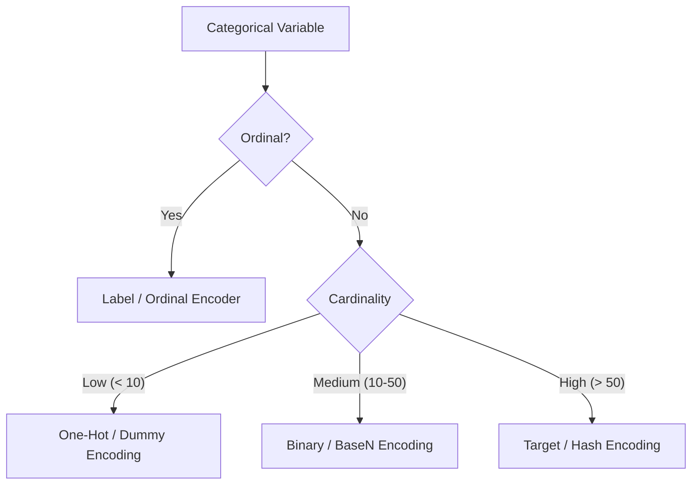
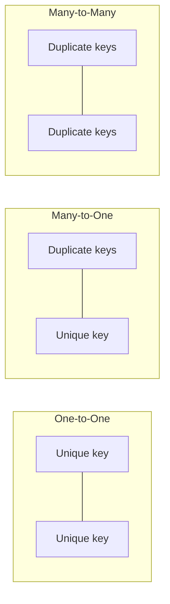
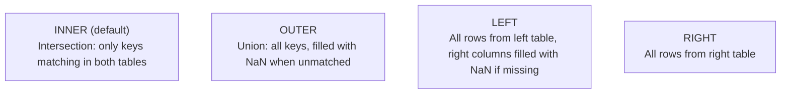
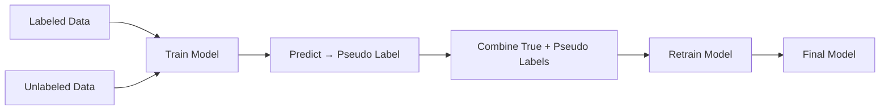

import { Accordion, Accordions } from 'fumadocs-ui/components/accordion';
import { Callout } from 'fumadocs-ui/components/callout';
import { Tab, Tabs } from 'fumadocs-ui/components/tabs';

> **Module & Portal Compiler:** Mahendar Dwi Payana  
> **DTS 2021 Training Material Authors:** Gunadarma University Team — Thematic Academy Digital Talent Scholarship 2021  
> **Organizer & Curriculum:** Ministry of Communication and Information Technology of the Republic of Indonesia (Kominfo) & School of Electrical Engineering and Informatics (STEI) ITB

---

## 1. Introduction & Lab Scope

This module is a direct continuation of Session 09. Whereas Session 09 transforms **numeric values** (imputation, binning, scaling), Session 10 engineers **feature structure**, **cross-table integration**, and **data labeling**.

<Callout type="info" title="Module 10 Lab Scope">
Module 10 (Feature Engineering and Data Integration) covers five hands-on labs:
1. **Lab 10-1** — One-Hot Encoding & data labeling (`creditApprovalUCI.csv`)
2. **Lab 10-2** — Semi-supervised Pseudo-Labelling
3. **Lab 10-3** — Segmentation (thresholding & K-Means on images)
4. **Lab 10-4** — Relational Merge & Join (Python Data Science Handbook)
5. **Lab 10-5** — Actuarial case study: PCA, Clustering & XGBoost (insurance *cross-selling*)
</Callout>

---

## 2. Philosophy: *"Data & Features Determine the Upper Bound"*

Artificial intelligence expert **Andrew Ng** emphasizes:

> *"Applied machine learning is basically feature engineering. Sophisticated models merely try to approach the performance upper bound determined by the quality of your feature representation."*

The implication is clear: adding quality data and engineering the right features has a far greater impact than simply swapping in a more complex algorithm. **Feature engineering** is the art of transforming raw data into representations that make hidden patterns easier for models to learn.



---

## 3. Categorical Data Encoding

Mathematical models (regression, SVM, neural networks) **only accept numeric values**. Text-based categorical data must be converted first. The quality of this conversion strongly determines model performance.

### A. Nominal vs. Ordinal

| Type | Definition | Examples | Ordered? |
| :--- | :--- | :--- | :---: |
| **Nominal** | Categories with no inherent order | Gender, Color, City | No |
| **Ordinal** | Categories with a clear order/ranking | Education (Elementary < Middle < High School < Bachelor's), Star rating | Yes |

### B. Eight Encoding Techniques

| No | Technique | How It Works | Ideal For | Drawback |
| :---: | :--- | :--- | :--- | :--- |
| 1 | **Label / Ordinal Encoding** | Each unique label → one integer | **Ordinal** data | Introduces false ordering on nominal data |
| 2 | **One-Hot Encoding** | Each category → $k$-column binary vector | Low-cardinality nominal data | Dimensional explosion (*curse of dimensionality*) |
| 3 | **Dummy Encoding** | One-Hot with $k-1$ columns | Linear models (avoids collinearity) | Reference category must remain consistent |
| 4 | **Effect Encoding** | Like dummy, but uses $-1$ baseline (instead of 0) | ANOVA / contrast analysis | Harder to interpret |
| 5 | **Binary Encoding** | Ordinal → binary, then split bit by bit | High cardinality | Not all bit combinations are valid |
| 6 | **BaseN Encoding** | Generalization of binary encoding with base $N$ | Very high cardinality | Harder to interpret |
| 7 | **Hash Encoding** | Category → fixed hash across $n$ columns | Very high-dimensional features (streaming) | Risk of **hash collision** |
| 8 | **Target Encoding** | Category → target mean (with smoothing) | High cardinality | Prone to **Target Leakage** |



---

### 3.1 Label Encoding (Ordinal Encoding)

Each category is sorted alphabetically and mapped to an integer. Suitable **only** for genuinely ordered data.

```python
import pandas as pd

df = pd.DataFrame({
    'country': ['India', 'US', 'Japan', 'US', 'Japan'],
    'age': [44, 34, 46, 35, 23],
    'salary': [72000, 65000, 98000, 45000, 34000]
})

from sklearn.preprocessing import LabelEncoder
label_encoder = LabelEncoder()
df['country'] = label_encoder.fit_transform(df['country'])

print(df)
# country  age  salary
#   0      44   72000    -> India
#   2      34   65000    -> US
#   1      46   98000    -> Japan

# Inspect the alphabetical mapping order
print(label_encoder.classes_)
# array(['India', 'Japan', 'US'], dtype=object)
# India -> 0, Japan -> 1, US -> 2
```

> [!CAUTION]
> **Danger of Label Encoding for Nominal Data:** The model will assume `US (2) > Japan (1) > India (0)`, as if there were a meaningful numeric distance between them. For nominal variables (without order), use One-Hot Encoding.

---

### 3.2 One-Hot Encoding

Each category is represented as a **binary vector**. For a variable with $k$ unique categories, $k$ binary columns are generated; a value of 1 indicates the presence of that category.

**Three implementation approaches:**

<Tabs items={['Pandas get_dummies', 'Scikit-learn', 'Feature-engine']}>
  <Tab value="Pandas get_dummies">
```python
import pandas as pd

df = pd.DataFrame({'country': ['India', 'US', 'Japan', 'US', 'Japan']})

# dummy_na=True includes an indicator column for NaN values
df_encoded = pd.get_dummies(df, columns=['country'], drop_first=True)
print(df_encoded)
#    country_Japan  country_US
# 0      False        False
# 1      False        True
# 2      True         False
```
  </Tab>
  <Tab value="Scikit-learn">
```python
from sklearn.preprocessing import OneHotEncoder
import numpy as np

X = np.array(['India', 'US', 'Japan', 'US', 'Japan']).reshape(-1, 1)

# sparse_output=False -> standard NumPy array; handle_unknown='ignore' -> ignore unseen categories
encoder = OneHotEncoder(categories='auto', drop='first', sparse_output=False)
X_enc = encoder.fit_transform(X)
print(encoder.categories_)
# [array(['India', 'Japan', 'US'], dtype=object)]
```
  </Tab>
  <Tab value="Feature-engine">
```python
# pip install feature_engine
from feature_engine.encoding import OneHotEncoder

# top_categories=None -> encode all categories; drop_last=True -> k-1 representation
ohe_enc = OneHotEncoder(top_categories=None, drop_last=True)
ohe_enc.fit(X_train)

# Advantage: returns a DataFrame with clear column names
X_train_enc = ohe_enc.transform(X_train)
X_test_enc = ohe_enc.transform(X_test)
```
  </Tab>
</Tabs>

> **Advantages of `feature_engine`:** (1) allows selecting variables to encode directly inside the transformer, (2) returns a Pandas DataFrame with descriptive column names, and (3) keeps the column count consistent between training and test sets — overcoming the limitations of `pd.get_dummies()` and raw `OneHotEncoder`.

---

### 3.3 Dummy Encoding & the *Dummy Variable Trap*

**Dummy Encoding** is One-Hot Encoding with the **$k-1$ column rule** (one category is kept as the reference/baseline and dropped). Its purpose is to avoid **perfect multicollinearity** in linear models.

* If all $k$ one-hot columns are summed, the result is always 1 (redundant) → the determinant of $X^TX$ becomes zero → the matrix inverse is undefined.
* By dropping one column (`drop='first'` / `drop_first=True`), all information is preserved while collinearity disappears.

| Encoding | Number of Columns | Multicollinearity | Best For |
| :--- | :---: | :---: | :--- |
| One-Hot ($k$ columns) | $k$ | Possible | Tree-based models (RF, XGBoost) |
| Dummy ($k-1$ columns) | $k-1$ | No | Linear regression, logistic regression |

```python
# Pandas: drop_first=True drops the first reference category
X_train_enc = pd.get_dummies(X_train[vars_categorical], drop_first=True)

# Scikit-learn: drop='first'
encoder = OneHotEncoder(categories='auto', drop='first', sparse_output=False)
encoder.fit(X_train[vars_categorical])
X_train_enc = encoder.transform(X_train[vars_categorical])
X_test_enc = encoder.transform(X_test[vars_categorical])
```

---

### 3.4 Target Encoding with Smoothing (M-Estimate)

For high-cardinality categories (cities, postal codes, product IDs), One-Hot Encoding explodes dimensionality. **Target Encoding** replaces each category with its target statistic, smoothed so rare categories do not overfit:

$$
\hat{S}_i = \frac{n_i \cdot \bar{y}_i + m \cdot \bar{y}_{\text{global}}}{n_i + m}
$$

Where $n_i$ = frequency of category $i$, $\bar{y}_i$ = target mean of category $i$, $\bar{y}_{\text{global}}$ = overall target mean, and $m$ = smoothing weight (*m-estimate*).

<Callout type="warn" title="Anti-Leakage in Target Encoding">
Target Encoding **must** be computed strictly from the training data and should ideally use an **out-of-fold** (K-Fold) scheme. Otherwise, the feature will "see" its own row's target and cause *target leakage*, making validation scores overly optimistic.
</Callout>

---

## 4. Lab 10-1: Cleaning & Encoding `creditApprovalUCI.csv`

The *Credit Approval* (UCI) dataset has no column headers and uses the `?` symbol as a missing-value placeholder.

```python
import pandas as pd
import numpy as np

# ============================================================
# STAGE 1: Loading & Column Naming (Module 9 style cleaning)
# ============================================================
data = pd.read_csv('https://mahendartea.github.io/Learn-AI/data/crx.data', header=None)
varnames = ['A' + str(s) for s in range(1, 17)]
data.columns = varnames

# Symbol '?' -> NaN
data = data.replace('?', np.nan)

# Cast misparsed numeric columns
data['A2'] = data['A2'].astype('float')
data['A14'] = data['A14'].astype('float')

# Map target A16: '+' -> 1, '-' -> 0
data['A16'] = data['A16'].map({'+': 1, '-': 0})

# ============================================================
# STAGE 2: Column Separation & Imputation
# ============================================================
cat_cols = [c for c in data.columns if data[c].dtypes == 'O']
num_cols = [c for c in data.columns if data[c].dtypes != 'O']

# Numeric -> 0, Categorical -> 'Missing' (meaningful imputation strategy)
data[num_cols] = data[num_cols].fillna(0)
data[cat_cols] = data[cat_cols].fillna('Missing')

# ============================================================
# STAGE 3: Train-Test Split & Encoding
# ============================================================
from sklearn.model_selection import train_test_split

X_train, X_test, y_train, y_test = train_test_split(
    data.drop(labels=['A16'], axis=1),
    data['A16'],
    test_size=0.3,
    random_state=0
)

vars_categorical = ['A1', 'A4', 'A5', 'A6', 'A7', 'A9', 'A10', 'A12', 'A13']

X_train_enc = pd.get_dummies(X_train[vars_categorical], drop_first=True)
X_test_enc = pd.get_dummies(X_test[vars_categorical], drop_first=True)

print(X_train_enc.head())
```

> **Discussion:** `get_dummies()` captures the variable name (e.g., `A1`) and appends an underscore + category name to label the resulting binary columns. Setting `drop_first=True` drops the first binary variable so we obtain the **$k-1$** representation and avoid the *dummy variable trap*. With Scikit-learn, use `handle_unknown='ignore'` so unseen categories in the test set do not trigger errors.

---

## 5. Data Integration: Relational Merge & Join

The best features often do not reside in a single table, but are spread across multiple sources. **`pd.merge()`** implements **relational algebra** operations — the same foundation used by SQL databases.

### A. Three Join Categories



| Join Type | Key Condition | Real-World Example |
| :--- | :--- | :--- |
| **One-to-One** | Unique ↔ Unique | `EmployeeInfo` ↔ `SalaryInfo` (by National ID) |
| **Many-to-One** | Duplicate ↔ Unique | `Transactions` ↔ `CustomerMaster` (many transactions per customer) |
| **Many-to-Many** | Duplicate ↔ Duplicate | `Employees` ↔ `Skills` (many employees, many skills) |

### B. Specifying Merge Keys

```python
import pandas as pd

df1 = pd.DataFrame({'employee': ['Bob', 'Jake', 'Lisa', 'Sue'],
                    'group': ['Accounting', 'Engineering', 'Engineering', 'HR']})
df2 = pd.DataFrame({'employee': ['Lisa', 'Bob', 'Jake', 'Sue'],
                    'hire_date': [2004, 2008, 2012, 2014]})

# 1. Identical key name -> pd.merge detects automatically
print(pd.merge(df1, df2))

# 2. Explicit key
print(pd.merge(df1, df2, on='employee'))

# 3. Different key column names -> left_on / right_on
df3 = pd.DataFrame({'name': ['Bob', 'Jake', 'Lisa', 'Sue'],
                    'salary': [70000, 80000, 120000, 90000]})
print(pd.merge(df1, df3, left_on='employee', right_on='name').drop('name', axis=1))

# 4. Index-based merge
df1a = df1.set_index('employee')
df2a = df2.set_index('employee')
print(pd.merge(df1a, df2a, left_index=True, right_index=True))
print(df1a.join(df2a))  # join() = default merge on index
```

### C. Set Arithmetic: The `how` Keyword



```python
df6 = pd.DataFrame({'name': ['Peter', 'Paul', 'Mary'],
                    'food': ['fish', 'beans', 'bread']})
df7 = pd.DataFrame({'name': ['Mary', 'Joseph'],
                    'drink': ['wine', 'beer']})

print(pd.merge(df6, df7, how='inner'))  # Mary only
print(pd.merge(df6, df7, how='outer'))  # all, NaN on missing side
print(pd.merge(df6, df7, how='left'))   # all rows from df6
print(pd.merge(df6, df7, how='right'))  # all rows from df7
```

### D. Resolving Overlapping Column Names (`suffixes`)

```python
df8 = pd.DataFrame({'name': ['Bob', 'Jake', 'Lisa', 'Sue'], 'rank': [1, 2, 3, 4]})
df9 = pd.DataFrame({'name': ['Bob', 'Jake', 'Lisa', 'Sue'], 'rank': [3, 1, 4, 2]})

# Default appends _x and _y suffixes
print(pd.merge(df8, df9, on="name"))

# Custom suffixes
print(pd.merge(df8, df9, on="name", suffixes=["_L", "_R"]))
```

### E. Case Study: Aligning Dapodik Data with PMP Data

In a real-world case study (Bogor Regency school data), school profile data from **Dapodik** had to be aligned with **PMP** reporting data because not all schools submitted PMP reports. The workflow:

```python
# 1. Load both data sources
df_sekolah = pd.read_csv("sekolah_smp_kb_bogor.csv")              # school profiles (Dapodik)
df_pmp = pd.read_csv("preparasi_tahap_2_data_pmp_smp_2019.csv")   # PMP achievement

# 2. Standardize join key type (NPSN must be string!)
df_sekolah['npsn'] = df_sekolah['npsn'].astype(str)
df_pmp['npsn'] = df_pmp['npsn'].astype(str)

# 3. Add year column (created manually)
df_pmp['tahun'] = '2019'

# 4. LEFT merge: keep all PMP schools, enrich with Dapodik profile
df_sek_2019_pmp = df_pmp.merge(df_sekolah, on='npsn', how='left')

# 5. Identify missing values post-merge (visual inspection)
import missingno as mno
mno.matrix(df_sek_2019_pmp, figsize=(20, 6))

# 6. Drop columns that are mostly empty (e.g., 'yayasan')
df_sek_2019_pmp.drop('yayasan', axis=1, inplace=True)
```

> **Key Lessons in Data Integration:**
> 1. **Align key types** before merging — an integer NPSN `12345` ≠ a string `"12345"`, which causes the join to fail.
> 2. **Choose the right `how`** — use `left` when the left table is the primary reference, and `outer` when you want to detect all mismatches.
> 3. **Inspect post-merge integrity** by checking `NaN` counts per column; use `pd.merge(..., validate='one_to_one'|'many_to_one')` to verify cardinality.

<Callout type="info" title="Validating Merge Cardinality">
Pandas provides the `validate` parameter to detect relationship violations:
```python
# Raises an error if the relationship is not one-to-one
pd.merge(df1, df2, on='id', validate='one_to_one')
```
Use this to prevent unexpected row explosions (*Cartesian explosion*) caused by unintended many-to-many joins.
</Callout>

---

## 6. Feature Extraction & Dimensionality Reduction with PCA

**Principal Component Analysis (PCA)** projects data onto new mutually **orthogonal** axes (principal components) that maximize explained variance. PCA creates uncorrelated **new features**, which is useful when original features are redundant.

### A. Cumulative Explained Variance

The number of components to retain is chosen by finding the point where cumulative variance crosses a threshold (commonly 90%).

```python
import numpy as np
import matplotlib.pyplot as plt
from sklearn.decomposition import PCA

# Fit PCA on features (without target)
pca = PCA().fit(df_final[VariablesNoTarget])

fig, axes = plt.subplots(nrows=1, ncols=2, figsize=(12, 5))
ax0, ax1 = axes.flatten()

ax0.plot(np.cumsum(pca.explained_variance_ratio_), marker='o')
ax0.set_xlabel('Number of components')
ax0.set_ylabel('Cumulative explained variance')

ax1.bar(range(df_final[VariablesNoTarget].shape[1]), pca.explained_variance_)
ax1.set_xlabel('Number of components')
ax1.set_ylabel('Explained variance')
plt.tight_layout()
plt.show()

# Compute the number of components covering 90% variance
cum = np.cumsum(pca.explained_variance_ratio_)
n_PCA_90 = np.size(cum) - np.count_nonzero(cum > 0.9)
print("Components covering 90% variance:", n_PCA_90)
```

### B. Interpreting Components

Once the number of components is fixed (e.g., 4), `pca.components_` reveals the **contribution weights** of each original feature toward each principal component. Features with large absolute weights (e.g., $|w| > 0.4$) are the dominant contributors and can be used to assign business-meaningful names to components.

| Original Feature | Component Contribution | Interpretation |
| :--- | :--- | :--- |
| `Age` & `Vehicle_Age` | Components 1 & 2 | Younger policyholders tend to own newer vehicles |
| `Previously_Insured` | 3 components | Prior insurance history |
| `Vintage` | Component 4 | Loyalty / membership tenure (unique pattern) |

> **Pros & Cons of PCA:**
> * **Pros**: removes multicollinearity, reduces dimensionality, speeds up training.
> * **Cons**: assumes **linear** relationships and components are difficult to interpret. For non-linear relationships, use **Kernel PCA** (Hilbert space transformation) or autoencoders.

---

## 7. Pseudo-Labelling: Semi-Supervised Labeling

**Pseudo-Labelling** is a semi-supervised technique: a model is trained on labeled data, then **predicts labels for unlabeled data** and merges them back as additional training samples. Useful when labeled data is expensive while raw unlabeled data is abundant.



```python
from sklearn.utils import shuffle
from sklearn.base import BaseEstimator, RegressorMixin

class PseudoLabeler(BaseEstimator, RegressorMixin):
    """Scikit-learn wrapper for pseudo-labeling."""
    def __init__(self, model, unlabled_data, features, target,
                 sample_rate=0.2, seed=42):
        self.sample_rate = sample_rate
        self.seed = seed
        self.model = model
        self.model.seed = seed
        self.unlabled_data = unlabled_data
        self.features = features
        self.target = target

    def fit(self, X, y):
        self.model.fit(X, y)

        # Predict unlabeled data as pseudo-labels
        pseudo_labels = self.model.predict(self.unlabled_data[self.features])
        temp = self.unlabled_data.copy()
        temp[self.target] = pseudo_labels

        # Subsample (sample_rate) to prevent overfitting
        temp = shuffle(temp, random_state=self.seed)
        temp = temp.sample(frac=self.sample_rate, random_state=self.seed)

        X_aug = pd.concat([X, temp[self.features]])
        y_aug = pd.concat([y, temp[self.target]])
        self.model.fit(X_aug, y_aug)
        return self

    def predict(self, X):
        return self.model.predict(X)
```

> **Result on the *Big Mart Sales* Case:** RMSE dropped from **1152.73** (plain XGBoost) to **1151.38** (XGBoost + Pseudo-Labelling at `sample_rate=0.3`). Typical improvements are marginal yet consistent: this technique is effective when unlabeled data comes from the **same distribution** as the training data.
>
> [!CAUTION]
> **Confirmation Bias Risk:** If the initial model makes wrong predictions, those errors are *reinforced* when retraining. Limit `sample_rate` (e.g., 0.2–0.3) and only apply this when initial model predictions are sufficiently reliable.

---

## 8. Cyclical Feature Encoding

Time variables such as hour of day (`0-23`) or month (`1-12`) are circular. 23:59 is very close to 00:01, yet numerically $23 - 0 = 23$. To preserve cyclicality, features are mapped onto trigonometric coordinates:

$$
x_{\sin} = \sin\left(\frac{2\pi \cdot x}{\max(x)}\right), \qquad x_{\cos} = \cos\left(\frac{2\pi \cdot x}{\max(x)}\right)
$$

```python
import numpy as np
import pandas as pd

df = pd.DataFrame({'hour': [0, 6, 12, 18, 23]})

df['hour_sin'] = np.sin(2 * np.pi * df['hour'] / 24)
df['hour_cos'] = np.cos(2 * np.pi * df['hour'] / 24)
print(df)
# The (sin, cos) pair represents a point on the unit circle
```

---

## 9. Feature Selection Techniques

Eliminating irrelevant features (*noise*) prevents the *Curse of Dimensionality* and speeds up model inference:

1. **Filter Methods**:
   - `VarianceThreshold`: removes features with constant or near-zero variance.
   - `SelectKBest` with statistical tests: **ANOVA F-Test** (continuous features vs. categorical target), **Chi-Square** (categorical vs. categorical), or **Mutual Information** (general non-linear relationships).
2. **Wrapper Methods**:
   - `RFE (Recursive Feature Elimination)`: repeatedly trains a model and iteratively prunes the weakest-weighted features.
3. **Embedded Methods**:
   - $L_1$ penalty (**Lasso**): forces insignificant feature coefficients to zero.
   - Built-in *Feature Importance* from tree algorithms (**Random Forest / LightGBM**).

```python
from sklearn.feature_selection import SelectKBest, mutual_info_classif
from sklearn.ensemble import ExtraTreesClassifier
import pandas as pd

# Embedded: Feature Importance from Extra Trees
model = ExtraTreesClassifier(n_estimators=100, random_state=42).fit(X, y)
importances = pd.Series(model.feature_importances_, index=X.columns)
print(importances.nlargest(10).plot(kind='barh'))

# Filter: Mutual Information
selector = SelectKBest(score_func=mutual_info_classif, k=5).fit(X, y)
print("Selected features:", X.columns[selector.get_support()])
```

---

## 10. Defining Data Labels & Handling Class Imbalance

Defining target labels must satisfy objectivity without ambiguity, while following applicable labeling SOPs.

### A. The Class Imbalance Challenge

In *fraud* detection, rare disease diagnosis, or insurance *cross-selling* response, the positive class often accounts for only `1%–5%` of the dataset. A model trained directly will be biased toward predicting the majority class for all rows (*Majority Guessing Paradox*).

### B. Modern Solutions

1. **Algorithmic Weighting**: `class_weight='balanced'` in Scikit-learn applies higher penalties when misclassifying the minority class.
2. **Resampling**: `RandomOverSampler`, `RandomUnderSampler`, or **SMOTE** (nearest-neighbor interpolation).
3. **Asymmetric evaluation metrics**: use **Recall**, **Precision**, **F1-Score**, or **ROC-AUC** — not accuracy.

```python
from sklearn.utils import resample
import pandas as pd

# Manual oversampling of the minority class
df_majority = df_final[df_final['Response'] == 0]
df_minority = df_final[df_final['Response'] == 1]

df_minority_upsampled = resample(
    df_minority, replace=True, n_samples=len(df_majority), random_state=0
)
balanced_df = pd.concat([df_minority_upsampled, df_majority]).sample(
    frac=1, random_state=0
)
print(balanced_df['Response'].value_counts())  # balanced 50:50
```

> **Note:** The mathematical implementation of SMOTE was covered in **Session 08 (§5)**. The golden rule still applies: **SMOTE must only be applied to the training data after *train-test split***.

---

## 11. Integrated Lab: End-to-End Feature Engineering Pipeline

<Callout type="info" title="Download Official Module 10 Lab Datasets">
Available on the Learn AI portal:
1. **`creditApprovalUCI.csv`** — <DataLink file="creditApprovalUCI.csv">Download</DataLink> *(cleaned output of Lab 10-1)*
2. **`crx.data`** — <DataLink file="crx.data">Download</DataLink> *(raw Credit Approval UCI data)*
3. **`mountain.jpeg`** — <DataLink file="mountain.jpeg">Download</DataLink> *(image for Lab 10-3 segmentation)*
4. **Health Insurance Cross Sell** *(Lab 10-5)* — [Kaggle](https://www.kaggle.com/anmolkumar/health-insurance-cross-sell-prediction)
</Callout>

```python
"""
End-to-End Feature Engineering Pipeline
Lab Source: Module 10 - Feature Engineering & Data Integration (DTS 2021)
Compiled by: Mahendar Dwi Payana
"""
import pandas as pd
import numpy as np
from sklearn.compose import ColumnTransformer
from sklearn.pipeline import Pipeline
from sklearn.preprocessing import OneHotEncoder, StandardScaler
from sklearn.feature_selection import SelectKBest, mutual_info_classif
from sklearn.ensemble import RandomForestClassifier

BASE = "https://mahendartea.github.io/Learn-AI/data"

# 1. Loading & Cleaning
data = pd.read_csv(f"{BASE}/crx.data", header=None)
data.columns = ['A' + str(s) for s in range(1, 17)]
data = data.replace('?', np.nan)
data['A2'] = data['A2'].astype(float)
data['A14'] = data['A14'].astype(float)
data['A16'] = data['A16'].map({'+': 1, '-': 0})

cat_cols = [c for c in data.columns if data[c].dtypes == 'O']
num_cols = [c for c in data.columns if data[c].dtypes != 'O']
data[num_cols] = data[num_cols].fillna(0)
data[cat_cols] = data[cat_cols].fillna('Missing')

X = data.drop('A16', axis=1)
y = data['A16']

# 2. Pipeline: Encoding + Scaling + Selection + Model
numeric_pipe = Pipeline([('scaler', StandardScaler())])
categorical_pipe = Pipeline([
    ('onehot', OneHotEncoder(handle_unknown='ignore', drop='first'))
])

preprocessor = ColumnTransformer([
    ('num', numeric_pipe, num_cols[:-1] if 'A16' in num_cols else num_cols),
    ('cat', categorical_pipe, cat_cols)
])

pipeline = Pipeline([
    ('preprocessor', preprocessor),
    ('selector', SelectKBest(score_func=mutual_info_classif, k=10)),
    ('classifier', RandomForestClassifier(
        n_estimators=100, class_weight='balanced', random_state=42))
])

pipeline.fit(X, y)
print("Feature Engineering Pipeline successfully trained with zero data leakage!")
```

---

## 12. Evaluation Sheet & Independent Lab Assignments

<Accordions>
  <Accordion title="Task 1: Comparison of Three Encoding Techniques on creditApprovalUCI.csv">
    Compare the performance of `LogisticRegression` using three categorical encoding strategies: (a) Label Encoding, (b) full One-Hot ($k$ columns), and (c) Dummy Encoding ($k-1$ columns). Report **accuracy, F1-Score, and resulting feature count**. Explain why full One-Hot encoding can cause issues in logistic regression!
  </Accordion>

  <Accordion title="Task 2: Data Integration & Cardinality Validation">
    Given two tables: `orders` (order_id, customer_id, amount) and `customers` (customer_id, city, segment). Perform: (a) inner join, (b) left join, and (c) outer join. For each, report the resulting row count and `NaN` count. Then apply `validate='many_to_one'` and explain any cardinality violation detected!
  </Accordion>

  <Accordion title="Task 3: Feature Extraction with PCA">
    Use a numeric dataset (e.g., `diabetes.csv` from Session 09). Apply `StandardScaler` followed by `PCA`. Determine the minimum number of components covering **90% of variance**. Compare `RandomForestClassifier` accuracy using (a) all original features and (b) the selected PCA components. Include a *scree plot*!
  </Accordion>

  <Accordion title="Task 4: Pseudo-Labelling & Utilizing Unlabeled Data">
    Split the dataset into three subsets: labeled train (60%), unlabeled (20%), and test (20%). Train an XGBoost/Random Forest model without pseudo-labels, then combine with pseudo-labels at `sample_rate` from 0.1 to 0.5. Plot the RMSE curve against `sample_rate` and conclude the optimal *sample rate* and its risks!
  </Accordion>

  <Accordion title="Task 5: Formal Feature Engineering Documentation">
    Write a feature construction report for your Capstone dataset covering: (1) initial feature representation, (2) chosen encoding & integration techniques with justification, (3) transformation summary table (feature counts & types), and (4) impact evaluation on baseline model performance. Document in a structured format!
  </Accordion>
</Accordions>

---

## 13. References & Official Links

1. **Gunadarma University Team** (2021). *Module 10 — Feature Engineering and Data Integration*. Thematic Academy Digital Talent Scholarship 2021, Ministry of Communication and Information Technology of RI.
2. **Alice Zheng & Amanda Casari** (2018). *Feature Engineering for Machine Learning: Principles and Techniques for Data Scientists*. O'Reilly Media.
3. **Jake VanderPlas** (2016). *Python Data Science Handbook: Combining Datasets — Merge and Join*. O'Reilly Media. [jakevdp.github.io](https://jakevdp.github.io/PythonDataScienceHandbook/).
4. **Sinno Jialin Pan & Qiang Yang** (2010). *A Survey on Transfer Learning*. IEEE Transactions on Knowledge and Data Engineering, 22(10). *(Pseudo-labelling / self-training concepts)*.
5. **Scikit-learn Developers**. *Preprocessing: Encoding Categorical Features & Principal Component Analysis*. [scikit-learn.org](https://scikit-learn.org/stable/modules/preprocessing.html).
6. **Feature-engine Documentation**. *Categorical Encoders*. [feature-engine.trainindata.com](https://feature-engine.trainindata.com).
7. **Analytics Vidhya** (2020). *Types of Categorical Data Encoding*. [analyticsvidhya.com](https://www.analyticsvidhya.com/blog/2020/08/types-of-categorical-data-encoding/).
