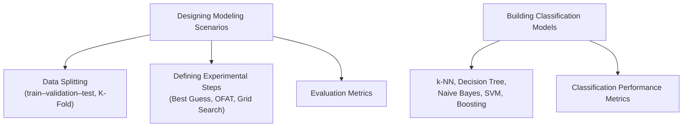
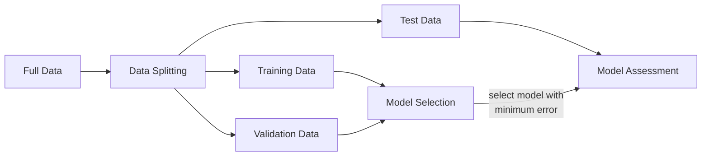
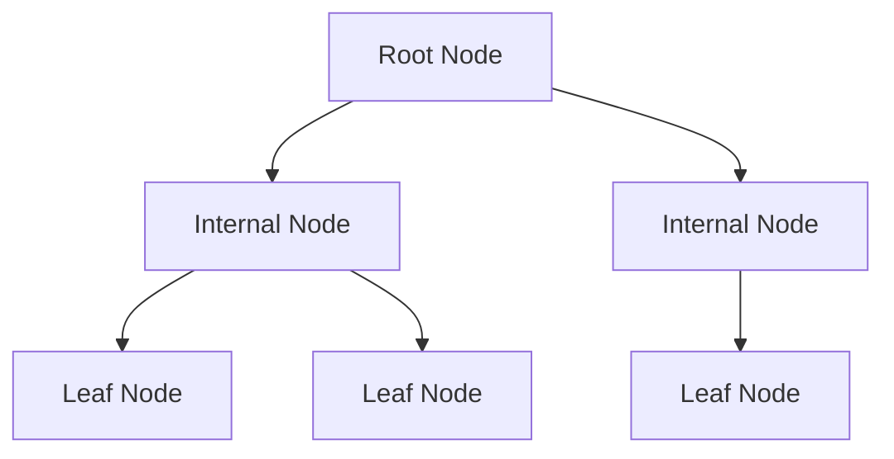
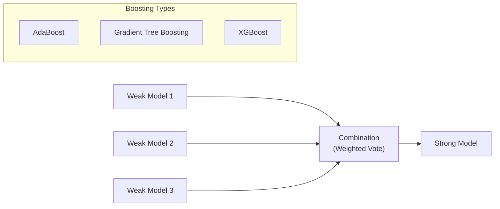

import { Accordion, Accordions } from 'fumadocs-ui/components/accordion';
import { Callout } from 'fumadocs-ui/components/callout';
import { Tab, Tabs } from 'fumadocs-ui/components/tabs';

> **Module & Portal Compiler:** Mahendar Dwi Payana  
> **DTS 2021 Training Material Author:** Afiahayati, S.Kom., M.Cs., Ph.D. — Thematic Academy Digital Talent Scholarship 2021  
> **Organizer & Curriculum:** Ministry of Communication and Information Technology of the Republic of Indonesia (Kominfo) & School of Electrical Engineering and Informatics (STEI) ITB

---

## 1. Learning Objectives & Scope

This module is the **first part of modeling**. It covers **designing modeling scenarios** and **building classification models** (regression modeling follows in Session 12).

### Module Learning Objectives

After completing this module, participants are expected to be able to:

1. **Design Modeling Scenarios** — identify modeling techniques, select techniques suited to data characteristics and technical goals, and prepare testing scenarios.
2. **Build Classification Models** — configure model parameters and utilize modeling tools.

**Key Topics:**



<Callout type="info" title="Module 11 Lab Scope">
Module 11 (Model Building and Case Study) uses the **Iris dataset** with a 70% training and 30% test split, applies multiple classification methods with *parameter tuning*, and compares them against the **AdaBoost algorithm**. The group case study models **education quality (SNP)** of schools in Bogor Regency using both classification and regression.
</Callout>

---

## 2. Designing Modeling Scenarios

Experimental scenario design is carried out **before** building any model, and consists of three crucial decisions: data splitting, experimental steps, and evaluation metrics.

### A. Data Splitting

Data is divided into two main parts: **training data** (to develop the model) and **test data** (to measure performance). A more rigorous practice adds a **validation set** in between.



**Role of each data split:**

| Split | Role | Connection |
| :--- | :--- | :--- |
| **Training Data** | Fits model parameters | — |
| **Validation Data** | Compares models with different hyperparameters; detects *underfitting*/*overfitting* | **Model Selection** (estimates performance across models → select minimum error) |
| **Test Data** | Evaluates final performance across competing algorithms | **Model Assessment** (estimates generalization error on unseen data) |

**Rationale & common proportions:**

* If the training set is too small, the model learns from insufficient data and generalization estimates become overly "optimistic" (high bias).
* Common train:validation proportions: **66.6%:33.3%**, **75%:25%**, and **80%:20%**. This module uses **70% train : 30% test**.

```python
from sklearn import datasets
from sklearn.model_selection import train_test_split

# Iris dataset: 150 samples, 4 features, 3 classes
iris = datasets.load_iris()
X, y = iris.data, iris.target

# 70% train : 30% test split
X_train, X_test, y_train, y_test = train_test_split(
    X, y, train_size=0.7, random_state=42
)
print("Train samples:", len(X_train), "| Test samples:", len(X_test))
```

### B. K-Fold Cross-Validation

Performed **on the training data**, especially when sample sizes are relatively small. The training set is split into $K$ folds; iteratively, 1 fold serves as validation data while $K-1$ folds train the model. The average score provides a more stable performance estimate than a single split.

$$
\text{CV}_{(K)} = \frac{1}{K}\sum_{k=1}^{K} \text{Score}_k
$$

```python
from sklearn.model_selection import cross_val_score
from sklearn.svm import SVC

model = SVC(kernel='linear', C=1)

# 5-Fold Cross Validation
scores = cross_val_score(model, X, y, cv=5)
print("Accuracy per fold :", scores)
print("Mean accuracy     :", scores.mean())
```

* **Stratified K-Fold**: preserves class proportions in every fold — **mandatory** for imbalanced data.
* **Time-Series Split**: for temporal data to prevent *future leakage*.

### C. Fatal Danger of Data Leakage

> [!CAUTION]
> **Data Leakage**: a condition where information from outside the training set (especially test data or future observations) leaks into the training process.
>
> *Common causes*: `StandardScaler.fit()`, `SimpleImputer.fit()`, or SMOTE applied to the **entire** dataset before train/test splitting.
>
> *Solution*: wrap preprocessing and the model inside a **Scikit-learn Pipeline** so `fit` only runs on training data.

```python
from sklearn.pipeline import Pipeline
from sklearn.preprocessing import StandardScaler
from sklearn.linear_model import LogisticRegression

# Wrong: fitting scaler on full data before split -> LEAKAGE!

# Correct: all stages inside a Pipeline
pipe = Pipeline([
    ('scaler', StandardScaler()),
    ('clf', LogisticRegression(max_iter=1000, random_state=42))
])
pipe.fit(X_train, y_train)
print("Pipeline Accuracy:", pipe.score(X_test, y_test))
```

### D. Defining Experimental Steps (Parameter Search Strategies)

Every algorithm has specific **parameters**. Experiments test multiple parameter variations, and the best-performing combination is carried forward. Three search strategies:

| Strategy | How It Works | Pros | Cons |
| :--- | :--- | :--- | :--- |
| **Best Guess** | Guessing one combination based on experience | Very fast | Unsystematic; may miss optimal combinations |
| **One Factor at a Time (OFAT)** | Varying one parameter while holding others fixed | Simple | Ignores interactions between parameters |
| **Grid Search** | Exhaustively testing every combination on a defined grid | Systematic & thorough | Computationally expensive |

### E. Evaluation Metrics by Task Type

| Task Type | Evaluation Metrics |
| :--- | :--- |
| **Classification** | Accuracy, Precision, Recall/Sensitivity, Specificity, F1-measure |
| **Regression** | MSE (*Mean Squared Error*), MAPE (*Mean Absolute Percentage Error*) |
| **Clustering** | Silhouette Score, Davies-Bouldin Index |

For binary classification, the four foundational metrics are derived from the **Confusion Matrix**:

$$
\text{Accuracy} = \frac{TP+TN}{TP+TN+FP+FN}, \quad
\text{Precision} = \frac{TP}{TP+FP}, \quad
\text{Recall} = \frac{TP}{TP+FN}
$$

$$
\text{Specificity} = \frac{TN}{TN+FP}, \qquad
F_1 = 2 \cdot \frac{P \cdot R}{P + R}
$$

> Deep dives into Confusion Matrices, ROC/PR Curves, and SHAP are covered in **Session 15**.

---

## 3. Building Classification Models

### 3.1 Logistic Regression (Linear Baseline)

A linear model that maps feature combinations to class probabilities via the **Sigmoid Function**:

$$
P(Y=1 \mid X) = \sigma(z) = \frac{1}{1 + e^{-z}}, \qquad z = \beta_0 + \sum_{j=1}^{p} \beta_j X_j
$$

```python
from sklearn.linear_model import LogisticRegression
from sklearn import metrics

lr = LogisticRegression(max_iter=1000, random_state=42)
lr.fit(X_train, y_train)
print("Logistic Regression Accuracy:", metrics.accuracy_score(y_test, lr.predict(X_test)))
```

---

### 3.2 k-Nearest Neighbor (k-NN) Classifier

**k-NN Algorithm:**

1. Choose the value of $k$ (number of neighbors).
2. Compute the **distance** from the new point to all training points.
3. Identify the $k$ nearest neighbors.
4. Assign the label of the new point based on neighbor classes (typically *majority voting*).

$$
d(x, x') = \sqrt{\sum_{j=1}^{p} (x_j - x'_j)^2}
$$

**Illustrative case:** 4 training samples (P1–P4) with 2 attributes ($x_1, x_2$) and 2 classes (BAD, GOOD); determine the class of test point P5 based on its $k$ nearest neighbors.

**Pros & Cons:**

| Pros | Cons |
| :--- | :--- |
| Well-suited for numeric data | *Lazy learner* — builds no explicit model |
| Easy to understand & implement | High prediction computation cost |
| Non-parametric | Requires choosing an appropriate $k$ |

> **Choosing $k$:** If $k$ is too small → sensitive to *noise*. If $k$ is too large → neighbors may include other classes.

| Parameter | Description | Example Values |
| :--- | :--- | :--- |
| `n_neighbors` | Number of neighbors | Integer $(1, 2, 3, \dots)$ |

```python
from sklearn.neighbors import KNeighborsClassifier

knn = KNeighborsClassifier()   # sklearn default: n_neighbors=5
knn.fit(X_train, y_train)
print("KNN:", knn.score(X_test, y_test))
```

> **Important:** KNN is **highly scale-sensitive** → feature standardization is mandatory (see Session 09).

---

### 3.3 Decision Tree Classifier

Builds a decision tree from training data; its output consists of **rules** used for classification. Tree structure:



**Construction procedure (Gini Index/Impurity):**

1. Compute the **Gini Index (GI)** for each attribute.
2. Select **root** = the attribute with the **lowest GI**.
3. Repeat steps 1–2 at subsequent levels until all leaves reach **GI = 0**.

$$
I_G(p) = 1 - \sum_{i=1}^{C} p_i^2
$$

**Gini Calculation Example ("Buy" case study):**

Training data with 7 records, 3 attributes (Primary Need, Paid Salary, Item Price), target Buy/Not Buy. **Total GI** is computed as the *weighted average* GI of both child nodes.

| Attribute | Gini Index | Decision |
| :--- | :---: | :--- |
| Primary Need | 0.40 | — |
| **Paid Salary** | **0.22** | ✅ **Root** (lowest GI) |
| Item Price | 0.34 | — |

> **Handling continuous attributes:** for `Item Price`, GI is computed at the midpoints between adjacent sorted values (e.g., `> 9500`, `> 15000`, `> 26500`, `> 36500`, `> 44000`, `> 66500`), selecting the lowest GI. In the example, `Item Price > 15000` yields the smallest GI and splits the left *leaf*. Because the right *leaf* already has GI = 0, it is not split further.

**Pros & Cons:**

| Pros | Cons |
| :--- | :--- |
| Produces human-readable **rules** | Harder to build on numeric data; potential information loss |
| Requires no distributional assumptions | Trees can grow overly complex (overfitting) |

| Parameter | Description | Default |
| :--- | :--- | :--- |
| `max_depth` | Maximum depth of the tree | `None` (grows until GI = 0) |
| `min_samples_split` | Minimum samples required to *split* a node | `2` |

```python
from sklearn.tree import DecisionTreeClassifier, plot_tree
import matplotlib.pyplot as plt

dt = DecisionTreeClassifier(max_depth=None, min_samples_split=2, random_state=42)
dt.fit(X_train, y_train)
print("Decision Tree:", dt.score(X_test, y_test))

plt.figure(figsize=(12, 8))
plot_tree(dt, feature_names=iris.feature_names, class_names=iris.target_names, filled=True)
plt.show()
```

> To prevent **overfitting**, constrain `max_depth` and/or increase `min_samples_split`.

---

### 3.4 Naive Bayes Classifier

Builds a **probabilistic model** for classification. Two modeling paradigms:

* **Discriminative Model** — models $P(y \mid x)$ directly.
* **Generative Model** — models $P(x \mid y)$ and $P(y)$, then derives $P(y \mid x)$. Naive Bayes is generative.

**MAP Classification Rule** (*Maximum A Posteriori*) via Bayes' theorem:

$$
\hat{y} = \arg\max_{y}\; P(y \mid x_1,\dots,x_n) \;\propto\; \arg\max_{y}\; P(y)\prod_{i=1}^{n} P(x_i \mid y)
$$

**Illustrative case:** 14 training samples for playing tennis with 4 attributes (Outlook, Temperature, Humidity, Wind) and 2 classes (YES/NO). Test data is classified using conditional probabilities of each attribute per class.

**Pros & Cons:**

| Pros | Cons |
| :--- | :--- |
| Performs well on **small training sets** | Harder to handle continuous numeric data directly |
| Very fast | The **feature independence** assumption rarely holds in practice |

```python
from sklearn.naive_bayes import GaussianNB, BernoulliNB

# GaussianNB suits continuous features; BernoulliNB suits binary features
nb = GaussianNB()
nb.fit(X_train, y_train)
print("Naive Bayes:", nb.score(X_test, y_test))
```

---

### 3.5 Support Vector Machine (SVM)

Core idea of SVM: find the **optimal hyperplane** that cleanly separates two decision regions. The optimal hyperplane is obtained by **maximizing the distance** (margin) to the closest data points (*support vectors*).

$$
\min_{w,b} \frac{1}{2}\lVert w \rVert^2 \quad \text{subject to} \quad y_i(w^T x_i + b) \ge 1
$$

**Algorithm:** features are mapped into a higher-dimensional space using a **kernel function**, where the optimal separating hyperplane is then found.

**Kernel Types:**

* **Linear**: $K(x_i, x_j) = x_i^T x_j$.
* **Polynomial**: $K(x_i, x_j) = (x_i^T x_j + c)^d$.
* **Radial Basis Function (RBF)**: $K(x_i, x_j) = \exp(-\gamma \lVert x_i - x_j \rVert^2)$.
* **Sigmoid**.

**Hyperparameter Interpretation:**

* **Parameter $C$** (regularization): trade-off between maximizing margin width and minimizing classification errors.
  * **High** $C$ → heavy penalty for misclassifications (suited for low-*noise* data).
  * **Low** $C$ → more tolerant of misclassifications (suited for high-*noise* data).
* **Parameter $\gamma$**: large $\gamma$ → sharper boundary curvature; small $\gamma$ → smoother decision boundary.

| Parameter | Description | Default |
| :--- | :--- | :--- |
| `kernel` | `linear`, `poly`, `rbf`, `sigmoid` | `rbf` |
| `C` | Regularization across all kernels | `1.0` |
| `gamma` | Kernel coefficient for `poly` & `rbf` | `scale` |
| `degree` | Polynomial degree (`poly` kernel) | `3` |

<Tabs items={['Linear', 'Polynomial', 'RBF']}>
  <Tab value="Linear">
```python
from sklearn.svm import SVC

svm_linear = SVC(kernel='linear', C=1)
svm_linear.fit(X_train, y_train)
print("SVM Linear:", svm_linear.score(X_test, y_test))
```
  </Tab>
  <Tab value="Polynomial">
```python
svm_poly = SVC(kernel='poly', C=1, gamma=0.01, degree=2)
svm_poly.fit(X_train, y_train)
print("SVM Polynomial:", svm_poly.score(X_test, y_test))
```
  </Tab>
  <Tab value="RBF">
```python
svm_rbf = SVC(kernel='rbf', C=1, gamma=0.01)
svm_rbf.fit(X_train, y_train)
print("SVM RBF:", svm_rbf.score(X_test, y_test))
```
  </Tab>
</Tabs>

**Pros & Cons:**

| Pros | Cons |
| :--- | :--- |
| Kernel trick handles complex data | Hyperparameters & kernel require tuning |
| Outliers handled via *soft margin* $C$ | Long training times on large datasets |

---

### 3.6 Random Forest (Bagging Ensemble)

Combines hundreds of independent decision trees. Each tree is trained on a *bootstrap* sample and selects a random subset of features at every split (*feature subspace sampling*). Final prediction = **majority vote**:

$$
\hat{y} = \text{mode}\left(T_1(x), T_2(x), \dots, T_B(x)\right)
$$

---

### 3.7 Boosting Algorithms

**Boosting** is an ensemble strategy that turns *weak models* into a *strong model* by combining individual predictions via *average/weighted average* or *weighted voting*. Three main types:



#### Adaptive Boosting (AdaBoost)

AdaBoost identifies **misclassified** samples and assigns **higher weights** to them so subsequent classifiers focus more heavily on hard examples. By default in Scikit-learn, the boosted *base estimator* is a **Decision Tree** (stump).

**Mathematical formulation:**

1. **Weighted error** of the $t$-th model:
$$
\varepsilon_t = \sum_{i:\, h_t(x_i) \neq y_i} w_i^{(t)}
$$

2. **Model confidence weight** (smaller error gives higher influence):
$$
\alpha_t = \frac{1}{2}\ln\left(\frac{1 - \varepsilon_t}{\varepsilon_t}\right)
$$

3. **Sample weight update** (misclassified samples → weight increases):
$$
w_i^{(t+1)} = w_i^{(t)} \cdot \exp\left(-\alpha_t\, y_i\, h_t(x_i)\right), \quad \text{then normalized}
$$

4. **Final prediction**:
$$
H(x) = \text{sign}\left(\sum_{t=1}^{T} \alpha_t\, h_t(x)\right)
$$

| Parameter | Description | Default |
| :--- | :--- | :--- |
| `n_estimators` | Number of *weak learners* used | `50` |
| `learning_rate` | Weight shrink per boosting iteration | `1.0` |

```python
from sklearn.ensemble import AdaBoostClassifier
from sklearn import metrics

ab = AdaBoostClassifier(n_estimators=50, learning_rate=1, random_state=42)
ab.fit(X_train, y_train)

y_pred_ab = ab.predict(X_test)
acc_ab = metrics.accuracy_score(y_test, y_pred_ab) * 100
print(f"AdaBoost Accuracy: {round(acc_ab, 2)}%")
```

> Higher `learning_rate` increases each estimator's contribution; smaller values require more estimators.

---

### 3.8 Gradient Boosting & XGBoost

Gradient Boosting is also sequential, but each new tree is trained to predict the **pseudo-residuals** (loss gradients) of the previous model:

$$
F_m(x) = F_{m-1}(x) + \gamma_m h_m(x)
$$

XGBoost adds regularization and second-order optimization (Hessian), often making it *state-of-the-art* on tabular data.

---

## 4. Hyperparameter Tuning with GridSearchCV

**Grid Search** systematically evaluates all hyperparameter combinations using cross-validation, then selects the best combination.

$$
\text{Best Params} = \arg\max_{\theta \in \Theta} \; \text{CV}_{(K)}(\theta)
$$

```python
from sklearn.model_selection import GridSearchCV
from sklearn.neighbors import KNeighborsClassifier

# Search space: k = 1..49 and weighting strategies
param_grid = dict(
    n_neighbors=list(range(1, 50)),
    weights=["uniform", "distance"]
)

knn = KNeighborsClassifier()
grid = GridSearchCV(knn, param_grid, cv=10, scoring='accuracy')
grid.fit(X_train, y_train)

print("Best KNN accuracy  :", grid.best_score_)
print("Best parameters    :", grid.best_params_)
print("Best estimator     :", grid.best_estimator_)
```

> **Alternatives**: `RandomizedSearchCV` (random sampling across parameter space, faster) and `HalvingGridSearchCV` (successive halving elimination).

---

## 5. Lab 11-1: Algorithm Comparison on the Iris Dataset

Iris dataset: 150 samples, 3 classes (Setosa, Versicolor, Virginica), 4 features (sepal & petal length/width in cm).

```python
"""
Classification Algorithm Comparison & Testing Scenario Execution
Lab Source: Module 11 - Model Building (DTS 2021)
Compiled by: Mahendar Dwi Payana
"""
from sklearn import datasets, metrics
from sklearn.model_selection import train_test_split, cross_val_score
from sklearn.pipeline import Pipeline
from sklearn.preprocessing import StandardScaler
from sklearn.linear_model import LogisticRegression
from sklearn.svm import SVC
from sklearn.tree import DecisionTreeClassifier
from sklearn.naive_bayes import GaussianNB
from sklearn.neighbors import KNeighborsClassifier

iris = datasets.load_iris()
X, y = iris.data, iris.target

X_train, X_test, y_train, y_test = train_test_split(
    X, y, train_size=0.7, random_state=42
)

models = {
    "Logistic Regression": LogisticRegression(max_iter=1000, random_state=42),
    "k-NN":                KNeighborsClassifier(),
    "Decision Tree":       DecisionTreeClassifier(max_depth=None, min_samples_split=2, random_state=42),
    "Naive Bayes":         GaussianNB(),
    "SVM Linear":          SVC(kernel='linear', C=1),
    "SVM Polynomial":      SVC(kernel='poly', C=1, gamma=0.01, degree=2),
    "SVM RBF":             SVC(kernel='rbf', C=1, gamma=0.01),
}

for name, model in models.items():
    pipe = Pipeline([('scaler', StandardScaler()), ('clf', model)])
    pipe.fit(X_train, y_train)
    acc = metrics.accuracy_score(y_test, pipe.predict(X_test))
    cv = cross_val_score(pipe, X, y, cv=5).mean()
    print(f"{name:<20} : Accuracy = {acc:.4f} | CV-5 = {cv:.4f}")
```

> **Lab Note:** Always evaluate models on the **exact same test split** for a fair comparison. For continuous data, `GaussianNB` is generally more appropriate than `BernoulliNB`.

---

## 6. Lab 11-2: AdaBoost vs. Baseline (Module 11 Assignment)

Following **Module 11 Daily Assignment**: use the Iris dataset, split 70% train / 30% test, perform parameter tuning for best accuracy, then compare against **AdaBoost**.

```python
from sklearn.ensemble import AdaBoostClassifier
from sklearn import metrics

# Best baseline from Lab 11-1 (e.g., SVM RBF)
svm = SVC(kernel='rbf', C=1, gamma=0.01)
svm.fit(X_train, y_train)
acc_svm = metrics.accuracy_score(y_test, svm.predict(X_test))
print(f"SVM RBF Accuracy : {acc_svm:.4f}")

# AdaBoost
abc = AdaBoostClassifier(n_estimators=50, learning_rate=1, random_state=42)
abc.fit(X_train, y_train)
acc_ab = metrics.accuracy_score(y_test, abc.predict(X_test))
print(f"AdaBoost Accuracy: {acc_ab:.4f}")
```

> **Reference Result (Module 11 Assignment Notebook):** Tuned SVM achieved **97.78%** accuracy, while AdaBoost achieved **95.56%**. This finding confirms that **boosting does not automatically outperform a single model** — performance depends on data characteristics. On small, relatively separable datasets like Iris, RBF-kernel SVM is very strong, whereas AdaBoost excels when *weak learners* can exploit complex non-linear structures.
>
> **Methodological Note:** Because Iris has only 150 rows, a difference of 1–2 samples can shift accuracy by several percentage points. Use **K-Fold Cross-Validation** for a more reliable comparison.

---

## 7. Case Study: Education Quality (SNP) Classification & Regression

The group case study (UGM03) models **National Education Standards (SNP)** for junior high schools in Bogor Regency from Dapodik data (integrated in Session 10). Eight standards (S1–S8) are analyzed to predict the SNP level.

### A. Target Labeling

SNP score = average of the eight standards, then discretized into ordinal levels:

```python
# SNP = mean of S1..S8
dt_pmp['SNP'] = dt_pmp[['S1','S2','S3','S4','S5','S6','S7','S8']].mean(axis=1)

def level_snp(hitung):
    rerata = round(hitung, 2)
    if   1.00 <= rerata <= 2.04: return 'SNP_1'
    elif 2.05 <= rerata <= 3.70: return 'SNP_2'
    elif 3.71 <= rerata <= 5.06: return 'SNP_3'
    elif 5.07 <= rerata <= 6.66: return 'SNP_4'
    else:                        return 'SNP'

dt_pmp['level'] = dt_pmp.apply(lambda x: level_snp(x['SNP']), axis=1)
```

### B. Handling Class Imbalance

Classes `SNP_3` and `SNP_4` had far fewer samples. Solution: append prior-year PMP records **only for the minority class** (`SNP_3`), then map labels into binary classes (`SNP_3` → 0, `SNP_4` → 1).

```python
def label_snp(level):
    if level == 'SNP_3':   return 0
    elif level == 'SNP_4': return 1

dt_pmp = pd.concat(
    [dt_pmp, dt_pmp_2018[dt_pmp_2018['level'] == 'SNP_3']],
    ignore_index=True,
)
dt_pmp['level'] = dt_pmp['level'].map(label_snp)
```

### C. Feature Selection via Correlation & Density Plots

Correlation (**Guilford, 1956** criteria) and per-class *density plots* identify the most discriminative features:

| Guilford Criterion | Coefficient $r$ |
| :--- | :--- |
| Very strong relationship | 0.80 – 1.00 |
| Strong relationship | 0.60 – 0.79 |
| Moderate relationship | 0.40 – 0.59 |
| Low | 0.20 – 0.39 |
| Very low | 0.00 – 0.19 |

```python
import seaborn as sn
import matplotlib.pyplot as plt
from pylab import rcParams

def plot_correlation(data):
    rcParams['figure.figsize'] = 15, 20
    sn.heatmap(data[['S1','S2','S3','S4','S5','S6','S7','S8','level']].corr(),
               annot=True, fmt=".2f")
    plt.show()

plot_correlation(dt_pmp)
```

> **Findings:** The most predictive features are **S5 (Educator & Staff Standard, $r=0.95$)** and **S6 (Facilities Standard, $r=0.94$)**, followed by S3 (0.60) and S7 (0.69). This is confirmed by the *density plot*: class 0 and 1 curves nearly overlap on S2, yet separate clearly on S5.

### D. Classification Modeling & Evaluation

```python
from sklearn.model_selection import GridSearchCV
from sklearn.neighbors import KNeighborsClassifier
from sklearn.metrics import accuracy_score
from sklearn.ensemble import AdaBoostClassifier

# Only 4 selected features
X = dt_pmp[['S3', 'S5', 'S6', 'S7']]
y = dt_pmp['level']

X_train, X_test, y_train, y_test = train_test_split(X, y, train_size=0.7, random_state=42)
scaler = StandardScaler()
X_train = scaler.fit_transform(X_train)
X_test = scaler.transform(X_test)

# KNN + GridSearchCV (parameter tuning)
grid = GridSearchCV(KNeighborsClassifier(),
                    dict(n_neighbors=list(range(1, 50)),
                         weights=["uniform", "distance"]),
                    cv=10, scoring='accuracy')
grid.fit(X_train, y_train)
print("Best KNN:", grid.best_score_, grid.best_params_)

# AdaBoost for comparison
ab = AdaBoostClassifier(n_estimators=50, learning_rate=1, random_state=42)
ab.fit(X_train, y_train)
print("AdaBoost Accuracy:", accuracy_score(y_test, ab.predict(X_test)))
```

> **Case Study Conclusion:** The tuned **KNN** model achieved the highest accuracy in classifying SNP levels from features S3, S5, S6, and S7.

### E. Regression Modeling (Supplement — covered in full in Session 12)

The case study also models the continuous **SNP** score as a multiple regression target:

```python
import numpy as np
from sklearn import linear_model
from sklearn.metrics import r2_score

msk = np.random.rand(len(dt_pmp)) < 0.8
train_reg, test_reg = dt_pmp[msk], dt_pmp[~msk]

regr = linear_model.LinearRegression()
regr.fit(np.asanyarray(train_reg[['S3','S5','S6','S7']]),
         np.asanyarray(train_reg[['SNP']]))

print("Coefficients:", regr.coef_, "| Intercept:", regr.intercept_)

test_y = np.asanyarray(test_reg[['SNP']])
test_y_ = regr.predict(np.asanyarray(test_reg[['S3','S5','S6','S7']]))
print("MAE   : %.2f" % np.mean(np.absolute(test_y_ - test_y)))
print("MSE   : %.2f" % np.mean((test_y_ - test_y) ** 2))
print("R2    : %.2f" % r2_score(test_y_, test_y))
```

Resulting multiple regression equation:
$$
\text{SNP} = 1.000 + 0.158\,S_3 + 0.146\,S_5 + 0.225\,S_6 + \dots
$$

---

## 8. Model Comparison Summary

| Algorithm | Key Assumption | Scale-Sensitive? | Pros | Cons |
| :--- | :--- | :---: | :--- | :--- |
| **Logistic Regression** | Linear log-odds relation | Yes | Fast, interpretable coefficients | Struggles with non-linearity |
| **k-NN** | Local proximity | **Very** | Simple, non-parametric | Lazy learner; high prediction cost |
| **Decision Tree** | Recursive Gini splits | No | Produces **rules**; assumption-free | Prone to overfitting; complex |
| **Naive Bayes** | Feature independence | No | Works on small data; very fast | Independence assumption often violated |
| **SVM** | Maximum margin | Yes | Effective in high dimensions (kernels) | Slow on large data; tuning $C$, $\gamma$ |
| **Random Forest** | Tree bagging | No | Robust, high accuracy | Less interpretable |
| **AdaBoost** | Sequential boosting | No | Focuses on hard samples; *weak → strong* | Sensitive to outliers & noise |
| **Gradient Boosting / XGBoost** | Boosting + regularization | No | SOTA on tabular data | Many hyperparameters |

> **Module Takeaway:** Designing an experimental scenario (data splitting, search strategy, evaluation metrics) is a mandatory step **before** building models. Every algorithm has trade-offs, so **comprehensive experimentation** is essential to identify the best model for a given problem and dataset.

---

## 9. Evaluation Sheet & Independent Lab Assignments

<Accordions>
  <Accordion title="Task 1: Algorithm Comparison & Parameter Tuning">
    Use the Iris dataset with a 70:30 split. Train at least **five** classification algorithms (k-NN, Decision Tree, Naive Bayes, SVM, Logistic Regression) using `Pipeline` + `StandardScaler`. Run `GridSearchCV` for each. Present a table of test accuracy, CV-5 accuracy, and best hyperparameters. Conclude which algorithm performs best and why!
  </Accordion>

  <Accordion title="Task 2: AdaBoost Implementation & Analysis (Official Module 11 Assignment)">
    Apply `AdaBoostClassifier` on the Iris dataset and compare it against the best classification method from Task 1. Experiment with `n_estimators` (10, 50, 100) and `learning_rate` (0.1, 0.5, 1.0). Plot the accuracy curve against the number of estimators and explain why boosting does not always outperform a single model on small datasets!
  </Accordion>

  <Accordion title="Task 3: Demonstrating the Danger of Data Leakage">
    Create two scenarios: (a) fitting `StandardScaler` on the **entire** dataset before `train_test_split`, and (b) placing the scaler inside a `Pipeline`. Compare both accuracies on the exact same test set. Explain why scenario (a) produces *falsely optimistic* estimates!
  </Accordion>

  <Accordion title="Task 4: Manual Gini Index Calculation Simulation">
    Given a small training dataset with 3 attributes and a binary target, manually compute the Gini Index of each attribute (weighted average GI of child nodes), determine the root attribute, and verify your result with `DecisionTreeClassifier` + `plot_tree`. Explain why the attribute with the lowest GI is chosen as the root!
  </Accordion>

  <Accordion title="Task 5: Formal Testing Scenario Design">
    For your Capstone project dataset, draft a testing scenario document detailing: (1) specific data assumptions, (2) chosen modeling techniques with justification, (3) validation strategy (Stratified K-Fold vs. Time-Series Split), (4) primary evaluation metrics and tolerance thresholds, and (5) data leakage prevention protocol. Document according to SOP!
  </Accordion>
</Accordions>

---

## 10. References & Official Links

1. **Afiahayati, S.Kom., M.Cs., Ph.D.** (2021). *Module 11 — Model Building and Case Study*. Thematic Academy Digital Talent Scholarship 2021, Ministry of Communication and Information Technology of RI.
2. **Christopher M. Bishop** (2006). *Pattern Recognition and Machine Learning*. Springer.
3. **Ronald A. Fisher** (1936). *The Use of Multiple Measurements in Taxonomic Problems*. Annals of Eugenics, 7(2), 179–188. *(Iris Dataset)*.
4. **Corinna Cortes & Vladimir Vapnik** (1995). *Support-Vector Networks*. Machine Learning, 20(3), 273–297. *(SVM & Kernel Trick)*.
5. **Yoav Freund & Robert E. Schapire** (1997). *A Decision-Theoretic Generalization of On-Line Learning and an Application to Boosting*. Journal of Computer and System Sciences, 55(1), 119–139. *(AdaBoost Algorithm)*.
6. **J. P. Guilford** (1956). *Fundamental Statistics in Psychology and Education* (3rd ed.). McGraw-Hill. *(Correlation coefficient interpretation criteria)*.
7. **F. Pedregosa et al.** (2011). *Scikit-learn: Machine Learning in Python*. Journal of Machine Learning Research, 12, 2825–2830.
