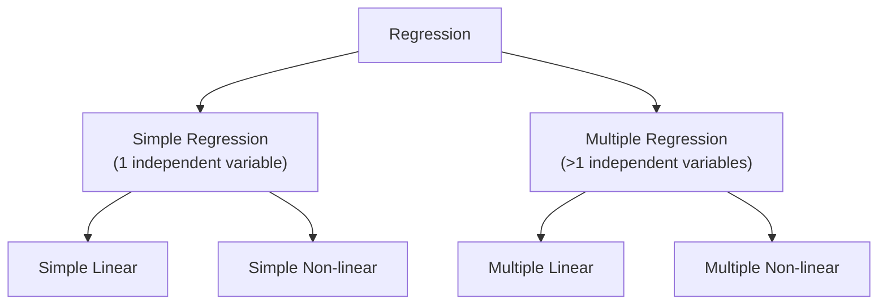

import { Accordion, Accordions } from 'fumadocs-ui/components/accordion';
import { Callout } from 'fumadocs-ui/components/callout';
import { Tab, Tabs } from 'fumadocs-ui/components/tabs';

> **Module & Portal Compiler:** Mahendar Dwi Payana  
> **DTS 2021 Training Material Author:** Noor Akhmad Setiawan, S.T., M.T., Ph.D. — Thematic Academy Digital Talent Scholarship 2021  
> **Organizer & Curriculum:** Ministry of Communication and Information Technology of the Republic of Indonesia (Kominfo) & School of Electrical Engineering and Informatics (STEI) ITB

---

## 1. Learning Objectives & Lab Datasets

This module is the **second part of modeling** (continuing Session 11) and focuses on **continuous** target variables (regression).

**Learning Objectives** — participants will be able to explain, prepare, and implement regression models using the following algorithms:

1. Simple and Multiple Linear Regression
2. Polynomial and Non-Linear Regression
3. Support Vector Regression (SVR)
4. Decision Tree Regression (DTR)
5. Random Forest Regression (RFR)

Along with evaluating their performance using **Python** and **Scikit-learn**.

<Callout type="info" title="Module 12 Lab Datasets">
All module labs use two datasets available on the portal:
1. **`FuelConsumption.csv`** — <DataLink file="FuelConsumption.csv">Download</DataLink> *(1,067 Canadian light-duty vehicles; EngineSize → CO₂ Emission)*
2. **`china_gdp.csv`** — <DataLink file="china_gdp.csv">Download</DataLink> *(China GDP 1960–2014; non-linear regression)*
</Callout>

---

## 2. Definition & Typology of Regression

### A. Definition

> **Regression** is the process of **predicting a continuous value** of a *dependent* variable based on the values of independent (*predictor*) variables.

Example: predicting the continuous value `CO2EMISSIONS` from `ENGINESIZE`, `CYLINDERS`, and `FUELCONSUMPTION`. A **regression model** is the outcome of parameter estimation capable of accurately predicting the dependent variable.

### B. Types of Regression Models



### C. Regression Applications

* Product sales forecasting
* Satisfaction analysis
* Price estimation
* Income prediction, and more

### D. Regression Algorithms

Linear Regression, Polynomial Regression, Support Vector Regression, Decision Tree Regression, Random Forest Regression, LASSO Regression, ANN Regression, K-NN Regression, and others.

---

## 3. Simple Linear Regression

A model with a single independent variable:

$$
y = \theta_0 + \theta_1 x
$$

Where $\theta_0$ = *intercept* and $\theta_1$ = *slope* (gradient). The regression line is fitted to **minimize the sum of squared residuals** between predicted and actual values.

### A. MSE as the *Loss Function*

To prevent positive and negative errors from canceling out, **Mean Squared Error (MSE)** is used:

$$
\text{MSE}(\theta_0, \theta_1) = \frac{1}{n}\sum_{i=1}^{n} \left(y_i - \hat{y}_i\right)^2
$$

### B. Parameter Estimation (Least Squares)

Optimal parameters are found via the **Least Squares** method, which yields an analytical solution (*normal equation*):

$$
\hat{\boldsymbol{\theta}} = (\mathbf{X}^T \mathbf{X})^{-1} \mathbf{X}^T \mathbf{y}
$$

### C. Advantages of Linear Regression

| Advantage | Explanation |
| :--- | :--- |
| **Lightweight** | Simple computation |
| **No parameter tuning** | Parameters are calculated directly from data |
| **Highly interpretable** | The effect of each predictor is clearly visible from its coefficient |

### D. Lab: `EngineSize` → `CO2EMISSIONS`

```python
import numpy as np
import pandas as pd
import matplotlib.pyplot as plt
from sklearn import linear_model
from sklearn.metrics import r2_score

BASE = "https://mahendartea.github.io/Learn-AI/data"
df = pd.read_csv(f"{BASE}/FuelConsumption.csv")

# Exploration
cdf = df[['ENGINESIZE', 'CYLINDERS', 'FUELCONSUMPTION_COMB', 'CO2EMISSIONS']]
cdf.hist()
plt.show()

plt.scatter(cdf.ENGINESIZE, cdf.CO2EMISSIONS, color='blue')
plt.xlabel("Engine size")
plt.ylabel("Emission")
plt.show()

# Train/test split (80:20)
msk = np.random.rand(len(df)) < 0.8
train, test = cdf[msk], cdf[~msk]

# Modeling
regr = linear_model.LinearRegression()
train_x = np.asanyarray(train[['ENGINESIZE']])
train_y = np.asanyarray(train[['CO2EMISSIONS']])
regr.fit(train_x, train_y)

print("Coefficients:", regr.coef_)
print("Intercept   :", regr.intercept_)

# Plot regression line
plt.scatter(train.ENGINESIZE, train.CO2EMISSIONS, color='blue')
plt.plot(train_x, regr.coef_[0][0] * train_x + regr.intercept_[0], '-r')
plt.xlabel("Engine size")
plt.ylabel("Emission")
plt.show()

# Evaluation
test_x = np.asanyarray(test[['ENGINESIZE']])
test_y = np.asanyarray(test[['CO2EMISSIONS']])
test_y_ = regr.predict(test_x)
print("MAE     : %.2f" % np.mean(np.absolute(test_y_ - test_y)))
print("MSE     : %.2f" % np.mean((test_y_ - test_y) ** 2))
print("R2-score: %.2f" % r2_score(test_y_, test_y))
```

---

## 4. Multiple Linear Regression

As the name implies, the model uses **more than one** independent variable:

$$
y_i = \beta_0 + \beta_1 x_{i1} + \beta_2 x_{i2} + \dots + \beta_p x_{ip} + \epsilon_i
$$

In matrix notation:

$$
\mathbf{y} = \mathbf{X}\boldsymbol{\beta} + \boldsymbol{\epsilon}
$$

**Example use cases:**

* **Predictor effectiveness:** Do anxiety, instructor attendance, and gender affect student exam performance?
* **Predicting impact of change:** How much does blood pressure rise for a given increase in a patient's BMI?

### A. Parameter Estimation: Least Squares vs. Gradient Descent

| Method | Characteristics | Best For |
| :--- | :--- | :--- |
| **Least Squares** | Linear algebra operations (normal equation) | Small–medium datasets |
| **Optimization Algorithm** | Gradient Descent | **Very large** datasets (> 10,000 rows) |

> **Why?** Directly computing $(X^TX)^{-1}$ becomes slow on large datasets, making Gradient Descent far more efficient.

### B. Lab: Three Predictors → `CO2EMISSIONS`

```python
from sklearn import linear_model
import numpy as np

msk = np.random.rand(len(df)) < 0.8
train, test = cdf[msk], cdf[~msk]

regr = linear_model.LinearRegression()
train_x = np.asanyarray(train[['ENGINESIZE', 'CYLINDERS', 'FUELCONSUMPTION_COMB']])
train_y = np.asanyarray(train[['CO2EMISSIONS']])
regr.fit(train_x, train_y)

print("Coefficients:", regr.coef_)
print("Intercept   :", regr.intercept_)

# Predict EngineSize=2.4, Cylinders=4, FuelConsumption=9.2
pred = regr.predict(np.array([[2.4, 4, 9.2]]))
print("Predicted CO2:", pred)
```

---

## 5. Gauss-Markov Classical Assumptions (Model Adequacy Diagnostics)

For the OLS estimator to be **BLUE (*Best Linear Unbiased Estimator*)**, a linear model must satisfy five classical assumptions:

1. **Linearity**: the relationship between features and target is linear.
2. **No Perfect Multicollinearity**: predictors are not perfectly correlated with each other. Tested via **VIF**:

$$
\text{VIF}_j = \frac{1}{1 - R_j^2} \qquad (\text{VIF} > 5 \text{ or } 10 = \text{severe multicollinearity})
$$

3. **Homoscedasticity**: constant residual variance: $\text{Var}(\epsilon_i \mid \mathbf{X}) = \sigma^2$. A funnel pattern in the residual plot indicates heteroscedasticity.
4. **Independence of Errors**: $\text{Cov}(\epsilon_i, \epsilon_j) = 0$, tested via **Durbin-Watson** ($1.5 \le d \le 2.5$).
5. **Normality of Residuals**: residual distribution approximates Gaussian (check via *Q-Q Plot*).

```python
# Simple residual diagnostic example
y_pred = regr.predict(train_x)
residual = train_y.ravel() - y_pred.ravel()

import matplotlib.pyplot as plt
plt.scatter(y_pred, residual, color='blue')
plt.axhline(y=0, color='r', linestyle='--')
plt.xlabel("Predicted Values")
plt.ylabel("Residuals")
plt.title("Residual Plot (Homoscedasticity Check)")
plt.show()
```

---

## 6. Polynomial & Non-Linear Regression

### A. Why Is Non-Linear Regression Needed?

Not all datasets exhibit linear relationships. Forcing a linear model onto curved data yields **large errors**; a non-linear model achieves smaller errors. Basic curve shapes: **linear**, **quadratic/parabolic**, and **cubic**.

### B. Polynomial Regression

Curved data can be modeled with a degree-$k$ polynomial:

$$
y = a x^3 + b x^2 + c x + d
$$

A polynomial model can be **transformed** into a multiple linear regression model (by defining $x_2 = x^2$, $x_3 = x^3$, etc.), allowing it to still be solved via **Least Squares**.

### C. Forms of Non-Linear Functions

| Type | Shape | Equation |
| :--- | :--- | :--- |
| **Quadratic** | parabola | $Y = X^2$ |
| **Exponential** | rapid growth | $Y = a + b\,c^{X}$ |
| **Logarithmic** | decelerating growth | $Y = \log(X)$ |
| **Sigmoid/Logistic** | S-curve | $Y = a + \dfrac{b}{1 + c^{(X-d)}}$ |

Non-linear regression models relationships where $\hat{y}$ is a **non-linear function of parameter $\theta$ and feature $x$** (e.g., $y = \log(a x^3 + b x^2 + c x + d)$).

### D. Linear or Non-Linear?

* **Determination:** visual inspection of the data (visualization) and modeling accuracy.
* **When non-linearity is indicated:** use polynomial regression, non-linear regression, or transform non-linear features into linear form.

### E. Lab: Non-Linear Regression on China's GDP (`china_gdp.csv`)

China's GDP data (1960–2014) follows an S-curve → approximated with a **logistic function** using `curve_fit` (non-linear least squares):

$$
\hat{Y} = \frac{1}{1 + e^{\beta_1(X - \beta_2)}}
$$

$\beta_1$ controls the curve's steepness; $\beta_2$ shifts the curve along the $X$-axis.

```python
import numpy as np
import pandas as pd
import matplotlib.pyplot as plt
from scipy.optimize import curve_fit
from sklearn.metrics import r2_score

df = pd.read_csv("https://mahendartea.github.io/Learn-AI/data/china_gdp.csv")
x_data, y_data = df["Year"].values, df["Value"].values

# Normalization
xdata = x_data / max(x_data)
ydata = y_data / max(y_data)

def sigmoid(x, Beta_1, Beta_2):
    return 1 / (1 + np.exp(-Beta_1 * (x - Beta_2)))

# Parameter optimization with non-linear least squares
popt, pcov = curve_fit(sigmoid, xdata, ydata)
print("beta_1 = %f, beta_2 = %f" % (popt[0], popt[1]))

# Visualization
x = np.linspace(1960, 2015, 55) / max(x_data)
plt.figure(figsize=(8, 5))
plt.plot(xdata, ydata, 'ro', label='data')
plt.plot(x, sigmoid(x, *popt), linewidth=3.0, label='fit')
plt.legend(loc='best')
plt.ylabel('GDP')
plt.xlabel('Year')
plt.show()
```

---

## 7. Support Vector Regression (SVR)

SVR gives flexibility in defining **how much error is acceptable** (*ε-tube*) and finds a suitable line/hyperplane. Unlike Least Squares, SVR's objective function **minimizes the coefficients** (specifically the $l_2$-norm of the coefficient vector), **not** the squared error.

**SVR optimization problem:**

$$
\text{Minimize} \quad \frac{1}{2}\lVert w \rVert^2 \qquad \text{subject to} \quad |y_i - (w^T x_i + b)| \le \epsilon
$$

**With *slack variables*** (to tolerate errors outside the ε-tube):

$$
\text{Minimize} \quad \frac{1}{2}\lVert w \rVert^2 + C\sum_{i=1}^{n}(\xi_i + \xi_i^*)
$$

**Effect of parameter C:** $C$ controls the trade-off between a wide margin and small errors. Example on *Boston Housing* ($\epsilon=5$): $C=1.0$ vs. $C=6.13$ (found via **GridSearch for C**) yield noticeably different fitted curves.

```python
from sklearn.svm import SVR
from sklearn.preprocessing import StandardScaler
from sklearn.model_selection import train_test_split

X = cdf.iloc[:, 0].values.reshape(-1, 1)   # EngineSize
y = cdf.iloc[:, 3].values.reshape(-1, 1)   # CO2EMISSIONS

X_train, X_test, y_train, y_test = train_test_split(X, y, test_size=0.2, random_state=0)

sc_X, sc_y = StandardScaler(), StandardScaler()
X_train = sc_X.fit_transform(X_train)
y_train = sc_y.fit_transform(y_train)

regressor = SVR(kernel='linear')
regressor.fit(X_train, y_train)

# Predict EngineSize = 5.4
y_pred = sc_y.inverse_transform(regressor.predict(sc_X.transform(np.array([[5.4]]))))
print(y_pred)
```

> **Note:** Always scale both features and target before SVR — SVR is highly sensitive to scale.

---

## 8. Decision Tree Regression (DTR)

DTR builds a regression model in a **tree structure**: the dataset is partitioned into progressively smaller subsets while the decision tree grows incrementally. Data points traverse the tree answering True/False splits until reaching a **leaf node**. Final prediction = **mean value of the dependent variable** in that leaf.

```python
from sklearn.tree import DecisionTreeRegressor
from sklearn.tree import export_graphviz

regressor = DecisionTreeRegressor()
regressor.fit(X_train, y_train)

# Visualize results (scaled values)
import numpy as np, matplotlib.pyplot as plt
X_grid = np.arange(min(X_train), max(X_train), 0.01).reshape(-1, 1)
plt.scatter(X_train, y_train, color='blue')
plt.plot(X_grid, regressor.predict(X_grid), color='red')
plt.title('Emission Dataset')
plt.show()

# Visualize tree structure (requires graphviz)
dot_data = export_graphviz(regressor, out_file=None, feature_names=['Engine Size'], filled=True)
# graphviz.Source(dot_data, format="png")
```

> **DTR Characteristics:** supports non-linearity, handles collinearity better than linear regression, and suits categorical variables. However, it is **prone to overfitting** if depth is left unconstrained.

---

## 9. Random Forest Regression (RFR)

A single tree is often insufficient to learn all feature patterns. **Random Forest** is an ensemble (*forest*) of **randomly constructed** decision trees whose final prediction is taken by **averaging** (regression) or **voting** (classification). RFR overcomes DTR's primary weakness — *overfitting* — and is more **robust and accurate**.

```python
from sklearn.ensemble import RandomForestRegressor

regressor = RandomForestRegressor(n_estimators=100, random_state=42)
regressor.fit(X_train, y_train)

y_pred = sc_y.inverse_transform(regressor.predict(sc_X.transform(np.array([[5.4]]))))
print(y_pred)
```

---

## 10. Regression Evaluation Metrics

**Error** measures how far actual data points deviate from the fitted regression line. Various error and goodness-of-fit metrics:

| Metric | Formula | Interpretation |
| :--- | :--- | :--- |
| **MAE** | $\frac{1}{n}\sum_{i=1}^{n} \lvert y_i - \hat{y}_i \rvert$ | Mean absolute error; easiest to interpret |
| **MSE** | $\frac{1}{n}\sum_{i=1}^{n} (y_i - \hat{y}_i)^2$ | Penalizes large errors more heavily |
| **RMSE** | $\sqrt{\text{MSE}}$ | MSE in the original units of the target variable |
| **RAE / RSE** | — | Relative error compared to a baseline |
| **R²** | $1 - \dfrac{SS_{\text{res}}}{SS_{\text{tot}}}$ | Proportion of variance explained by the model; best = 1.0 (can be negative) |

```python
from sklearn.metrics import r2_score

test_x = np.asanyarray(cdf[['ENGINESIZE']])
test_y = np.asanyarray(cdf[['CO2EMISSIONS']])
test_y_ = sc_y.inverse_transform(regressor.predict(sc_X.transform(test_x)))

print("MAE     : %.2f" % np.mean(np.absolute(test_y_ - test_y)))
print("MSE     : %.2f" % np.mean((test_y_ - test_y) ** 2))
print("R2-score: %.2f" % r2_score(test_y_, test_y))
```

---

## 11. Regression Algorithm Comparison

### A. Linear Regression (LR) vs. DTR

* DTR supports **non-linearity**, whereas LR only yields linear solutions.
* Many features + small sample size (low noise) → **LR can outperform** DTR/RFR.
* For **categorical** independent variables, DTR handles them better than LR.
* DTR handles **collinearity** better than LR.

### B. Linear Regression vs. SVR

* SVR supports both **linear and non-linear** solutions via the *kernel trick*.
* SVR handles **outliers** better than LR.
* Both perform well when training samples are limited and features are numerous.

### C. DTR vs. RFR

* RFR is a collection of DTRs; output = average/vote across the forest.
* RFR is **less prone to overfitting** and generalizes better.
* RFR is more **robust and accurate** than a single decision tree.

### D. Regularization as an Alternative (Extension)

When features are numerous and correlated, $\mathbf{X}^T\mathbf{X}$ becomes nearly singular. Regularization adds a penalty term to the *loss function*:

| Method | Penalty | Characteristics |
| :--- | :--- | :--- |
| **Ridge** | $L_2$: $\alpha\sum \beta_j^2$ | Shrinks coefficients toward zero |
| **Lasso** | $L_1$: $\alpha\sum \lvert \beta_j \rvert$ | Forces unimportant coefficients = 0 (*feature selection*) |
| **ElasticNet** | Combination of $L_1 + L_2$ | Balances both penalties |

```python
from sklearn.linear_model import LinearRegression, Ridge, Lasso
from sklearn.ensemble import RandomForestRegressor
from sklearn.metrics import mean_squared_error, r2_score

models = {
    "OLS": LinearRegression(),
    "Ridge (L2)": Ridge(alpha=10.0),
    "Lasso (L1)": Lasso(alpha=0.5),
    "Random Forest": RandomForestRegressor(n_estimators=100, random_state=42),
}
for name, reg in models.items():
    reg.fit(train_x, train_y)
    pred = reg.predict(test_x)
    print(f"{name:<14} RMSE={np.sqrt(mean_squared_error(test_y, pred)):.2f} | R2={r2_score(test_y, pred):.4f}")
```

---

## 12. Module Summary

* **Regression** = predicting a continuous dependent variable from independent (*predictor*) variables.
* Regression has two main types: **simple** (one predictor) and **multiple** (many predictors).
* Each supports both **linear** and **non-linear** approaches.
* Regression evaluation relies on error-based metrics (**MAE, MSE, RMSE**) as well as goodness-of-fit (**R²**).
* Many regression algorithms exist, each with distinct strengths and trade-offs.

---

## 13. Evaluation Sheet & Independent Lab Assignments

<Accordions>
  <Accordion title="Task 1: Simple vs. Multiple Linear Regression">
    Use `FuelConsumption.csv`. Build (a) a simple linear regression using `ENGINESIZE` and (b) a multiple linear regression using `ENGINESIZE`, `CYLINDERS`, and `FUELCONSUMPTION_COMB` to predict `CO2EMISSIONS`. Compare MAE, MSE, and R² for both models on the same test set. Does adding features always increase R²? Explain!
  </Accordion>

  <Accordion title="Task 2: Non-Linear Regression on China's GDP">
    Reproduce the `china_gdp.csv` lab using a logistic function and `curve_fit`. Compare the performance (MAE, R²) of the sigmoid model against a simple **linear** regression model on the same data. Explain why the non-linear model is more appropriate based on the scatter visualization!
  </Accordion>

  <Accordion title="Task 3: Comparing SVR, DTR, and RFR">
    On `FuelConsumption.csv`, compare **SVR** (`linear` and `rbf` kernels), **Decision Tree Regression**, and **Random Forest Regression** (`n_estimators` = 10, 100, 500). Use `GridSearchCV` to find the optimal `C`, `gamma`, `max_depth`, and `n_estimators`. Present a table of RMSE and R², and conclude which algorithm performs best and why.
  </Accordion>

  <Accordion title="Task 4: Testing Gauss-Markov Classical Assumptions">
    For the multiple regression model in Task 1, run assumption diagnostics: (a) compute VIF across predictors, (b) plot residuals vs. predicted values to inspect homoscedasticity, (c) compute the Durbin-Watson statistic, and (d) generate a residual Q-Q Plot. Conclude whether the model satisfies the BLUE assumptions!
  </Accordion>

  <Accordion title="Task 5: Formal Regression Modeling Documentation">
    Write a regression modeling report for your Capstone project: (1) data characteristics & target type, (2) chosen algorithms with justification, (3) parameters and evaluation tolerance thresholds, (4) comparison table of MAE/MSE/RMSE/R² metrics, and (5) final model recommendation. Document formally!
  </Accordion>
</Accordions>

---

## 14. References & Official Links

1. **Noor Akhmad Setiawan, S.T., M.T., Ph.D.** (2021). *Module 12 — Regression*. Thematic Academy Digital Talent Scholarship 2021, Ministry of Communication and Information Technology of RI.
2. **F. Pedregosa, G. Varoquaux, A. Gramfort, et al.** (2011). *Scikit-learn: Machine Learning in Python*. Journal of Machine Learning Research, 12, 2825–2830.
3. **G. Varoquaux, L. Buitinck, G. Louppe, O. Grisel, F. Pedregosa, & A. Mueller** (2015). *Scikit-learn: Machine Learning Without Learning the Machinery*. GetMobile: Mobile Computing and Communications, 19(1), 29–33.
4. **Christopher M. Bishop** (2006). *Pattern Recognition and Machine Learning*. Springer. *(Theoretical foundation of SVR & regression)*.
5. **Alex J. Smola & Bernhard Schölkopf** (2004). *A Tutorial on Support Vector Regression*. Statistics and Computing, 14(3), 199–222.
6. **Scikit-learn Developers**. *Supervised Learning — Linear Models & Support Vector Machines*. [scikit-learn.org](https://scikit-learn.org/stable/supervised_learning.html).
