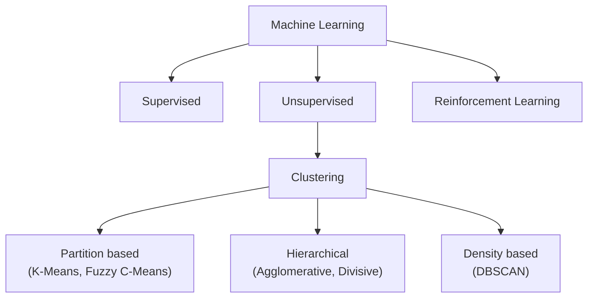
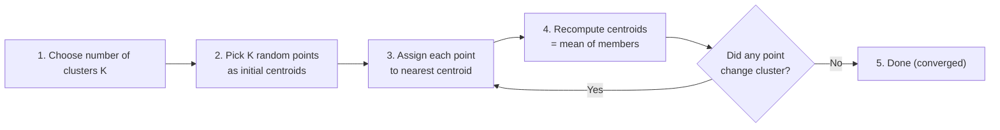
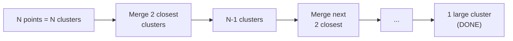
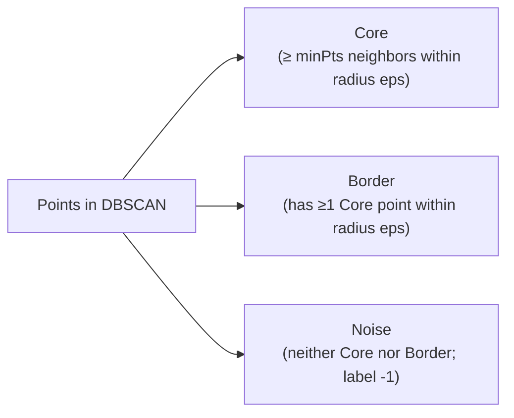

import { Accordion, Accordions } from 'fumadocs-ui/components/accordion';
import { Callout } from 'fumadocs-ui/components/callout';
import { Tab, Tabs } from 'fumadocs-ui/components/tabs';

> **Module & Portal Compiler:** Mahendar Dwi Payana  
> **DTS 2021 Training Material Author:** Dr. Berlian Al Kindhi, S.ST., MT. — Thematic Academy Digital Talent Scholarship 2021  
> **Organizer & Curriculum:** Ministry of Communication and Information Technology of the Republic of Indonesia (Kominfo) & School of Electrical Engineering and Informatics (STEI) ITB

---

## 1. Learning Objectives

This module extends modeling into **unsupervised learning**.

**Learning Objectives:**

1. Selecting and preparing data to serve as *input features*.
2. Studying **K-Means**, **Hierarchical Clustering**, and **DBSCAN** algorithms.
3. Optimizing K-Means with the **Elbow Method** (determining the right $K$).
4. Optimizing Hierarchical Clustering with a **Dendrogram**.
5. Optimizing **density-based** clustering with DBSCAN.
6. Hands-on coding practice in Python.

---

## 2. Clustering & Its Taxonomy

> **Clustering** is an **unsupervised** *machine learning* technique (no target labels). Its goal is to group data so that points within the same cluster (**intra-cluster**) are highly similar, while points across different clusters (**inter-cluster**) are highly distinct. Similarity is measured by **centroid** positions and pairwise **distances**.



**Clustering use cases:**

* **Customer segmentation** (*customer profiling*) for marketing strategy.
* **Network anomaly detection** (packets falling outside normal traffic groups).
* **Image compression** (centroid-based color quantization).

<Callout type="info" title="Module 13 Lab Dataset">
The module lab uses **`Customer.csv`** (200 *department store* customers): `IDPelanggan, Kelamin, Usia, Rating_belanja (1-100), Pendapatan (juta Rp)`.
<DataLink file="Customer.csv">Download here</DataLink>
</Callout>

---

## 3. K-Means Clustering (Partition-based)

K-Means is an **iterative** algorithm that partitions a dataset into $K$ **non-overlapping** subgroups; each data point belongs to strictly one cluster. K-Means assigns points to clusters such that the **sum of squared distances** to their cluster centers is minimized.

### A. Objective Function (WCSS / Inertia)

$$
\text{WCSS} = \sum_{k=1}^{K} \sum_{x \in C_k} \lVert x - \mu_k \rVert^2
$$

The smaller the within-cluster variation, the more homogeneous (similar) the points inside each cluster. K-Means aims to **minimize WCSS**.

### B. K-Means Steps



1. **Choose the number of clusters $K$**.
2. **Pick $K$ random points** as initial *centroids* (arbitrary positions; refined iteratively).
3. **Assign each point** to its nearest centroid, forming $K$ clusters.
4. **Recompute each cluster's centroid** = mean of its members (typically using **Euclidean** distance).
5. **Repeat steps 3–4** until no points change clusters (*convergence*).

### C. Optimizing Cluster Count: The Elbow Method

Choosing $K$ is the most critical factor:
* $K$ **too small** (e.g., 2) → hidden patterns remain unrevealed.
* $K$ **too large** (e.g., 8) → hard to interpret and act upon for decision-making.

The **Elbow Method** plots **WCSS** against the number of clusters. The chosen $K$ is the point where the drop in WCSS begins to slow down sharply — forming an **elbow**.

### D. K-Means++

Purely random centroid initialization can trap the algorithm in a poor **local optimum**. **K-Means++** spreads initial centroids as far apart from each other as possible using a probability distribution proportional to squared distance $D(x)^2$.

### E. Lab: `Customer.csv` Customer Segmentation Case Study

```python
import numpy as np
import matplotlib.pyplot as plt
import pandas as pd
from sklearn.cluster import KMeans

BASE = "https://mahendartea.github.io/Learn-AI/data"
dataset = pd.read_csv(f"{BASE}/Customer.csv")

# Input features: Rating_belanja (column index 3) & Pendapatan (column index 4)
X = dataset.iloc[:, [3, 4]].values

# ---- Optimizing K-Means with the Elbow Method (WCSS) ----
wcss = []
for i in range(1, 11):
    kmeans = KMeans(n_clusters=i, init='k-means++', random_state=42)
    kmeans.fit(X)
    wcss.append(kmeans.inertia_)

plt.plot(range(1, 11), wcss, marker='o')
plt.title('Elbow Method')
plt.xlabel('Cluster Number')
plt.ylabel('WCSS')
plt.show()

# ---- Running K-Means ----
kmeans = KMeans(n_clusters=5, init='k-means++', random_state=42)
y_kmeans = kmeans.fit_predict(X)

plt.scatter(X[y_kmeans == 0, 0], X[y_kmeans == 0, 1], s=100, c='blue', label='Cluster 1')
plt.scatter(X[y_kmeans == 1, 0], X[y_kmeans == 1, 1], s=100, c='red', label='Cluster 2')
plt.scatter(X[y_kmeans == 2, 0], X[y_kmeans == 2, 1], s=100, c='magenta', label='Cluster 3')
plt.scatter(X[y_kmeans == 3, 0], X[y_kmeans == 3, 1], s=100, c='cyan', label='Cluster 4')
plt.scatter(X[y_kmeans == 4, 0], X[y_kmeans == 4, 1], s=100, c='green', label='Cluster 5')
plt.scatter(kmeans.cluster_centers_[:, 0], kmeans.cluster_centers_[:, 1],
            s=300, c='yellow', label='Centroids')
plt.title('Consumers Cluster')
plt.xlabel('Yearly expense rating (1-100)')
plt.ylabel('Yearly Salary')
plt.legend()
plt.show()
```

> **Findings:** Elbows in the WCSS plot appear at clusters **3 and 5**, making **3 or 5** the optimal cluster counts. The resulting segments can directly guide store marketing strategies for each customer group.

---

## 4. Hierarchical Clustering

**Hierarchical clustering** separates data into groups based on similarity measures and merges or splits them progressively. Illustration: given several cars, group them into *sedans* and *SUVs*, then merge both, until all belong to one overarching cluster.

### A. Two Approaches

| Approach | Direction | How It Works |
| :--- | :--- | :--- |
| **Divisive** | *Top-down* | Starts with one large cluster, recursively splitting into two, three, four, … |
| **Agglomerative** | *Bottom-up* | Starts with tiny clusters (each point = 1 cluster), merging until one large cluster remains |

### B. Agglomerative Steps



1. Every data point starts as its own cluster → $N$ points = $N$ clusters.
2. Find the 2 **closest** points/clusters (Euclidean distance) and merge them.
3. Repeat finding and merging the 2 closest clusters (including previously merged clusters).
4. Continue until **one large cluster** remains. Cluster sizes do not need to be equal.

### C. Optimization with a Dendrogram

Where K-Means uses the *Elbow Method*, Hierarchical Clustering uses a **Dendrogram** — a tree diagram illustrating the cluster merging sequence. The $x$-axis represents samples/clusters, and the $y$-axis represents **Euclidean distance**.

How to pick $K$: locate the **longest vertical line not crossed** by any horizontal *threshold* line, or set a *threshold* directly along the distance axis.

### D. Lab: Hierarchical Clustering on `Customer.csv`

```python
import scipy.cluster.hierarchy as sch
from sklearn.cluster import AgglomerativeClustering

# ---- Dendrogram to determine number of clusters ----
dendrogram = sch.dendrogram(sch.linkage(X, method='ward'))
plt.title('Dendrogram')
plt.xlabel('Consumer')
plt.ylabel('Euclidean Distance')
plt.show()

# ---- Running Hierarchical Clustering ----
hc = AgglomerativeClustering(n_clusters=5, linkage='ward')
y_hc = hc.fit_predict(X)

plt.scatter(X[y_hc == 0, 0], X[y_hc == 0, 1], s=100, c='red', label='Cluster 1')
plt.scatter(X[y_hc == 1, 0], X[y_hc == 1, 1], s=100, c='blue', label='Cluster 2')
plt.scatter(X[y_hc == 2, 0], X[y_hc == 2, 1], s=100, c='green', label='Cluster 3')
plt.scatter(X[y_hc == 3, 0], X[y_hc == 3, 1], s=100, c='cyan', label='Cluster 4')
plt.scatter(X[y_hc == 4, 0], X[y_hc == 4, 1], s=100, c='magenta', label='Cluster 5')
plt.title('Consumers Cluster')
plt.xlabel('Yearly expense rating (1-100)')
plt.ylabel('Yearly Salary')
plt.legend()
plt.show()
```

> **Findings:** The most suitable number of clusters is **5** (from the number of vertical lines intersected by the *threshold*). Hierarchical clustering produces **nearly identical** results to K-Means — both are effective when clusters are roughly normal/spherical.

---

## 5. DBSCAN (Density-based)

K-Means and Hierarchical clustering work efficiently when clusters are **normal/spherical**. However, when clusters take **arbitrary shapes** (rings, crescents) or when you need **outlier detection**, use DBSCAN.

> **DBSCAN (*Density-Based Spatial Clustering of Applications with Noise*)** is a **density-based** clustering algorithm capable of discovering clusters of varying shapes and sizes in large datasets containing *noise* and *outliers*.

### A. Two Core Parameters

| Parameter | Description |
| :--- | :--- |
| **`minPts`** | Minimum number of points (threshold) within a region to be considered dense |
| **`eps` ($\varepsilon$)** | Radius distance used to locate neighboring points around a point |

**Two supporting concepts:**

* **Density Reachability** — point $p$ is "reachable" from $q$ if $p$ lies within distance `eps` of $q$.
* **Density Connectivity** — transitive *chaining*: $p$ and $q$ are density-connected if $p \to r \to s \to t \to q$ (via *neighborhood* relations).

### B. DBSCAN Steps

1. Pick an unvisited point in the dataset at random (until all points have been visited).
2. If at least `minPts` points lie within radius `eps` of that point, all those points form a cluster.
3. Expand the cluster by **recursively** evaluating the neighborhood of each neighbor point.

### C. Three Point Types



### D. Lab 1: DBSCAN on Spherical Data (`make_blobs`)

```python
import numpy as np
from sklearn.cluster import DBSCAN
from sklearn import metrics
from sklearn.datasets import make_blobs
from sklearn.preprocessing import StandardScaler
import matplotlib.pyplot as plt

# Generate spherical data (3 centers)
centers = [[1, 1], [-1, -1], [1, -1]]
X, labels_true = make_blobs(n_samples=750, centers=centers, cluster_std=0.4, random_state=0)
X = StandardScaler().fit_transform(X)

# DBSCAN
db = DBSCAN(eps=0.3, min_samples=10).fit(X)
core_samples_mask = np.zeros_like(db.labels_, dtype=bool)
core_samples_mask[db.core_sample_indices_] = True
labels = db.labels_

n_clusters_ = len(set(labels)) - (1 if -1 in labels else 0)
n_noise_ = list(labels).count(-1)
print('Estimated number of clusters: %d' % n_clusters_)
print('Estimated number of noise points: %d' % n_noise_)
print("Homogeneity: %0.3f" % metrics.homogeneity_score(labels_true, labels))
print("Completeness: %0.3f" % metrics.completeness_score(labels_true, labels))
print("V-measure: %0.3f" % metrics.v_measure_score(labels_true, labels))
print("Adjusted Rand Index: %0.3f" % metrics.adjusted_rand_score(labels_true, labels))
print("Adjusted Mutual Information: %0.3f" % metrics.adjusted_mutual_info_score(labels_true, labels))
print("Silhouette Coefficient: %0.3f" % metrics.silhouette_score(X, labels))
```

> **Reference results (spherical data):** `clusters = 3`, `noise = 18`, Homogeneity = **0.953**, Completeness = **0.883**, V-measure = **0.917**, ARI = **0.952**, AMI = **0.916**, Silhouette = **0.626**.

### E. Lab 2: DBSCAN on Non-Spherical Data (`make_circles`)

```python
from sklearn.datasets import make_circles
from sklearn.cluster import KMeans

# Non-spherical data: two concentric rings
X, y = make_circles(n_samples=750, factor=0.3, noise=0.1)
X = StandardScaler().fit_transform(X)

# DBSCAN
y_pred = DBSCAN(eps=0.3, min_samples=10).fit_predict(X)
plt.scatter(X[:, 0], X[:, 1], c=y_pred)
print('Number of clusters: {}'.format(len(set(y_pred[np.where(y_pred != -1)]))))
print('Homogeneity: {}'.format(metrics.homogeneity_score(y, y_pred)))
print('Completeness: {}'.format(metrics.completeness_score(y, y_pred)))
print("Silhouette Coefficient: %0.3f" % metrics.silhouette_score(X, y_pred))
```

> **DBSCAN vs. K-Means Comparison (non-spherical):**
>
> | Metric | DBSCAN | K-Means |
> | :--- | :---: | :---: |
> | Number of clusters | 2 | 2 |
> | Homogeneity | **1.000** | 0.0017 |
> | Completeness | **0.937** | 0.0016 |
> | Silhouette | -0.061 | -0.057 |
>
> DBSCAN **cleanly separates** both rings (Homogeneity ≈ 1.0), whereas K-Means fails because it partitions by centroid distance — spatially adjacent points on the inner and outer rings get grouped into the same cluster.

---

## 6. Clustering Evaluation Metrics

Because clustering is unsupervised, evaluation compares the resulting cluster structure against **ground-truth labels** (*external*) or measures cohesion/separation (*internal*).

### A. Silhouette Coefficient (internal)

$$
s(i) = \frac{b(i) - a(i)}{\max(a(i), b(i))}, \qquad -1 \le s(i) \le 1
$$

* $a(i)$: mean distance from point $i$ to other points in the same cluster (**cohesion**).
* $b(i)$: mean distance from point $i$ to points in the nearest neighboring cluster (**separation**).
* $s(i) \approx +1$: tight, well-separated clusters; $s(i) \le 0$: likely misassigned cluster.

### B. External Metrics (when ground-truth labels exist)

| Metric | Meaning |
| :--- | :--- |
| **Homogeneity** | Each cluster contains members of only a single class |
| **Completeness** | All members of a given class are assigned to the same cluster |
| **V-measure** | Harmonic mean of Homogeneity & Completeness |
| **Adjusted Rand Index (ARI)** | Pairwise agreement adjusted for random chance |
| **Adjusted Mutual Information (AMI)** | Mutual information adjusted for random chance |
| **Davies-Bouldin Index** | Ratio of within-cluster scatter to between-cluster separation (lower is better) |

```python
from sklearn import metrics

# Example usage of external metrics
print("Homogeneity        :", metrics.homogeneity_score(y, y_pred))
print("Completeness       :", metrics.completeness_score(y, y_pred))
print("V-measure          :", metrics.v_measure_score(y, y_pred))
print("Adjusted Rand Index:", metrics.adjusted_rand_score(y, y_pred))
print("AMI                :", metrics.adjusted_mutual_info_score(y, y_pred))
```

---

## 7. Clustering Algorithm Comparison Summary

| Aspect | K-Means | Hierarchical (Agglomerative) | DBSCAN |
| :--- | :--- | :--- | :--- |
| **Basis** | Partition (centroid) | Distance hierarchy | Density |
| **Number of $K$** | Must be set *a priori* | Determined from Dendrogram | Automatic from `eps` & `minPts` |
| **Cluster shape** | Spherical / convex | Varied (depends on *linkage*) | Arbitrary (rings, crescents) |
| **Handles noise** | No | No | **Yes** (label -1) |
| **Scalability** | High (fast) | Low ($O(N^2)$) | Moderate (depends on spatial index) |
| **Scale sensitivity** | High | High | High |

---

## 8. Evaluation Sheet & Independent Lab Assignments

<Accordions>
  <Accordion title="Task 1: K-Means + Elbow Method (Official Module 13 Assignment)">
    A *department store* wants to analyze customer shopping behavior segments using `Customer.csv`. Use columns 2 through 4 as *input features*. Using the **elbow** method, analyze the optimal number of clusters (plot WCSS for $K=1..10$), then run **K-Means** and analyze the results (interpret each customer segment)!
  </Accordion>

  <Accordion title="Task 2: Hierarchical + Dendrogram vs. K-Means (Official Module 13 Assignment)">
    Using the same dataset and features, construct a **dendrogram** to determine the optimal cluster count, then run **Hierarchical Clustering**. Compare the results with **K-Means** from Task 1 (e.g., via a contingency table or Adjusted Rand Index). Do both methods yield consistent segmentation? Explain!
  </Accordion>

  <Accordion title="Task 3: DBSCAN Spherical vs. Non-Spherical (Official Module 13 Assignment)">
    Generate a training dataset of **500 points** with matching ground-truth labels. Perform **feature normalization**, then apply `sklearn`'s **DBSCAN**. Build two cases: **spherical** (`make_blobs`) and **non-spherical** (`make_circles`). On the non-spherical case, also test **K-Means** and compare results. Include Homogeneity, Completeness, and Silhouette metrics!
  </Accordion>

  <Accordion title="Task 4: DBSCAN Parameter Experimentation">
    On the non-spherical dataset, run a parameter *grid* over `eps` (0.1, 0.2, 0.3, 0.5) and `min_samples` (3, 5, 10, 15). Record the cluster count, noise count, and Silhouette Score for every combination. Conclude how `eps` and `min_samples` affect cluster formation and noise detection!
  </Accordion>
</Accordions>

---

## 9. References & Official Links

1. **Dr. Berlian Al Kindhi, S.ST., MT.** (2021). *Module 13 — Clustering*. Thematic Academy Digital Talent Scholarship 2021, Ministry of Communication and Information Technology of RI.
2. **Ethem Alpaydin** (2020). *Introduction to Machine Learning* (4th ed.). MIT Press.
3. **Zhi-Hua Zhou** (2021). *Machine Learning*. Springer.
4. **Charu C. Aggarwal & Chandan K. Reddy** (2013). *Data Clustering: Algorithms and Applications*. Chapman and Hall/CRC.
5. **Anil K. Jain & Richard C. Dubes** (1988). *Algorithms for Clustering Data*. Prentice Hall.
6. **Martin Ester, Hans-Peter Kriegel, Jörg Sander, & Xiaowei Xu** (1996). *A Density-Based Algorithm for Discovering Clusters in Large Spatial Databases with Noise*. Proceedings of KDD-96. *(DBSCAN Algorithm)*.
7. **Scikit-learn Developers**. *Clustering & Clustering Performance Evaluation*. [scikit-learn.org](https://scikit-learn.org/stable/modules/clustering.html).
