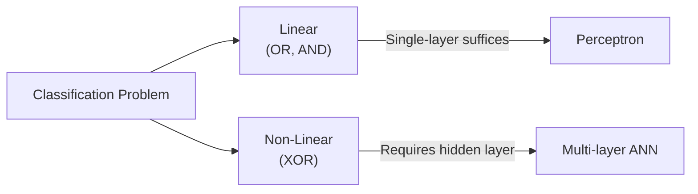
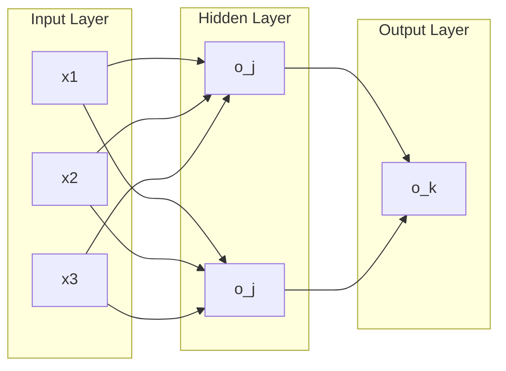
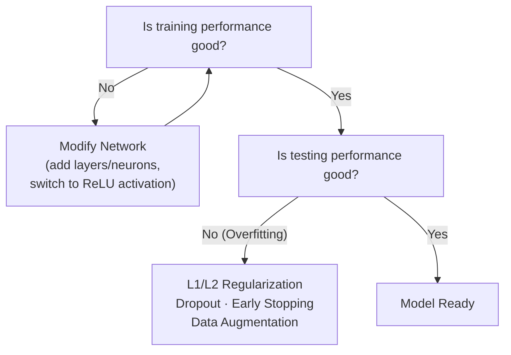
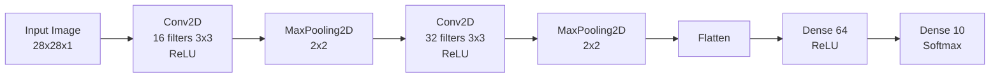

import { Accordion, Accordions } from 'fumadocs-ui/components/accordion';
import { Callout } from 'fumadocs-ui/components/callout';
import { Tab, Tabs } from 'fumadocs-ui/components/tabs';

> **Module & Portal Compiler:** Mahendar Dwi Payana  
> **DTS 2021 Training Material Author:** Dr. Eng. Chastine Fatichah, S.Kom, M.Kom — Institut Teknologi Sepuluh Nopember (ITS)  
> **Organizer & Curriculum:** Ministry of Communication and Informatics RI (Kominfo) & School of Electrical Engineering and Informatics (STEI) ITB

---

## 1. Learning Objectives & Scope

This module enters the domain of **Deep Learning**. Its coverage includes *fully connected networks* (FCN/MLP), **CNN**, and **RNN**, along with the use of the **Scikit-learn**, **PyTorch**, and **Keras 3** libraries.

**Learning Objective:** Participants are able to perform the **Artificial Neural Network (ANN)** modeling process.

---

## 2. Introduction to Artificial Neural Networks

> **ANN** is a *machine learning* method inspired by how **biological neural networks** work in the human brain — a network of small, interconnected processing units.

| Biological Nervous System | ANNs |
| :--- | :--- |
| Soma | Neuron |
| Dendrite | Input |
| Axon | Output |
| Synapse | Weight |

The concept of ANN originated from the paper by **Warren McCulloch & Walter Pitts (1943)**, which formulated a mathematical model of human brain cells.

### A. Single-Layer Perceptron Architecture

A single-layer ANN consists only of an **input layer** and an **output layer**. Its information processing unit is:

$$
f = \sum_{i=1}^{m} w_i x_i + b, \qquad y = a(f)
$$

* A set of links consisting of neurons and weights $w$.
* An adder function (*linear combiner*) to compute the weighted sum of the inputs.
* An activation function $a(\cdot)$.

### B. What Can a Single Neuron Do?

A neuron can solve **binary classification** as:
* A **separating function** (*hyperspace separation*).
* A **Binary threshold**:

$$
y = \begin{cases} 1, & f(x) \ge 0 \\ 0, & \text{otherwise} \end{cases}
$$

### C. Linear vs. Non-Linear Problems



---

## 3. Activation Functions

Activation functions **transform a neuron to be non-linear**. Without an activation function, a multi-layer network of any depth is only equivalent to a single linear model.

| Function | Formulation | Characteristics & Recommendations |
| :--- | :--- | :--- |
| **Sigmoid** | $a(f) = \dfrac{1}{1 + e^{-f}}$ | Range $(0,1)$; suitable for binary classification outputs; prone to *vanishing gradient* |
| **Tanh** | $\tanh(x) = 2\sigma(2x) - 1$ | Range $(-1,1)$; *zero-centered* |
| **Gaussian** | $a(f) = \dfrac{1}{\sqrt{2\pi}\,\sigma}\exp\!\left(-\dfrac{(f-\mu)^2}{2\sigma^2}\right)$ | Based on the Gaussian function |
| **ReLU** | $f(x) = \max(0, x)$ | **Modern hidden layer standard**; efficient; free from saturation for $x>0$ |
| **Softmax** | $\dfrac{e^{z_i}}{\sum_{j=1}^{C} e^{z_j}}$ | Multi-class output; converts logits into a probability distribution |

---

## 4. Multi-Layer ANN Architecture

For non-linear and complex problems, a **Multi-layer ANN** is used, consisting of:

* **Input layer** — number of neurons = number of input features.
* **Hidden layer** — one or more; connections between neurons are **fully connected**.
* **Output layer** — number of neurons matches the problem:
  * Binary classification / regression → 1 neuron.
  * Multi-class classification → number of neurons = number of classes (e.g., 10 for digits 0–9).

**Design guidelines:**

* The number of **hidden layers** is adjusted to the problem complexity; more layers → longer computation time.
* The number of **hidden neurons** is generally greater than the number of output neurons; increase gradually to prevent *overfitting*.



---

## 5. ANN Stages

### A. Feed Forward (Forward Propagation)

1. Feed vector $X$ into the input layer.
2. Compute the output of each neuron in the hidden & output layers:

$$
o_j = \sum_{i=1}^{n} w_{ji} x_i + b, \qquad o_k = \sum_{j=1}^{m} w_{kj} o_j + b
$$

3. Compute the activation function at the output: $\hat{y} = a(o_k)$.

### B. Learning

1. **Initialize weights** $W$ randomly.
2. **Update weights** so outputs are consistent with class labels. Objective function (loss):

$$
J(W) = \frac{1}{n}\sum_{i=1}^{n}\left(y^{(i)} - f(x^{(i)}; W)\right)^2
$$

New weights are found by **minimizing** the objective function using **backpropagation**:

$$
W^{*} = \arg\min_{W} J(W)
$$

**Three key questions when designing a learning algorithm:**

| Aspect | Answer |
| :--- | :--- |
| When to stop? | Convergence or iteration limit (*epoch*) |
| Which direction? | *Gradient descent* |
| How large a step? | *Learning rate* ($\eta$) |

**Backpropagation Gradient Descent:**

* Initialize weights randomly.
* Iterate until convergence / maximum iterations:
  * Compute gradient $\dfrac{\partial J(W)}{\partial W}$.
  * Update weights: $W \leftarrow W - \eta \dfrac{\partial J(W)}{\partial W}$.

> **Importance of Learning Rate:** $\eta$ too small → slow convergence; $\eta$ too large → unstable model.

### C. Stochastic Gradient Descent (SGD) & Mini-Batch SGD

| Variant | How It Works |
| :--- | :--- |
| **Full-batch GD** | Compute gradient over the entire dataset per iteration |
| **SGD** | Update weights per **single** data point |
| **Mini-batch SGD** | Update per **batch** of $B$ data points: $\dfrac{\partial J(W)}{\partial W} = \dfrac{1}{B}\sum_{k=1}^{B}\dfrac{\partial J_k(W)}{\partial W}$ |

### D. MLP Learning Steps

0. Initialize weights, *learning rate*, maximum iterations.
1. Read input vector $X$.
2. Perform iterations (*epochs*).
3. Compute neuron outputs in the hidden & output layers.
4. Compute *backpropagate error* (output & hidden layers).
5. Update all weights (output & hidden layers).
6. Repeat steps 3–5 until weights converge / maximum iterations are reached.
7. Output is the **weight matrices** (output & hidden layers).

---

## 6. Learning Process Strategies & Overfitting Prevention



### A. Parameter Optimization: Adaptive Learning Rate

Learning rates that adapt to gradient values generally yield better performance:

* **Adagrad** (John Duchi, JMLR 2011)
* **Adadelta** (Matthew D. Zeiler, arXiv 2012)
* **Adam** (Diederik P. Kingma, ICLR 2015)
* **AdaSecant** (Caglar Gulcehre, arXiv 2014)
* **RMSprop**

### B. Regularization

Adding a *regularization term* (weights) to the objective function to reduce *generalization error*:

* **L1 norm**: adds the *sum of absolute weights* as a penalty.
* **L2 norm (weight decay)**: adds the *sum of squared weights* as a penalty.

### C. Dropout & Early Stopping

* **Dropout**: randomly deactivates a fraction $p\%$ of neurons during training.
* **Early Stopping**: halts training iterations when the *generalization error* begins to rise.

### D. Data Augmentation

Increases training data diversity so the model generalizes better. Methods depend on the data type:
* Numerical data → **SMOTE**, **ADASYN**, etc.
* Image data → **rotation, translation, flip, zoom**.

---

## 7. Implementation Stages & Tools

**Implementation workflow (load → split → define → compile → fit → evaluate → save → predict):**

1. **Load data** — read the input data file.
2. **Split data** — divide into training, validation, and test sets.
3. **Define model** — design the ANN architecture.
4. **Compile model** — set the optimizer, loss, and metrics.
5. **Fit model** — train the model on training data.
6. **Evaluate model** — evaluate on validation/test data.
7. **Save model** — save the best model.
8. **Prediction** — predict outputs on test data.

Several stages can be combined into one.

### `MLPClassifier` Parameters (Scikit-learn)

| Parameter | Description |
| :--- | :--- |
| `hidden_layer_sizes` | Number of neurons in hidden layers |
| `activation` | Hidden layer activation function |
| `solver` | Adaptive learning rate method |
| `batch_size` | Batch size |
| `learning_rate_init` | Initial learning rate |
| `max_iter` | Maximum iterations |
| `early_stopping` | `False` if early stopping is not applied |

---

## 8. Lab 1: ANN for Iris Classification

### A. Implementation with Scikit-learn

```python
from sklearn import datasets
from sklearn.model_selection import train_test_split
from sklearn.neural_network import MLPClassifier
from sklearn.metrics import accuracy_score, ConfusionMatrixDisplay
import matplotlib.pyplot as plt

# Load data
iris = datasets.load_iris()
X, y = iris.data, iris.target

# Split: train / validation / test
X_train, X_test, Y_train, Y_test = train_test_split(X, y, test_size=.10, random_state=42)
X_train, X_val, Y_train, Y_val = train_test_split(X_train, Y_train, test_size=.15, random_state=42)
print('X_train', X_train.shape)
print('X_val', X_val.shape)
print('X_test', X_test.shape)

# Define & compile model
mlp = MLPClassifier(hidden_layer_sizes=(64,), activation='relu', max_iter=1000, epsilon=1e-08, random_state=42)

# Fit + validation evaluation
mlp.fit(X_train, Y_train)
acc_val = accuracy_score(Y_val, mlp.predict(X_val))
print('ANN Validation Accuracy:', acc_val)

# Test data evaluation
acc_test = accuracy_score(Y_test, mlp.predict(X_test))
print('ANN Testing Accuracy:', acc_test)
ConfusionMatrixDisplay.from_estimator(mlp, X_test, Y_test)
plt.show()
```

### B. Implementation with Keras 3

```python
import keras
from keras.utils import to_categorical
from keras.models import Sequential
from keras.layers import Input, Dense

# One-hot encoding labels (3 classes)
Y_train_oh = to_categorical(Y_train, 3)
Y_val_oh = to_categorical(Y_val, 3)
Y_test_oh = to_categorical(Y_test, 3)

model = Sequential([
    Input(shape=(4,)),
    Dense(64, activation='relu'),
    Dense(3, activation='softmax'),
])

model.compile(optimizer='adam', loss='categorical_crossentropy', metrics=['accuracy'])

history = model.fit(X_train, Y_train_oh, epochs=100, batch_size=5,
                    validation_data=(X_val, Y_val_oh), verbose=0)
model.summary()

loss, accuracy = model.evaluate(X_test, Y_test_oh, verbose=0)
print('ANN Testing Accuracy (Keras):', accuracy)
```

### C. Implementation with PyTorch

**PyTorch** is the industry standard for modern *deep learning* research and production with a flexible explicit *training loop*:

```python
import torch
import torch.nn as nn
from torch.utils.data import TensorDataset, DataLoader

# Convert to PyTorch tensors
X_tr_t = torch.tensor(X_train, dtype=torch.float32)
y_tr_t = torch.tensor(Y_train, dtype=torch.long)
X_te_t = torch.tensor(X_test, dtype=torch.float32)
y_te_t = torch.tensor(Y_test, dtype=torch.long)

loader = DataLoader(TensorDataset(X_tr_t, y_tr_t), batch_size=16, shuffle=True)

class IrisMLP(nn.Module):
    def __init__(self):
        super().__init__()
        self.net = nn.Sequential(
            nn.Linear(4, 64),
            nn.ReLU(),
            nn.Linear(64, 3),
        )

    def forward(self, x):
        return self.net(x)

pt_model = IrisMLP()
criterion = nn.CrossEntropyLoss()
optimizer = torch.optim.Adam(pt_model.parameters(), lr=1e-2)

for epoch in range(100):
    pt_model.train()
    for xb, yb in loader:
        optimizer.zero_grad()
        loss = criterion(pt_model(xb), yb)
        loss.backward()
        optimizer.step()

pt_model.eval()
with torch.no_grad():
    preds = pt_model(X_te_t).argmax(dim=1)
    acc_pt = (preds == y_te_t).float().mean().item()
print('ANN Testing Accuracy (PyTorch):', round(acc_pt, 4))
```

---

## 9. Lab 2: Fully Connected Network on MNIST

The **MNIST** dataset (handwritten digits) is split into **55,000 training**, **10,000 test**, and **5,000 validation** samples. Each image is $28 \times 28$ pixels, and labels are converted into *one-hot encoding*.

**FCN Architecture:** input 784 ($28\times28$) → 1 hidden layer (Dense, 64 neurons, ReLU) → output 10 neurons (Softmax).

```python
import keras
from keras.datasets import mnist
from keras.models import Sequential
from keras.layers import Input, Flatten, Dense
import matplotlib.pyplot as plt

# 1. Load data
(X_train, y_train), (X_test, y_test) = mnist.load_data()
X_train = X_train.reshape(-1, 28, 28, 1).astype('float32') / 255
X_test = X_test.reshape(-1, 28, 28, 1).astype('float32') / 255
y_train = keras.utils.to_categorical(y_train, 10)
y_test = keras.utils.to_categorical(y_test, 10)

# 2. Define model (Multilayer Neural Network)
model1 = Sequential([
    Input(shape=(28, 28, 1)),
    Flatten(),
    Dense(64, activation='relu'),
    Dense(10, activation='softmax'),
])

# 3. Compile, Fit, Evaluate
model1.compile(optimizer='adam', loss='categorical_crossentropy', metrics=['accuracy'])
history1 = model1.fit(X_train, y_train, epochs=10, batch_size=100,
                      validation_data=(X_test, y_test))
model1.summary()
model1.evaluate(X_test, y_test)

# 4. Training vs validation loss plot
epochs = range(10)
plt.plot(epochs, history1.history['loss'], 'r', label='ANN training loss')
plt.plot(epochs, history1.history['val_loss'], 'b', label='ANN validation loss')
plt.legend()
plt.show()
```

---

## 10. Introduction to Deep Learning

| Approach | Pipeline |
| :--- | :--- |
| **Conventional Machine Learning** | Input → **Manual feature extraction** → Classification → Output |
| **Deep Learning** | Input → **Automatic feature extraction + Classification** → Output |

**Weaknesses of the conventional approach:**

* Requires more time and domain knowledge for feature extraction.
* Heavily dependent on a single problem domain (less generalizable).

**Deep Learning** learns hierarchical representations (feature patterns) automatically through multiple stages of *feature learning*.

---

## 11. Convolutional Neural Network (CNN)

CNN is a Deep Learning method that is a specialized type of ANN architecture. It consists of **three main layers**: *convolutional layer*, *pooling layer*, and *fully connected layer*.

### A. Convolutional Layer

The **convolution** process of the input image with a *filter* produces a **feature map**. The filter slides from top-left to bottom-right across the image matrix:

$$
(I * K)(i, j) = \sum_m \sum_n I(m, n)\, K(i+m, j+n)
$$

The image matrix size and filter size affect the resulting *feature map* size.

### B. Pooling Layer

Reduces image dimensions (*down-sampling*) and extracts *salient features*. Common types: **Maximum pooling** and **Average pooling**.

### C. Fully Connected Layer

Feature maps from convolution & pooling are **flattened** (matrix → vector) into the input of a *fully connected layer* (Multi-layer ANN architecture).



### D. Lab 3: CNN on MNIST

```python
from keras.layers import Conv2D, MaxPooling2D

model2 = Sequential([
    Input(shape=(28, 28, 1)),
    Conv2D(16, (3, 3), activation='relu', padding='same'),
    MaxPooling2D(2, 2),
    Conv2D(32, (3, 3), activation='relu', padding='same'),
    MaxPooling2D(2, 2),
    Flatten(),
    Dense(64, activation='relu'),
    Dense(10, activation='softmax'),
])

model2.compile(optimizer='adam', loss='categorical_crossentropy', metrics=['accuracy'])
history2 = model2.fit(X_train, y_train, epochs=10, batch_size=100,
                      validation_data=(X_test, y_test))
model2.evaluate(X_test, y_test)
```

**CNN with Dropout** (to prevent overfitting):

```python
from keras.layers import Dropout

model3 = Sequential([
    Input(shape=(28, 28, 1)),
    Conv2D(16, (3, 3), activation='relu', padding='same'),
    MaxPooling2D(2, 2),
    Conv2D(32, (3, 3), activation='relu', padding='same'),
    MaxPooling2D(2, 2),
    Flatten(),
    Dense(64, activation='relu'),
    Dropout(0.5),
    Dense(10, activation='softmax'),
])

model3.compile(optimizer='adam', loss='categorical_crossentropy', metrics=['accuracy'])
history3 = model3.fit(X_train, y_train, epochs=10, batch_size=100,
                      validation_data=(X_test, y_test))
```

> **Comparison:** Compare the loss/accuracy curves of `model1` (ANN) vs `model2` (CNN) vs `model3` (CNN + Dropout). CNNs generally outperform FCNs on image data because they exploit local spatial structure.

### E. CNN Architecture Variants

| Application | Architectures |
| :--- | :--- |
| **Image Classification** | LeNet-5 (1998), AlexNet (2012), GoogLeNet/Inception (2014), VGGNet (2014), ResNet (2015) |
| **Object Detection** | R-CNN (2013), Fast R-CNN (2014), Faster R-CNN (2015), SSD (2016), YOLO (2016) |
| **Semantic/Instance Segmentation** | FCN (2015), U-Net (2015), FPN (2016), Mask R-CNN (2017), DeepLab |
| **Generative Models** | Autoencoder, VAE, GAN |

---

## 12. Recurrent Neural Network (RNN)

RNN is an ANN architecture capable of representing **sequential data** (text, DNA, audio, *time series*):

$$
H_t = \phi\!\left(X_t W_{xh} + H_{t-1} W_{hh} + b_h\right), \qquad \hat{y}_t = H_t W_{hy} + b_y
$$

### A. RNN Architecture Types

| Type | Applications |
| :--- | :--- |
| **Many to One** | Sentiment classification, *opinion mining*, *speech recognition*, *automated answer scoring* |
| **One to Many** | *Image captioning*, *text generation* |
| **Many to Many** | Translation, *forecasting*, chatbots, music generation |

### B. RNN Architecture Variants

* **LSTM (*Long Short-Term Memory*)**: consists of an *input gate*, *output gate*, and *forget gate*.
* **GRU (*Gated Recurrent Unit*)**: simplifies LSTM by combining input & forget gates → fewer parameters.
* **IndRNN (*Independently RNN*)**: each neuron within a layer is independent.
* **Bi-directional RNN**: two hidden layers running in opposite directions toward the same output.
* **Echo State Network (ESN)**: randomly connected recurrent network (*reservoir*).

---

## 13. Summary: FCN vs. CNN vs. RNN

| Aspect | FCN (MLP) | CNN | RNN |
| :--- | :--- | :--- | :--- |
| **Data Type** | Numerical / tabular data | Images, video | Text, signals, audio, time-series |
| **Key Structure** | Number of hidden layers matched to complexity | Convolution & Pooling layers | *Recurrent* state & input sequence |
| **Applications** | Classification & regression | Classification, object detection, segmentation, image generation | Classification, regression, text generation, translation |

---

## 14. Evaluation Sheet & Independent Lab Assignments

<Accordions>
  <Accordion title="Assignment 1: ANN on the Hepatitis C Dataset (Official Module 14 Assignment)">
    Download the HCV dataset from the [UCI ML Repository](https://archive.ics.uci.edu/ml/datasets/HCV+data). Split the dataset into **train, validation, and test data**. Design and build an **ANN** model, perform **parameter tuning** (number of hidden layers/neurons, activation, learning rate, batch size) for the best results. Display the **train vs validation loss plot** as well as the **confusion matrix & accuracy** on the test data!
  </Accordion>

  <Accordion title="Assignment 2: CNN for Sign Language Classification (Official Module 14 Assignment)">
    Download the Sign Language (ASL) dataset from [Kaggle](https://www.kaggle.com/ayuraj/asl-dataset). Split the data into train/validation/test with a **70% / 20% / 10%** ratio. Design and build a **CNN** model, perform **parameter tuning**, display the **train & validation loss plot**, as well as the **confusion matrix and accuracy** on the test data!
  </Accordion>

  <Accordion title="Assignment 3: Anti-Overfitting Mechanism Study">
    On an MNIST model (FCN or CNN), compare three configurations: (a) without regularization, (b) with `Dropout`, and (c) with `EarlyStopping`. Plot the training vs validation *loss* curves for each. Explain quantitatively how each technique reduces the *gap* between training and validation loss!
  </Accordion>

  <Accordion title="Assignment 4: Adaptive Learning Rate Experiment">
    Train the same ANN model with different optimizers: **SGD, Adagrad, RMSprop, Adam**. Use the Iris/MNIST dataset. Compare convergence speed (epochs until loss stabilizes) and final accuracy. Explain why *adaptive learning rates* generally converge faster than plain SGD!
  </Accordion>
</Accordions>

---

## 15. References & Official Links

1. **Dr. Eng. Chastine Fatichah, S.Kom, M.Kom** (2021). *Modul 14 — Membangun Model Artificial Neural Network (ANN)*. Thematic Academy Digital Talent Scholarship 2021, Ministry of Communication and Informatics RI.
2. **Warren S. McCulloch & Walter Pitts** (1943). *A Logical Calculus of the Ideas Immanent in Nervous Activity*. Bulletin of Mathematical Biophysics, 5(4), 115–133.
3. **Michael Negnevitsky** (2005). *Artificial Intelligence: A Guide to Intelligent Systems* (2nd ed.). Addison Wesley.
4. **Diederik P. Kingma & Jimmy Ba** (2015). *Adam: A Method for Stochastic Optimization*. ICLR 2015.
5. **Yann LeCun, Léon Bottou, Yoshua Bengio, & Patrick Haffner** (1998). *Gradient-Based Learning Applied to Document Recognition*. Proceedings of the IEEE, 86(11), 2278–2324. *(LeNet-5 & MNIST)*.
6. **Alexander Amini & Ava Amini** (2021). *Intro to Deep Learning (MIT 6.S191)*. MIT.
7. **TensorFlow/Keras Documentation**. [tensorflow.org](https://www.tensorflow.org/overview/), [keras.io](https://keras.io/).
8. **TensorFlow Playground** — interactive ANN architecture simulator: [playground.tensorflow.org](https://playground.tensorflow.org/).
