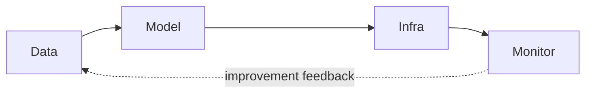

import { Accordion, Accordions } from 'fumadocs-ui/components/accordion';
import { Callout } from 'fumadocs-ui/components/callout';
import { Tab, Tabs } from 'fumadocs-ui/components/tabs';

> **Module & Portal Compiler:** Mahendar Dwi Payana  
> **DTS 2021 Training Material Author:** Ir. Agus Pratondo, S.T., M.T., Ph.D. — Thematic Academy Digital Talent Scholarship 2021  
> **Organizer & Curriculum:** Ministry of Communication and Informatics RI (Kominfo) & School of Electrical Engineering and Informatics (STEI) ITB

---

## 1. Learning Objectives & Evaluation Scope

Evaluation determines whether a model is **fit for use or not**. This session covers the quantitative evaluation of modeling results as well as the review process for modeling quality and suitability.

**Learning Objective:** Participants are able to compute various *machine learning* model performance measurements and implement them in a programming language.

**Models measured:**

| Category | Type |
| :--- | :--- |
| **Supervised Learning** | Classification, Regression |
| **Unsupervised Learning** | Clustering |

> **Fundamental Principle:** Evaluation is conducted **after** training is complete, using evaluation data that **must not overlap** with the training data.

---

## 2. Accuracy & Its Limitations

Accuracy indicates the percentage of valid classifications out of the total classifications:

$$
a = \frac{t}{n} \times 100\%
$$

Where $a$ = accuracy (%), $t$ = number of valid trials, and $n$ = total number of trials.

**Simple example:** Out of 5 trials, only 2 are valid → accuracy = $2/5 \times 100\% = 40\%$.

> [!CAUTION]
> **Accuracy Often Deceives.** Consider a **Covid-19 X** detector case: out of 100 samples (90 negative, 10 positive), the detector correctly identifies 90 negatives, but detects only 5 out of 10 positives. Accuracy = $(90+5)/(90+10) = 95\%$. This figure looks high, yet **5 False Negative errors** in a contagious disease can be fatal. Accuracy alone is **not enough** — we need metrics that measure per-class performance.

---

## 3. Confusion Matrix

> **A Confusion Matrix is not a metric**, but rather a tabulation that maps predicted results against actual data per class.

**Characteristics:**

* Has an **actual data** axis and a **predicted data** axis (following convention).
* Every class is mapped against one another.
* **Valid predictions lie on the main diagonal**.
* The matrix is **square-shaped**.

**4-class fruit classification example** (25 test images per class, 100 total):

| Actual Class \ Predicted | mango | apple | guava | pear |
| :--- | :---: | :---: | :---: | :---: |
| **mango** | **19** | 3 | 2 | 1 |
| **apple** | 1 | **22** | 1 | 1 |
| **guava** | 2 | 2 | **21** | 0 |
| **pear** | 0 | 1 | 1 | **23** |

* **Mango class accuracy** = $19/25 \times 100\% = 76\%$.
* **Total accuracy** = $(19+22+21+23)/(25\times4) \times 100\% = 85\%$.

> A *heat map* visualization of the confusion matrix makes quick visual comparisons across training *epochs* much easier (before even reading the numbers).

---

## 4. Binary Classification

Binary classification has only **two classes** — one designated as **positive** (focus) and the other as **negative**. Examples: Covid/non-Covid, spam/not spam, hoax/not hoax, tsunami/not tsunami.

**Four basic parameters:**

| Parameter | Definition |
| :--- | :--- |
| **True Positive (TP)** | Actual positive, predicted positive |
| **False Positive (FP)** | Actual negative, predicted positive |
| **True Negative (TN)** | Actual negative, predicted negative |
| **False Negative (FN)** | Actual positive, predicted negative |

| Actual Value \ Predicted | Positive | Negative |
| :--- | :---: | :---: |
| **Positive** | True Positive (TP) | False Negative (FN) |
| **Negative** | False Positive (FP) | True Negative (TN) |

### FN vs. FP: Case-Dependent

| Domain | Case | Most Dangerous Error |
| :--- | :--- | :--- |
| **Disaster Management** (tsunami) | FN: predicted no tsunami, but tsunami occurs | **FN** (loss of life) |
| **Spam Filter** | FP: important email lands in spam folder | **FP** (missed job/project) |
| **Medical** (infectious disease) | FN: sick patient declared negative | **FN** (transmission/fatality) |

> **Every problem has different parameter priorities.** There is no single best metric for all cases.

---

## 5. Binary Classification Metrics

Based on the confusion matrix, several metrics can be derived:

| Metric | Formula | Meaning |
| :--- | :--- | :--- |
| **Accuracy** | $\dfrac{TP + TN}{TP + TN + FP + FN}$ | Overall proportion of correct predictions |
| **Precision** | $\dfrac{TP}{TP + FP}$ | Out of those predicted positive, how many are truly positive |
| **Recall / Sensitivity / TPR** | $\dfrac{TP}{TP + FN}$ | Out of actual positives, how many are successfully detected |
| **Specificity / TNR** | $\dfrac{TN}{FP + TN}$ | Out of actual negatives, how many are correctly detected as negative |
| **False Positive Rate** | $\dfrac{FP}{FP + TN}$ | Complement of Specificity |
| **Negative Predictive Value** | $\dfrac{TN}{TN + FN}$ | Out of those predicted negative, how many are truly negative |
| **F1-Score** | $2 \cdot \dfrac{\text{Precision} \cdot \text{Recall}}{\text{Precision} + \text{Recall}}$ | Balance between Precision and Recall |

**F-$\beta$ Score** (when Recall is prioritized $k\times$ higher):

$$
F_\beta = (1 + \beta^2) \cdot \frac{\text{Precision} \cdot \text{Recall}}{\beta^2 \cdot \text{Precision} + \text{Recall}}
$$

### Interpreting Recall–Precision Combinations

| Condition | FALSE Negatives | FALSE Positives | Performance |
| :--- | :---: | :---: | :--- |
| **Low Recall, Low Precision** | High | High | ❌ Poor |
| **High Recall, Low Precision** | Low | High | Positives well detected, but many negatives falsely marked positive |
| **Low Recall, High Precision** | High | Low | Predicted positives are almost always right, but many positives are missed |
| **High Recall, High Precision** | Low | Low | ✅ Best performance |

---

## 6. Probabilistic Model Evaluation

A model can output **probability values** $[0,1]$ for each label before mapping them to classes via a *threshold*. Probabilistic evaluation considers **all possible thresholds**.

### A. ROC-AUC

**ROC (Receiver Operating Characteristic)** plots **Recall (TPR)** on the $y$-axis against **False Positive Rate** on the $x$-axis for every threshold in $[0,1]$. The area under the curve = **AUC**.

* AUC = 1.0 → perfect classifier.
* AUC = 0.5 (dashed diagonal line) → equivalent to *random guessing*.

> **Why ROC-AUC instead of just accuracy?** Accuracy only represents performance at a **single threshold value**, whereas ROC-AUC summarizes performance across **all thresholds**.

### B. Precision-Recall Curve (PR-AUC)

Plots **Precision** ($y$-axis) vs **Recall** ($x$-axis). More appropriate for the **minority class** on severely *imbalanced* data, because it is not skewed by massive numbers of True Negatives.

### C. Logarithmic Loss (Log Loss)

Indicates how **confident** the model's label assignments are on the test data:

$$
\text{LogLoss} = -\frac{1}{N}\sum_{i=1}^{N}\sum_{j=1}^{M} y_{ij} \log(p_{ij})
$$

Where $N$ = number of samples, $M$ = number of classes, $y_{ij}$ = indicator for sample $i$ in class $j$, and $p_{ij}$ = predicted probability for sample $i$ in class $j$. Values lie in $[0, \infty)$ — **smaller is better**.

---

## 7. Image Segmentation Evaluation

For **per-pixel** classification (*foreground* vs *background* segmentation), with $A$ = segmentation output and $B$ = *ground truth*:

$$
\text{Jaccard Index (JI)} = \frac{|A \cap B|}{|A \cup B|}
$$

$$
\text{Dice / Similarity Index (SI)} = \frac{2\,|A \cap B|}{|A| + |B|}
$$

Where $|.|$ denotes the number of elements (pixels).

---

## 8. Regression Model Evaluation

Regression models predict **continuous** values (real numbers), such as house prices, temperatures, earthquake magnitudes, or stock prices. **Error** = the difference between the actual value and the predicted value.

| Metric | Formula | Notes |
| :--- | :--- | :--- |
| **MAE** | $\dfrac{1}{n}\sum_{j=1}^{n} \lvert y_j - \hat{y}_j \rvert$ | Mean absolute error (easy to interpret) |
| **MSE** | $\dfrac{1}{n}\sum_{j=1}^{n} (y_j - \hat{y}_j)^2$ | Penalizes large errors more heavily |
| **RMSE** | $\sqrt{\dfrac{1}{n}\sum_{j=1}^{n} (y_j - \hat{y}_j)^2}$ | MSE in the same unit as the target variable |
| **RAE / RSE** | — | Error relative to a baseline |
| **MAPE / MPE** | — | Error expressed as a percentage |
| **R-squared** | $1 - \dfrac{SS_{\text{res}}}{SS_{\text{tot}}}$ | Goodness of fit; best = 1.0 |

> **Why absolute values in MAE?** So that positive and negative errors do not cancel each other out.
>
> **Why is RMSE more sensitive to outliers?** Because errors are squared, large errors have a much larger impact. RMSE's quadratic function is also **continuous and differentiable**, making it advantageous for gradient-based optimization.

---

## 9. Clustering Evaluation (Unsupervised)

Clustering has no class labels. Its goal: **group similar data as closely as possible** and **separate dissimilar data as far apart as possible**. Common metrics:

1. **Silhouette Coefficient**
2. **Rand Index**
3. **Mutual Information**
4. **Calinski-Harabasz Index (C-H Index)**
5. **Davies-Bouldin Index**
6. **Dunn Index**

### Silhouette Coefficient

$$
s = \frac{b - a}{\max(a, b)}, \qquad -1 \le s \le 1
$$

* $a$: average distance from a sample to other samples **within the same cluster**.
* $b$: average distance from a sample to samples in the **nearest neighboring cluster**.
* $s \to +1$: dense & well-separated clusters; $s \approx 0$: *overlapping*; $s \to -1$: improper clustering.

---

## 10. Comparing Two Models: McNemar's Test

Higher accuracy alone is **not enough** to claim one model is statistically better. A hypothesis test is needed:

* **H₀**: Both models have the same accuracy (error probability).
* **H₁**: Both models differ significantly.

**McNemar's Test** uses a contingency table of paired predictions from both models:

| | Model 2 correct | Model 2 wrong |
| :--- | :---: | :---: |
| **Model 1 correct** | 4 | 2 |
| **Model 1 wrong** | 1 | 3 |

Test statistic:

$$
S = \frac{(b - c)^2}{b + c}
$$

Where $b, c$ = the cells where the models **disagree**. For small table counts, the **Binomial** distribution (*exact* correction) is used. Python example:

```python
from statsmodels.stats.contingency_tables import mcnemar

conti = [[4, 2],
         [1, 3]]
retVal = mcnemar(conti, exact=True)
print('Statistic = %.3f, \np-value = %.3f' % (retVal.statistic, retVal.pvalue))

alpha = 0.01
if retVal.pvalue > alpha:
    print('Failed to reject H0: both models have the same error probability')
else:
    print('Reject H0: both models have different error probabilities')
# Output: Statistic = 1.000, p-value = 1.000 -> Failed to reject H0
```

**Decision rule:**

* $p > \alpha$ → **Fail to reject** H₀ (no significant difference).
* $p < \alpha$ → **Reject** H₀ (significant difference exists).

> McNemar's Test is a straightforward test; further extensions include the **5×2cv paired t-test** (Dietterich, 1998).

---

## 11. Modeling Review & Explainable AI (SHAP)

The modeling review process requires assessing the **suitability** and **quality** of each modeling stage. Modern models (XGBoost, Deep Neural Networks) are often regarded as **black boxes**; regulators demand transparency: *"Why did the model reject this customer's loan application?"*

**SHAP (*SHapley Additive exPlanations*)** — rooted in cooperative game theory (Shapley values) — allocates a fair contribution to each feature for a prediction's deviation from the base value:

$$
f(x) = \phi_0 + \sum_{j=1}^{M} \phi_j(x)
$$

* $f(x)$: actual prediction for observation $x$.
* $\phi_0 = \mathbb{E}[f(z)]$: baseline expected value (*base value*).
* $\phi_j(x)$: **Shapley** value of feature $j$ (contribution to the prediction); positive pushes higher, negative pushes lower.

```python
import shap
from sklearn.linear_model import LogisticRegression

clf = LogisticRegression(max_iter=1000).fit(X, Y)
explainer = shap.LinearExplainer(clf, data=X)
shap_values = explainer.shap_values(X)

# Bar plot: global feature importance
shap.summary_plot(shap_values, X, plot_type="bar")

# Beeswarm: direction & distribution of each feature's impact
shap.summary_plot(shap_values, X)
```

---

## 12. Python Implementation: Comprehensive Evaluation

```python
"""
Classification Diagnostic Evaluation (Accuracy, Confusion Matrix, ROC, Binary Metrics)
Compiled by: Mahendar Dwi Payana
"""
import numpy as np
from sklearn.datasets import make_classification
from sklearn.model_selection import train_test_split
from sklearn.ensemble import RandomForestClassifier
from sklearn.metrics import (
    accuracy_score, precision_score, recall_score, f1_score,
    confusion_matrix, classification_report, roc_auc_score, roc_curve, log_loss
)

X, y = make_classification(n_samples=2000, n_features=12, weights=[0.9, 0.1], random_state=42)
X_tr, X_te, y_tr, y_te = train_test_split(X, y, test_size=0.25, random_state=42, stratify=y)

clf = RandomForestClassifier(n_estimators=100, random_state=42).fit(X_tr, y_tr)
y_pred = clf.predict(X_te)
y_prob = clf.predict_proba(X_te)[:, 1]

print("Accuracy :", round(accuracy_score(y_te, y_pred), 4))
print("Precision:", round(precision_score(y_te, y_pred), 4))
print("Recall   :", round(recall_score(y_te, y_pred), 4))
print("F1-Score :", round(f1_score(y_te, y_pred), 4))
print("ROC-AUC  :", round(roc_auc_score(y_te, y_prob), 4))
print("Log Loss :", round(log_loss(y_te, y_prob), 4))
print("\nConfusion Matrix:\n", confusion_matrix(y_te, y_pred))
print("\n", classification_report(y_te, y_pred, digits=4))
```

---

## 13. Google ML Test Score (Production Readiness)

To assess overall modeling **process quality**, Google proposed the **ML Test Score** consisting of 28 criteria grouped into 4 aspects:

| Aspect | Focus | Example Criteria |
| :--- | :--- | :--- |
| **Data** | Features & data pipelines | All features documented in a schema; features are useful & not overly complex; feature code is tested; privacy controls |
| **Model** | Model specification & tuning | Every model spec is *code-reviewed*; offline metrics correlate with online impact; hyperparameters are tuned; simpler models are not better |
| **Infra** | Pipeline reliability | Reproducible training; end-to-end pipeline tested; model quality validated before serving; fast rollback |
| **Monitor** | Production monitoring | Dependency changes notified; data invariants maintained; training & serving features match; model is not stale; numerical stability |



> **Uniqueness of ML-based systems:** influenced by **dynamic data** and **model configuration**, making continuous monitoring (MLOps) mandatory.

---

## 14. Evaluation Sheet & Independent Lab Assignments

<Accordions>
  <Accordion title="Assignment 1: Multi-Class Confusion Matrix Evaluation">
    Train a 4-class classification model (e.g., Iris or fruits dataset). Create a confusion matrix *heat map* with `seaborn`. Calculate **per-class accuracy** and **total accuracy**. Identify which classes are most frequently confused and explain the likely cause!
  </Accordion>

  <Accordion title="Assignment 2: Precision–Recall Trade-off Analysis on Imbalanced Data">
    Use a dataset with class imbalance (e.g., fraud/diagnosis). Train a model, then plot the **ROC-AUC** and **PR-AUC** curves. Compare both curves and conclude which is more informative. Show how changing the threshold shifts Precision and Recall values!
  </Accordion>

  <Accordion title="Assignment 3: Comparing Two Models with McNemar's Test">
    Train two different models (e.g., Logistic Regression vs Random Forest) on the same dataset. Build the contingency table of paired predictions, then run `mcnemar(T, exact=True)`. Conclude whether the performance difference between the two models is statistically significant at $\alpha = 0.05$!
  </Accordion>

  <Accordion title="Assignment 4: Regression & Clustering Evaluation">
    (a) On a regression dataset (e.g., `FuelConsumption.csv`), calculate MAE, MSE, RMSE, and R² and compare two models. (b) On a clustering dataset (e.g., `Customer.csv`), compute the **Silhouette Coefficient**, **Davies-Bouldin**, and **Calinski-Harabasz Index** for $K=2..10$, then determine the optimal $K$ based on all three metrics!
  </Accordion>

  <Accordion title="Assignment 5: Modeling Review & Explainable AI (SHAP)">
    Select the best model from your Capstone project. Create a **SHAP Summary Plot** and a **SHAP Waterfall Plot** for an individual prediction. Prepare a modeling review report containing: (1) process stage compliance, (2) key evaluation metrics, (3) interpretation of the most important features, and (4) follow-up recommendations. Document it in a formal review report!
  </Accordion>
</Accordions>

---

## 15. References & Official Links

1. **Ir. Agus Pratondo, S.T., M.T., Ph.D.** (2021). *Modul Model Evaluasi (Pertemuan 15)*. Thematic Academy Digital Talent Scholarship 2021, Ministry of Communication and Informatics RI.
2. **Thomas G. Dietterich** (1998). *Approximate Statistical Tests for Comparing Supervised Classification Learning Algorithms*. Neural Computation, 10(7), 1895–1923. *(McNemar's Test & 5×2cv)*.
3. **Scott M. Lundberg & Su-In Lee** (2017). *A Unified Approach to Interpreting Model Predictions*. NeurIPS 2017. *(SHAP)*.
4. **Alberto Fernández, Salvador García, Mikel Galar, Ronaldo C. Prati, Bartosz Krawczyk, & Francisco Herrera** (2018). *Learning from Imbalanced Data Sets*. Springer.
5. **E. T. Whittaker, G. F. R. Ellis, et al.** — Jaccard Index & Dice Coefficient (set similarity metrics).
6. **Google Research** (2019). *The ML Test Score: A Rubric for ML Production Readiness and Technical Debt Reduction*. Google.
7. **Scikit-learn Developers**. *Model Evaluation & Metrics*. [scikit-learn.org](https://scikit-learn.org/stable/modules/model_evaluation.html).
8. **Analytics Vidhya** (2020). *Quick Guide to Evaluation Metrics for Supervised and Unsupervised Machine Learning*.
