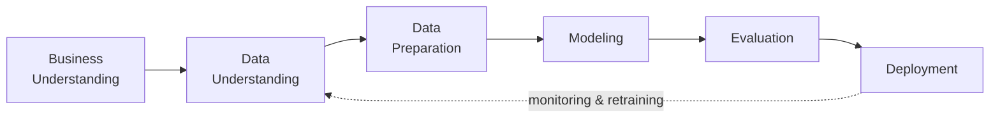
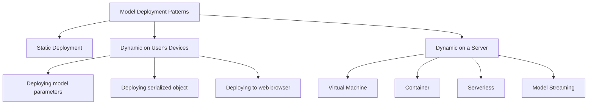
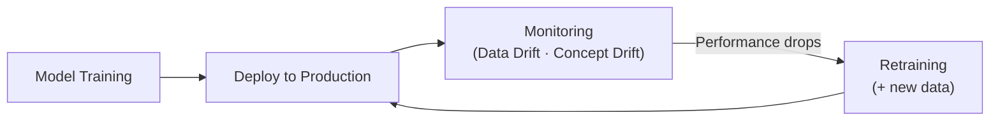

import { Accordion, Accordions } from 'fumadocs-ui/components/accordion';
import { Callout } from 'fumadocs-ui/components/callout';
import { Tab, Tabs } from 'fumadocs-ui/components/tabs';

> **Module & Portal Compiler:** Mahendar Dwi Payana  
> **DTS 2021 Training Material Team:** Suryo Adhi Wibowo, Citra Yasin Ahmad Fadhlika, & Ahmad Alfan — Thematic Academy Digital Talent Scholarship 2021  
> **Organizer & Curriculum:** Ministry of Communication and Informatics RI (Kominfo) & School of Electrical Engineering and Informatics (STEI) ITB

---

## 1. Learning Objectives & Scope

A model that sits idle inside a Jupyter Notebook has no business value. The culmination of the entire learning pipeline is **releasing the model as an operational service** (website) accessible to many users.

**Learning Objective:** Participants are able to deploy an AI model (Neural Network or Regression) into a **simple web application**, understanding deployment concepts & types, strategies, environment setup, through to full implementation.

**Subtopics:** Introduction → Pattern-based model deployment → Deployment strategies → Linear Regression deployment → ANN deployment.

---

## 2. Core Concepts of Model Deployment

> **Model deployment** is the process of making an AI model **available in a production environment** so it can deliver predictions to other software systems. It is both the **final stage** and the **most challenging stage** in the *machine learning lifecycle*.

**Why is it important?**

* So the model can be applied effectively in production and serve other systems.
* To reliably extract predictions and share them → maximizing the model's value.



### A. Implementation Challenges

| Category | Challenges |
| :--- | :--- |
| **General software** | Reliability, Reusability, Maintainability, Flexibility |
| **Machine Learning-specific** | **Reproducibility** |

**Key considerations:**

1. **Coordination** among Data Scientists, IT Teams, Software Developers, and business professionals → ensures the model works *reliably* and delivers the intended output.
2. **Programming language differences** between the model development environment and the production system → *re-coding* extends project timelines and reduces reproducibility.

---

## 3. Pattern-Based Model Deployment



### A. Static Deployment

Similar to traditional software deployment: an installable *binary* file where the model is packaged as a runtime *resource* (Windows `.dll`, Linux `*.so`, Java, .NET).

| Advantages |
| :--- |
| Fast execution (direct access to the model) |
| Time-efficient & privacy-preserving (user data is not uploaded to a server) |
| Model can be invoked **offline** |
| Model operations become the user's responsibility, not the vendor's |

### B. Dynamic Deployment on User's Devices

The model is **not** part of the application binary → model updates happen without updating the entire app. Three scenarios:

| Scenario | Characteristics |
| :--- | :--- |
| **Deploying model parameters** | File contains trained parameters; user installs a runtime (TensorFlow, Core ML, Scikit-learn, Keras, XGBoost) |
| **Deploying serialized object** | Serialized object file *deserialized* by the app; no device runtime needed, but updates are heavy for millions of users |
| **Deploying to web browser** | Model trained in Python, deployed & executed in browser via JavaScript runtime (e.g., TensorFlow.js, can utilize GPU) |

**Advantages:** partial computation on-device (fast); infrastructure only serves web pages; model is easy for third parties to inspect.  
**Disadvantages:** increased bandwidth (browser); model update overhead (serialized); performance is difficult to monitor.

### C. Dynamic Deployment on a Server

The model resides on a server and is accessed via **REST API** or **gRPC**:

| Form | Summary | Notes |
| :--- | :--- | :--- |
| **Virtual Machine (VM)** | Predictions returned as HTTP responses; VMs run in parallel; REST API via Flask/FastAPI; TensorFlow Serving (gRPC) | Conceptually simple; requires server maintenance, network latency, relatively high cost |
| **Container** | Isolated runtime (filesystem, CPU, memory) sharing the OS; Docker; orchestrated via Kubernetes/AWS Fargate/GKE | Resource-efficient & flexible; considered complex and requires expertise |
| **Serverless** | ZIP archive containing model + feature extractor + scoring code uploaded to cloud (AWS Lambda, GCP, Azure Functions) | No server/VM management, scalable, pay-per-compute; execution time limits, ZIP size, RAM caps, no GPU |
| **Model Streaming** | Opposite of REST API; model & code registered to a *Stream Processing Engine* (Apache Storm/Spark/Flink/Samza/Kafka Streams) | REST: synchronous one-by-one requests; Streaming: open connections & event-driven updates |

### D. AI Infrastructure & Platforms

AI infrastructure providers include: **NVIDIA**, **Huawei** (full-stack AI), **Google AI Platform**, and **Microsoft AI services & tools**.

---

## 4. Deployment Strategy

| Strategy | How It Works | Advantages | Disadvantages |
| :--- | :--- | :--- | :--- |
| **Single Deployment** | Model is serialized; old file is replaced with new file (including feature extractor if needed) | Simple | If a bug exists, **all** users are affected |
| **Silent Deployment** | **New & old model versions run in parallel** | Ample time to validate the new model | Consumes high resources (two models concurrently) |
| **Canary Deployment** | New version pushed to a **small subset** of users; majority stays on old version | Validates model & prediction impact without affecting most users | More intricate & complex |

**Single Deployment examples:**

* *Cloud*: provision new VM/container → replace old image → autoscaler starts the new instance.
* *Server*: upload new model file → replace the old one → restart the web service.

### Reproducibility

> **Reproducibility** is the ability to **duplicate a model exactly**, so that the same input yields the same output. This is a business accountability requirement for trusting ML adoption.

**Challenges:** features unavailable in the *live environment*; programming language differences; software differences; real-world conditions mismatching training conditions.

**Solutions:**

* Exact same software versions + pin all third-party library dependencies with their versions.
* Use **containers** and specification-tracking tools.
* Research, develop, and deploy in the **same language** (e.g., Python).
* Understand how the model integrates with other systems **before** building the model.

---

## 5. Saving Models (Serialization)

```python
# Keras 3 / ANN model (modern standard .keras format)
import keras
model.save('model.keras')
model = keras.saving.load_model('model.keras')

# Scikit-learn model (joblib or skops recommended)
import joblib
joblib.dump(regressor, 'model.joblib', compress=3)
model = joblib.load('model.joblib')
```

> [!WARNING]
> **Serialization Security:** Avoid loading `.pkl` files (`pickle.load`) from untrusted sources because `pickle` can execute arbitrary code during deserialization. Use `joblib`/`skops` for Scikit-learn, `.keras` or `safetensors` for Deep Learning, and `ONNX` for cross-language inference.

---

## 6. Deployment Preparation

| Tool / Platform | Function |
| :--- | :--- |
| **Virtual Env (`uv` / `venv` / `conda`)** | Isolates the Python 3.11+ environment and holds all model dependencies |
| **Visual Studio Code (VSCode)** | Editor for writing API source code, Dockerfiles, and service configurations |
| **Docker & Modern Cloud PaaS** | Packages applications into portable containers and deploys to **Render**, **Railway**, **Hugging Face Spaces**, or **Streamlit Community Cloud** *(replacing the discontinued Heroku free tier)* |

**Local environment setup flow:**

```bash
conda create --name deploy-model-linreg python=3.12 -y
conda activate deploy-model-linreg
pip install -r requirements.txt
```

**Example `Dockerfile` for modern cloud deployment (Render / Railway / HF Spaces):**

```dockerfile
FROM python:3.12-slim
WORKDIR /app
COPY requirements.txt .
RUN pip install --no-cache-dir -r requirements.txt
COPY . .
EXPOSE 8000
CMD ["gunicorn", "--bind", "0.0.0.0:8000", "app:app"]
```

---

## 7. Linear Regression Model Deployment (Flask)

**Project structure:**

```text
├── templates/
│   └── index.html        # Website template (input form + prediction result)
├── app.py                # Flask API route configuration
├── model.joblib          # Trained Linear Regression model
├── Dockerfile            # Container configuration for cloud deployment
└── requirements.txt      # Python dependency list
```

### A. `app.py` — API Routes

```python
from flask import Flask, request, render_template
import joblib

app = Flask(__name__)

# Load saved Linear Regression model (joblib)
model = joblib.load('model.joblib')

@app.route('/')
def index():
    # Send insurance_cost=0 when page first loads
    return render_template('index.html', insurance_cost=0)

@app.route('/predict', methods=['POST'])
def predict():
    # Read values explicitly from the form by key
    age = int(request.form['Age'])
    sex = request.form['Gender']
    smoker = request.form['Smoker']

    data = [age]
    # One-hot encoding for gender: [Female, Male]
    data.extend([0, 1] if sex == 'Male' else [1, 0])
    # One-hot encoding for smoker: [No, Yes]
    data.extend([0, 1] if smoker == 'Yes' else [1, 0])

    prediction = model.predict([data])
    output = round(float(prediction[0]), 2)
    return render_template('index.html', insurance_cost=output,
                           age=age, sex=sex, smoker=smoker)

if __name__ == '__main__':
    app.run(debug=True)
```

### B. `index.html` — Template (key snippet)

```html
<!-- action calls the /predict endpoint with POST method -->
<form action="{{ url_for('predict') }}" method="post" class="flex flex-col">
  <input type="text" name="Age" placeholder="Age" required />

  <select name="Gender">
    <option value="Male">Male</option>
    <option value="Female">Female</option>
  </select>

  <select name="Smoker">
    <option value="Yes">Yes</option>
    <option value="No">No</option>
  </select>

  <button type="submit">PREDICT NOW</button>
</form>

<!-- Display prediction result from insurance_cost variable -->
<h2>USD {{ insurance_cost }}</h2>
```

### C. Running & Deploying

```bash
# 1. Run local server
python app.py
# -> http://localhost:5000/ or http://127.0.0.1:5000/

# 2. Test Docker container locally
docker build -t deploy-model-linreg .
docker run -p 8000:8000 deploy-model-linreg

# 3. Deploy to Cloud PaaS (connect GitHub repository to Render / Railway / HF Spaces)
```

> **Hands-on Practice:** (1) run the local server at `http://127.0.0.1:5000`, (2) package the app with a `Dockerfile` and deploy it to **Render**, **Railway**, or **Hugging Face Spaces**.

---

## 8. ANN Model Deployment (Cat vs Dog)

The procedure is the same as Linear Regression; only the directory structure and program code differ.

**Project structure:**

```text
├── static/
│   └── uploads/          # Images uploaded for prediction
├── templates/
│   └── index.html
├── app.py
├── model.keras           # Trained ANN Image Classification model (Keras 3)
├── Dockerfile
└── requirements.txt
```

```python
from flask import Flask, render_template, request, send_from_directory
from werkzeug.utils import secure_filename
import keras
import numpy as np
import os

app = Flask(__name__)
app.config['UPLOAD_FOLDER'] = './static/uploads/'
os.makedirs(app.config['UPLOAD_FOLDER'], exist_ok=True)
model = keras.saving.load_model('model.keras')
class_dict = {0: 'Cat', 1: 'Dog'}

def predict_label(img_path):
    loaded_img = keras.utils.load_img(img_path, target_size=(256, 256))
    img_array = keras.utils.img_to_array(loaded_img) / 255.0  # Normalize pixels
    img_array = np.expand_dims(img_array, axis=0)             # (1, 256, 256, 3)
    predicted_bit = int(np.round(model.predict(img_array, verbose=0)[0][0]))
    return class_dict[predicted_bit]

@app.route('/', methods=['GET', 'POST'])
def index():
    if request.method == 'POST' and 'image' in request.files:
        image = request.files['image']
        filename = secure_filename(image.filename)
        img_path = os.path.join(app.config['UPLOAD_FOLDER'], filename)
        image.save(img_path)
        prediction = predict_label(img_path)
        return render_template('index.html', uploaded_image=filename,
                               prediction=prediction)
    return render_template('index.html')

@app.route('/display/<filename>')
def send_uploaded_image(filename=''):
    return send_from_directory(app.config['UPLOAD_FOLDER'], filename)

if __name__ == '__main__':
    app.run(debug=True)
```

> **Differences from Linear Regression:** the input is an **image** (not text), a `.keras` model (Keras 3) instead of `.joblib`, filename sanitization uses `secure_filename`, and there is a `/display/<filename>` endpoint to serve the uploaded image.

---

## 9. Modern Alternative: FastAPI + Streamlit

Besides Flask, the most popular modern industry stack for Python prototypes and production services is **FastAPI** (high-performance REST API backend) and **Streamlit** (interactive web UI) using **joblib/ONNX** model formats.

### A. Modern Serialization

```python
import joblib

# Save pipeline (fast & optimized for large NumPy arrays)
joblib.dump(best_pipeline, "model_pipeline.joblib", compress=3)

# Load on server
loaded_model = joblib.load("model_pipeline.joblib")
```

* **`joblib`**: reliable for Scikit-learn models.
* **`ONNX`**: universal language-independent format (train in PyTorch/Python, infer in C++/Go/JS).

### B. FastAPI REST API

```python
from fastapi import FastAPI, HTTPException
from pydantic import BaseModel, Field
import joblib, numpy as np

app = FastAPI(title="Production AI Inference Service", version="1.0.0")

class PredictionInput(BaseModel):
    age: int = Field(..., ge=18, le=100)
    income: float = Field(..., gt=0)
    credit_score: float = Field(..., ge=300, le=850)

@app.get("/")
def health_check():
    return {"status": "Healthy", "service": "Active"}

@app.post("/predict")
def predict(input_data: PredictionInput):
    try:
        features = np.array([[input_data.age, input_data.income, input_data.credit_score]])
        prob = float(loaded_model.predict_proba(features)[0, 1])
        return {"status": "APPROVED" if prob >= 0.5 else "REJECTED",
                "probability": round(prob, 4)}
    except Exception as e:
        raise HTTPException(status_code=500, detail=str(e))
```

### C. Streamlit Interface

```python
import streamlit as st, requests

st.set_page_config(page_title="AI Dashboard", layout="centered")
st.title("Smart Prediction Portal")

with st.form("prediction_form"):
    age = st.slider("Customer Age", 18, 80, 30)
    income = st.number_input("Monthly Income (IDR)", min_value=1_000_000,
                             value=10_000_000, step=500_000)
    credit_score = st.slider("Credit Score", 300, 850, 700)
    submit_btn = st.form_submit_button("Evaluate Eligibility")

if submit_btn:
    res = requests.post("http://localhost:8000/predict",
                        json={"age": age, "income": income, "credit_score": credit_score},
                        timeout=5).json()
    st.write(res)
```

---

## 10. MLOps Foundations: Model Drift Monitoring

Once released to production, models experience **natural performance degradation** over time:

* **Data Drift**: input feature distribution changes ($P(X) \neq P_{\text{train}}(X)$). Example: currency inflation.
* **Concept Drift**: input–label relationship changes ($P(Y \mid X) \neq P_{\text{train}}(Y \mid X)$). Example: post-pandemic shopping behavior shifts.



Practitioners must establish **periodic audit** procedures and **automated retraining** pipelines.

---

## 11. Evaluation Sheet & Independent Lab Assignments

<Accordions>
  <Accordion title="Assignment 1: Deploying Linear Regression Model with Flask & Docker">
    Follow the module steps to deploy a **Linear Regression model** (insurance cost prediction) using **Flask** with `joblib` serialization. Set up a Python 3.11+ virtual environment, run the **local server** at `http://127.0.0.1:5000`, then package it with a `Dockerfile` and deploy to **Render**, **Railway**, or **Hugging Face Spaces**. Include screenshots of local predictions and the live app URL!
  </Accordion>

  <Accordion title="Assignment 2: Deploying an ANN Image Classification Model">
    Deploy a **Cat vs Dog image classification ANN** model with Flask using a Keras 3 `.keras` model. Pay attention to image upload handling (`secure_filename`), pixel normalization ($\times 1/255$), and the `/display/<filename>` endpoint. Test with several different images and report the accuracy!
  </Accordion>

  <Accordion title="Assignment 3: Designing a Deployment Plan">
    For your Capstone project, prepare a **deployment plan** containing: (1) deployment pattern choice (static/dynamic on-device/on-server) with justification, (2) deployment strategy (Single/Silent/Canary), (3) resource requirements & latency estimates, (4) dependency list & reproducibility handling, and (5) step-by-step deployment instructions. Document everything thoroughly!
  </Accordion>

  <Accordion title="Assignment 4: Comparing Flask vs FastAPI">
    Build the same prediction endpoint using **Flask** and **FastAPI**. Compare: response speed (simple benchmark), ease of input validation, automatic documentation (Swagger), and ease of deployment. Conclude when to choose each framework!
  </Accordion>

  <Accordion title="Assignment 5: Simulating Model Drift Monitoring">
    Build a classification model, then simulate **data drift** by shifting/altering feature distributions on new data. Observe the drop in metrics (accuracy/F1). Propose a threshold for when retraining should occur and design an automated retraining workflow!
  </Accordion>
</Accordions>

---

## 12. References & Official Links

1. **Suryo Adhi Wibowo, Citra Yasin Ahmad Fadhlika, & Ahmad Alfan** (2021). *Modul Melakukan Deployment Model*. Thematic Academy Digital Talent Scholarship 2021, Ministry of Communication and Informatics RI.
2. **Andriy Burkov** (2020). *Machine Learning Engineering*. True Positive Inc.
3. **Martin Fowler** (2016). *Continuous Delivery for Machine Learning (CD4ML)*. ThoughtWorks.
4. **Google Developers**. *MLOps: Continuous Delivery and Automation Pipelines in Machine Learning*. [developers.google.com](https://developers.google.com/machine-learning/crash-course/production-ml-systems).
5. **Docker Documentation**. *Containerizing Python Applications*. [docs.docker.com](https://docs.docker.com/guides/python/).
6. **FastAPI Documentation**. [fastapi.tiangolo.com](https://fastapi.tiangolo.com/).
7. **Streamlit Documentation**. [docs.streamlit.io](https://docs.streamlit.io/).
8. **Hugging Face Spaces**. *Deploying ML Apps with Docker & Streamlit*. [huggingface.co/docs/hub/spaces](https://huggingface.co/docs/hub/spaces).
