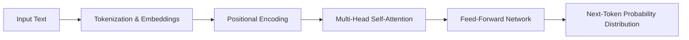

import { Accordion, Accordions } from 'fumadocs-ui/components/accordion';
import { Callout } from 'fumadocs-ui/components/callout';
import { Tab, Tabs } from 'fumadocs-ui/components/tabs';

> **Module & Portal Compiler:** Mahendar Dwi Payana  
> **Topic Coverage:** Transformer Architecture, Large Language Models (LLMs), and Structured Prompt Engineering

---

## 1. Learning Objectives & Scope

After mastering classical *machine learning* and *neural networks* (MLP, CNN, RNN), this module brings you into the **modern Generative AI** paradigm centered on **Large Language Models (LLMs)**.

**Learning Objectives:**
1. Understand why the **Transformer** architecture replaced RNN/LSTM for large-scale language processing.
2. Understand **Tokenization**, **Self-Attention**, and the LLM training stages (*Pretraining → Supervised Fine-Tuning → Alignment*).
3. Apply systematic **Prompt Engineering** techniques (Zero-shot, Few-shot, Chain-of-Thought, and *Structured Outputs*) via Python APIs.

---

## 2. From RNN to Transformer Architecture

In Session 14, we saw that RNNs process tokens **sequentially** ($h_t$ depends on $h_{t-1}$). This approach has two major bottlenecks:
1. **Difficult to parallelize** during GPU training because it must wait for the previous time step.
2. **Long-range dependencies** weaken across long sentences or documents.

The paper *Attention Is All You Need* (Vaswani et al., 2017) introduced the **Transformer** architecture, which processes all tokens simultaneously using the **Self-Attention** mechanism.



### Scaled Dot-Product Attention

Each token is projected into three vectors: **Query ($Q$)**, **Key ($K$)**, and **Value ($V$)**:

$$
\text{Attention}(Q, K, V) = \text{softmax}\left(\frac{Q K^T}{\sqrt{d_k}}\right) V
$$

* $Q K^T$ measures contextual similarity between token pairs.
* Dividing by $\sqrt{d_k}$ stabilizes gradients so *softmax* does not saturate in high dimensions.
* **Decoder-Only Transformers** (such as the GPT, Gemini, Claude, and Llama families) use *Causal Masking* so each token can only attend to preceding tokens (*autoregressive next-token prediction*).

---

## 3. Tokenization, Context Window & Inference Parameters

LLMs do not read raw characters or whole words directly, but rather *subword tokens* using algorithms such as **Byte-Pair Encoding (BPE)**.

| Concept | Practical Explanation |
| :--- | :--- |
| **Token** | The smallest unit of text (~3–4 English characters, or ~1–2 words on average depending on the language). |
| **Context Window** | The total token limit (input prompt + conversation history + output) that can be processed in a single model call. |
| **Temperature ($T$)** | Controls randomness (*sampling*): $T \approx 0$ is deterministic/factual; $T \ge 0.7$ is more varied/creative. |
| **Top-p (Nucleus Sampling)** | Restricts candidate tokens to the smallest set whose cumulative probability is $\ge p$. |

---

## 4. Three Stages of Modern LLM Training

1. **Pre-training (Self-Supervised)**: The model is trained to predict the next token across trillions of tokens of internet text, code, and books → yields a *Base Model* rich in knowledge, though not yet skilled at following instructions.
2. **Supervised Fine-Tuning (SFT)**: The model is fine-tuned on pairs of *(instruction, ideal answer)* examples → yields an *Instruction-tuned Model* ready for dialogue.
3. **Preference Alignment (RLHF / DPO)**: The model is aligned with human preferences (helpful, honest, harmless) using *Reinforcement Learning from Human Feedback* or *Direct Preference Optimization*.

---

## 5. Systematic Prompt Engineering Techniques

Good prompt engineering treats instructions like a measurable **program specification**, not guesswork.

<Tabs items={['Zero-Shot & Role', 'Few-Shot', 'Chain-of-Thought (CoT)']}>
  <Tab value="Zero-Shot & Role">
    Provide the role, task boundaries, output format, and quality criteria explicitly:

    ```text
    Role: You are a senior data quality analyst.
    Task: Identify potential anomalies in the following transaction table schema.
    Rules:
    - Answer concisely in English (maximum 5 bullet points).
    - Include a risk level (High/Medium/Low) for each point.
    ```
  </Tab>
  <Tab value="Few-Shot">
    Include 2–5 input–output example pairs so the model mimics the desired classification pattern or format:

    ```text
    Classify the customer review sentiment into [Positive, Neutral, Negative].

    Review: "Fast shipping and neat packaging." -> Positive
    Review: "Item matches description, nothing special." -> Neutral
    Review: "The app frequently crashes at checkout." -> Negative
    Review: "Affordable price, though the battery drains quickly." ->
    ```
  </Tab>
  <Tab value="Chain-of-Thought (CoT)">
    Ask the model to break down its reasoning steps before concluding the final answer for logic, math, or multi-step analysis tasks:

    ```text
    Solve the following business problem step by step:
    1. Calculate the gross margin per unit.
    2. Calculate the break-even point.
    3. Provide a final pricing recommendation based on a 20% profit target.
    ```
  </Tab>
</Tabs>

---

## 6. Python Implementation: LLM Calls & Structured Outputs

In production applications, we rarely want free-form text; we need **structured outputs (JSON validated by a Pydantic schema)** so the backend can process them reliably.

<Callout type="info" title="API Key Security Practice">
Never write API keys directly inside source code (*hardcoding*). Store them in environment variables (`export GEMINI_API_KEY=...` or a `.env` file added to `.gitignore`).
</Callout>

```python
import os
from pydantic import BaseModel, Field
from google import genai

# 1. Define a structured output schema using Pydantic
class ReviewAnalysis(BaseModel):
    category: str = Field(description="Issue category: Product, Shipping, or Service")
    sentiment: str = Field(description="Positive, Neutral, or Negative")
    summary: str = Field(description="One-sentence summary of the complaint or praise")
    follow_up_priority: int = Field(ge=1, le=5, description="Urgency scale 1-5")

# 2. Initialize official client (reads GEMINI_API_KEY from environment)
client = genai.Client(api_key=os.environ["GEMINI_API_KEY"])

review = "The courier was very friendly, but the package arrived 3 days later than estimated."

response = client.models.generate_content(
    model="gemini-2.5-flash",
    contents=f"Analyze the following customer review:\n{review}",
    config={
        "response_mime_type": "application/json",
        "response_schema": ReviewAnalysis,
        "temperature": 0.1,
    },
)

# 3. Automatically parse into a validated Python object
result = ReviewAnalysis.model_validate_json(response.text)
print(result.model_dump())
```

> **Local Open-Weight Alternative:** The same *structured output* and *chat completions* concepts can also be run locally without API costs using **Ollama** or **vLLM** with open models (such as Llama, Qwen, or Gemma).

---

## 7. Evaluation Sheet & Independent Lab Assignments

<Accordions>
  <Accordion title="Assignment 1: Temperature & Few-Shot Classification Experiment">
    Write a Python script to classify 20 product reviews into 3 sentiment classes. Compare accuracy between *Zero-Shot* (`temperature=0.0`) and *Few-Shot* with 3 balanced examples. Record output consistency across 3 repeated runs!
  </Accordion>

  <Accordion title="Assignment 2: Unstructured Data Extraction to JSON (Pydantic)">
    Given free-form job posting texts or product descriptions, design a Pydantic schema (`entity_name`, `requirements`, `location`, `estimated_salary`), then call an LLM with *structured output* so it always produces valid JSON that can be directly converted into a Pandas DataFrame!
  </Accordion>

  <Accordion title="Assignment 3: Local Model vs Cloud API Benchmark">
    Install **Ollama** locally (or run in Colab) with a lightweight model (e.g., small Gemma / Qwen / Llama). Compare latency, language quality, and JSON schema compliance against a cloud API model!
  </Accordion>
</Accordions>

---

## 8. References & Official Links

1. **Vaswani, A., Shazeer, N., Parmar, N., et al.** (2017). *Attention Is All You Need*. NeurIPS 2017.
2. **Ouyang, L., Wu, J., Jiang, X., et al.** (2022). *Training language models to follow instructions with human feedback*. NeurIPS 2022.
3. **Google Gemini API Documentation**. [ai.google.dev/gemini-api/docs](https://ai.google.dev/gemini-api/docs).
4. **Pydantic Documentation**. *Data Validation & Structured Schemas*. [docs.pydantic.dev](https://docs.pydantic.dev/).
5. **Andrej Karpathy**. *Intro to Large Language Models & Let's build GPT from scratch*.
