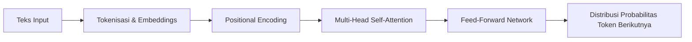

import { Accordion, Accordions } from 'fumadocs-ui/components/accordion';
import { Callout } from 'fumadocs-ui/components/callout';
import { Tab, Tabs } from 'fumadocs-ui/components/tabs';

> **Penyusun Modul & Portal:** Mahendar Dwi Payana  
> **Cakupan Topik:** Arsitektur Transformer, Large Language Models (LLM), dan Prompt Engineering Terstruktur

---

## 1. Tujuan Pembelajaran & Ruang Lingkup

Setelah menguasai *machine learning* klasik dan *neural networks* (MLP, CNN, RNN), modul ini membawa Anda ke paradigma **AI Generatif modern** yang berpusat pada **Large Language Models (LLM)**.

**Tujuan Pembelajaran:**
1. Memahami mengapa arsitektur **Transformer** menggantikan RNN/LSTM pada pemrosesan bahasa skala besar.
2. Memahami mekanisme **Tokenisasi**, **Self-Attention**, dan tahapan pelatihan LLM (*Pretraining → Supervised Fine-Tuning → Alignment*).
3. Menerapkan teknik **Prompt Engineering** sistematis (Zero-shot, Few-shot, Chain-of-Thought, dan *Structured Outputs*) lewat API Python.

---

## 2. Dari RNN ke Arsitektur Transformer

Pada Pertemuan 14, kita melihat bahwa RNN memproses token secara **sekuensial** ($h_t$ bergantung pada $h_{t-1}$). Pendekatan ini memiliki dua hambatan besar:
1. **Sulit diparalelkan** saat pelatihan di GPU karena harus menunggu langkah waktu sebelumnya.
2. **Ketergantungan jarak jauh (*long-range dependency*)** melemah pada kalimat atau dokumen panjang.

Makalah *Attention Is All You Need* (Vaswani et al., 2017) memperkenalkan arsitektur **Transformer** yang memproses seluruh token sekaligus menggunakan mekanisme **Self-Attention**.



### Scaled Dot-Product Attention

Setiap token diproyeksikan menjadi tiga vektor: **Query ($Q$)**, **Key ($K$)**, dan **Value ($V$)**:

$$
\text{Attention}(Q, K, V) = \text{softmax}\left(\frac{Q K^T}{\sqrt{d_k}}\right) V
$$

* $Q K^T$ mengukur kemiripan kontekstual antar-pasangan token.
* Pembagian dengan $\sqrt{d_k}$ menstabilkan gradien agar *softmax* tidak jenuh pada dimensi besar.
* **Decoder-Only Transformer** (seperti keluarga GPT, Gemini, Claude, Llama) menggunakan *Causal Masking* sehingga setiap token hanya dapat memperhatikan token-token sebelumnya (*autoregressive next-token prediction*).

---

## 3. Tokenisasi, Context Window & Parameter Inferensi

LLM tidak membaca karakter atau kata secara langsung, melainkan potongan sub-kata (*subword tokens*) menggunakan algoritma seperti **Byte-Pair Encoding (BPE)**.

| Konsep | Penjelasan Praktis |
| :--- | :--- |
| **Token** | Unit terkecil teks (~3–4 karakter bahasa Inggris, atau ~1–2 kata rata-rata tergantung bahasa). |
| **Context Window** | Batas total token (input prompt + riwayat percakapan + output) yang dapat diproses dalam satu pemanggilan model. |
| **Temperature ($T$)** | Mengontrol keacakan (*sampling*): $T \approx 0$ bersifat deterministik/faktual; $T \ge 0{,}7$ lebih variatif/kreatif. |
| **Top-p (Nucleus Sampling)** | Membatasi kandidat token hanya pada himpunan terkecil yang jumlah probabilitas kumulatifnya $\ge p$. |

---

## 4. Tiga Tahap Pelatihan LLM Modern

1. **Pre-training (Self-Supervised)**: Model dilatih memprediksi token berikutnya pada triliunan token teks internet/kode/buku → menghasilkan *Base Model* yang kaya pengetahuan, namun belum pandai mengikuti instruksi.
2. **Supervised Fine-Tuning (SFT)**: Model dilatih ulang pada pasangan contoh *(instruksi, jawaban ideal)* → menghasilkan *Instruction-tuned Model* yang siap berdialog.
3. **Preference Alignment (RLHF / DPO)**: Model diselaraskan dengan preferensi manusia (membantu, jujur, aman) menggunakan *Reinforcement Learning from Human Feedback* atau *Direct Preference Optimization*.

---

## 5. Teknik Prompt Engineering Sistematis

Prompt engineering yang baik memperlakukan instruksi seperti **spesifikasi program** yang terukur, bukan tebak-tebakan.

<Tabs items={['Zero-Shot & Role', 'Few-Shot', 'Chain-of-Thought (CoT)']}>
  <Tab value="Zero-Shot & Role">
    Berikan peran, batasan tugas, format keluaran, dan kriteria kualitas secara eksplisit:

    ```text
    Peran: Anda adalah analis kualitas data senior.
    Tugas: Identifikasi potensi anomali pada skema tabel transaksi berikut.
    Aturan:
    - Jawab dalam bahasa Indonesia ringkas (maksimal 5 poin).
    - Sertakan tingkat risiko (Tinggi/Sedang/Rendah) tiap poin.
    ```
  </Tab>
  <Tab value="Few-Shot">
    Sertakan 2–5 contoh pasangan input–output agar model meniru pola klasifikasi atau format yang diinginkan:

    ```text
    Klasifikasikan sentimen ulasan pelanggan ke [Positif, Netral, Negatif].

    Ulasan: "Pengiriman cepat dan kemasan rapi." -> Positif
    Ulasan: "Barang sesuai deskripsi, standar saja." -> Netral
    Ulasan: "Aplikasi sering crash saat checkout." -> Negatif
    Ulasan: "Harganya terjangkau tetapi baterainya cepat habis." ->
    ```
  </Tab>
  <Tab value="Chain-of-Thought (CoT)">
    Minta model menguraikan langkah penalaran sebelum menyimpulkan jawaban akhir untuk tugas logika, matematika, atau analisis multi-langkah:

    ```text
    Selesaikan masalah bisnis berikut langkah demi langkah:
    1. Hitung margin kotor per unit.
    2. Hitung titik impas (break-even point).
    3. Berikan rekomendasi harga akhir berdasarkan target laba 20%.
    ```
  </Tab>
</Tabs>

---

## 6. Implementasi Python: Pemanggilan LLM & Structured Outputs

Pada aplikasi produksi, kita jarang menginginkan teks bebas; kita membutuhkan **keluaran terstruktur (JSON tervalidasi skema Pydantic)** agar mudah diproses backend.

<Callout type="info" title="Praktik Keamanan API Key">
Jangan pernah menuliskan API key langsung di dalam kode sumber (*hardcode*). Simpan di variabel lingkungan (`export GEMINI_API_KEY=...` atau berkas `.env` yang masuk ke `.gitignore`).
</Callout>

```python
import os
from pydantic import BaseModel, Field
from google import genai

# 1. Definisikan skema output terstruktur menggunakan Pydantic
class ReviewAnalysis(BaseModel):
    kategori: str = Field(description="Kategori isu: Produk, Pengiriman, atau Layanan")
    sentimen: str = Field(description="Positif, Netral, atau Negatif")
    ringkasan: str = Field(description="Ringkasan keluhan atau pujian dalam 1 kalimat")
    prioritas_tindak_lanjut: int = Field(ge=1, le=5, description="Skala urgensi 1-5")

# 2. Inisialisasi klien resmi (membaca GEMINI_API_KEY dari environment)
client = genai.Client(api_key=os.environ["GEMINI_API_KEY"])

ulasan = "Kurir sangat ramah, tetapi paket tiba terlambat 3 hari dari estimasi."

response = client.models.generate_content(
    model="gemini-2.5-flash",
    contents=f"Analisis ulasan pelanggan berikut:\n{ulasan}",
    config={
        "response_mime_type": "application/json",
        "response_schema": ReviewAnalysis,
        "temperature": 0.1,
    },
)

# 3. Parsing otomatis menjadi objek Python yang tervalidasi
hasil = ReviewAnalysis.model_validate_json(response.text)
print(hasil.model_dump())
```

> **Alternatif Open-Weight Lokal:** Konsep *structured output* dan *chat completions* yang sama juga dapat dijalankan secara lokal tanpa biaya API menggunakan **Ollama** atau **vLLM** dengan model terbuka (misalnya Llama, Qwen, atau Gemma).

---

## 7. Lembar Evaluasi & Tugas Praktikum Mandiri

<Accordions>
  <Accordion title="Tugas 1: Eksperimen Temperature & Few-Shot Classification">
    Buat skrip Python untuk mengklasifikasikan 20 ulasan produk berbahasa Indonesia ke dalam 3 kelas sentimen. Bandingkan akurasi antara *Zero-Shot* (`temperature=0.0`) dan *Few-Shot* dengan 3 contoh berimbang. Catat konsistensi hasil pada 3 kali eksekusi berulang!
  </Accordion>

  <Accordion title="Tugas 2: Ekstraksi Data Tidak Terstruktur ke JSON (Pydantic)">
    Diberikan teks pengumuman lowongan kerja atau deskripsi produk bebas. Rancang skema Pydantic (`nama_entitas`, `persyaratan`, `lokasi`, `gaji_estimasi`), lalu panggil LLM dengan *structured output* agar selalu menghasilkan JSON valid yang dapat langsung dikonversi ke DataFrame Pandas!
  </Accordion>

  <Accordion title="Tugas 3: Pengujian Model Lokal vs Cloud API">
    Pasang **Ollama** secara lokal (atau jalankan di Colab) dengan model ringan (misalnya Gemma / Qwen / Llama ukuran kecil). Bandingkan latensi, kualitas bahasa Indonesia, dan kepatuhan format JSON terhadap model cloud API!
  </Accordion>
</Accordions>

---

## 8. Referensi Pustaka & Tautan Resmi

1. **Vaswani, A., Shazeer, N., Parmar, N., et al.** (2017). *Attention Is All You Need*. NeurIPS 2017.
2. **Ouyang, L., Wu, J., Jiang, X., et al.** (2022). *Training language models to follow instructions with human feedback*. NeurIPS 2022.
3. **Google Gemini API Documentation**. [ai.google.dev/gemini-api/docs](https://ai.google.dev/gemini-api/docs).
4. **Pydantic Documentation**. *Data Validation & Structured Schemas*. [docs.pydantic.dev](https://docs.pydantic.dev/).
5. **Andrej Karpathy**. *Intro to Large Language Models & Let's build GPT from scratch*.
